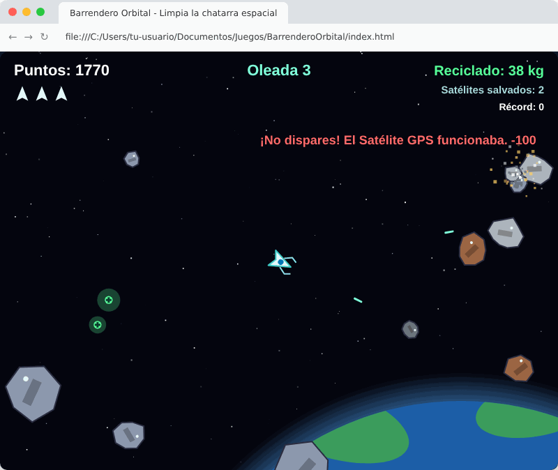

# 🛰️ Barrendero Orbital — Limpia la chatarra espacial

Juego 2D de naves del género "asteroides": gira (← →), acelera (↑) y dispara (Espacio) para romper la chatarra espacial, recoge los fragmentos verdes para reciclarlos y protege los satélites activos (si la chatarra los golpea, se convierten en más chatarra: el síndrome de Kessler).

- ▶️ **Jugar:** abre [`index.html`](index.html) en el navegador (necesita teclado).
- 📘 **Informe paso a paso:** [Markdown](informe/Informe_BarrenderoOrbital.md) · [PDF](informe/Informe_BarrenderoOrbital.pdf) · [Word](informe/Informe_BarrenderoOrbital.docx)
- 🛟 **Código de cada paso:** carpeta [`pasos/`](pasos/)
