<!-- solo-github -->
# Informe de creación del videojuego «Barrendero Orbital»

**Un juego 2D de naves al estilo de los clásicos de asteroides para entender y combatir la basura espacial, explicado paso a paso y línea por línea.**

> 📄 Este mismo informe está también en **PDF** (`Informe_BarrenderoOrbital.pdf`) y en **Word** (`Informe_BarrenderoOrbital.docx`) dentro de esta carpeta.
> 🎮 El juego terminado está en la carpeta de arriba: abre `../index.html` en tu navegador para jugar.
<!-- /solo-github -->

# 1. Presentación del proyecto

## 1.1 ¿Qué es Barrendero Orbital?

**Barrendero Orbital** es un juego 2D de naves en el espacio, del mismo género que los clásicos "de asteroides" de las máquinas recreativas: una nave que gira y avanza con inercia, dispara a las rocas, y las rocas se parten en trozos cada vez más pequeños. Pero aquí **no hay rocas**: hay **chatarra espacial** (restos de cohetes y satélites viejos) que pone en peligro la órbita de la Tierra. Eres un **barrendero espacial**: rompes la chatarra, **recoges los fragmentos para reciclarlos** y **proteges los satélites activos** que cruzan la pantalla.

<p align="center">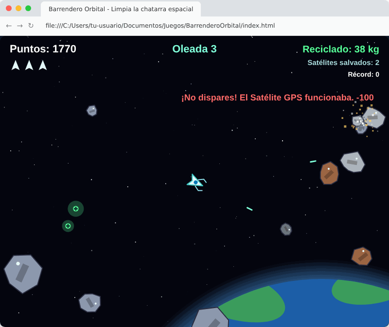</p>

<p align="center"><em>Figura 1. Barrendero Orbital terminado: la nave (centro) dispara a la chatarra mientras un satélite activo cruza la pantalla. Abajo, la Tierra.</em></p>

## 1.2 La problemática que resuelve

Alrededor de la Tierra giran **muchísimos objetos que ya no sirven**: satélites apagados, partes de cohetes, tornillos, trozos de pintura… Las agencias espaciales siguen la pista de **decenas de miles** de objetos, y la Agencia Espacial Europea (ESA) estima que hay **más de un millón de fragmentos de entre 1 y 10 cm**, demasiado pequeños para vigilarlos y lo bastante grandes para romper un satélite, porque en órbita viajan a unos **28.000 km/h**.

Esto nos afecta a todos: dependemos de los satélites para el **GPS** del móvil, la **predicción del tiempo**, **internet**, la **televisión** o la vigilancia de **incendios y del cambio climático**. Y el problema puede crecer solo: cada choque crea más fragmentos, que provocan más choques. Es el **síndrome de Kessler**.

<p align="center">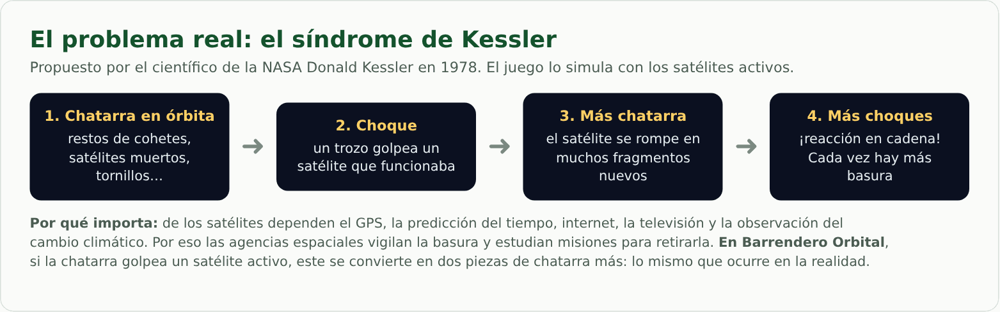</p>

<p align="center"><em>Figura 2. El síndrome de Kessler: una reacción en cadena de choques que el juego simula con los satélites activos.</em></p>

La mayoría de la gente **no sabe que este problema existe**. Barrendero Orbital lo hace visible y comprensible jugando:

- La chatarra **no desaparece** al dispararle: se rompe en trozos más pequeños (¡como en la realidad, romperla crea más piezas!). La solución es **recogerla y reciclarla**, no solo destruirla.
- Los **satélites activos** muestran su nombre (GPS, clima, internet…) para que veas qué perderíamos.
- Si la chatarra golpea un satélite, este **se convierte en más chatarra**: el síndrome de Kessler en directo.
- La pantalla final enseña un **dato real** sobre la basura espacial.

## 1.3 Cómo se juega

| Acción | Tecla |
|---|---|
| Girar a la izquierda / derecha | ← → (o A / D) |
| Encender el motor (avanzar) | ↑ (o W) |
| Disparar el láser | Espacio |
| Empezar / volver a jugar | Enter o Espacio |

**Reglas:**

- 💥 **Chatarra grande** → al dispararle se parte en 2 medianas; cada mediana en 2 pequeñas; cada pequeña deja un **fragmento verde**. Más puntos cuanto más pequeña (20, 50 y 100).
- ♻️ **Fragmento verde** → pasa cerca con la nave para recogerlo: +30 puntos y entre 5 y 10 **kg reciclados**. ¡Desaparece a los 8 segundos!
- 🛰️ **Satélite activo** → cruza la pantalla. Si llega al otro lado: **+150**. Si le disparas: **−100** y se rompe. Si lo golpea la chatarra: se rompe y crea **más chatarra**.
- ❤️ Tienes **3 vidas**. Si la chatarra toca la nave, pierdes una y reapareces en el centro con 3 segundos de protección (la nave parpadea).
- 🌊 Al limpiar toda la chatarra: **bonus** y llega la siguiente **oleada**, con más piezas y más rápidas.

<p align="center"></p>

<p align="center"><em>Figura 3. Pantalla de inicio: explica los tres tipos de objetos con sus dibujos reales y los controles.</em></p>

## 1.4 Parecido a los clásicos… pero diferente

Como pediste un juego **parecido a los de asteroides**, Barrendero Orbital mantiene las mecánicas que hacen divertido ese género, pero **todo su contenido es original** (gráficos, sonidos, reglas nuevas y código propio):

| Mecánica clásica del género | Qué añade Barrendero Orbital |
|---|---|
| Nave que gira y avanza con inercia | Igual (es lo divertido de controlar) y además pinzas recolectoras con efecto imán |
| Las rocas se parten en trozos más pequeños | La chatarra pequeña deja **fragmentos reciclables** que hay que recoger a tiempo |
| La pantalla "da la vuelta" por los bordes | Igual, con la Tierra de fondo para situarnos en órbita |
| Enemigos que disparan | En su lugar, **satélites que hay que proteger**: un objetivo que NO se debe destruir |
| Oleadas cada vez más difíciles | Igual, con un mensaje de "¡Órbita limpia!" y bonus |
| — | Contador de **kilos reciclados**, satélites salvados y datos reales al final |

## 1.5 Qué vas a aprender construyéndolo

Crear una página con un lienzo (**HTML** y **CSS**), programar en **JavaScript**, dibujar y **girar** figuras con el **Canvas API**, mover objetos con **velocidad e inercia** usando **seno y coseno**, hacer que la pantalla "dé la vuelta", **disparar**, generar **formas aleatorias**, detectar **choques entre círculos**, dividir objetos, crear **partículas**, **sonidos** sintetizados, **temblor de pantalla**, una **máquina de estados** (menú, partida y fin) y guardar el **récord**.

# 2. Antes de empezar

## 2.1 Lo que necesitas

| Qué | Para qué | Dónde conseguirlo | Precio |
|---|---|---|---|
| Un ordenador (Windows, Mac o Linux) con teclado | Escribir el código y jugar | — | — |
| Un navegador moderno: **Google Chrome**, **Microsoft Edge** o **Firefox** | Ejecutar el juego | Ya lo tienes instalado casi seguro | Gratis |
| Un editor de código: **Visual Studio Code** (recomendado) | Escribir los archivos | <https://code.visualstudio.com> | Gratis |

> 💡 **No hay que instalar nada más.** Ni motores de juegos, ni librerías: el juego son dos archivos de texto que el navegador entiende directamente.

## 2.2 Instalar Visual Studio Code (5 minutos)

1. Entra en **<https://code.visualstudio.com>**.
2. Pulsa el botón grande de descarga.
3. Abre el archivo descargado y acepta las opciones por defecto (en Windows, marca **"Agregar acción 'Abrir con Code' al menú contextual"**).
4. Para ponerlo en español: `Ctrl + Shift + P` (Mac: `⌘ + Shift + P`) → escribe **Configure Display Language** → **Español** → reinicia.

## 2.3 De dónde sale cada parte del juego

**No se ha descargado ni copiado ningún recurso** (ni imágenes, ni sonidos, ni código de otros juegos): todo se crea con el código de este informe.

| Parte del juego | Cómo se hizo | De dónde sale / documentación |
|---|---|---|
| Página y lienzo | HTML5 `<canvas>` | [MDN – Canvas API](https://developer.mozilla.org/es/docs/Web/API/Canvas_API) |
| Estilo de la página | CSS | [MDN – CSS](https://developer.mozilla.org/es/docs/Web/CSS) |
| Lógica del juego | JavaScript sin librerías | [MDN – JavaScript](https://developer.mozilla.org/es/docs/Web/JavaScript) |
| Nave, chatarra, satélites, Tierra, estrellas | Dibujados con figuras del Canvas (líneas, polígonos, círculos, elipses, degradados) | Diseño propio. [MDN – CanvasRenderingContext2D](https://developer.mozilla.org/es/docs/Web/API/CanvasRenderingContext2D) |
| Formas irregulares de la chatarra | Generadas al azar con seno y coseno (cada pieza es única) | Técnica clásica de "polígonos aleatorios" |
| Giros (`rotate`) y traslados (`translate`) | Transformaciones del Canvas | [MDN – Transformaciones](https://developer.mozilla.org/es/docs/Web/API/Canvas_API/Tutorial/Transformations) |
| Física (inercia, empuje, rozamiento) | Fórmulas sencillas con vectores | Física básica (ver diagrama del paso 4) |
| Sonidos (láser, explosiones, recoger) | Sintetizados con la **Web Audio API** | [MDN – Web Audio API](https://developer.mozilla.org/es/docs/Web/API/Web_Audio_API) |
| Mecánicas de género (girar, inercia, dividir rocas, bordes que "dan la vuelta") | Ideas del género clásico de "asteroides" (las mecánicas no tienen dueño; el código y el arte son propios) | — |
| Fragmentos reciclables, satélites a proteger, síndrome de Kessler | Diseño original de este juego | — |
| Datos sobre basura espacial | Agencia Espacial Europea (ESA) | [ESA – Space debris](https://www.esa.int/Space_Safety/Space_Debris) |
| Récord guardado | `localStorage` | [MDN – localStorage](https://developer.mozilla.org/es/docs/Web/API/Window/localStorage) |
| Capturas de este informe | Tomadas automáticamente ejecutando cada paso en el navegador Chromium | [Playwright](https://playwright.dev) |

## 2.4 Conceptos básicos de programación en 5 minutos

**1. Variable:** una caja con nombre que guarda un dato. `let` si va a cambiar, `const` si no.

```javascript
let puntos = 0;
puntos = puntos + 20;   // ahora vale 20
const ANCHO = 800;      // no cambiará nunca
```

**2. Objeto:** una caja con apartados.

```javascript
const nave = { x: 400, y: 300, angulo: 0 };
nave.x = nave.x + 5;   // mover la nave 5 píxeles a la derecha
```

**3. Array (lista):** varios datos en orden; posiciones desde **0**.

```javascript
let chatarras = [];          // lista vacía
chatarras.push(pieza);       // añadir al final
chatarras.length;            // cuántas hay
chatarras.splice(2, 1);      // borrar 1 elemento en la posición 2
```

**4. Función:** órdenes con nombre que se ejecutan al llamarlas.

```javascript
function distancia(x1, y1, x2, y2) {
  return Math.hypot(x2 - x1, y2 - y1);
}
distancia(0, 0, 3, 4);   // → 5
```

**5. Condición (`if / else`)** y **6. Bucles (`for`, `for...of`)**:

```javascript
if (vidas <= 0) {
  terminarPartida();
}
for (let i = 0; i < 3; i++) { /* se repite con i = 0, 1, 2 */ }
for (const c of chatarras) { /* se repite una vez por cada pieza c */ }
```

**7. Seno y coseno:** convierten un **ángulo** en cuánto hay que moverse en **x** (coseno) y en **y** (seno). Los usaremos muchísimo (ver 2.6).

| Símbolo | Significa | Ejemplo |
|---|---|---|
| `=` | guardar un valor | `vidas = 3` |
| `===` / `!==` | ¿es igual? / ¿es distinto? | `estado === "menu"` |
| `&&` | y además | `a && b` |
| <code>&#124;&#124;</code> | o | `teclas["ArrowUp"]` <code>&#124;&#124;</code> `teclas["KeyW"]` |
| `!` | no | `!impacto` |
| `+=` / `-=` | sumar / restar a lo que había | `nave.x += 5` |
| `? :` | si… entonces… si no… | `vivo ? "sí" : "no"` |
| `//` | comentario (el ordenador lo ignora) | `// nota` |

## 2.5 Las coordenadas del lienzo

<p align="center">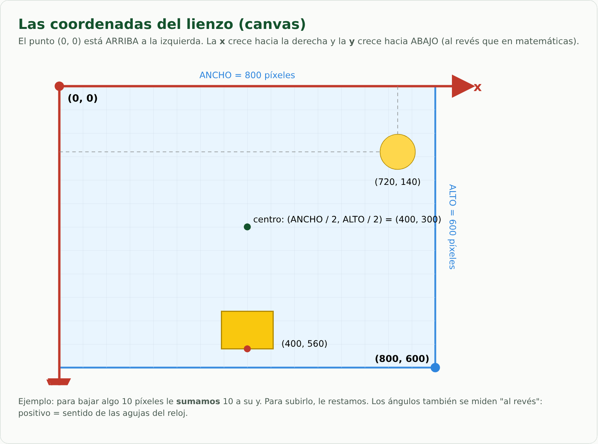</p>

<p align="center"><em>Figura 4. Sistema de coordenadas del canvas: la y crece hacia abajo. Nuestro lienzo mide 800 × 600.</em></p>

## 2.6 Ángulos, seno y coseno

En este juego todo gira: la nave, la chatarra, los satélites. Es la parte con más matemáticas, pero solo necesitas recordar las dos "fórmulas mágicas" de la derecha.

<p align="center">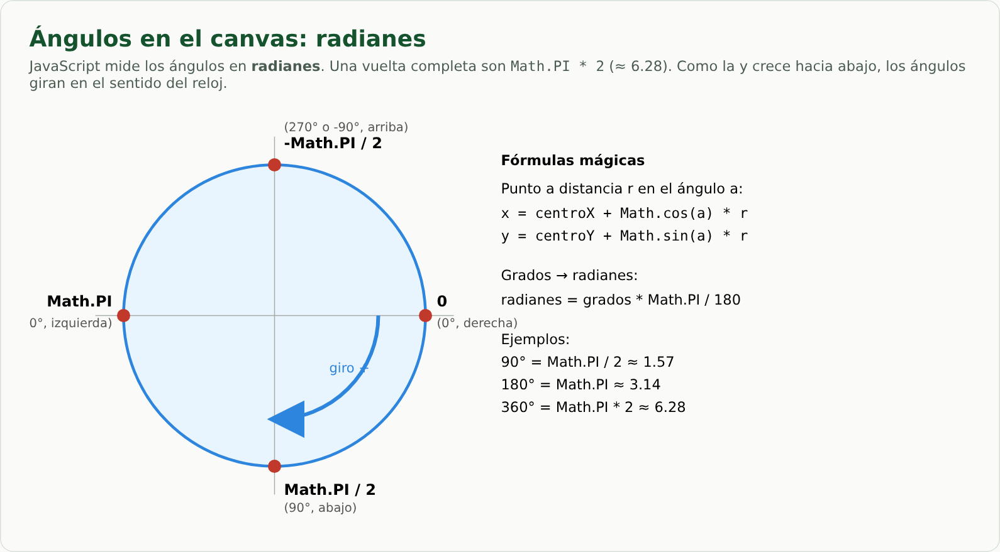</p>

<p align="center"><em>Figura 5. Radianes y las fórmulas para pasar de un ángulo a una posición (x, y).</em></p>

## 2.7 El bucle del juego

<p align="center">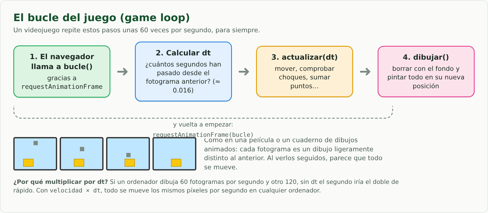</p>

<p align="center"><em>Figura 6. El bucle del juego: medir el tiempo, actualizar y dibujar, unas 60 veces por segundo.</em></p>

## 2.8 Hoja de ruta: los 14 pasos

<p align="center">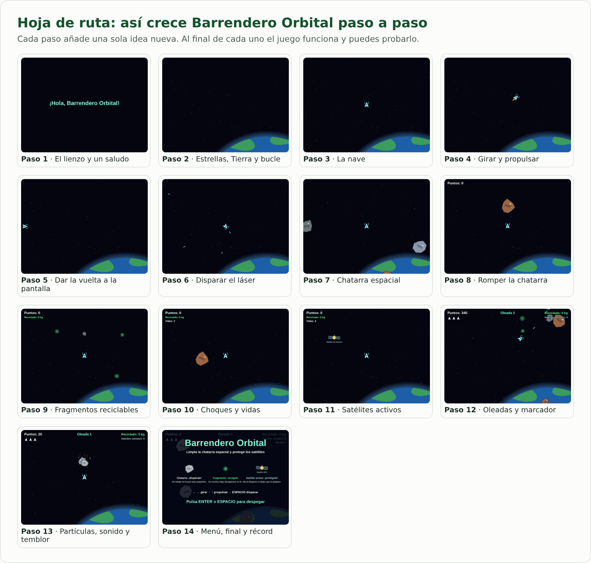</p>

<p align="center"><em>Figura 7. Cómo se ve el juego al terminar cada uno de los 14 pasos.</em></p>

## 2.9 Cómo leer los pasos de este informe

1. **Objetivo** del paso.
2. **Cambios en el código:** dónde escribir, **imagen del editor** con las líneas nuevas en **verde** (las que hay que borrar, en **rojo tachado**), la **explicación de cada línea** y el **código para copiar**.
3. **Resultado:** capturas reales del juego en ese paso.
4. **Pruébalo tú:** experimentos para entenderlo mejor.

> 🛟 **Red de seguridad:** la carpeta `pasos/` tiene el código completo tal y como queda al final de cada paso (`pasos/paso01`, `pasos/paso02`…). Si algo no funciona, compara tu archivo con ese.

> ⌨️ Escribe el código a mano siempre que puedas: así se aprende de verdad. Los comentarios (`// ...`) puedes saltártelos.

# 3. Paso 0 · Preparar la carpeta y los archivos

**Objetivo:** tener la carpeta del proyecto con dos archivos vacíos, abierta en el editor.

1. En **Documentos** (o donde prefieras) crea una carpeta **`Juegos`** y dentro otra llamada **`BarrenderoOrbital`** (todo junto, sin espacios).
2. En **Visual Studio Code**: **Archivo → Abrir carpeta…** → elige **BarrenderoOrbital** → **Seleccionar carpeta** (si pregunta si confías en los autores, di que sí).
3. En el **Explorador** (panel izquierdo) pulsa el icono **Nuevo archivo** y crea **`index.html`**.
4. Crea otro archivo llamado **`juego.js`**.

> ⚠️ Nombres en minúsculas, sin espacios y con su extensión. En Windows, cuidado con que no se llamen `index.html.txt`.

<p align="center">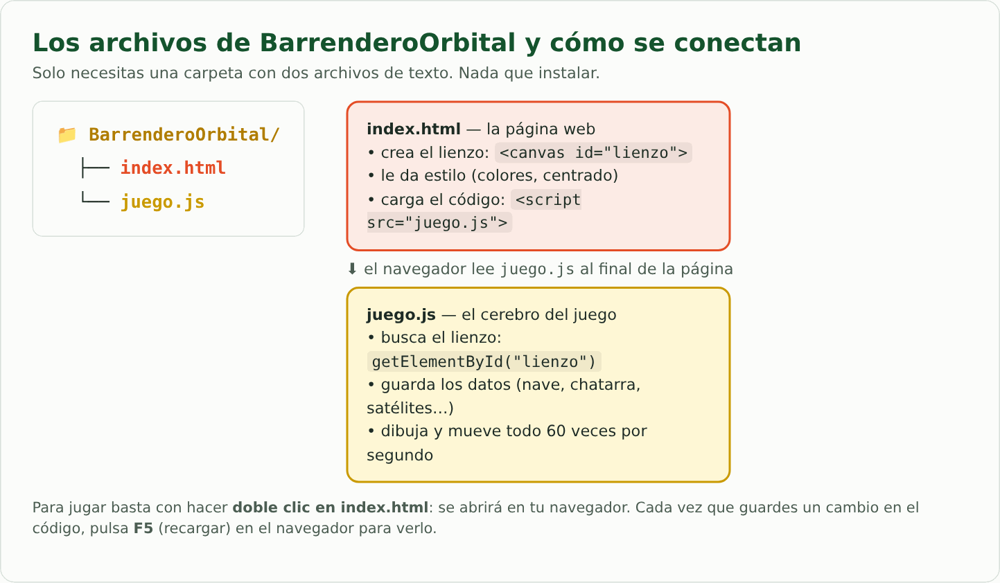</p>

<p align="center"><em>Figura 8. La carpeta del proyecto: dos archivos y cómo se relacionan.</em></p>

<p align="center">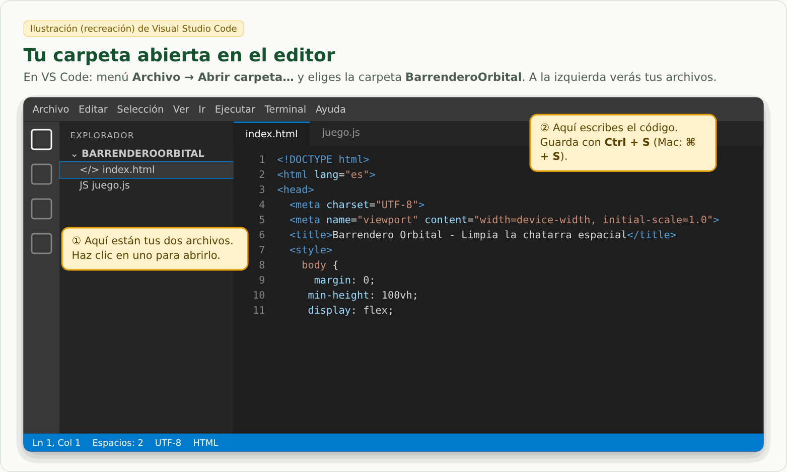</p>

<p align="center"><em>Figura 9. La carpeta abierta en Visual Studio Code (ilustración).</em></p>

<p align="center">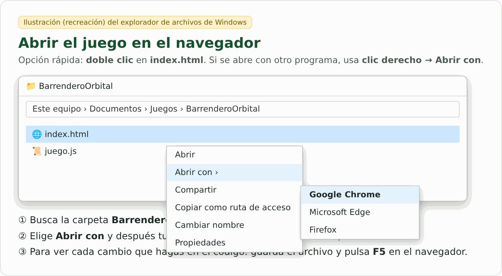</p>

<p align="center"><em>Figura 10. Abrir index.html con el navegador (ilustración).</em></p>

<p align="center">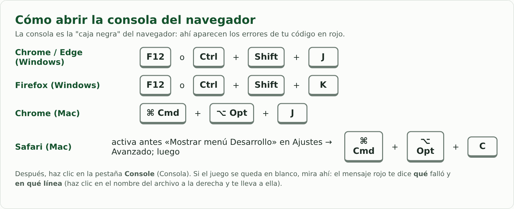</p>

<p align="center"><em>Figura 11. La consola del navegador: donde aparecen los errores.</em></p>

> 🔁 **Ciclo de trabajo:** escribir → guardar (`Ctrl + S`) → recargar el navegador (`F5`) → mirar.

# 4. Paso 1 · El lienzo y un saludo

**Objetivo:** crear la página web con un lienzo de 800 × 600 y comprobar que JavaScript puede dibujar en él.

**Qué aprenderás:** la estructura de un HTML, el `<canvas>`, cómo se conecta un `.js` y las primeras órdenes de dibujo.

El archivo `index.html` se escribe **una sola vez**; todo lo demás irá en `juego.js`.

#### Cambio 1 de 2 · Escribir el archivo completo en `index.html`

📄 Abre `index.html` (vacío) y escribe **todo** este código. Tiene 34 líneas.

<p align="center">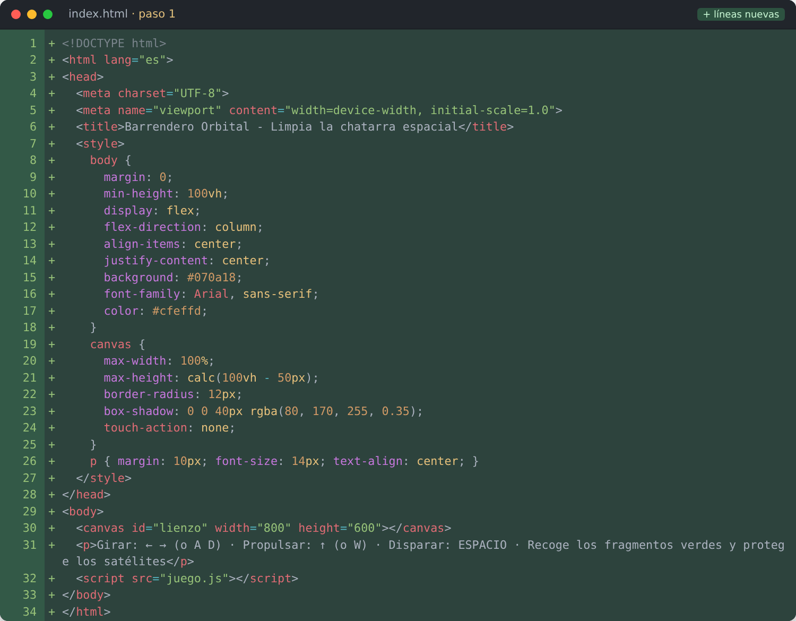</p>

<p align="center"><em>Figura 12. Paso 1: código nuevo en index.html. Lo verde es lo que escribes; lo gris ya lo tenías.</em></p>

**Explicación línea por línea:**


> **La "partida de nacimiento" de la página.** Estas primeras líneas le dicen al navegador qué tipo de documento es y en qué idioma está.

- **Línea 1** · `<!DOCTYPE html>`  
  → Declara que este archivo es una página web moderna (HTML5). Siempre va en la primera línea.
- **Línea 2** · `<html lang="es">`  
  → Abre el documento HTML e indica que el idioma es español (lang="es"). Ayuda a los lectores de pantalla y a los traductores.
- **Línea 3** · `<head>`  
  → Abre la cabecera: aquí va información SOBRE la página (título, estilos...), no lo que se ve dentro de ella.
- **Línea 4** · `<meta charset="UTF-8">`  
  → Usa la codificación UTF-8 para que se vean bien las tildes, la ñ y los signos ¡ ¿.
- **Línea 5** · `<meta name="viewport" content="width=device-width, initial-scale=1.0">`  
  → Hace que en móviles la página use el ancho real de la pantalla en lugar de verse diminuta.
- **Línea 6** · `<title>Barrendero Orbital - Limpia la chatarra espacial</title>`  
  → El texto que aparece en la pestaña del navegador.

> **Los estilos (CSS).** Entre `<style>` y `</style>` decimos cómo se ve la página: colores, centrado y tamaño del lienzo.

- **Línea 7** · `<style>`  
  → Abre el bloque de estilos CSS.
- **Línea 8** · `body {`  
  → Empieza las reglas para el cuerpo (body) de la página: todo lo que se ve.
- **Línea 9** · `margin: 0;`  
  → Quita el margen blanco que los navegadores ponen por defecto alrededor de la página.
- **Línea 10** · `min-height: 100vh;`  
  → Hace que el cuerpo mida como mínimo el 100 % del alto de la ventana (vh = "viewport height").
- **Línea 11** · `display: flex;`  
  → Activa "flexbox", un sistema para colocar elementos fácilmente.
- **Línea 12** · `flex-direction: column;`  
  → Coloca los elementos uno debajo de otro (en columna): primero el lienzo y debajo el texto de ayuda.
- **Línea 13** · `align-items: center;`  
  → Centra los elementos horizontalmente.
- **Línea 14** · `justify-content: center;`  
  → Centra los elementos verticalmente.
- **Línea 15** · `background: #070a18;`  
  → Color de fondo de la página: un azul casi negro, como el espacio.
- **Línea 16** · `font-family: Arial, sans-serif;`  
  → Tipo de letra de la página: Arial (o, si no existe, cualquier letra sin adornos).
- **Línea 17** · `color: #cfeffd;`  
  → Color del texto: un celeste muy claro.
- **Línea 18** · `}`  
  → Cierra la llave `{` que se abrió más arriba: aquí termina ese bloque.
- **Línea 19** · `canvas {`  
  → Empieza las reglas para el lienzo (canvas), que es donde se dibuja el juego.
- **Línea 20** · `max-width: 100%;`  
  → El lienzo nunca será más ancho que la ventana (así cabe en móviles).
- **Línea 21** · `max-height: calc(100vh - 50px);`  
  → Ni más alto que la ventana menos 50 píxeles (dejamos sitio para el texto de ayuda).
- **Línea 22** · `border-radius: 12px;`  
  → Redondea las esquinas del lienzo 12 píxeles.
- **Línea 23** · `box-shadow: 0 0 40px rgba(80, 170, 255, 0.35);`  
  → Añade un resplandor azulado alrededor del lienzo, como el brillo de la atmósfera.
- **Línea 24** · `touch-action: none;`  
  → Evita que en pantallas táctiles se mueva o haga zoom la página al tocar el lienzo.
- **Línea 25** · `}`  
  → Cierra la llave `{` que se abrió más arriba: aquí termina ese bloque.
- **Línea 26** · `p { margin: 10px; font-size: 14px; text-align: center; }`  
  → Reglas para los párrafos (p): un poco de margen y letra de 14 píxeles.
- **Línea 27** · `</style>`  
  → Cierra el bloque de estilos.
- **Línea 28** · `</head>`  
  → Cierra la cabecera.

> **El contenido visible.** Dentro de `<body>` está lo que se ve: el lienzo, una línea de ayuda y la orden de cargar nuestro código.

- **Línea 29** · `<body>`  
  → Abre el cuerpo: todo lo que hay aquí dentro se ve en la página.
- **Línea 30** · `<canvas id="lienzo" width="800" height="600"></canvas>`  
  → Crea el lienzo de dibujo. id="lienzo" es su nombre para encontrarlo desde JavaScript. Mide 800 × 600 píxeles.
- **Línea 31** · `<p>Girar: ← → (o A D) · Propulsar: ↑ (o W) · Disparar: ESPACIO · Recoge los fragmentos ...`  
  → Un párrafo con la ayuda de los controles, debajo del lienzo.
- **Línea 32** · `<script src="juego.js"></script>`  
  → Carga y ejecuta nuestro archivo juego.js. Va al final para que el lienzo ya exista cuando el código lo busque.
- **Línea 33** · `</body>`  
  → Cierra el cuerpo.
- **Línea 34** · `</html>`  
  → Cierra el documento HTML.

**Código para copiar** (o mejor, ¡escríbelo tú para aprender!):

```html
<!DOCTYPE html>
<html lang="es">
<head>
  <meta charset="UTF-8">
  <meta name="viewport" content="width=device-width, initial-scale=1.0">
  <title>Barrendero Orbital - Limpia la chatarra espacial</title>
  <style>
    body {
      margin: 0;
      min-height: 100vh;
      display: flex;
      flex-direction: column;
      align-items: center;
      justify-content: center;
      background: #070a18;
      font-family: Arial, sans-serif;
      color: #cfeffd;
    }
    canvas {
      max-width: 100%;
      max-height: calc(100vh - 50px);
      border-radius: 12px;
      box-shadow: 0 0 40px rgba(80, 170, 255, 0.35);
      touch-action: none;
    }
    p { margin: 10px; font-size: 14px; text-align: center; }
  </style>
</head>
<body>
  <canvas id="lienzo" width="800" height="600"></canvas>
  <p>Girar: ← → (o A D) · Propulsar: ↑ (o W) · Disparar: ESPACIO · Recoge los fragmentos verdes y protege los satélites</p>
  <script src="juego.js"></script>
</body>
</html>
```

#### Cambio 2 de 2 · Escribir el archivo completo en `juego.js`

📄 Abre `juego.js` (vacío) y escribe **todo** este código. Tiene 16 líneas.

<p align="center">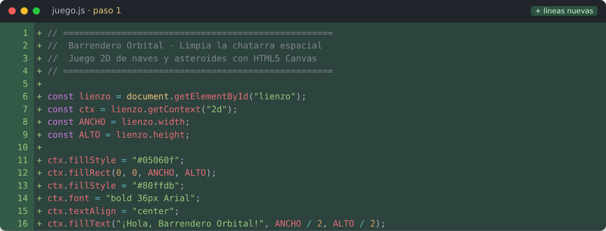</p>

<p align="center"><em>Figura 13. Paso 1: código nuevo en juego.js. Lo verde es lo que escribes; lo gris ya lo tenías.</em></p>

**Explicación línea por línea:**

- **Línea 1** · `// ===================================================`  
  → Comentario decorativo (una línea de signos =). El navegador lo ignora.
- **Línea 2** · `//  Barrendero Orbital - Limpia la chatarra espacial`  
  → Comentario: el navegador lo ignora. Sirve para que las personas entendamos el código («Barrendero Orbital - Limpia la chatarra espacial»).
- **Línea 3** · `//  Juego 2D de naves y asteroides con HTML5 Canvas`  
  → Comentario: el navegador lo ignora. Sirve para que las personas entendamos el código («Juego 2D de naves y asteroides con HTML5 Canvas»).
- **Línea 4** · `// ===================================================`  
  → Comentario decorativo (una línea de signos =). El navegador lo ignora.

> **El lienzo y el pincel.** Igual que en cualquier juego con canvas: buscamos el lienzo del HTML y pedimos su contexto 2D, el objeto con todas las órdenes de dibujo.

- **Línea 6** · `const lienzo = document.getElementById("lienzo");`  
  → Busca en la página el elemento con id="lienzo" y lo guarda en la constante lienzo. Una constante (const) es una caja con nombre cuyo contenido no se cambia.
- **Línea 7** · `const ctx = lienzo.getContext("2d");`  
  → Pide al lienzo su "contexto 2D": el pincel con el que dibujaremos. Por costumbre se llama ctx.
- **Línea 8** · `const ANCHO = lienzo.width;`  
  → Guarda el ancho del lienzo (800 píxeles) en una constante para usarla en todo el código.
- **Línea 9** · `const ALTO = lienzo.height;`  
  → Guarda el alto del lienzo (600 píxeles).

> **Prueba de vida.** Pintamos el espacio de negro y un saludo para comprobar que el HTML y el JavaScript están conectados. En el paso 2 borraremos estas líneas.

- **Línea 11** · `ctx.fillStyle = "#05060f";`  
  → Elige el color de relleno: un azul casi negro (formato hexadecimal #RRGGBB).
- **Línea 12** · `ctx.fillRect(0, 0, ANCHO, ALTO);`  
  → Pinta un rectángulo desde la esquina (0, 0) que ocupa todo el ancho y todo el alto: el lienzo entero.
- **Línea 13** · `ctx.fillStyle = "#80ffdb";`  
  → Cambia el color de relleno a un verde agua brillante para el texto.
- **Línea 14** · `ctx.font = "bold 36px Arial";`  
  → Elige la letra: negrita, 36 píxeles, Arial.
- **Línea 15** · `ctx.textAlign = "center";`  
  → El texto se centrará horizontalmente en el punto que le demos.
- **Línea 16** · `ctx.fillText("¡Hola, Barrendero Orbital!", ANCHO / 2, ALTO / 2);`  
  → Escribe el saludo en el centro del lienzo.

**Código para copiar** (o mejor, ¡escríbelo tú para aprender!):

```javascript
// ===================================================
//  Barrendero Orbital - Limpia la chatarra espacial
//  Juego 2D de naves y asteroides con HTML5 Canvas
// ===================================================

const lienzo = document.getElementById("lienzo");
const ctx = lienzo.getContext("2d");
const ANCHO = lienzo.width;
const ALTO = lienzo.height;

ctx.fillStyle = "#05060f";
ctx.fillRect(0, 0, ANCHO, ALTO);
ctx.fillStyle = "#80ffdb";
ctx.font = "bold 36px Arial";
ctx.textAlign = "center";
ctx.fillText("¡Hola, Barrendero Orbital!", ANCHO / 2, ALTO / 2);
```

### Resultado del paso 1

<p align="center">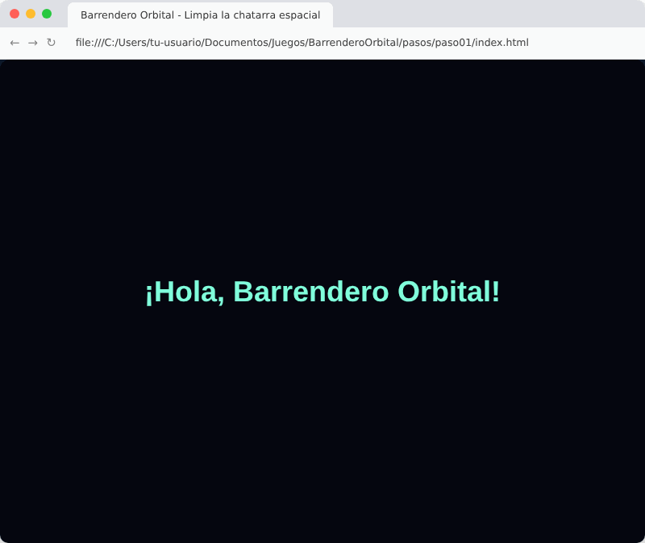</p>

<p align="center"><em>Figura 14. Resultado del paso 1: el espacio negro con el saludo en el centro.</em></p>

### Pruébalo tú

- Cambia `"#80ffdb"` por `"yellow"` y recarga.
- Cambia `bold 36px` por `bold 60px`.
- Si no ves nada, abre la consola (F12): lo más común es un error al escribir `lienzo`.

# 5. Paso 2 · Estrellas, la Tierra y el bucle del juego

**Objetivo:** pintar un cielo con 140 estrellas que titilan, la Tierra asomando por abajo con su atmósfera, y crear el **bucle del juego**.

**Qué aprenderás:** crear objetos en un bucle, opacidad (`globalAlpha`), degradados circulares, elipses, **recortes** con `clip()` y `requestAnimationFrame`.

#### Cambio 1 de 1 · Cambiar (reemplazar) código en `juego.js`

🗑️ **Primero, borra las líneas 11 a 16 de tu archivo `juego.js`** (están justo debajo de `const ALTO = lienzo.height;`). En la imagen aparecen en rojo y tachadas:

<p align="center">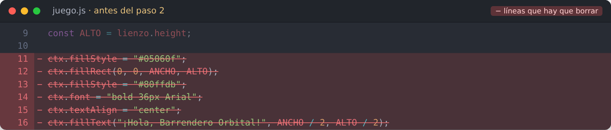</p>

<p align="center"><em>Figura 15. Paso 2: líneas que se borran de juego.js</em></p>

Estas son las líneas que desaparecen:

```javascript
ctx.fillStyle = "#05060f";
ctx.fillRect(0, 0, ANCHO, ALTO);
ctx.fillStyle = "#80ffdb";
ctx.font = "bold 36px Arial";
ctx.textAlign = "center";
ctx.fillText("¡Hola, Barrendero Orbital!", ANCHO / 2, ALTO / 2);
```

✏️ **Después, en ese mismo sitio, escribe las líneas nuevas** (quedan en las líneas 11 a 87 del archivo terminado).

##### Parte 1 de 3 (líneas 11 a 38)

<p align="center">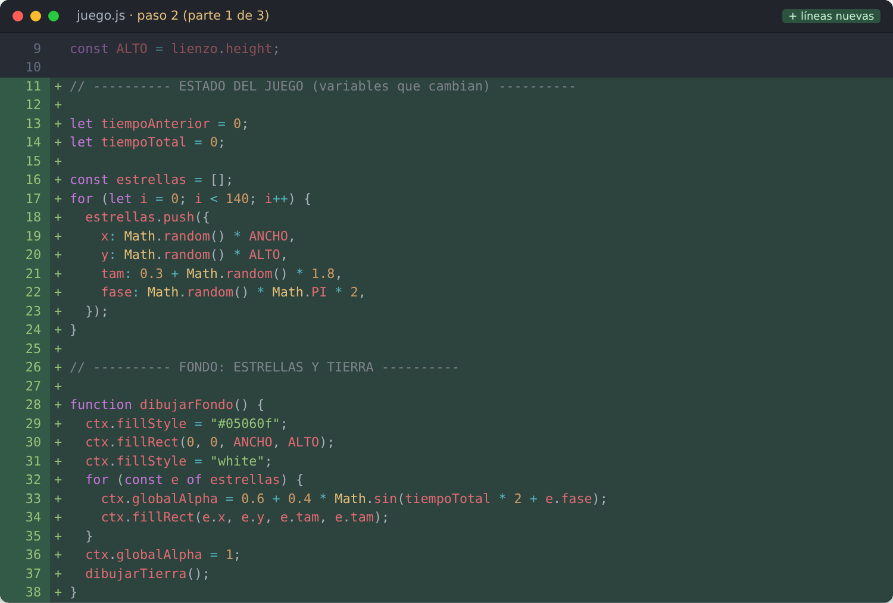</p>

<p align="center"><em>Figura 16. Paso 2: código nuevo en juego.js (parte 1 de 3). Lo verde es lo que escribes; lo gris ya lo tenías.</em></p>

**Explicación línea por línea:**

- **Línea 11** · `// ---------- ESTADO DEL JUEGO (variables que cambian) ----------`  
  → Comentario que sirve de título de sección: «ESTADO DEL JUEGO (variables que cambian)». El navegador lo ignora; nos ayuda a ordenar el código.

> **Variables del tiempo.** Usamos let porque su valor cambiará en cada fotograma.

- **Línea 13** · `let tiempoAnterior = 0;`  
  → Momento (en milisegundos) del fotograma anterior, para medir cuánto tiempo pasa entre fotogramas.
- **Línea 14** · `let tiempoTotal = 0;`  
  → Segundos que lleva el juego funcionando. Sirve para animar (por ejemplo, el parpadeo de las estrellas).

> **Las estrellas.** Creamos 140 estrellas en posiciones al azar UNA sola vez, al cargar. Si las creáramos en cada fotograma, saltarían de sitio sin parar.

- **Línea 16** · `const estrellas = [];`  
  → Una lista vacía donde guardaremos las estrellas.
- **Línea 17** · `for (let i = 0; i < 140; i++) {`  
  → Repite 140 veces (i = 0, 1, 2… 139).
- **Línea 18** · `estrellas.push({`  
  → Añade (push) una estrella a la lista: un objeto con su posición, tamaño y un desfase para que no titilen todas a la vez.
- **Línea 19** · `x: Math.random() * ANCHO,`  
  → x al azar entre 0 y el ancho. Math.random() da un número entre 0 y 0.999…
- **Línea 20** · `y: Math.random() * ALTO,`  
  → y al azar entre 0 y el alto.
- **Línea 21** · `tam: 0.3 + Math.random() * 1.8,`  
  → Tamaño entre 0.3 y 2.1 píxeles.
- **Línea 22** · `fase: Math.random() * Math.PI * 2,`  
  → Desfase del parpadeo: un ángulo al azar.
- **Línea 23** · `});`  
  → Cierra la llave de la función, el paréntesis de la llamada y termina la instrucción con `;`.
- **Línea 24** · `}`  
  → Cierra la llave `{` que se abrió más arriba: aquí termina ese bloque.
- **Línea 26** · `// ---------- FONDO: ESTRELLAS Y TIERRA ----------`  
  → Comentario que sirve de título de sección: «FONDO: ESTRELLAS Y TIERRA». El navegador lo ignora; nos ayuda a ordenar el código.

> **El fondo.** Pintamos el espacio, las estrellas titilando y la Tierra asomando abajo. Al pintar el fondo completo en cada fotograma, también "borramos" el fotograma anterior.

- **Línea 28** · `function dibujarFondo() {`  
  → Declara la función dibujarFondo.
- **Línea 29** · `ctx.fillStyle = "#05060f";`  
  → Azul casi negro para el espacio.
- **Línea 30** · `ctx.fillRect(0, 0, ANCHO, ALTO);`  
  → Pinta todo el lienzo (y así borra lo anterior).
- **Línea 31** · `ctx.fillStyle = "white";`  
  → Las estrellas son blancas.
- **Línea 32** · `for (const e of estrellas) {`  
  → Para cada estrella e de la lista…
- **Línea 33** · `ctx.globalAlpha = 0.6 + 0.4 * Math.sin(tiempoTotal * 2 + e.fase);`  
  → …su opacidad sube y baja con el seno (entre 0.2 y 1): así titila. Cada una tiene su propia fase.
- **Línea 34** · `ctx.fillRect(e.x, e.y, e.tam, e.tam);`  
  → …y la dibujamos como un cuadradito diminuto.
- **Línea 35** · `}`  
  → Cierra la llave `{` que se abrió más arriba: aquí termina ese bloque.
- **Línea 36** · `ctx.globalAlpha = 1;`  
  → Volvemos a la opacidad normal (1 = opaco).
- **Línea 37** · `dibujarTierra();`  
  → Dibujamos la Tierra.
- **Línea 38** · `}`  
  → Cierra la llave `{` que se abrió más arriba: aquí termina ese bloque.

**Código para copiar** (o mejor, ¡escríbelo tú para aprender!):

```javascript
// ---------- ESTADO DEL JUEGO (variables que cambian) ----------

let tiempoAnterior = 0;
let tiempoTotal = 0;

const estrellas = [];
for (let i = 0; i < 140; i++) {
  estrellas.push({
    x: Math.random() * ANCHO,
    y: Math.random() * ALTO,
    tam: 0.3 + Math.random() * 1.8,
    fase: Math.random() * Math.PI * 2,
  });
}

// ---------- FONDO: ESTRELLAS Y TIERRA ----------

function dibujarFondo() {
  ctx.fillStyle = "#05060f";
  ctx.fillRect(0, 0, ANCHO, ALTO);
  ctx.fillStyle = "white";
  for (const e of estrellas) {
    ctx.globalAlpha = 0.6 + 0.4 * Math.sin(tiempoTotal * 2 + e.fase);
    ctx.fillRect(e.x, e.y, e.tam, e.tam);
  }
  ctx.globalAlpha = 1;
  dibujarTierra();
}
```

##### Parte 2 de 3 (líneas 40 a 77)

<p align="center">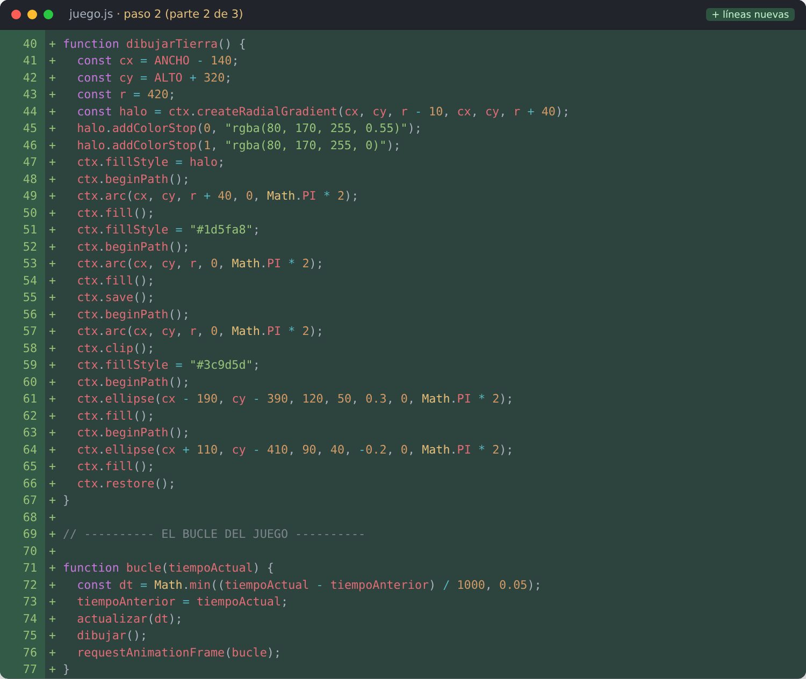</p>

<p align="center"><em>Figura 17. Paso 2: código nuevo en juego.js (parte 2 de 3). Lo verde es lo que escribes; lo gris ya lo tenías.</em></p>

**Explicación línea por línea:**


> **La Tierra.** Un círculo enorme cuyo centro está por debajo del lienzo: solo vemos su parte de arriba, como desde una nave en órbita.

- **Línea 40** · `function dibujarTierra() {`  
  → Declara la función dibujarTierra.
- **Línea 41** · `const cx = ANCHO - 140;`  
  → Centro x de la Tierra.
- **Línea 42** · `const cy = ALTO + 320;`  
  → Centro y: 320 píxeles POR DEBAJO del borde inferior del lienzo.
- **Línea 43** · `const r = 420;`  
  → Radio de la Tierra: 420 píxeles. Así asoma unos 100 píxeles.
- **Línea 44** · `const halo = ctx.createRadialGradient(cx, cy, r - 10, cx, cy, r + 40);`  
  → Degradado circular para la atmósfera: desde el borde de la Tierra hasta 40 píxeles más afuera.
- **Línea 45** · `halo.addColorStop(0, "rgba(80, 170, 255, 0.55)");`  
  → Por dentro, azul claro semitransparente.
- **Línea 46** · `halo.addColorStop(1, "rgba(80, 170, 255, 0)");`  
  → Por fuera, totalmente transparente: se difumina.
- **Línea 47** · `ctx.fillStyle = halo;`  
  → Usamos el degradado como relleno.
- **Línea 48** · `ctx.beginPath();`  
  → Empieza un trazo nuevo, para que esta figura no se mezcle con la anterior.
- **Línea 49** · `ctx.arc(cx, cy, r + 40, 0, Math.PI * 2);`  
  → Círculo de la atmósfera, un poco más grande que la Tierra.
- **Línea 50** · `ctx.fill();`  
  → Rellena la figura que acabamos de trazar con el color de `fillStyle`.
- **Línea 51** · `ctx.fillStyle = "#1d5fa8";`  
  → Azul océano.
- **Línea 52** · `ctx.beginPath();`  
  → Empieza un trazo nuevo, para que esta figura no se mezcle con la anterior.
- **Línea 53** · `ctx.arc(cx, cy, r, 0, Math.PI * 2);`  
  → El círculo de la Tierra.
- **Línea 54** · `ctx.fill();`  
  → Rellena la figura que acabamos de trazar con el color de `fillStyle`.
- **Línea 55** · `ctx.save();`  
  → Guardamos el estado del pincel antes de recortar.
- **Línea 56** · `ctx.beginPath();`  
  → Empieza un trazo nuevo, para que esta figura no se mezcle con la anterior.
- **Línea 57** · `ctx.arc(cx, cy, r, 0, Math.PI * 2);`  
  → Trazamos otra vez el círculo de la Tierra…
- **Línea 58** · `ctx.clip();`  
  → …y lo usamos como "máscara" (clip): a partir de aquí solo se pinta DENTRO del círculo.
- **Línea 59** · `ctx.fillStyle = "#3c9d5d";`  
  → Verde para los continentes.
- **Línea 60** · `ctx.beginPath();`  
  → Empieza un trazo nuevo, para que esta figura no se mezcle con la anterior.
- **Línea 61** · `ctx.ellipse(cx - 190, cy - 390, 120, 50, 0.3, 0, Math.PI * 2);`  
  → Un continente: una elipse (centro, radio horizontal, radio vertical, giro, ángulos).
- **Línea 62** · `ctx.fill();`  
  → Rellena la figura que acabamos de trazar con el color de `fillStyle`.
- **Línea 63** · `ctx.beginPath();`  
  → Empieza un trazo nuevo, para que esta figura no se mezcle con la anterior.
- **Línea 64** · `ctx.ellipse(cx + 110, cy - 410, 90, 40, -0.2, 0, Math.PI * 2);`  
  → Otro continente.
- **Línea 65** · `ctx.fill();`  
  → Rellena la figura que acabamos de trazar con el color de `fillStyle`.
- **Línea 66** · `ctx.restore();`  
  → Quitamos la máscara recuperando el estado guardado.
- **Línea 67** · `}`  
  → Cierra la llave `{` que se abrió más arriba: aquí termina ese bloque.
- **Línea 69** · `// ---------- EL BUCLE DEL JUEGO ----------`  
  → Comentario que sirve de título de sección: «EL BUCLE DEL JUEGO». El navegador lo ignora; nos ayuda a ordenar el código.

> **El bucle.** Unas 60 veces por segundo: medimos el tiempo, actualizamos el mundo y lo dibujamos. requestAnimationFrame vuelve a llamar a bucle en el siguiente fotograma.

- **Línea 71** · `function bucle(tiempoActual) {`  
  → Declara la función bucle. El navegador le pasa el tiempo actual en milisegundos.
- **Línea 72** · `const dt = Math.min((tiempoActual - tiempoAnterior) / 1000, 0.05);`  
  → Segundos desde el fotograma anterior, como máximo 0.05 (por si la pestaña estuvo en segundo plano).
- **Línea 73** · `tiempoAnterior = tiempoActual;`  
  → Guardamos el tiempo para el próximo fotograma.
- **Línea 74** · `actualizar(dt);`  
  → Actualizamos…
- **Línea 75** · `dibujar();`  
  → …dibujamos…
- **Línea 76** · `requestAnimationFrame(bucle);`  
  → …y pedimos el siguiente fotograma.
- **Línea 77** · `}`  
  → Cierra la llave `{` que se abrió más arriba: aquí termina ese bloque.

**Código para copiar** (o mejor, ¡escríbelo tú para aprender!):

```javascript
function dibujarTierra() {
  const cx = ANCHO - 140;
  const cy = ALTO + 320;
  const r = 420;
  const halo = ctx.createRadialGradient(cx, cy, r - 10, cx, cy, r + 40);
  halo.addColorStop(0, "rgba(80, 170, 255, 0.55)");
  halo.addColorStop(1, "rgba(80, 170, 255, 0)");
  ctx.fillStyle = halo;
  ctx.beginPath();
  ctx.arc(cx, cy, r + 40, 0, Math.PI * 2);
  ctx.fill();
  ctx.fillStyle = "#1d5fa8";
  ctx.beginPath();
  ctx.arc(cx, cy, r, 0, Math.PI * 2);
  ctx.fill();
  ctx.save();
  ctx.beginPath();
  ctx.arc(cx, cy, r, 0, Math.PI * 2);
  ctx.clip();
  ctx.fillStyle = "#3c9d5d";
  ctx.beginPath();
  ctx.ellipse(cx - 190, cy - 390, 120, 50, 0.3, 0, Math.PI * 2);
  ctx.fill();
  ctx.beginPath();
  ctx.ellipse(cx + 110, cy - 410, 90, 40, -0.2, 0, Math.PI * 2);
  ctx.fill();
  ctx.restore();
}

// ---------- EL BUCLE DEL JUEGO ----------

function bucle(tiempoActual) {
  const dt = Math.min((tiempoActual - tiempoAnterior) / 1000, 0.05);
  tiempoAnterior = tiempoActual;
  actualizar(dt);
  dibujar();
  requestAnimationFrame(bucle);
}
```

##### Parte 3 de 3 (líneas 79 a 87)

<p align="center">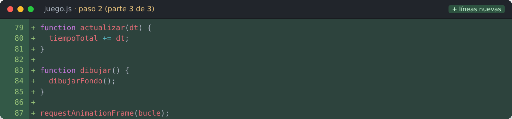</p>

<p align="center"><em>Figura 18. Paso 2: código nuevo en juego.js (parte 3 de 3). Lo verde es lo que escribes; lo gris ya lo tenías.</em></p>

**Explicación línea por línea:**


> **Actualizar.** Llama en orden a todo lo que se mueve o se calcula.

- **Línea 79** · `function actualizar(dt) {`  
  → Declara la función actualizar.
- **Línea 80** · `tiempoTotal += dt;`  
  → Suma el tiempo transcurrido.
- **Línea 81** · `}`  
  → Cierra la llave `{` que se abrió más arriba: aquí termina ese bloque.

> **Dibujar.** De atrás hacia delante: fondo, objetos, nave, efectos y, al final, el marcador y los menús.

- **Línea 83** · `function dibujar() {`  
  → Declara la función dibujar.
- **Línea 84** · `dibujarFondo();`  
  → El fondo (y borrar lo anterior).
- **Línea 85** · `}`  
  → Cierra la llave `{` que se abrió más arriba: aquí termina ese bloque.
- **Línea 87** · `requestAnimationFrame(bucle);`  
  → ¡Despegamos! Pedimos el primer fotograma y el bucle ya no para.

**Código para copiar** (o mejor, ¡escríbelo tú para aprender!):

```javascript
function actualizar(dt) {
  tiempoTotal += dt;
}

function dibujar() {
  dibujarFondo();
}

requestAnimationFrame(bucle);
```

### Resultado del paso 2

<p align="center">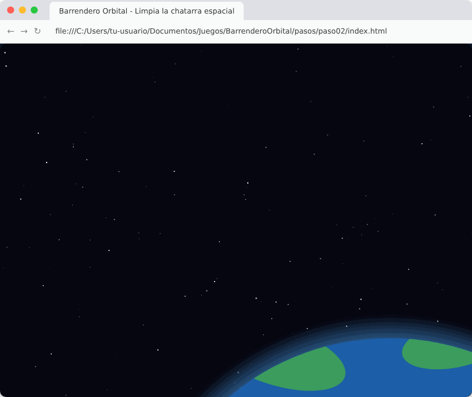</p>

<p align="center"><em>Figura 19. Resultado del paso 2: el espacio con estrellas y la Tierra con su halo azul de atmósfera.</em></p>

### Pruébalo tú

- Cambia `i < 140` por `i < 600`: ¡un cielo lleno de estrellas!
- Cambia `"#1d5fa8"` por `"#c1440e"` y `"#3c9d5d"` por `"#8a2c0d"`: ahora estás en órbita de Marte.

# 6. Paso 3 · La nave

**Objetivo:** dibujar la nave barrendera en el centro: casco en forma de flecha, cabina y pinzas recolectoras.

**Qué aprenderás:** el truco de `translate` + `rotate` para dibujar una figura en cualquier posición y ángulo.

#### Cambio 1 de 3 · Añadir código en `juego.js`

📍 **Dónde:** justo **debajo** de la línea `}` que cierra el bloque `for (let i = 0; i < 140; i++) {` (en el archivo terminado de este paso es la línea 24). Las líneas nuevas son de la 26 a la 31.

<p align="center">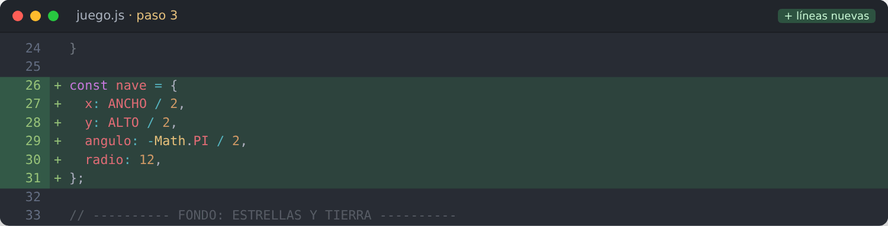</p>

<p align="center"><em>Figura 20. Paso 3: código nuevo en juego.js. Lo verde es lo que escribes; lo gris ya lo tenías.</em></p>

**Explicación línea por línea:**


> **La nave del jugador.** Guardamos todos sus datos juntos en un objeto.

- **Línea 26** · `const nave = {`  
  → Crea el objeto nave.
- **Línea 27** · `x: ANCHO / 2,`  
  → Posición x del centro: la mitad del lienzo.
- **Línea 28** · `y: ALTO / 2,`  
  → Posición y del centro: la mitad del lienzo.
- **Línea 29** · `angulo: -Math.PI / 2,`  
  → Hacia dónde apunta, en radianes. -Math.PI / 2 es "hacia arriba" (recuerda: en el canvas la y crece hacia abajo).
- **Línea 30** · `radio: 12,`  
  → Radio para calcular choques. Es algo menor que el dibujo para que el juego sea "justo".
- **Línea 31** · `};`  
  → Cierra la llave del objeto y termina la instrucción.

**Código para copiar** (o mejor, ¡escríbelo tú para aprender!):

```javascript
const nave = {
  x: ANCHO / 2,
  y: ALTO / 2,
  angulo: -Math.PI / 2,
  radio: 12,
};
```

#### Cambio 2 de 3 · Añadir código en `juego.js`

📍 **Dónde:** justo **debajo** de la línea `}` que cierra el bloque `function dibujarTierra() {` (en el archivo terminado de este paso es la línea 74). Las líneas nuevas son de la 76 a la 110.

<p align="center">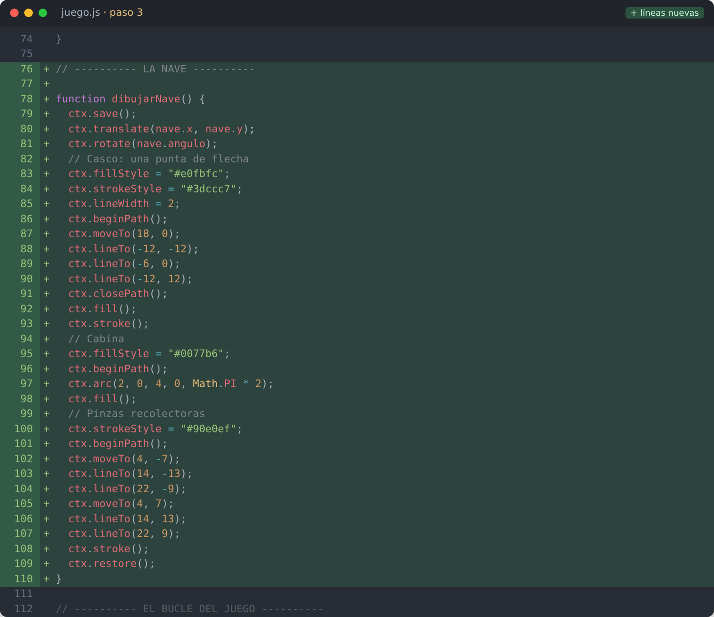</p>

<p align="center"><em>Figura 21. Paso 3: código nuevo en juego.js. Lo verde es lo que escribes; lo gris ya lo tenías.</em></p>

**Explicación línea por línea:**

- **Línea 76** · `// ---------- LA NAVE ----------`  
  → Comentario que sirve de título de sección: «LA NAVE». El navegador lo ignora; nos ayuda a ordenar el código.

> **Dibujar la nave.** El truco: movemos (translate) y giramos (rotate) el pincel hasta la nave, y dibujamos siempre la misma forma apuntando hacia la derecha (ángulo 0). El canvas se encarga de girarla.

- **Línea 78** · `function dibujarNave() {`  
  → Declara la función dibujarNave.
- **Línea 79** · `ctx.save();`  
  → Guarda el estado del pincel.
- **Línea 80** · `ctx.translate(nave.x, nave.y);`  
  → Lleva el punto (0, 0) al centro de la nave.
- **Línea 81** · `ctx.rotate(nave.angulo);`  
  → Gira el pincel el ángulo de la nave.
- **Línea 82** · `// Casco: una punta de flecha`  
  → Comentario: el navegador lo ignora. Sirve para que las personas entendamos el código («Casco: una punta de flecha»).
- **Línea 83** · `ctx.fillStyle = "#e0fbfc";`  
  → Casco blanco azulado.
- **Línea 84** · `ctx.strokeStyle = "#3dccc7";`  
  → Borde turquesa.
- **Línea 85** · `ctx.lineWidth = 2;`  
  → Grosor de las líneas: `2` píxeles.
- **Línea 86** · `ctx.beginPath();`  
  → Empieza un trazo nuevo, para que esta figura no se mezcle con la anterior.
- **Línea 87** · `ctx.moveTo(18, 0);`  
  → La punta de la nave, 18 píxeles hacia delante.
- **Línea 88** · `ctx.lineTo(-12, -12);`  
  → Ala izquierda, atrás.
- **Línea 89** · `ctx.lineTo(-6, 0);`  
  → Hueco trasero (le da forma de flecha).
- **Línea 90** · `ctx.lineTo(-12, 12);`  
  → Ala derecha, atrás.
- **Línea 91** · `ctx.closePath();`  
  → Cierra la figura: une el último punto con el primero.
- **Línea 92** · `ctx.fill();`  
  → Rellena la figura que acabamos de trazar con el color de `fillStyle`.
- **Línea 93** · `ctx.stroke();`  
  → Dibuja el contorno (la línea) de la figura con el color de `strokeStyle`.
- **Línea 94** · `// Cabina`  
  → Comentario: el navegador lo ignora. Sirve para que las personas entendamos el código («Cabina»).
- **Línea 95** · `ctx.fillStyle = "#0077b6";`  
  → Azul para la cabina.
- **Línea 96** · `ctx.beginPath();`  
  → Empieza un trazo nuevo, para que esta figura no se mezcle con la anterior.
- **Línea 97** · `ctx.arc(2, 0, 4, 0, Math.PI * 2);`  
  → Cabina: círculo de radio 4 en el centro.
- **Línea 98** · `ctx.fill();`  
  → Rellena la figura que acabamos de trazar con el color de `fillStyle`.
- **Línea 99** · `// Pinzas recolectoras`  
  → Comentario: el navegador lo ignora. Sirve para que las personas entendamos el código («Pinzas recolectoras»).
- **Línea 100** · `ctx.strokeStyle = "#90e0ef";`  
  → Color de las pinzas.
- **Línea 101** · `ctx.beginPath();`  
  → Empieza un trazo nuevo, para que esta figura no se mezcle con la anterior.
- **Línea 102** · `ctx.moveTo(4, -7);`  
  → Pinza de arriba: empieza en el casco…
- **Línea 103** · `ctx.lineTo(14, -13);`  
  → …sale hacia fuera…
- **Línea 104** · `ctx.lineTo(22, -9);`  
  → …y se cierra hacia delante.
- **Línea 105** · `ctx.moveTo(4, 7);`  
  → Pinza de abajo (simétrica): moveTo para no unirla con la anterior.
- **Línea 106** · `ctx.lineTo(14, 13);`  
  → Traza una línea recta hasta el punto `(14, 13)`.
- **Línea 107** · `ctx.lineTo(22, 9);`  
  → Traza una línea recta hasta el punto `(22, 9)`.
- **Línea 108** · `ctx.stroke();`  
  → Dibuja el contorno (la línea) de la figura con el color de `strokeStyle`.
- **Línea 109** · `ctx.restore();`  
  → Recupera el estado del pincel (sin traslado ni giro).
- **Línea 110** · `}`  
  → Cierra la llave `{` que se abrió más arriba: aquí termina ese bloque.

**Código para copiar** (o mejor, ¡escríbelo tú para aprender!):

```javascript
// ---------- LA NAVE ----------

function dibujarNave() {
  ctx.save();
  ctx.translate(nave.x, nave.y);
  ctx.rotate(nave.angulo);
  // Casco: una punta de flecha
  ctx.fillStyle = "#e0fbfc";
  ctx.strokeStyle = "#3dccc7";
  ctx.lineWidth = 2;
  ctx.beginPath();
  ctx.moveTo(18, 0);
  ctx.lineTo(-12, -12);
  ctx.lineTo(-6, 0);
  ctx.lineTo(-12, 12);
  ctx.closePath();
  ctx.fill();
  ctx.stroke();
  // Cabina
  ctx.fillStyle = "#0077b6";
  ctx.beginPath();
  ctx.arc(2, 0, 4, 0, Math.PI * 2);
  ctx.fill();
  // Pinzas recolectoras
  ctx.strokeStyle = "#90e0ef";
  ctx.beginPath();
  ctx.moveTo(4, -7);
  ctx.lineTo(14, -13);
  ctx.lineTo(22, -9);
  ctx.moveTo(4, 7);
  ctx.lineTo(14, 13);
  ctx.lineTo(22, 9);
  ctx.stroke();
  ctx.restore();
}
```

#### Cambio 3 de 3 · Añadir código en `juego.js`

📍 **Dónde:** justo **debajo** de la línea `dibujarFondo();` (en el archivo terminado de este paso es la línea 127). Las líneas nuevas son de la 128 a la 128.

<p align="center">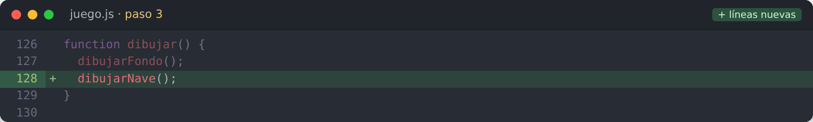</p>

<p align="center"><em>Figura 22. Paso 3: código nuevo en juego.js. Lo verde es lo que escribes; lo gris ya lo tenías.</em></p>

**Explicación línea por línea:**

- **Línea 128** · `dibujarNave();`  
  → La nave.

**Código para copiar** (o mejor, ¡escríbelo tú para aprender!):

```javascript
  dibujarNave();
```

### Resultado del paso 3

<p align="center">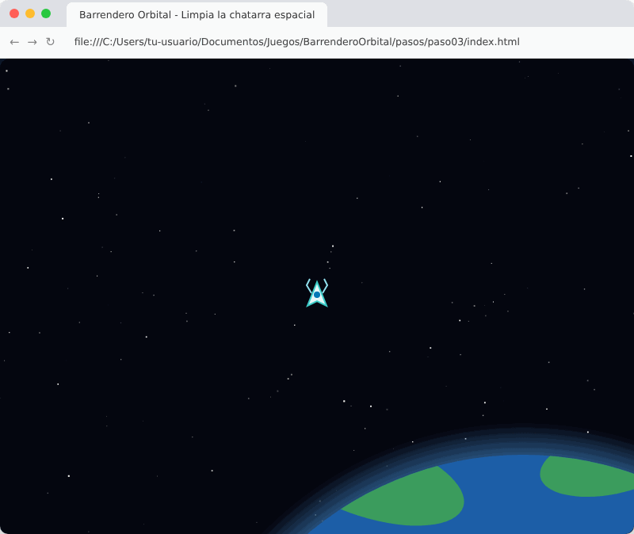</p>

<p align="center"><em>Figura 23. Resultado del paso 3: la nave en el centro, apuntando hacia arriba.</em></p>

### Pruébalo tú

- Cambia `angulo: -Math.PI / 2` por `angulo: 0` (mira a la derecha) o `Math.PI / 4` (diagonal hacia abajo a la derecha).
- Cambia los colores del casco para personalizar tu nave.

# 7. Paso 4 · Girar y propulsar con inercia

**Objetivo:** girar con ← →, acelerar con ↑ (con una llama en el motor) y que la nave se deslice y frene poco a poco.

**Qué aprenderás:** eventos de teclado y la **física de la inercia** con seno y coseno.

<p align="center">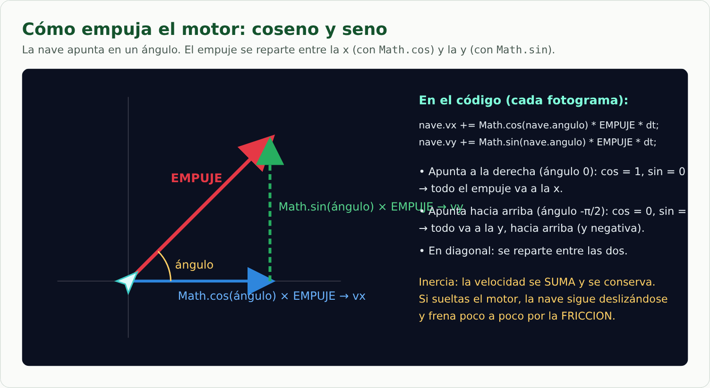</p>

<p align="center"><em>Figura 24. El empuje del motor se reparte entre x e y con coseno y seno.</em></p>

#### Cambio 1 de 6 · Añadir código en `juego.js`

📍 **Dónde:** justo **debajo** de la línea `const ALTO = lienzo.height;` (en el archivo terminado de este paso es la línea 9). Las líneas nuevas son de la 11 a la 15.

<p align="center">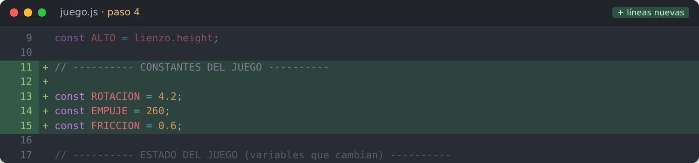</p>

<p align="center"><em>Figura 25. Paso 4: código nuevo en juego.js. Lo verde es lo que escribes; lo gris ya lo tenías.</em></p>

**Explicación línea por línea:**

- **Línea 11** · `// ---------- CONSTANTES DEL JUEGO ----------`  
  → Comentario que sirve de título de sección: «CONSTANTES DEL JUEGO». El navegador lo ignora; nos ayuda a ordenar el código.

> **Las reglas de la física de la nave.** Las ponemos arriba, con nombre, para poder ajustarlas fácilmente.

- **Línea 13** · `const ROTACION = 4.2;`  
  → Velocidad de giro de la nave: 4.2 radianes por segundo (algo más de dos tercios de vuelta por segundo).
- **Línea 14** · `const EMPUJE = 260;`  
  → Fuerza del motor: cada segundo con el motor encendido, la velocidad aumenta 260 píxeles por segundo.
- **Línea 15** · `const FRICCION = 0.6;`  
  → Rozamiento: la nave pierde un 60 % de su velocidad cada segundo si no acelera. (En el espacio real no hay rozamiento, pero así es más fácil de controlar.)

**Código para copiar** (o mejor, ¡escríbelo tú para aprender!):

```javascript
// ---------- CONSTANTES DEL JUEGO ----------

const ROTACION = 4.2;
const EMPUJE = 260;
const FRICCION = 0.6;
```

#### Cambio 2 de 6 · Añadir código en `juego.js`

📍 **Dónde:** justo **debajo** de la línea `radio: 12,` (en el archivo terminado de este paso es la línea 36). Las líneas nuevas son de la 37 a la 39.

<p align="center">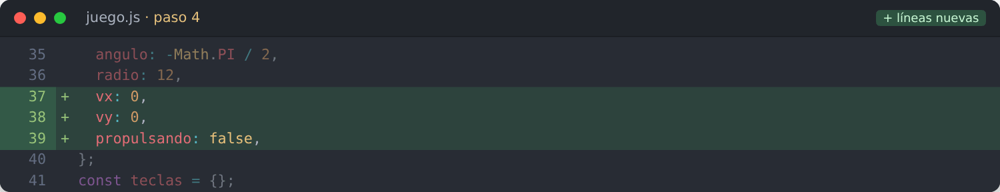</p>

<p align="center"><em>Figura 26. Paso 4: código nuevo en juego.js. Lo verde es lo que escribes; lo gris ya lo tenías.</em></p>

**Explicación línea por línea:**

- **Línea 37** · `vx: 0,`  
  → Velocidad horizontal actual (píxeles por segundo). Empieza quieta.
- **Línea 38** · `vy: 0,`  
  → Velocidad vertical actual.
- **Línea 39** · `propulsando: false,`  
  → ¿Está el motor encendido? Sirve para dibujar la llama.

**Código para copiar** (o mejor, ¡escríbelo tú para aprender!):

```javascript
  vx: 0,
  vy: 0,
  propulsando: false,
```

#### Cambio 3 de 6 · Añadir código en `juego.js`

📍 **Dónde:** justo **debajo** de la línea `};` que cierra el bloque `const nave = {` (en el archivo terminado de este paso es la línea 40). Las líneas nuevas son de la 41 a la 41.

<p align="center">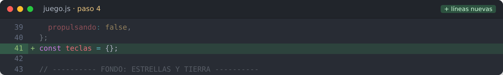</p>

<p align="center"><em>Figura 27. Paso 4: código nuevo en juego.js. Lo verde es lo que escribes; lo gris ya lo tenías.</em></p>

**Explicación línea por línea:**

- **Línea 41** · `const teclas = {};`  
  → Objeto donde apuntamos qué teclas están pulsadas: teclas["ArrowUp"] valdrá true mientras se pulse la flecha arriba.

**Código para copiar** (o mejor, ¡escríbelo tú para aprender!):

```javascript
const teclas = {};
```

#### Cambio 4 de 6 · Añadir código en `juego.js`

📍 **Dónde:** justo **debajo** de la línea `ctx.rotate(nave.angulo);` (en el archivo terminado de este paso es la línea 91). Las líneas nuevas son de la 92 a la 100.

<p align="center">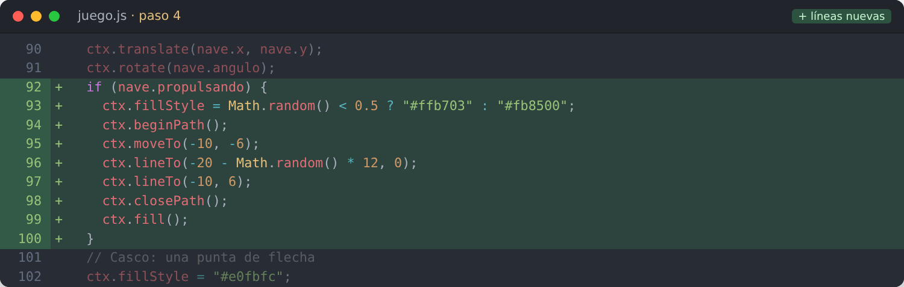</p>

<p align="center"><em>Figura 28. Paso 4: código nuevo en juego.js. Lo verde es lo que escribes; lo gris ya lo tenías.</em></p>

**Explicación línea por línea:**

- **Línea 92** · `if (nave.propulsando) {`  
  → Si el motor está encendido, dibujamos la llama detrás (en la x negativa).
- **Línea 93** · `ctx.fillStyle = Math.random() < 0.5 ? "#ffb703" : "#fb8500";`  
  → Color al azar entre amarillo y naranja en cada fotograma: así la llama parece que "baila".
- **Línea 94** · `ctx.beginPath();`  
  → Empieza un trazo nuevo, para que esta figura no se mezcle con la anterior.
- **Línea 95** · `ctx.moveTo(-10, -6);`  
  → Esquina superior de la base de la llama.
- **Línea 96** · `ctx.lineTo(-20 - Math.random() * 12, 0);`  
  → Punta de la llama: con una longitud al azar entre 10 y 22 píxeles.
- **Línea 97** · `ctx.lineTo(-10, 6);`  
  → Esquina inferior de la base.
- **Línea 98** · `ctx.closePath();`  
  → Cierra la figura: une el último punto con el primero.
- **Línea 99** · `ctx.fill();`  
  → Rellena la figura que acabamos de trazar con el color de `fillStyle`.
- **Línea 100** · `}`  
  → Cierra la llave `{` que se abrió más arriba: aquí termina ese bloque.

**Código para copiar** (o mejor, ¡escríbelo tú para aprender!):

```javascript
  if (nave.propulsando) {
    ctx.fillStyle = Math.random() < 0.5 ? "#ffb703" : "#fb8500";
    ctx.beginPath();
    ctx.moveTo(-10, -6);
    ctx.lineTo(-20 - Math.random() * 12, 0);
    ctx.lineTo(-10, 6);
    ctx.closePath();
    ctx.fill();
  }
```

#### Cambio 5 de 6 · Añadir código en `juego.js`

📍 **Dónde:** justo **debajo** de la línea `}` que cierra el bloque `function dibujarNave() {` (en el archivo terminado de este paso es la línea 129). Las líneas nuevas son de la 131 a la 154.

<p align="center">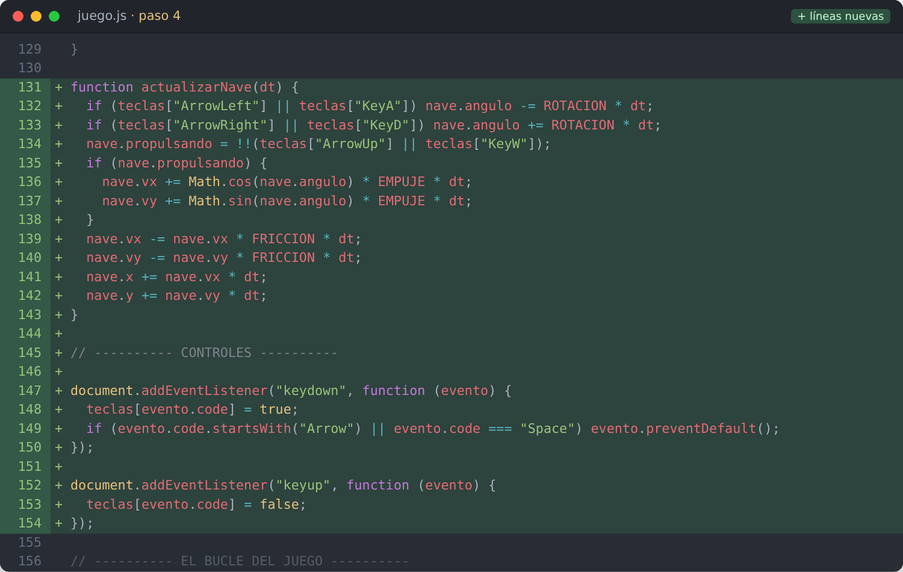</p>

<p align="center"><em>Figura 29. Paso 4: código nuevo en juego.js. Lo verde es lo que escribes; lo gris ya lo tenías.</em></p>

**Explicación línea por línea:**


> **Mover la nave con inercia.** La nave no se mueve "a saltos": tiene velocidad (vx, vy). El motor empuja en la dirección en la que apunta, usando coseno y seno para repartir el empuje entre x e y. Al soltar, sigue deslizándose y frena poco a poco.

- **Línea 131** · `function actualizarNave(dt) {`  
  → Declara la función actualizarNave. dt son los segundos desde el fotograma anterior.
- **Línea 132** · `if (teclas["ArrowLeft"] || teclas["KeyA"]) nave.angulo -= ROTACION * dt;`  
  → Flecha izquierda o A: gira hacia la izquierda (ángulo negativo).
- **Línea 133** · `if (teclas["ArrowRight"] || teclas["KeyD"]) nave.angulo += ROTACION * dt;`  
  → Flecha derecha o D: gira hacia la derecha.
- **Línea 134** · `nave.propulsando = !!(teclas["ArrowUp"] || teclas["KeyW"]);`  
  → El motor está encendido si se pulsa la flecha arriba o W. El !! convierte el resultado en true o false.
- **Línea 135** · `if (nave.propulsando) {`  
  → Si el motor está encendido…
- **Línea 136** · `nave.vx += Math.cos(nave.angulo) * EMPUJE * dt;`  
  → …la velocidad x aumenta según el coseno del ángulo (cuánto apunta hacia la derecha o la izquierda)…
- **Línea 137** · `nave.vy += Math.sin(nave.angulo) * EMPUJE * dt;`  
  → …y la velocidad y según el seno (cuánto apunta hacia abajo o arriba).
- **Línea 138** · `}`  
  → Cierra la llave `{` que se abrió más arriba: aquí termina ese bloque.
- **Línea 139** · `nave.vx -= nave.vx * FRICCION * dt;`  
  → Rozamiento: quita a la velocidad x una parte proporcional a ella misma.
- **Línea 140** · `nave.vy -= nave.vy * FRICCION * dt;`  
  → Lo mismo con la velocidad y.
- **Línea 141** · `nave.x += nave.vx * dt;`  
  → Mueve la nave según su velocidad.
- **Línea 142** · `nave.y += nave.vy * dt;`  
  → Y lo mismo en vertical: la y avanza según la velocidad vy.
- **Línea 143** · `}`  
  → Cierra la llave `{` que se abrió más arriba: aquí termina ese bloque.
- **Línea 145** · `// ---------- CONTROLES ----------`  
  → Comentario que sirve de título de sección: «CONTROLES». El navegador lo ignora; nos ayuda a ordenar el código.

> **El teclado.** Al pulsar una tecla la apuntamos como pulsada (true) y al soltarla como no pulsada (false). Las funciones de actualizar consultan este objeto en cada fotograma.

- **Línea 147** · `document.addEventListener("keydown", function (evento) {`  
  → Cuando se pulse una tecla…
- **Línea 148** · `teclas[evento.code] = true;`  
  → …la apuntamos como pulsada.
- **Línea 149** · `if (evento.code.startsWith("Arrow") || evento.code === "Space") evento.preventDefault();`  
  → Las flechas y el espacio no deben mover (hacer scroll) la página.
- **Línea 150** · `});`  
  → Cierra la llave de la función, el paréntesis de la llamada y termina la instrucción con `;`.
- **Línea 152** · `document.addEventListener("keyup", function (evento) {`  
  → Cuando se suelte una tecla…
- **Línea 153** · `teclas[evento.code] = false;`  
  → …la apuntamos como no pulsada.
- **Línea 154** · `});`  
  → Cierra la llave de la función, el paréntesis de la llamada y termina la instrucción con `;`.

**Código para copiar** (o mejor, ¡escríbelo tú para aprender!):

```javascript
function actualizarNave(dt) {
  if (teclas["ArrowLeft"] || teclas["KeyA"]) nave.angulo -= ROTACION * dt;
  if (teclas["ArrowRight"] || teclas["KeyD"]) nave.angulo += ROTACION * dt;
  nave.propulsando = !!(teclas["ArrowUp"] || teclas["KeyW"]);
  if (nave.propulsando) {
    nave.vx += Math.cos(nave.angulo) * EMPUJE * dt;
    nave.vy += Math.sin(nave.angulo) * EMPUJE * dt;
  }
  nave.vx -= nave.vx * FRICCION * dt;
  nave.vy -= nave.vy * FRICCION * dt;
  nave.x += nave.vx * dt;
  nave.y += nave.vy * dt;
}

// ---------- CONTROLES ----------

document.addEventListener("keydown", function (evento) {
  teclas[evento.code] = true;
  if (evento.code.startsWith("Arrow") || evento.code === "Space") evento.preventDefault();
});

document.addEventListener("keyup", function (evento) {
  teclas[evento.code] = false;
});
```

#### Cambio 6 de 6 · Añadir código en `juego.js`

📍 **Dónde:** justo **debajo** de la línea `tiempoTotal += dt;` (en el archivo terminado de este paso es la línea 167). Las líneas nuevas son de la 168 a la 168.

<p align="center">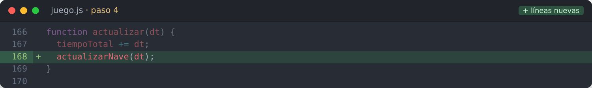</p>

<p align="center"><em>Figura 30. Paso 4: código nuevo en juego.js. Lo verde es lo que escribes; lo gris ya lo tenías.</em></p>

**Explicación línea por línea:**

- **Línea 168** · `actualizarNave(dt);`  
  → Mueve la nave.

**Código para copiar** (o mejor, ¡escríbelo tú para aprender!):

```javascript
  actualizarNave(dt);
```

### Resultado del paso 4

<p align="center"></p>

<p align="center"><em>Figura 31. Tras pulsar la flecha derecha un momento, la nave ha girado.</em></p>

<p align="center">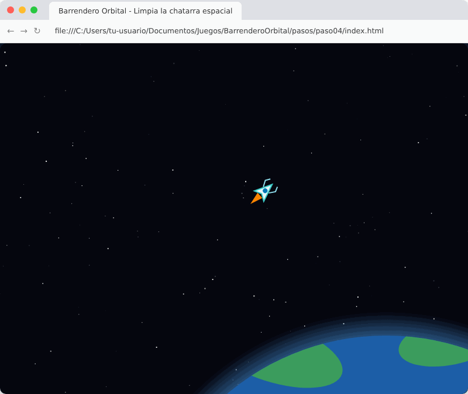</p>

<p align="center"><em>Figura 32. Con la flecha arriba pulsada: la llama del motor se enciende y la nave avanza en la dirección en la que apunta.</em></p>

### Pruébalo tú

- Pon `FRICCION = 0`: así es el espacio de verdad… ¡e imposible de frenar!
- Sube `EMPUJE` a `600` para una nave de carreras.

# 8. Paso 5 · La pantalla "da la vuelta"

**Objetivo:** que la nave, al salir por un borde, aparezca por el contrario.

**Qué aprenderás:** a escribir una función **reutilizable** que sirve para cualquier objeto (la usaremos con disparos, chatarra y fragmentos).

<p align="center">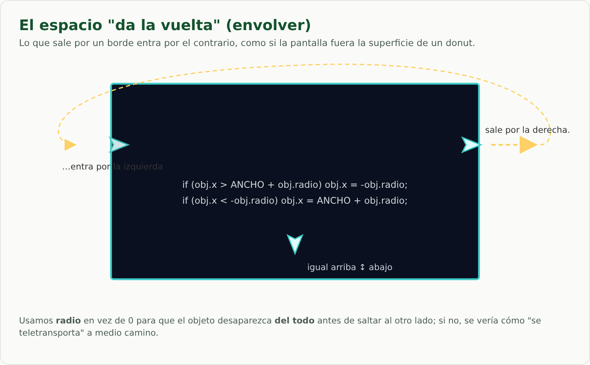</p>

<p align="center"><em>Figura 33. Cómo funciona envolver(): lo que sale por un lado entra por el otro.</em></p>

#### Cambio 1 de 2 · Añadir código en `juego.js`

📍 **Dónde:** justo **debajo** de la línea `const teclas = {};` (en el archivo terminado de este paso es la línea 41). Las líneas nuevas son de la 43 a la 50.

<p align="center">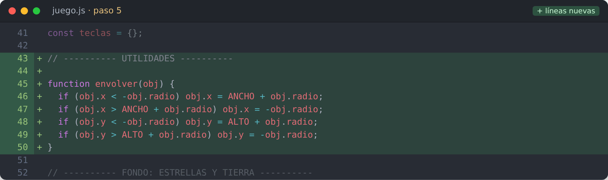</p>

<p align="center"><em>Figura 34. Paso 5: código nuevo en juego.js. Lo verde es lo que escribes; lo gris ya lo tenías.</em></p>

**Explicación línea por línea:**

- **Línea 43** · `// ---------- UTILIDADES ----------`  
  → Comentario que sirve de título de sección: «UTILIDADES». El navegador lo ignora; nos ayuda a ordenar el código.

> **Salir por un lado y entrar por el otro.** Esta es la regla más famosa de los juegos de asteroides: el espacio "da la vuelta". Si algo sale por la derecha, aparece por la izquierda, y si sale por arriba, aparece por abajo. Sirve para la nave, los disparos, la chatarra y los fragmentos.

- **Línea 45** · `function envolver(obj) {`  
  → Declara la función envolver. Recibe cualquier objeto que tenga x, y y radio.
- **Línea 46** · `if (obj.x < -obj.radio) obj.x = ANCHO + obj.radio;`  
  → Si ha salido del todo por la izquierda (su x es menor que -radio)…
- **Línea 47** · `if (obj.x > ANCHO + obj.radio) obj.x = -obj.radio;`  
  → …si ha salido por la derecha, lo pasamos a la izquierda.
- **Línea 48** · `if (obj.y < -obj.radio) obj.y = ALTO + obj.radio;`  
  → Si ha salido por arriba, lo pasamos abajo.
- **Línea 49** · `if (obj.y > ALTO + obj.radio) obj.y = -obj.radio;`  
  → Si ha salido por abajo, lo pasamos arriba.
- **Línea 50** · `}`  
  → Cierra la llave `{` que se abrió más arriba: aquí termina ese bloque.

**Código para copiar** (o mejor, ¡escríbelo tú para aprender!):

```javascript
// ---------- UTILIDADES ----------

function envolver(obj) {
  if (obj.x < -obj.radio) obj.x = ANCHO + obj.radio;
  if (obj.x > ANCHO + obj.radio) obj.x = -obj.radio;
  if (obj.y < -obj.radio) obj.y = ALTO + obj.radio;
  if (obj.y > ALTO + obj.radio) obj.y = -obj.radio;
}
```

#### Cambio 2 de 2 · Añadir código en `juego.js`

📍 **Dónde:** justo **debajo** de la línea `nave.y += nave.vy * dt;` (en el archivo terminado de este paso es la línea 151). Las líneas nuevas son de la 152 a la 152.

<p align="center">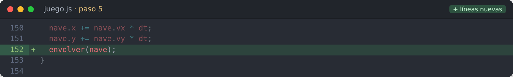</p>

<p align="center"><em>Figura 35. Paso 5: código nuevo en juego.js. Lo verde es lo que escribes; lo gris ya lo tenías.</em></p>

**Explicación línea por línea:**

- **Línea 152** · `envolver(nave);`  
  → Si sale por un borde, aparece por el contrario.

**Código para copiar** (o mejor, ¡escríbelo tú para aprender!):

```javascript
  envolver(nave);
```

### Resultado del paso 5

<p align="center">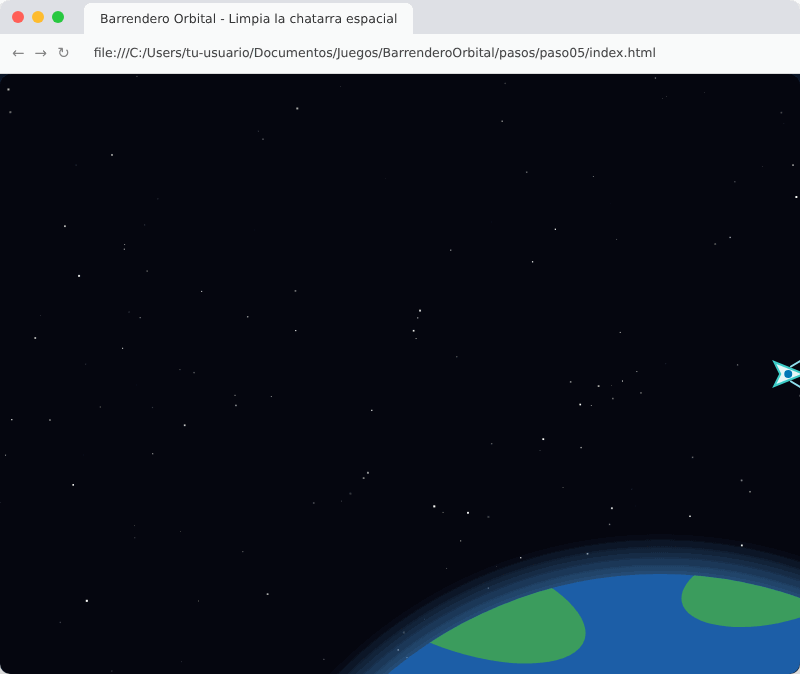</p>

<p align="center"><em>Figura 36. La nave avanza hacia el borde derecho…</em></p>

<p align="center">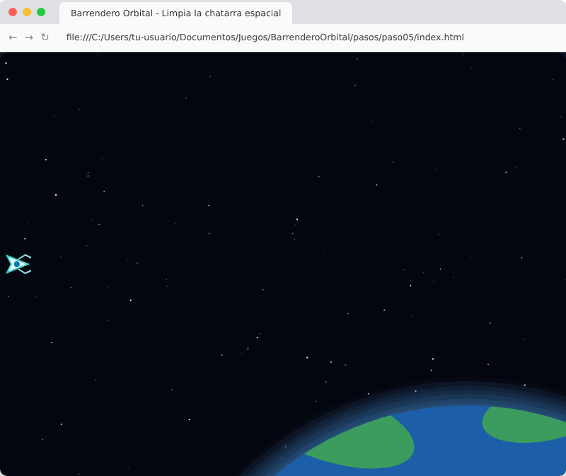</p>

<p align="center"><em>Figura 37. …y un instante después aparece por el borde izquierdo.</em></p>

# 9. Paso 6 · Disparar el láser

**Objetivo:** disparar con ESPACIO rayos láser que salen de la punta de la nave, con un pequeño tiempo de "enfriamiento" entre disparos.

**Qué aprenderás:** crear objetos sobre la marcha, listas que se vacían solas con `filter`, y un temporizador de enfriamiento.

#### Cambio 1 de 6 · Añadir código en `juego.js`

📍 **Dónde:** justo **debajo** de la línea `const FRICCION = 0.6;` (en el archivo terminado de este paso es la línea 15). Las líneas nuevas son de la 16 a la 16.

<p align="center">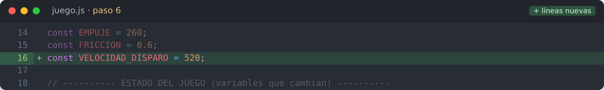</p>

<p align="center"><em>Figura 38. Paso 6: código nuevo en juego.js. Lo verde es lo que escribes; lo gris ya lo tenías.</em></p>

**Explicación línea por línea:**

- **Línea 16** · `const VELOCIDAD_DISPARO = 520;`  
  → Velocidad de los disparos láser: 520 píxeles por segundo.

**Código para copiar** (o mejor, ¡escríbelo tú para aprender!):

```javascript
const VELOCIDAD_DISPARO = 520;
```

#### Cambio 2 de 6 · Añadir código en `juego.js`

📍 **Dónde:** justo **debajo** de la línea `const teclas = {};` (en el archivo terminado de este paso es la línea 42). Las líneas nuevas son de la 43 a la 44.

<p align="center">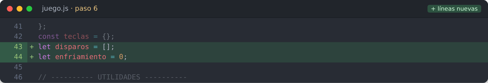</p>

<p align="center"><em>Figura 39. Paso 6: código nuevo en juego.js. Lo verde es lo que escribes; lo gris ya lo tenías.</em></p>

**Explicación línea por línea:**

- **Línea 43** · `let disparos = [];`  
  → Lista de disparos láser que están volando.
- **Línea 44** · `let enfriamiento = 0;`  
  → Segundos que faltan para poder volver a disparar (evita disparar 60 veces por segundo).

**Código para copiar** (o mejor, ¡escríbelo tú para aprender!):

```javascript
let disparos = [];
let enfriamiento = 0;
```

#### Cambio 3 de 6 · Añadir código en `juego.js`

📍 **Dónde:** justo **debajo** de la línea `envolver(nave);` (en el archivo terminado de este paso es la línea 155). Las líneas nuevas son de la 156 a la 157.

<p align="center">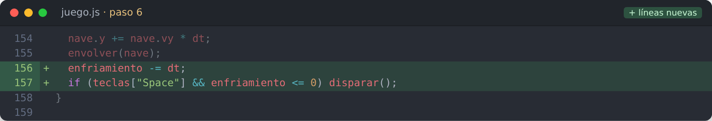</p>

<p align="center"><em>Figura 40. Paso 6: código nuevo en juego.js. Lo verde es lo que escribes; lo gris ya lo tenías.</em></p>

**Explicación línea por línea:**

- **Línea 156** · `enfriamiento -= dt;`  
  → Descuenta el tiempo de enfriamiento del láser.
- **Línea 157** · `if (teclas["Space"] && enfriamiento <= 0) disparar();`  
  → Si se pulsa ESPACIO y el láser ya se ha enfriado, disparamos.

**Código para copiar** (o mejor, ¡escríbelo tú para aprender!):

```javascript
  enfriamiento -= dt;
  if (teclas["Space"] && enfriamiento <= 0) disparar();
```

#### Cambio 4 de 6 · Añadir código en `juego.js`

📍 **Dónde:** justo **debajo** de la línea `}` que cierra el bloque `function actualizarNave(dt) {` (en el archivo terminado de este paso es la línea 158). Las líneas nuevas son de la 160 a la 195.

<p align="center">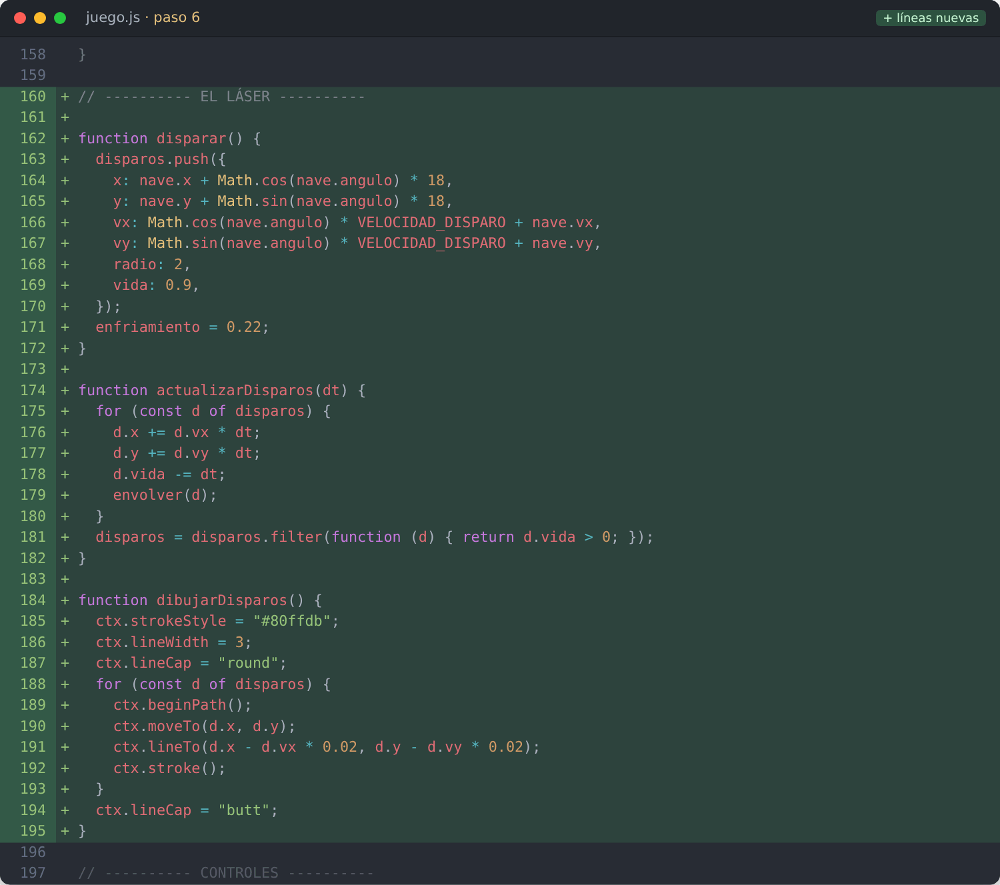</p>

<p align="center"><em>Figura 41. Paso 6: código nuevo en juego.js. Lo verde es lo que escribes; lo gris ya lo tenías.</em></p>

**Explicación línea por línea:**

- **Línea 160** · `// ---------- EL LÁSER ----------`  
  → Comentario que sirve de título de sección: «EL LÁSER». El navegador lo ignora; nos ayuda a ordenar el código.

> **Disparar.** Cada disparo sale de la punta de la nave, en la dirección en la que apunta. Le sumamos la velocidad de la nave para que, si vas rápido, el disparo no se quede atrás.

- **Línea 162** · `function disparar() {`  
  → Declara la función disparar.
- **Línea 163** · `disparos.push({`  
  → Añade un disparo nuevo a la lista.
- **Línea 164** · `x: nave.x + Math.cos(nave.angulo) * 18,`  
  → Sale desde la punta de la nave: 18 píxeles hacia delante desde su centro.
- **Línea 165** · `y: nave.y + Math.sin(nave.angulo) * 18,`  
  → La y de salida: 18 píxeles hacia delante usando el seno.
- **Línea 166** · `vx: Math.cos(nave.angulo) * VELOCIDAD_DISPARO + nave.vx,`  
  → Velocidad x: la del láser en la dirección de la nave, más la de la nave.
- **Línea 167** · `vy: Math.sin(nave.angulo) * VELOCIDAD_DISPARO + nave.vy,`  
  → Velocidad y: igual.
- **Línea 168** · `radio: 2,`  
  → Radio pequeñito para los choques.
- **Línea 169** · `vida: 0.9,`  
  → Vivirá 0.9 segundos (luego se apaga).
- **Línea 170** · `});`  
  → Cierra la llave de la función, el paréntesis de la llamada y termina la instrucción con `;`.
- **Línea 171** · `enfriamiento = 0.22;`  
  → Hasta dentro de 0.22 segundos no se puede volver a disparar (unos 4 disparos por segundo).
- **Línea 172** · `}`  
  → Cierra la llave `{` que se abrió más arriba: aquí termina ese bloque.
- **Línea 174** · `function actualizarDisparos(dt) {`  
  → Declara la función actualizarDisparos: mueve los disparos y quita los que se han apagado.
- **Línea 175** · `for (const d of disparos) {`  
  → Para cada disparo d…
- **Línea 176** · `d.x += d.vx * dt;`  
  → …avanza en x…
- **Línea 177** · `d.y += d.vy * dt;`  
  → …y en y…
- **Línea 178** · `d.vida -= dt;`  
  → …pierde vida…
- **Línea 179** · `envolver(d);`  
  → …y si sale por un borde entra por el otro.
- **Línea 180** · `}`  
  → Cierra la llave `{` que se abrió más arriba: aquí termina ese bloque.
- **Línea 181** · `disparos = disparos.filter(function (d) { return d.vida > 0; });`  
  → Nos quedamos solo con los disparos que siguen vivos.
- **Línea 182** · `}`  
  → Cierra la llave `{` que se abrió más arriba: aquí termina ese bloque.
- **Línea 184** · `function dibujarDisparos() {`  
  → Declara la función dibujarDisparos.
- **Línea 185** · `ctx.strokeStyle = "#80ffdb";`  
  → Color verde agua brillante.
- **Línea 186** · `ctx.lineWidth = 3;`  
  → Línea de 3 píxeles.
- **Línea 187** · `ctx.lineCap = "round";`  
  → Extremos redondeados.
- **Línea 188** · `for (const d of disparos) {`  
  → Para cada disparo…
- **Línea 189** · `ctx.beginPath();`  
  → Empieza un trazo nuevo, para que esta figura no se mezcle con la anterior.
- **Línea 190** · `ctx.moveTo(d.x, d.y);`  
  → …empezamos en su posición…
- **Línea 191** · `ctx.lineTo(d.x - d.vx * 0.02, d.y - d.vy * 0.02);`  
  → …y trazamos una rayita hacia atrás (la distancia que recorre en 0.02 segundos): parece un rayo en movimiento.
- **Línea 192** · `ctx.stroke();`  
  → Dibuja el contorno (la línea) de la figura con el color de `strokeStyle`.
- **Línea 193** · `}`  
  → Cierra la llave `{` que se abrió más arriba: aquí termina ese bloque.
- **Línea 194** · `ctx.lineCap = "butt";`  
  → Volvemos a los extremos rectos normales.
- **Línea 195** · `}`  
  → Cierra la llave `{` que se abrió más arriba: aquí termina ese bloque.

**Código para copiar** (o mejor, ¡escríbelo tú para aprender!):

```javascript
// ---------- EL LÁSER ----------

function disparar() {
  disparos.push({
    x: nave.x + Math.cos(nave.angulo) * 18,
    y: nave.y + Math.sin(nave.angulo) * 18,
    vx: Math.cos(nave.angulo) * VELOCIDAD_DISPARO + nave.vx,
    vy: Math.sin(nave.angulo) * VELOCIDAD_DISPARO + nave.vy,
    radio: 2,
    vida: 0.9,
  });
  enfriamiento = 0.22;
}

function actualizarDisparos(dt) {
  for (const d of disparos) {
    d.x += d.vx * dt;
    d.y += d.vy * dt;
    d.vida -= dt;
    envolver(d);
  }
  disparos = disparos.filter(function (d) { return d.vida > 0; });
}

function dibujarDisparos() {
  ctx.strokeStyle = "#80ffdb";
  ctx.lineWidth = 3;
  ctx.lineCap = "round";
  for (const d of disparos) {
    ctx.beginPath();
    ctx.moveTo(d.x, d.y);
    ctx.lineTo(d.x - d.vx * 0.02, d.y - d.vy * 0.02);
    ctx.stroke();
  }
  ctx.lineCap = "butt";
}
```

#### Cambio 5 de 6 · Añadir código en `juego.js`

📍 **Dónde:** justo **debajo** de la línea `actualizarNave(dt);` (en el archivo terminado de este paso es la línea 220). Las líneas nuevas son de la 221 a la 221.

<p align="center">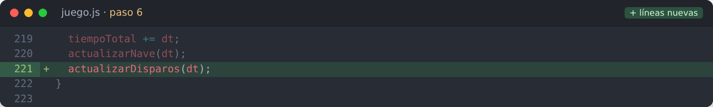</p>

<p align="center"><em>Figura 42. Paso 6: código nuevo en juego.js. Lo verde es lo que escribes; lo gris ya lo tenías.</em></p>

**Explicación línea por línea:**

- **Línea 221** · `actualizarDisparos(dt);`  
  → Mueve los disparos.

**Código para copiar** (o mejor, ¡escríbelo tú para aprender!):

```javascript
  actualizarDisparos(dt);
```

#### Cambio 6 de 6 · Añadir código en `juego.js`

📍 **Dónde:** justo **debajo** de la línea `dibujarFondo();` (en el archivo terminado de este paso es la línea 225). Las líneas nuevas son de la 226 a la 226.

<p align="center">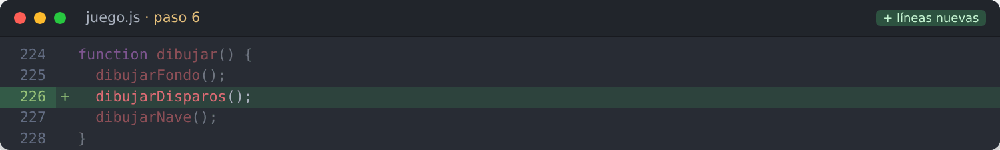</p>

<p align="center"><em>Figura 43. Paso 6: código nuevo en juego.js. Lo verde es lo que escribes; lo gris ya lo tenías.</em></p>

**Explicación línea por línea:**

- **Línea 226** · `dibujarDisparos();`  
  → Los disparos.

**Código para copiar** (o mejor, ¡escríbelo tú para aprender!):

```javascript
  dibujarDisparos();
```

### Resultado del paso 6

<p align="center">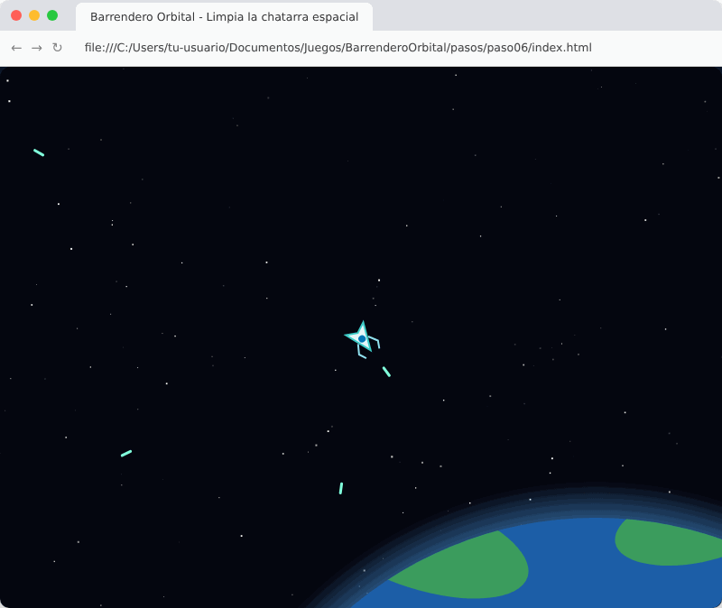</p>

<p align="center"><em>Figura 44. Disparando mientras la nave gira: los rayos salen en abanico.</em></p>

### Pruébalo tú

- Cambia `enfriamiento = 0.22` por `0.05`: ¡ametralladora láser!
- Cambia `vida: 0.9` por `vida: 0.3`: disparos de corto alcance.

# 10. Paso 7 · La chatarra espacial

**Objetivo:** crear piezas de chatarra con formas irregulares únicas, que flotan, giran y dan la vuelta a la pantalla.

**Qué aprenderás:** generar **formas aleatorias** con trigonometría, `do...while`, y dibujar polígonos a partir de una lista de puntos.

#### Cambio 1 de 7 · Añadir código en `juego.js`

📍 **Dónde:** justo **debajo** de la línea `const VELOCIDAD_DISPARO = 520;` (en el archivo terminado de este paso es la línea 16). Las líneas nuevas son de la 17 a la 18.

<p align="center">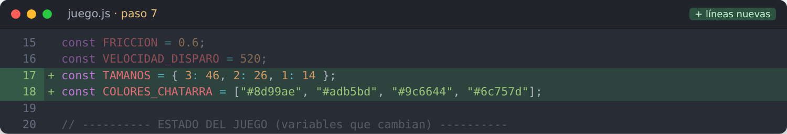</p>

<p align="center"><em>Figura 45. Paso 7: código nuevo en juego.js. Lo verde es lo que escribes; lo gris ya lo tenías.</em></p>

**Explicación línea por línea:**


> **Los tamaños de la chatarra.** Hay tres tamaños: 3 (grande), 2 (mediana) y 1 (pequeña). Este objeto dice el radio en píxeles de cada uno.

- **Línea 17** · `const TAMANOS = { 3: 46, 2: 26, 1: 14 };`  
  → Un objeto cuyos apartados se llaman 3, 2 y 1. TAMANOS[3] vale 46, TAMANOS[1] vale 14. (Escribimos TAMANOS sin ñ para evitar problemas.)
- **Línea 18** · `const COLORES_CHATARRA = ["#8d99ae", "#adb5bd", "#9c6644", "#6c757d"];`  
  → Lista de colores para la chatarra: grises metálicos y un marrón óxido. Cada pieza elegirá uno al azar.

**Código para copiar** (o mejor, ¡escríbelo tú para aprender!):

```javascript
const TAMANOS = { 3: 46, 2: 26, 1: 14 };
const COLORES_CHATARRA = ["#8d99ae", "#adb5bd", "#9c6644", "#6c757d"];
```

#### Cambio 2 de 7 · Añadir código en `juego.js`

📍 **Dónde:** justo **debajo** de la línea `let enfriamiento = 0;` (en el archivo terminado de este paso es la línea 46). Las líneas nuevas son de la 47 a la 48.

<p align="center">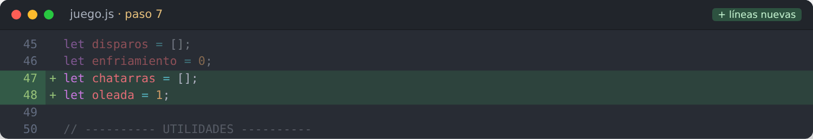</p>

<p align="center"><em>Figura 46. Paso 7: código nuevo en juego.js. Lo verde es lo que escribes; lo gris ya lo tenías.</em></p>

**Explicación línea por línea:**

- **Línea 47** · `let chatarras = [];`  
  → Lista de piezas de chatarra espacial.
- **Línea 48** · `let oleada = 1;`  
  → Número de oleada actual. Cuanto más alta, más chatarra y más rápida.

**Código para copiar** (o mejor, ¡escríbelo tú para aprender!):

```javascript
let chatarras = [];
let oleada = 1;
```

#### Cambio 3 de 7 · Añadir código en `juego.js`

📍 **Dónde:** justo **debajo** de la línea `}` que cierra el bloque `function envolver(obj) {` (en el archivo terminado de este paso es la línea 57). Las líneas nuevas son de la 59 a la 61.

<p align="center">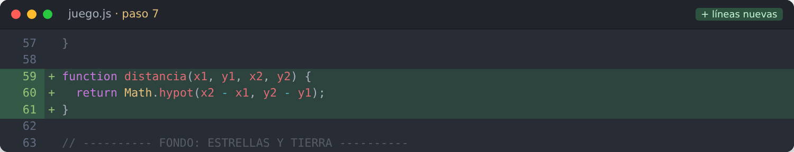</p>

<p align="center"><em>Figura 47. Paso 7: código nuevo en juego.js. Lo verde es lo que escribes; lo gris ya lo tenías.</em></p>

**Explicación línea por línea:**


> **Distancia entre dos puntos.** Usa el teorema de Pitágoras: la distancia es la hipotenusa de un triángulo cuyos lados son la diferencia en x y la diferencia en y. Math.hypot hace la cuenta por nosotros.

- **Línea 59** · `function distancia(x1, y1, x2, y2) {`  
  → Declara la función distancia: recibe las coordenadas de dos puntos.
- **Línea 60** · `return Math.hypot(x2 - x1, y2 - y1);`  
  → Devuelve la raíz cuadrada de (x2 - x1)² + (y2 - y1)².
- **Línea 61** · `}`  
  → Cierra la llave `{` que se abrió más arriba: aquí termina ese bloque.

**Código para copiar** (o mejor, ¡escríbelo tú para aprender!):

```javascript
function distancia(x1, y1, x2, y2) {
  return Math.hypot(x2 - x1, y2 - y1);
}
```

#### Cambio 4 de 7 · Añadir código en `juego.js`

📍 **Dónde:** justo **debajo** de la línea `}` que cierra el bloque `function dibujarDisparos() {` (en el archivo terminado de este paso es la línea 203). Las líneas nuevas son de la 205 a la 277.

##### Parte 1 de 2 (líneas 205 a 245)

<p align="center">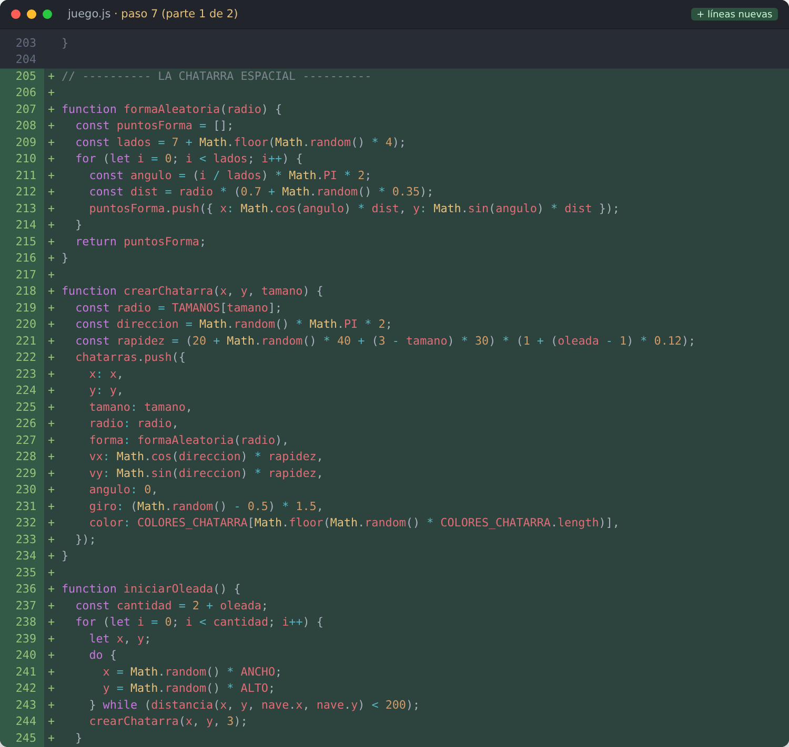</p>

<p align="center"><em>Figura 48. Paso 7: código nuevo en juego.js (parte 1 de 2). Lo verde es lo que escribes; lo gris ya lo tenías.</em></p>

**Explicación línea por línea:**

- **Línea 205** · `// ---------- LA CHATARRA ESPACIAL ----------`  
  → Comentario que sirve de título de sección: «LA CHATARRA ESPACIAL». El navegador lo ignora; nos ayuda a ordenar el código.

> **Una forma irregular.** La chatarra no es redonda: repartimos puntos alrededor de un círculo, cada uno a una distancia algo distinta del centro. Al unirlos sale una roca o pieza retorcida, ¡y cada una es diferente!

- **Línea 207** · `function formaAleatoria(radio) {`  
  → Declara la función formaAleatoria: recibe un radio y devuelve una lista de puntos.
- **Línea 208** · `const puntosForma = [];`  
  → Lista vacía de puntos.
- **Línea 209** · `const lados = 7 + Math.floor(Math.random() * 4);`  
  → Número de vértices: entre 7 y 10. Math.floor quita los decimales.
- **Línea 210** · `for (let i = 0; i < lados; i++) {`  
  → Una vuelta por vértice.
- **Línea 211** · `const angulo = (i / lados) * Math.PI * 2;`  
  → Ángulo de este vértice: repartimos la vuelta completa en partes iguales.
- **Línea 212** · `const dist = radio * (0.7 + Math.random() * 0.35);`  
  → Distancia al centro: entre el 70 % y el 105 % del radio (esto la hace irregular).
- **Línea 213** · `puntosForma.push({ x: Math.cos(angulo) * dist, y: Math.sin(angulo) * dist });`  
  → Con coseno y seno convertimos (ángulo, distancia) en un punto (x, y) y lo guardamos.
- **Línea 214** · `}`  
  → Cierra la llave `{` que se abrió más arriba: aquí termina ese bloque.
- **Línea 215** · `return puntosForma;`  
  → Devuelve la lista de puntos.
- **Línea 216** · `}`  
  → Cierra la llave `{` que se abrió más arriba: aquí termina ese bloque.

> **Crear una pieza de chatarra.** Recibe dónde aparece y su tamaño (3, 2 o 1), y le da una dirección y velocidad al azar.

- **Línea 218** · `function crearChatarra(x, y, tamano) {`  
  → Declara la función crearChatarra.
- **Línea 219** · `const radio = TAMANOS[tamano];`  
  → Busca el radio que corresponde a ese tamaño.
- **Línea 220** · `const direccion = Math.random() * Math.PI * 2;`  
  → Dirección al azar (cualquier ángulo).
- **Línea 221** · `const rapidez = (20 + Math.random() * 40 + (3 - tamano) * 30) * (1 + (oleada - 1) * 0.12);`  
  → Rapidez: más rápida cuanto más pequeña, y un 12 % más rápida en cada oleada.
- **Línea 222** · `chatarras.push({`  
  → Añade la pieza a la lista.
- **Línea 223** · `x: x,`  
  → Posición.
- **Línea 224** · `y: y,`  
  → Posición vertical.
- **Línea 225** · `tamano: tamano,`  
  → Tamaño (3, 2 o 1) y radio en píxeles.
- **Línea 226** · `radio: radio,`  
  → Radio en píxeles (el que buscamos en TAMANOS).
- **Línea 227** · `forma: formaAleatoria(radio),`  
  → Su forma irregular.
- **Línea 228** · `vx: Math.cos(direccion) * rapidez,`  
  → Velocidad en x e y, calculada con coseno y seno de la dirección.
- **Línea 229** · `vy: Math.sin(direccion) * rapidez,`  
  → Velocidad vertical: el seno de la dirección por la rapidez.
- **Línea 230** · `angulo: 0,`  
  → Ángulo de giro actual y velocidad de giro al azar (entre -0.75 y 0.75 radianes por segundo).
- **Línea 231** · `giro: (Math.random() - 0.5) * 1.5,`  
  → Velocidad de giro al azar (positiva = horario, negativa = antihorario).
- **Línea 232** · `color: COLORES_CHATARRA[Math.floor(Math.random() * COLORES_CHATARRA.length)],`  
  → Un color al azar de la lista COLORES_CHATARRA.
- **Línea 233** · `});`  
  → Cierra la llave de la función, el paréntesis de la llamada y termina la instrucción con `;`.
- **Línea 234** · `}`  
  → Cierra la llave `{` que se abrió más arriba: aquí termina ese bloque.

> **Empezar una oleada.** Crea varias piezas grandes, siempre lejos de la nave para no aparecer encima de ella.

- **Línea 236** · `function iniciarOleada() {`  
  → Declara la función iniciarOleada.
- **Línea 237** · `const cantidad = 2 + oleada;`  
  → En la oleada 1 hay 3 piezas grandes, en la 2 hay 4, etc.
- **Línea 238** · `for (let i = 0; i < cantidad; i++) {`  
  → Una vuelta por pieza.
- **Línea 239** · `let x, y;`  
  → Declaramos x e y sin valor todavía.
- **Línea 240** · `do {`  
  → do...while: "haz esto, y repítelo mientras se cumpla la condición". Elegimos una posición al azar…
- **Línea 241** · `x = Math.random() * ANCHO;`  
  → x al azar dentro del lienzo.
- **Línea 242** · `y = Math.random() * ALTO;`  
  → y al azar dentro del lienzo.
- **Línea 243** · `} while (distancia(x, y, nave.x, nave.y) < 200);`  
  → …y si está a menos de 200 píxeles de la nave, volvemos a elegir.
- **Línea 244** · `crearChatarra(x, y, 3);`  
  → Crea una pieza grande (tamaño 3) en esa posición.
- **Línea 245** · `}`  
  → Cierra la llave `{` que se abrió más arriba: aquí termina ese bloque.

**Código para copiar** (o mejor, ¡escríbelo tú para aprender!):

```javascript
// ---------- LA CHATARRA ESPACIAL ----------

function formaAleatoria(radio) {
  const puntosForma = [];
  const lados = 7 + Math.floor(Math.random() * 4);
  for (let i = 0; i < lados; i++) {
    const angulo = (i / lados) * Math.PI * 2;
    const dist = radio * (0.7 + Math.random() * 0.35);
    puntosForma.push({ x: Math.cos(angulo) * dist, y: Math.sin(angulo) * dist });
  }
  return puntosForma;
}

function crearChatarra(x, y, tamano) {
  const radio = TAMANOS[tamano];
  const direccion = Math.random() * Math.PI * 2;
  const rapidez = (20 + Math.random() * 40 + (3 - tamano) * 30) * (1 + (oleada - 1) * 0.12);
  chatarras.push({
    x: x,
    y: y,
    tamano: tamano,
    radio: radio,
    forma: formaAleatoria(radio),
    vx: Math.cos(direccion) * rapidez,
    vy: Math.sin(direccion) * rapidez,
    angulo: 0,
    giro: (Math.random() - 0.5) * 1.5,
    color: COLORES_CHATARRA[Math.floor(Math.random() * COLORES_CHATARRA.length)],
  });
}

function iniciarOleada() {
  const cantidad = 2 + oleada;
  for (let i = 0; i < cantidad; i++) {
    let x, y;
    do {
      x = Math.random() * ANCHO;
      y = Math.random() * ALTO;
    } while (distancia(x, y, nave.x, nave.y) < 200);
    crearChatarra(x, y, 3);
  }
```

##### Parte 2 de 2 (líneas 246 a 277)

<p align="center">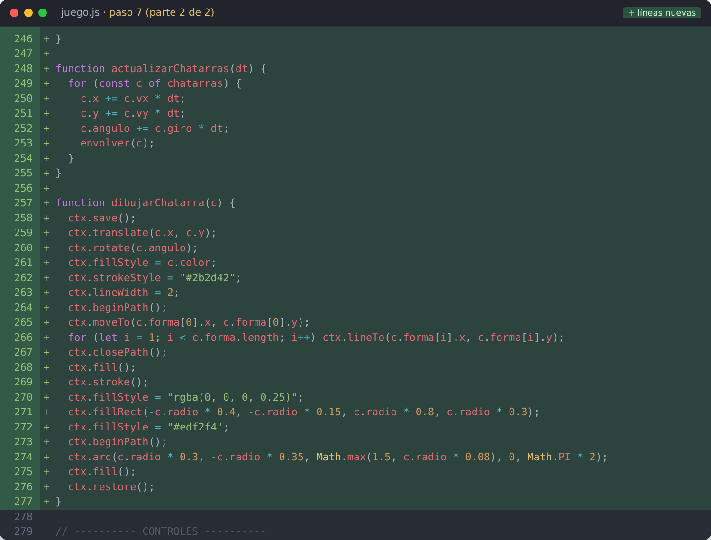</p>

<p align="center"><em>Figura 49. Paso 7: código nuevo en juego.js (parte 2 de 2). Lo verde es lo que escribes; lo gris ya lo tenías.</em></p>

**Explicación línea por línea:**

- **Línea 246** · `}`  
  → Cierra la llave `{` que se abrió más arriba: aquí termina ese bloque.
- **Línea 248** · `function actualizarChatarras(dt) {`  
  → Declara la función actualizarChatarras: mueve, gira y envuelve cada pieza.
- **Línea 249** · `for (const c of chatarras) {`  
  → Para cada pieza c…
- **Línea 250** · `c.x += c.vx * dt;`  
  → …avanza en x…
- **Línea 251** · `c.y += c.vy * dt;`  
  → …avanza en y…
- **Línea 252** · `c.angulo += c.giro * dt;`  
  → …gira…
- **Línea 253** · `envolver(c);`  
  → …y da la vuelta por los bordes.
- **Línea 254** · `}`  
  → Cierra la llave `{` que se abrió más arriba: aquí termina ese bloque.
- **Línea 255** · `}`  
  → Cierra la llave `{` que se abrió más arriba: aquí termina ese bloque.

> **Dibujar una pieza de chatarra.** Unimos sus puntos con líneas y añadimos una placa oscura y un tornillo para que parezca un trozo de satélite viejo.

- **Línea 257** · `function dibujarChatarra(c) {`  
  → Declara la función dibujarChatarra.
- **Línea 258** · `ctx.save();`  
  → Guarda el estado del pincel.
- **Línea 259** · `ctx.translate(c.x, c.y);`  
  → Lleva el origen al centro de la pieza.
- **Línea 260** · `ctx.rotate(c.angulo);`  
  → Gira el pincel.
- **Línea 261** · `ctx.fillStyle = c.color;`  
  → Color de la pieza.
- **Línea 262** · `ctx.strokeStyle = "#2b2d42";`  
  → Borde casi negro.
- **Línea 263** · `ctx.lineWidth = 2;`  
  → Grosor de las líneas: `2` píxeles.
- **Línea 264** · `ctx.beginPath();`  
  → Empieza un trazo nuevo, para que esta figura no se mezcle con la anterior.
- **Línea 265** · `ctx.moveTo(c.forma[0].x, c.forma[0].y);`  
  → Empieza en el primer punto de la forma (posición 0 de la lista).
- **Línea 266** · `for (let i = 1; i < c.forma.length; i++) ctx.lineTo(c.forma[i].x, c.forma[i].y);`  
  → Traza una línea a cada uno de los demás puntos (desde la posición 1 hasta el final).
- **Línea 267** · `ctx.closePath();`  
  → Cierra la figura volviendo al primer punto.
- **Línea 268** · `ctx.fill();`  
  → Rellena la figura que acabamos de trazar con el color de `fillStyle`.
- **Línea 269** · `ctx.stroke();`  
  → Dibuja el contorno (la línea) de la figura con el color de `strokeStyle`.
- **Línea 270** · `ctx.fillStyle = "rgba(0, 0, 0, 0.25)";`  
  → Negro semitransparente para la placa.
- **Línea 271** · `ctx.fillRect(-c.radio * 0.4, -c.radio * 0.15, c.radio * 0.8, c.radio * 0.3);`  
  → Una placa rectangular proporcional al tamaño de la pieza.
- **Línea 272** · `ctx.fillStyle = "#edf2f4";`  
  → Blanco grisáceo para el tornillo.
- **Línea 273** · `ctx.beginPath();`  
  → Empieza un trazo nuevo, para que esta figura no se mezcle con la anterior.
- **Línea 274** · `ctx.arc(c.radio * 0.3, -c.radio * 0.35, Math.max(1.5, c.radio * 0.08), 0, Math.PI * 2);`  
  → El tornillo: un circulito (como mínimo de 1.5 píxeles de radio).
- **Línea 275** · `ctx.fill();`  
  → Rellena la figura que acabamos de trazar con el color de `fillStyle`.
- **Línea 276** · `ctx.restore();`  
  → Recupera el estado del pincel.
- **Línea 277** · `}`  
  → Cierra la llave `{` que se abrió más arriba: aquí termina ese bloque.

**Código para copiar** (o mejor, ¡escríbelo tú para aprender!):

```javascript
}

function actualizarChatarras(dt) {
  for (const c of chatarras) {
    c.x += c.vx * dt;
    c.y += c.vy * dt;
    c.angulo += c.giro * dt;
    envolver(c);
  }
}

function dibujarChatarra(c) {
  ctx.save();
  ctx.translate(c.x, c.y);
  ctx.rotate(c.angulo);
  ctx.fillStyle = c.color;
  ctx.strokeStyle = "#2b2d42";
  ctx.lineWidth = 2;
  ctx.beginPath();
  ctx.moveTo(c.forma[0].x, c.forma[0].y);
  for (let i = 1; i < c.forma.length; i++) ctx.lineTo(c.forma[i].x, c.forma[i].y);
  ctx.closePath();
  ctx.fill();
  ctx.stroke();
  ctx.fillStyle = "rgba(0, 0, 0, 0.25)";
  ctx.fillRect(-c.radio * 0.4, -c.radio * 0.15, c.radio * 0.8, c.radio * 0.3);
  ctx.fillStyle = "#edf2f4";
  ctx.beginPath();
  ctx.arc(c.radio * 0.3, -c.radio * 0.35, Math.max(1.5, c.radio * 0.08), 0, Math.PI * 2);
  ctx.fill();
  ctx.restore();
}
```

#### Cambio 5 de 7 · Añadir código en `juego.js`

📍 **Dónde:** justo **debajo** de la línea `tiempoTotal += dt;` (en el archivo terminado de este paso es la línea 301). Las líneas nuevas son de la 302 a la 302.

<p align="center">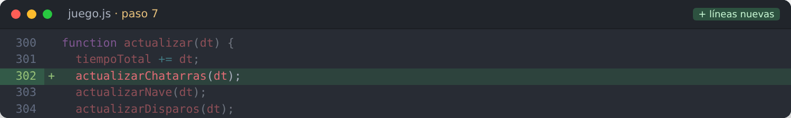</p>

<p align="center"><em>Figura 50. Paso 7: código nuevo en juego.js. Lo verde es lo que escribes; lo gris ya lo tenías.</em></p>

**Explicación línea por línea:**

- **Línea 302** · `actualizarChatarras(dt);`  
  → Mueve la chatarra (también en el menú, como decorado).

**Código para copiar** (o mejor, ¡escríbelo tú para aprender!):

```javascript
  actualizarChatarras(dt);
```

#### Cambio 6 de 7 · Añadir código en `juego.js`

📍 **Dónde:** justo **debajo** de la línea `dibujarFondo();` (en el archivo terminado de este paso es la línea 308). Las líneas nuevas son de la 309 a la 309.

<p align="center">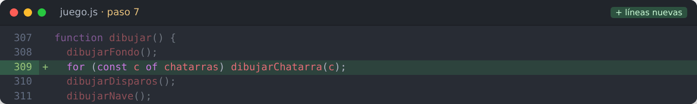</p>

<p align="center"><em>Figura 51. Paso 7: código nuevo en juego.js. Lo verde es lo que escribes; lo gris ya lo tenías.</em></p>

**Explicación línea por línea:**

- **Línea 309** · `for (const c of chatarras) dibujarChatarra(c);`  
  → La chatarra.

**Código para copiar** (o mejor, ¡escríbelo tú para aprender!):

```javascript
  for (const c of chatarras) dibujarChatarra(c);
```

#### Cambio 7 de 7 · Añadir código en `juego.js`

📍 **Dónde:** justo **debajo** de la línea `}` que cierra el bloque `function dibujar() {` (en el archivo terminado de este paso es la línea 312). Las líneas nuevas son de la 314 a la 314.

<p align="center">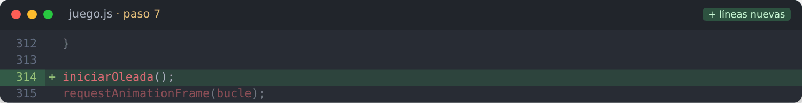</p>

<p align="center"><em>Figura 52. Paso 7: código nuevo en juego.js. Lo verde es lo que escribes; lo gris ya lo tenías.</em></p>

**Explicación línea por línea:**

- **Línea 314** · `iniciarOleada();`  
  → Creamos la primera oleada de chatarra.

**Código para copiar** (o mejor, ¡escríbelo tú para aprender!):

```javascript
iniciarOleada();
```

### Resultado del paso 7

<p align="center"></p>

<p align="center"><em>Figura 53. Resultado del paso 7: tres piezas grandes de chatarra, cada una con forma y color distintos.</em></p>

### Pruébalo tú

- En `formaAleatoria`, cambia `0.7 + Math.random() * 0.35` por `0.3 + Math.random() * 0.9`: ¡chatarra con pinchos!
- Cambia `const cantidad = 2 + oleada;` por `10 + oleada`.

# 11. Paso 8 · Romper la chatarra

**Objetivo:** detectar cuándo un disparo toca una pieza y partirla en dos más pequeñas, sumando puntos.

**Qué aprenderás:** **colisiones entre círculos**, bucles anidados recorridos al revés y la lógica de "dividir".

<p align="center"></p>

<p align="center"><em>Figura 54. La regla de oro de las colisiones circulares.</em></p>

<p align="center"></p>

<p align="center"><em>Figura 55. De una pieza grande a cuatro fragmentos.</em></p>

#### Cambio 1 de 6 · Añadir código en `juego.js`

📍 **Dónde:** justo **debajo** de la línea `const COLORES_CHATARRA = ["#8d99ae", "#adb5bd", "#9c6644", "#6c757d"];` (en el archivo terminado de este paso es la línea 18). Las líneas nuevas son de la 19 a la 19.

<p align="center"></p>

<p align="center"><em>Figura 56. Paso 8: código nuevo en juego.js. Lo verde es lo que escribes; lo gris ya lo tenías.</em></p>

**Explicación línea por línea:**

- **Línea 19** · `const PUNTOS_POR_TAMANO = { 3: 20, 2: 50, 1: 100 };`  
  → Puntos por romper cada tamaño. Los pequeños valen más porque son más difíciles de acertar.

**Código para copiar** (o mejor, ¡escríbelo tú para aprender!):

```javascript
const PUNTOS_POR_TAMANO = { 3: 20, 2: 50, 1: 100 };
```

#### Cambio 2 de 6 · Añadir código en `juego.js`

📍 **Dónde:** justo **debajo** de la línea `let oleada = 1;` (en el archivo terminado de este paso es la línea 49). Las líneas nuevas son de la 50 a la 50.

<p align="center"></p>

<p align="center"><em>Figura 57. Paso 8: código nuevo en juego.js. Lo verde es lo que escribes; lo gris ya lo tenías.</em></p>

**Explicación línea por línea:**

- **Línea 50** · `let puntos = 0;`  
  → Puntos del jugador.

**Código para copiar** (o mejor, ¡escríbelo tú para aprender!):

```javascript
let puntos = 0;
```

#### Cambio 3 de 6 · Añadir código en `juego.js`

📍 **Dónde:** justo **debajo** de la línea `}` que cierra el bloque `function distancia(x1, y1, x2, y2) {` (en el archivo terminado de este paso es la línea 63). Las líneas nuevas son de la 65 a la 79.

<p align="center"></p>

<p align="center"><em>Figura 58. Paso 8: código nuevo en juego.js. Lo verde es lo que escribes; lo gris ya lo tenías.</em></p>

**Explicación línea por línea:**


> **¿Chocan dos círculos?** Dos círculos se tocan si la distancia entre sus centros es menor que la suma de sus radios. ¡Así de fácil! Es la forma más usada en los videojuegos para detectar choques.

- **Línea 65** · `function chocan(a, b) {`  
  → Declara la función chocan: recibe dos objetos con x, y y radio. Devuelve true o false.
- **Línea 66** · `return distancia(a.x, a.y, b.x, b.y) < a.radio + b.radio;`  
  → Compara la distancia entre centros con la suma de los radios.
- **Línea 67** · `}`  
  → Cierra la llave `{` que se abrió más arriba: aquí termina ese bloque.

> **Escribir texto con borde.** Una función de ayuda para que los textos se lean bien sobre el espacio.

- **Línea 69** · `function escribir(texto, x, y, tamano, color, alineacion) {`  
  → Declara la función escribir: texto, posición, tamaño, color y alineación (opcional).
- **Línea 70** · `ctx.font = "bold " + tamano + "px Arial";`  
  → Letra en negrita del tamaño indicado.
- **Línea 71** · `ctx.textAlign = alineacion || "center";`  
  → Alineación horizontal: la que nos pasen o, si no pasan ninguna, "center".
- **Línea 72** · `ctx.textBaseline = "middle";`  
  → La y será el centro vertical del texto.
- **Línea 73** · `ctx.lineJoin = "round";`  
  → Esquinas del borde redondeadas.
- **Línea 74** · `ctx.lineWidth = Math.max(2, tamano / 6);`  
  → Grosor del borde proporcional al tamaño (mínimo 2).
- **Línea 75** · `ctx.strokeStyle = "rgba(0, 0, 0, 0.7)";`  
  → Borde negro semitransparente.
- **Línea 76** · `ctx.strokeText(texto, x, y);`  
  → Dibuja el borde del texto.
- **Línea 77** · `ctx.fillStyle = color;`  
  → Color del relleno.
- **Línea 78** · `ctx.fillText(texto, x, y);`  
  → Dibuja el relleno encima.
- **Línea 79** · `}`  
  → Cierra la llave `{` que se abrió más arriba: aquí termina ese bloque.

**Código para copiar** (o mejor, ¡escríbelo tú para aprender!):

```javascript
function chocan(a, b) {
  return distancia(a.x, a.y, b.x, b.y) < a.radio + b.radio;
}

function escribir(texto, x, y, tamano, color, alineacion) {
  ctx.font = "bold " + tamano + "px Arial";
  ctx.textAlign = alineacion || "center";
  ctx.textBaseline = "middle";
  ctx.lineJoin = "round";
  ctx.lineWidth = Math.max(2, tamano / 6);
  ctx.strokeStyle = "rgba(0, 0, 0, 0.7)";
  ctx.strokeText(texto, x, y);
  ctx.fillStyle = color;
  ctx.fillText(texto, x, y);
}
```

#### Cambio 4 de 6 · Añadir código en `juego.js`

📍 **Dónde:** justo **debajo** de la línea `}` que cierra el bloque `function dibujarChatarra(c) {` (en el archivo terminado de este paso es la línea 295). Las líneas nuevas son de la 297 a la 321.

<p align="center"></p>

<p align="center"><em>Figura 59. Paso 8: código nuevo en juego.js. Lo verde es lo que escribes; lo gris ya lo tenías.</em></p>

**Explicación línea por línea:**

- **Línea 297** · `// ---------- DISPAROS CONTRA LA CHATARRA ----------`  
  → Comentario que sirve de título de sección: «DISPAROS CONTRA LA CHATARRA». El navegador lo ignora; nos ayuda a ordenar el código.

> **Comprobar los impactos.** Para cada disparo, miramos si toca alguna pieza de chatarra. Recorremos las listas AL REVÉS porque vamos a borrar elementos mientras las recorremos.

- **Línea 299** · `function comprobarDisparos() {`  
  → Declara la función comprobarDisparos.
- **Línea 300** · `for (let i = disparos.length - 1; i >= 0; i--) {`  
  → Bucle por los disparos, del último al primero.
- **Línea 301** · `const d = disparos[i];`  
  → El disparo de esta vuelta.
- **Línea 302** · `let impacto = false;`  
  → ¿Ha chocado ya con algo? Empezamos suponiendo que no.
- **Línea 303** · `for (let j = chatarras.length - 1; j >= 0 && !impacto; j--) {`  
  → Bucle por la chatarra, del último al primero, mientras no haya habido impacto (!impacto = "no impacto").
- **Línea 304** · `if (chocan(d, chatarras[j])) {`  
  → Si el disparo y la pieza chocan…
- **Línea 305** · `romperChatarra(j);`  
  → …rompemos la pieza…
- **Línea 306** · `impacto = true;`  
  → …y apuntamos que hubo impacto.
- **Línea 307** · `}`  
  → Cierra la llave `{` que se abrió más arriba: aquí termina ese bloque.
- **Línea 308** · `}`  
  → Cierra la llave `{` que se abrió más arriba: aquí termina ese bloque.
- **Línea 309** · `if (impacto) disparos.splice(i, 1);`  
  → Si el disparo chocó con algo, desaparece (splice borra 1 elemento en la posición i).
- **Línea 310** · `}`  
  → Cierra la llave `{` que se abrió más arriba: aquí termina ese bloque.
- **Línea 311** · `}`  
  → Cierra la llave `{` que se abrió más arriba: aquí termina ese bloque.

> **Romper una pieza.** Como en los juegos clásicos de asteroides: una grande se parte en dos medianas, una mediana en dos pequeñas y una pequeña se convierte en un fragmento reciclable.

- **Línea 313** · `function romperChatarra(indice) {`  
  → Declara la función romperChatarra: recibe la posición de la pieza en la lista.
- **Línea 314** · `const c = chatarras[indice];`  
  → Guardamos la pieza para usar sus datos.
- **Línea 315** · `chatarras.splice(indice, 1);`  
  → La quitamos de la lista.
- **Línea 316** · `puntos += PUNTOS_POR_TAMANO[c.tamano];`  
  → Sumamos los puntos que vale su tamaño.
- **Línea 317** · `if (c.tamano > 1) {`  
  → Si no era de las pequeñas (tamaño mayor que 1)…
- **Línea 318** · `crearChatarra(c.x, c.y, c.tamano - 1);`  
  → …creamos dos piezas del tamaño inferior en el mismo sitio (saldrán en direcciones al azar).
- **Línea 319** · `crearChatarra(c.x, c.y, c.tamano - 1);`  
  → Segunda pieza del tamaño inferior.
- **Línea 320** · `}`  
  → Cierra la llave `{` que se abrió más arriba: aquí termina ese bloque.
- **Línea 321** · `}`  
  → Cierra la llave `{` que se abrió más arriba: aquí termina ese bloque.

**Código para copiar** (o mejor, ¡escríbelo tú para aprender!):

```javascript
// ---------- DISPAROS CONTRA LA CHATARRA ----------

function comprobarDisparos() {
  for (let i = disparos.length - 1; i >= 0; i--) {
    const d = disparos[i];
    let impacto = false;
    for (let j = chatarras.length - 1; j >= 0 && !impacto; j--) {
      if (chocan(d, chatarras[j])) {
        romperChatarra(j);
        impacto = true;
      }
    }
    if (impacto) disparos.splice(i, 1);
  }
}

function romperChatarra(indice) {
  const c = chatarras[indice];
  chatarras.splice(indice, 1);
  puntos += PUNTOS_POR_TAMANO[c.tamano];
  if (c.tamano > 1) {
    crearChatarra(c.x, c.y, c.tamano - 1);
    crearChatarra(c.x, c.y, c.tamano - 1);
  }
}
```

#### Cambio 5 de 6 · Añadir código en `juego.js`

📍 **Dónde:** justo **debajo** de la línea `actualizarDisparos(dt);` (en el archivo terminado de este paso es la línea 348). Las líneas nuevas son de la 349 a la 349.

<p align="center"></p>

<p align="center"><em>Figura 60. Paso 8: código nuevo en juego.js. Lo verde es lo que escribes; lo gris ya lo tenías.</em></p>

**Explicación línea por línea:**

- **Línea 349** · `comprobarDisparos();`  
  → ¿Algún disparo dio en el blanco?

**Código para copiar** (o mejor, ¡escríbelo tú para aprender!):

```javascript
  comprobarDisparos();
```

#### Cambio 6 de 6 · Añadir código en `juego.js`

📍 **Dónde:** justo **debajo** de la línea `dibujarNave();` (en el archivo terminado de este paso es la línea 356). Las líneas nuevas son de la 357 a la 357.

<p align="center"></p>

<p align="center"><em>Figura 61. Paso 8: código nuevo en juego.js. Lo verde es lo que escribes; lo gris ya lo tenías.</em></p>

**Explicación línea por línea:**

- **Línea 357** · `escribir("Puntos: " + puntos, 20, 28, 22, "white", "left");`  
  → Marcador PROVISIONAL (en el paso 12 lo cambiaremos por uno completo).

**Código para copiar** (o mejor, ¡escríbelo tú para aprender!):

```javascript
  escribir("Puntos: " + puntos, 20, 28, 22, "white", "left");
```

### Resultado del paso 8

<p align="center"></p>

<p align="center"><em>Figura 62. El láser va hacia una pieza grande…</em></p>

<p align="center"></p>

<p align="center"><em>Figura 63. …¡impacto! Se ha partido en dos piezas medianas que salen en direcciones distintas.</em></p>

<p align="center"></p>

<p align="center"><em>Figura 64. Disparando sin parar: las medianas se rompen en pequeñas. El marcador provisional suma los puntos.</em></p>

# 12. Paso 9 · Fragmentos reciclables

**Objetivo:** que la chatarra más pequeña deje un fragmento verde que se recoge pasando cerca con la nave (las pinzas lo atraen como un imán), sumando kilos reciclados. También añadimos los textos flotantes.

**Qué aprenderás:** la "atracción" con vectores de dirección, objetos con tiempo de vida y parpadeo.

#### Cambio 1 de 8 · Añadir código en `juego.js`

📍 **Dónde:** justo **debajo** de la línea `let puntos = 0;` (en el archivo terminado de este paso es la línea 50). Las líneas nuevas son de la 51 a la 53.

<p align="center"></p>

<p align="center"><em>Figura 65. Paso 9: código nuevo en juego.js. Lo verde es lo que escribes; lo gris ya lo tenías.</em></p>

**Explicación línea por línea:**

- **Línea 51** · `let fragmentos = [];`  
  → Lista de fragmentos reciclables (las bolitas verdes) que hay que recoger.
- **Línea 52** · `let kilosRecogidos = 0;`  
  → Kilos de chatarra recogidos para reciclar.
- **Línea 53** · `let textosFlotantes = [];`  
  → Lista de textos flotantes ("+15 kg").

**Código para copiar** (o mejor, ¡escríbelo tú para aprender!):

```javascript
let fragmentos = [];
let kilosRecogidos = 0;
let textosFlotantes = [];
```

#### Cambio 2 de 8 · Añadir código en `juego.js`

📍 **Dónde:** justo **debajo** de la línea `}` que cierra el bloque `if (c.tamano > 1) {` (en el archivo terminado de este paso es la línea 323). Las líneas nuevas son de la 324 a la 324.

<p align="center"></p>

<p align="center"><em>Figura 66. Paso 9: código nuevo en juego.js. Lo verde es lo que escribes; lo gris ya lo tenías.</em></p>

**Explicación línea por línea:**

- **Línea 324** · `if (c.tamano === 1) crearFragmento(c.x, c.y);`  
  → Si era pequeña, deja un fragmento reciclable.

**Código para copiar** (o mejor, ¡escríbelo tú para aprender!):

```javascript
  if (c.tamano === 1) crearFragmento(c.x, c.y);
```

#### Cambio 3 de 8 · Añadir código en `juego.js`

📍 **Dónde:** justo **debajo** de la línea `}` que cierra el bloque `function romperChatarra(indice) {` (en el archivo terminado de este paso es la línea 325). Las líneas nuevas son de la 327 a la 403.

##### Parte 1 de 3 (líneas 327 a 359)

<p align="center"></p>

<p align="center"><em>Figura 67. Paso 9: código nuevo en juego.js (parte 1 de 3). Lo verde es lo que escribes; lo gris ya lo tenías.</em></p>

**Explicación línea por línea:**

- **Línea 327** · `// ---------- FRAGMENTOS RECICLABLES ----------`  
  → Comentario que sirve de título de sección: «FRAGMENTOS RECICLABLES». El navegador lo ignora; nos ayuda a ordenar el código.

> **Fragmentos reciclables.** Al romper la chatarra más pequeña queda un fragmento verde. Hay que recogerlo con la nave antes de 8 segundos. Las pinzas de la nave lo atraen cuando pasas cerca, como un imán.

- **Línea 329** · `function crearFragmento(x, y) {`  
  → Declara la función crearFragmento: recibe la posición.
- **Línea 330** · `fragmentos.push({ x: x, y: y, vx: (Math.random() - 0.5) * 30, vy: (Math.random() - 0.5)...`  
  → Añade un fragmento a la lista con velocidad lenta al azar (entre -15 y 15), radio 8 y 8 segundos de vida.
- **Línea 331** · `}`  
  → Cierra la llave `{` que se abrió más arriba: aquí termina ese bloque.
- **Línea 333** · `function actualizarFragmentos(dt) {`  
  → Declara la función actualizarFragmentos.
- **Línea 334** · `for (let i = fragmentos.length - 1; i >= 0; i--) {`  
  → Recorremos al revés porque podemos borrar fragmentos.
- **Línea 335** · `const f = fragmentos[i];`  
  → El fragmento de esta vuelta.
- **Línea 336** · `const d = distancia(f.x, f.y, nave.x, nave.y);`  
  → Distancia del fragmento a la nave.
- **Línea 337** · `if (d < 110 && d > 0) {`  
  → Si está a menos de 110 píxeles (y no justo encima)…
- **Línea 338** · `f.vx += ((nave.x - f.x) / d) * 400 * dt;`  
  → …lo empujamos hacia la nave: (nave.x - f.x) / d es la dirección hacia la nave en x, de tamaño 1.
- **Línea 339** · `f.vy += ((nave.y - f.y) / d) * 400 * dt;`  
  → …lo mismo en y.
- **Línea 340** · `}`  
  → Cierra la llave `{` que se abrió más arriba: aquí termina ese bloque.
- **Línea 341** · `f.x += f.vx * dt;`  
  → Mueve el fragmento.
- **Línea 342** · `f.y += f.vy * dt;`  
  → Lo mismo en vertical.
- **Línea 343** · `f.vida -= dt;`  
  → Le resta vida.
- **Línea 344** · `envolver(f);`  
  → Da la vuelta por los bordes.
- **Línea 345** · `if (chocan(f, nave)) {`  
  → Si toca la nave…
- **Línea 346** · `fragmentos.splice(i, 1);`  
  → …lo quitamos de la lista…
- **Línea 347** · `recoger(f);`  
  → …y lo recogemos.
- **Línea 348** · `} else if (f.vida <= 0) {`  
  → Si no, pero se le acabó la vida…
- **Línea 349** · `fragmentos.splice(i, 1);`  
  → …desaparece (perdimos la oportunidad de reciclarlo).
- **Línea 350** · `}`  
  → Cierra la llave `{` que se abrió más arriba: aquí termina ese bloque.
- **Línea 351** · `}`  
  → Cierra la llave `{` que se abrió más arriba: aquí termina ese bloque.
- **Línea 352** · `}`  
  → Cierra la llave `{` que se abrió más arriba: aquí termina ese bloque.
- **Línea 354** · `function recoger(f) {`  
  → Declara la función recoger: suma kilos y puntos.
- **Línea 355** · `const kilos = 5 + Math.floor(Math.random() * 6);`  
  → Cada fragmento pesa entre 5 y 10 kilos (al azar).
- **Línea 356** · `kilosRecogidos += kilos;`  
  → Sumamos los kilos al total reciclado.
- **Línea 357** · `puntos += 30;`  
  → Y 30 puntos.
- **Línea 358** · `crearTextoFlotante("+" + kilos + " kg reciclados", f.x, f.y - 18, "#57ff9a");`  
  → Texto flotante verde con los kilos.
- **Línea 359** · `}`  
  → Cierra la llave `{` que se abrió más arriba: aquí termina ese bloque.

**Código para copiar** (o mejor, ¡escríbelo tú para aprender!):

```javascript
// ---------- FRAGMENTOS RECICLABLES ----------

function crearFragmento(x, y) {
  fragmentos.push({ x: x, y: y, vx: (Math.random() - 0.5) * 30, vy: (Math.random() - 0.5) * 30, radio: 8, vida: 8 });
}

function actualizarFragmentos(dt) {
  for (let i = fragmentos.length - 1; i >= 0; i--) {
    const f = fragmentos[i];
    const d = distancia(f.x, f.y, nave.x, nave.y);
    if (d < 110 && d > 0) {
      f.vx += ((nave.x - f.x) / d) * 400 * dt;
      f.vy += ((nave.y - f.y) / d) * 400 * dt;
    }
    f.x += f.vx * dt;
    f.y += f.vy * dt;
    f.vida -= dt;
    envolver(f);
    if (chocan(f, nave)) {
      fragmentos.splice(i, 1);
      recoger(f);
    } else if (f.vida <= 0) {
      fragmentos.splice(i, 1);
    }
  }
}

function recoger(f) {
  const kilos = 5 + Math.floor(Math.random() * 6);
  kilosRecogidos += kilos;
  puntos += 30;
  crearTextoFlotante("+" + kilos + " kg reciclados", f.x, f.y - 18, "#57ff9a");
}
```

##### Parte 2 de 3 (líneas 361 a 401)

<p align="center"></p>

<p align="center"><em>Figura 68. Paso 9: código nuevo en juego.js (parte 2 de 3). Lo verde es lo que escribes; lo gris ya lo tenías.</em></p>

**Explicación línea por línea:**


> **Dibujar un fragmento.** Un círculo verde con un halo que late (con el seno del tiempo) y una cruz oscura en el centro.

- **Línea 361** · `function dibujarFragmento(f) {`  
  → Declara la función dibujarFragmento (uno solo).
- **Línea 362** · `const pulso = 1 + Math.sin(tiempoTotal * 6 + f.x) * 0.15;`  
  → Tamaño del halo: late entre el 85 % y el 115 %. Usamos f.x en el seno para que no latan todos a la vez.
- **Línea 363** · `ctx.fillStyle = "rgba(87, 255, 154, 0.25)";`  
  → Verde transparente para el halo.
- **Línea 364** · `ctx.beginPath();`  
  → Empieza un trazo nuevo, para que esta figura no se mezcle con la anterior.
- **Línea 365** · `ctx.arc(f.x, f.y, f.radio * 1.8 * pulso, 0, Math.PI * 2);`  
  → El halo.
- **Línea 366** · `ctx.fill();`  
  → Rellena la figura que acabamos de trazar con el color de `fillStyle`.
- **Línea 367** · `ctx.fillStyle = "#57ff9a";`  
  → Verde intenso para el núcleo.
- **Línea 368** · `ctx.beginPath();`  
  → Empieza un trazo nuevo, para que esta figura no se mezcle con la anterior.
- **Línea 369** · `ctx.arc(f.x, f.y, f.radio * 0.7, 0, Math.PI * 2);`  
  → El núcleo.
- **Línea 370** · `ctx.fill();`  
  → Rellena la figura que acabamos de trazar con el color de `fillStyle`.
- **Línea 371** · `ctx.fillStyle = "#0b3d2e";`  
  → Verde muy oscuro para la cruz.
- **Línea 372** · `ctx.fillRect(f.x - 1.5, f.y - 4, 3, 8);`  
  → Barra vertical de la cruz.
- **Línea 373** · `ctx.fillRect(f.x - 4, f.y - 1.5, 8, 3);`  
  → Barra horizontal de la cruz.
- **Línea 374** · `}`  
  → Cierra la llave `{` que se abrió más arriba: aquí termina ese bloque.
- **Línea 376** · `function dibujarFragmentos() {`  
  → Declara la función dibujarFragmentos (todos).
- **Línea 377** · `for (const f of fragmentos) {`  
  → Para cada fragmento…
- **Línea 378** · `if (f.vida < 2 && Math.floor(f.vida * 8) % 2 === 0) continue;`  
  → …si le quedan menos de 2 segundos, parpadea: en la mitad de los octavos de segundo nos lo saltamos (continue).
- **Línea 379** · `dibujarFragmento(f);`  
  → …lo dibujamos.
- **Línea 380** · `}`  
  → Cierra la llave `{` que se abrió más arriba: aquí termina ese bloque.
- **Línea 381** · `}`  
  → Cierra la llave `{` que se abrió más arriba: aquí termina ese bloque.
- **Línea 383** · `// ---------- TEXTOS FLOTANTES ----------`  
  → Comentario que sirve de título de sección: «TEXTOS FLOTANTES». El navegador lo ignora; nos ayuda a ordenar el código.
- **Línea 385** · `function crearTextoFlotante(texto, x, y, color) {`  
  → Declara la función crearTextoFlotante. Limitamos la x para que los textos largos no se corten en los bordes.
- **Línea 386** · `textosFlotantes.push({ texto: texto, x: Math.min(Math.max(x, 230), ANCHO - 230), y: y, ...`  
  → Añade el texto con 1.3 segundos de vida.
- **Línea 387** · `}`  
  → Cierra la llave `{` que se abrió más arriba: aquí termina ese bloque.
- **Línea 389** · `function actualizarTextos(dt) {`  
  → Declara la función actualizarTextos.
- **Línea 390** · `for (const t of textosFlotantes) {`  
  → Para cada texto…
- **Línea 391** · `t.y -= 40 * dt;`  
  → …sube 40 píxeles por segundo…
- **Línea 392** · `t.vida -= dt;`  
  → …y pierde vida.
- **Línea 393** · `}`  
  → Cierra la llave `{` que se abrió más arriba: aquí termina ese bloque.
- **Línea 394** · `textosFlotantes = textosFlotantes.filter(function (t) { return t.vida > 0; });`  
  → Quitamos los que ya no tienen vida.
- **Línea 395** · `}`  
  → Cierra la llave `{` que se abrió más arriba: aquí termina ese bloque.
- **Línea 397** · `function dibujarTextos() {`  
  → Declara la función dibujarTextos.
- **Línea 398** · `for (const t of textosFlotantes) {`  
  → Para cada texto…
- **Línea 399** · `ctx.globalAlpha = Math.min(1, t.vida);`  
  → …se desvanece en su último segundo…
- **Línea 400** · `escribir(t.texto, t.x, t.y, 18, t.color);`  
  → …y lo escribimos.
- **Línea 401** · `}`  
  → Cierra la llave `{` que se abrió más arriba: aquí termina ese bloque.

**Código para copiar** (o mejor, ¡escríbelo tú para aprender!):

```javascript
function dibujarFragmento(f) {
  const pulso = 1 + Math.sin(tiempoTotal * 6 + f.x) * 0.15;
  ctx.fillStyle = "rgba(87, 255, 154, 0.25)";
  ctx.beginPath();
  ctx.arc(f.x, f.y, f.radio * 1.8 * pulso, 0, Math.PI * 2);
  ctx.fill();
  ctx.fillStyle = "#57ff9a";
  ctx.beginPath();
  ctx.arc(f.x, f.y, f.radio * 0.7, 0, Math.PI * 2);
  ctx.fill();
  ctx.fillStyle = "#0b3d2e";
  ctx.fillRect(f.x - 1.5, f.y - 4, 3, 8);
  ctx.fillRect(f.x - 4, f.y - 1.5, 8, 3);
}

function dibujarFragmentos() {
  for (const f of fragmentos) {
    if (f.vida < 2 && Math.floor(f.vida * 8) % 2 === 0) continue;
    dibujarFragmento(f);
  }
}

// ---------- TEXTOS FLOTANTES ----------

function crearTextoFlotante(texto, x, y, color) {
  textosFlotantes.push({ texto: texto, x: Math.min(Math.max(x, 230), ANCHO - 230), y: y, color: color, vida: 1.3 });
}

function actualizarTextos(dt) {
  for (const t of textosFlotantes) {
    t.y -= 40 * dt;
    t.vida -= dt;
  }
  textosFlotantes = textosFlotantes.filter(function (t) { return t.vida > 0; });
}

function dibujarTextos() {
  for (const t of textosFlotantes) {
    ctx.globalAlpha = Math.min(1, t.vida);
    escribir(t.texto, t.x, t.y, 18, t.color);
  }
```

##### Parte 3 de 3 (líneas 402 a 403)

<p align="center"></p>

<p align="center"><em>Figura 69. Paso 9: código nuevo en juego.js (parte 3 de 3). Lo verde es lo que escribes; lo gris ya lo tenías.</em></p>

**Explicación línea por línea:**

- **Línea 402** · `ctx.globalAlpha = 1;`  
  → Opacidad normal.
- **Línea 403** · `}`  
  → Cierra la llave `{` que se abrió más arriba: aquí termina ese bloque.

**Código para copiar** (o mejor, ¡escríbelo tú para aprender!):

```javascript
  ctx.globalAlpha = 1;
}
```

#### Cambio 4 de 8 · Añadir código en `juego.js`

📍 **Dónde:** justo **debajo** de la línea `tiempoTotal += dt;` (en el archivo terminado de este paso es la línea 427). Las líneas nuevas son de la 428 a la 428.

<p align="center"></p>

<p align="center"><em>Figura 70. Paso 9: código nuevo en juego.js. Lo verde es lo que escribes; lo gris ya lo tenías.</em></p>

**Explicación línea por línea:**

- **Línea 428** · `actualizarTextos(dt);`  
  → Mueve los textos flotantes.

**Código para copiar** (o mejor, ¡escríbelo tú para aprender!):

```javascript
  actualizarTextos(dt);
```

#### Cambio 5 de 8 · Añadir código en `juego.js`

📍 **Dónde:** justo **debajo** de la línea `actualizarDisparos(dt);` (en el archivo terminado de este paso es la línea 431). Las líneas nuevas son de la 432 a la 432.

<p align="center"></p>

<p align="center"><em>Figura 71. Paso 9: código nuevo en juego.js. Lo verde es lo que escribes; lo gris ya lo tenías.</em></p>

**Explicación línea por línea:**

- **Línea 432** · `actualizarFragmentos(dt);`  
  → Mueve y recoge fragmentos.

**Código para copiar** (o mejor, ¡escríbelo tú para aprender!):

```javascript
  actualizarFragmentos(dt);
```

#### Cambio 6 de 8 · Añadir código en `juego.js`

📍 **Dónde:** justo **debajo** de la línea `dibujarFondo();` (en el archivo terminado de este paso es la línea 437). Las líneas nuevas son de la 438 a la 438.

<p align="center"></p>

<p align="center"><em>Figura 72. Paso 9: código nuevo en juego.js. Lo verde es lo que escribes; lo gris ya lo tenías.</em></p>

**Explicación línea por línea:**

- **Línea 438** · `dibujarFragmentos();`  
  → Los fragmentos reciclables.

**Código para copiar** (o mejor, ¡escríbelo tú para aprender!):

```javascript
  dibujarFragmentos();
```

#### Cambio 7 de 8 · Añadir código en `juego.js`

📍 **Dónde:** justo **debajo** de la línea `dibujarNave();` (en el archivo terminado de este paso es la línea 441). Las líneas nuevas son de la 442 a la 442.

<p align="center"></p>

<p align="center"><em>Figura 73. Paso 9: código nuevo en juego.js. Lo verde es lo que escribes; lo gris ya lo tenías.</em></p>

**Explicación línea por línea:**

- **Línea 442** · `dibujarTextos();`  
  → Los textos flotantes.

**Código para copiar** (o mejor, ¡escríbelo tú para aprender!):

```javascript
  dibujarTextos();
```

#### Cambio 8 de 8 · Añadir código en `juego.js`

📍 **Dónde:** justo **debajo** de la línea `escribir("Puntos: " + puntos, 20, 28, 22, "white", "left");` (en el archivo terminado de este paso es la línea 443). Las líneas nuevas son de la 444 a la 444.

<p align="center"></p>

<p align="center"><em>Figura 74. Paso 9: código nuevo en juego.js. Lo verde es lo que escribes; lo gris ya lo tenías.</em></p>

**Explicación línea por línea:**

- **Línea 444** · `escribir("Reciclado: " + kilosRecogidos + " kg", 20, 56, 16, "#57ff9a", "left");`  
  → Provisional: kilos reciclados.

**Código para copiar** (o mejor, ¡escríbelo tú para aprender!):

```javascript
  escribir("Reciclado: " + kilosRecogidos + " kg", 20, 56, 16, "#57ff9a", "left");
```

### Resultado del paso 9

<p align="center"></p>

<p align="center"><em>Figura 75. Fragmentos verdes flotando: hay que recogerlos antes de 8 segundos (en los 2 últimos parpadean).</em></p>

<p align="center"></p>

<p align="center"><em>Figura 76. La nave atrae un fragmento cercano y lo recoge: "+N kg reciclados".</em></p>

### Pruébalo tú

- Cambia `d < 110` por `d < 300`: ¡imán superpotente!
- Cambia `vida: 8` por `vida: 3` para hacerlo más difícil.

# 13. Paso 10 · Choques y vidas

**Objetivo:** que la chatarra pueda golpear la nave: se pierde una vida y la nave reaparece en el centro, parpadeando e invulnerable durante 3 segundos.

**Qué aprenderás:** temporizadores de invulnerabilidad y parpadeo con `Math.floor` y `%`.

#### Cambio 1 de 7 · Añadir código en `juego.js`

📍 **Dónde:** justo **debajo** de la línea `propulsando: false,` (en el archivo terminado de este paso es la línea 43). Las líneas nuevas son de la 44 a la 44.

<p align="center"></p>

<p align="center"><em>Figura 77. Paso 10: código nuevo en juego.js. Lo verde es lo que escribes; lo gris ya lo tenías.</em></p>

**Explicación línea por línea:**

- **Línea 44** · `invulnerable: 0,`  
  → Segundos que le quedan de invulnerabilidad (tras perder una vida). 0 = normal.

**Código para copiar** (o mejor, ¡escríbelo tú para aprender!):

```javascript
  invulnerable: 0,
```

#### Cambio 2 de 7 · Añadir código en `juego.js`

📍 **Dónde:** justo **debajo** de la línea `let textosFlotantes = [];` (en el archivo terminado de este paso es la línea 54). Las líneas nuevas son de la 55 a la 55.

<p align="center"></p>

<p align="center"><em>Figura 78. Paso 10: código nuevo en juego.js. Lo verde es lo que escribes; lo gris ya lo tenías.</em></p>

**Explicación línea por línea:**

- **Línea 55** · `let vidas = 3;`  
  → Vidas que quedan.

**Código para copiar** (o mejor, ¡escríbelo tú para aprender!):

```javascript
let vidas = 3;
```

#### Cambio 3 de 7 · Añadir código en `juego.js`

📍 **Dónde:** justo **debajo** de la línea `function dibujarNave() {` (en el archivo terminado de este paso es la línea 131). Las líneas nuevas son de la 132 a la 132.

<p align="center"></p>

<p align="center"><em>Figura 79. Paso 10: código nuevo en juego.js. Lo verde es lo que escribes; lo gris ya lo tenías.</em></p>

**Explicación línea por línea:**

- **Línea 132** · `if (nave.invulnerable > 0 && Math.floor(nave.invulnerable * 10) % 2 === 0) return;`  
  → Si es invulnerable, parpadea: en la mitad de las décimas de segundo no la dibujamos (return sale de la función).

**Código para copiar** (o mejor, ¡escríbelo tú para aprender!):

```javascript
  if (nave.invulnerable > 0 && Math.floor(nave.invulnerable * 10) % 2 === 0) return;
```

#### Cambio 4 de 7 · Añadir código en `juego.js`

📍 **Dónde:** justo **debajo** de la línea `if (teclas["Space"] && enfriamiento <= 0) disparar();` (en el archivo terminado de este paso es la línea 189). Las líneas nuevas son de la 190 a la 190.

<p align="center"></p>

<p align="center"><em>Figura 80. Paso 10: código nuevo en juego.js. Lo verde es lo que escribes; lo gris ya lo tenías.</em></p>

**Explicación línea por línea:**

- **Línea 190** · `if (nave.invulnerable > 0) nave.invulnerable -= dt;`  
  → Descuenta el tiempo de invulnerabilidad.

**Código para copiar** (o mejor, ¡escríbelo tú para aprender!):

```javascript
  if (nave.invulnerable > 0) nave.invulnerable -= dt;
```

#### Cambio 5 de 7 · Añadir código en `juego.js`

📍 **Dónde:** justo **debajo** de la línea `}` que cierra el bloque `function dibujarTextos() {` (en el archivo terminado de este paso es la línea 407). Las líneas nuevas son de la 409 a la 429.

<p align="center"></p>

<p align="center"><em>Figura 81. Paso 10: código nuevo en juego.js. Lo verde es lo que escribes; lo gris ya lo tenías.</em></p>

**Explicación línea por línea:**

- **Línea 409** · `// ---------- CHOQUES DE LA NAVE ----------`  
  → Comentario que sirve de título de sección: «CHOQUES DE LA NAVE». El navegador lo ignora; nos ayuda a ordenar el código.

> **¿La chatarra golpea la nave?** Si la nave no es invulnerable y toca cualquier pieza, pierde una vida.

- **Línea 411** · `function comprobarChoqueNave() {`  
  → Declara la función comprobarChoqueNave.
- **Línea 412** · `if (nave.invulnerable > 0) return;`  
  → Si es invulnerable, no puede chocar: salimos.
- **Línea 413** · `for (const c of chatarras) {`  
  → Para cada pieza de chatarra…
- **Línea 414** · `if (chocan(nave, c)) {`  
  → …si choca con la nave…
- **Línea 415** · `naveDestruida();`  
  → …destruimos la nave…
- **Línea 416** · `return;`  
  → …y salimos (no hace falta mirar más piezas).
- **Línea 417** · `}`  
  → Cierra la llave `{` que se abrió más arriba: aquí termina ese bloque.
- **Línea 418** · `}`  
  → Cierra la llave `{` que se abrió más arriba: aquí termina ese bloque.
- **Línea 419** · `}`  
  → Cierra la llave `{` que se abrió más arriba: aquí termina ese bloque.

> **Perder una vida.** La nave explota y reaparece en el centro, quieta y con 3 segundos de invulnerabilidad para que no la golpeen nada más volver.

- **Línea 421** · `function naveDestruida() {`  
  → Declara la función naveDestruida.
- **Línea 422** · `vidas -= 1;`  
  → Una vida menos.
- **Línea 423** · `nave.x = ANCHO / 2;`  
  → Vuelve al centro.
- **Línea 424** · `nave.y = ALTO / 2;`  
  → Centro vertical.
- **Línea 425** · `nave.vx = 0;`  
  → Quieta.
- **Línea 426** · `nave.vy = 0;`  
  → Velocidad vertical a cero.
- **Línea 427** · `nave.angulo = -Math.PI / 2;`  
  → Mirando hacia arriba.
- **Línea 428** · `nave.invulnerable = 3;`  
  → 3 segundos de invulnerabilidad.
- **Línea 429** · `}`  
  → Cierra la llave `{` que se abrió más arriba: aquí termina ese bloque.

**Código para copiar** (o mejor, ¡escríbelo tú para aprender!):

```javascript
// ---------- CHOQUES DE LA NAVE ----------

function comprobarChoqueNave() {
  if (nave.invulnerable > 0) return;
  for (const c of chatarras) {
    if (chocan(nave, c)) {
      naveDestruida();
      return;
    }
  }
}

function naveDestruida() {
  vidas -= 1;
  nave.x = ANCHO / 2;
  nave.y = ALTO / 2;
  nave.vx = 0;
  nave.vy = 0;
  nave.angulo = -Math.PI / 2;
  nave.invulnerable = 3;
}
```

#### Cambio 6 de 7 · Añadir código en `juego.js`

📍 **Dónde:** justo **debajo** de la línea `comprobarDisparos();` (en el archivo terminado de este paso es la línea 459). Las líneas nuevas son de la 460 a la 460.

<p align="center"></p>

<p align="center"><em>Figura 82. Paso 10: código nuevo en juego.js. Lo verde es lo que escribes; lo gris ya lo tenías.</em></p>

**Explicación línea por línea:**

- **Línea 460** · `comprobarChoqueNave();`  
  → ¿La chatarra golpeó la nave?

**Código para copiar** (o mejor, ¡escríbelo tú para aprender!):

```javascript
  comprobarChoqueNave();
```

#### Cambio 7 de 7 · Añadir código en `juego.js`

📍 **Dónde:** justo **debajo** de la línea `escribir("Reciclado: " + kilosRecogidos + " kg", 20, 56, 16, "#57ff9a", "left");` (en el archivo terminado de este paso es la línea 471). Las líneas nuevas son de la 472 a la 472.

<p align="center"></p>

<p align="center"><em>Figura 83. Paso 10: código nuevo en juego.js. Lo verde es lo que escribes; lo gris ya lo tenías.</em></p>

**Explicación línea por línea:**

- **Línea 472** · `escribir("Vidas: " + vidas, 20, 80, 16, "white", "left");`  
  → Provisional: vidas.

**Código para copiar** (o mejor, ¡escríbelo tú para aprender!):

```javascript
  escribir("Vidas: " + vidas, 20, 80, 16, "white", "left");
```

### Resultado del paso 10

<p align="center"></p>

<p align="center"><em>Figura 84. Una pieza grande se acerca a la nave…</em></p>

<p align="center"></p>

<p align="center"><em>Figura 85. …¡choque! La nave reaparece en el centro (parpadeando, invulnerable) y las vidas bajan a 2.</em></p>

# 14. Paso 11 · Satélites activos (el síndrome de Kessler)

**Objetivo:** añadir satélites que cruzan la pantalla y que hay que proteger: premio si llegan al otro lado, castigo si les disparas, y si la chatarra los golpea se convierten en más chatarra.

**Qué aprenderás:** objetos con dos finales posibles, el método `some` de los arrays y a dibujar un objeto compuesto (paneles, brazo, cuerpo y luz).

#### Cambio 1 de 6 · Añadir código en `juego.js`

📍 **Dónde:** justo **debajo** de la línea `const PUNTOS_POR_TAMANO = { 3: 20, 2: 50, 1: 100 };` (en el archivo terminado de este paso es la línea 19). Las líneas nuevas son de la 20 a la 20.

<p align="center"></p>

<p align="center"><em>Figura 86. Paso 11: código nuevo en juego.js. Lo verde es lo que escribes; lo gris ya lo tenías.</em></p>

**Explicación línea por línea:**

- **Línea 20** · `const NOMBRES_SATELITE = ["Satélite GPS", "Satélite del clima", "Satélite de internet",...`  
  → Nombres de los satélites activos que cruzarán la pantalla. Cada uno hace algo útil para las personas.

**Código para copiar** (o mejor, ¡escríbelo tú para aprender!):

```javascript
const NOMBRES_SATELITE = ["Satélite GPS", "Satélite del clima", "Satélite de internet", "Telescopio espacial", "Satélite de televisión"];
```

#### Cambio 2 de 6 · Añadir código en `juego.js`

📍 **Dónde:** justo **debajo** de la línea `let vidas = 3;` (en el archivo terminado de este paso es la línea 56). Las líneas nuevas son de la 57 a la 60.

<p align="center"></p>

<p align="center"><em>Figura 87. Paso 11: código nuevo en juego.js. Lo verde es lo que escribes; lo gris ya lo tenías.</em></p>

**Explicación línea por línea:**

- **Línea 57** · `let satelites = [];`  
  → Lista de satélites activos en pantalla.
- **Línea 58** · `let tiempoSatelite = 5;`  
  → Segundos hasta que aparezca el siguiente satélite.
- **Línea 59** · `let satelitesSalvados = 0;`  
  → Cuántos satélites han cruzado sanos y salvos.
- **Línea 60** · `let satelitesPerdidos = 0;`  
  → Cuántos satélites se han destruido.

**Código para copiar** (o mejor, ¡escríbelo tú para aprender!):

```javascript
let satelites = [];
let tiempoSatelite = 5;
let satelitesSalvados = 0;
let satelitesPerdidos = 0;
```

#### Cambio 3 de 6 · Añadir código en `juego.js`

📍 **Dónde:** justo **debajo** de la línea `}` que cierra el bloque `for (let j = chatarras.length - 1; j >= 0 && !impacto; j--) {` (en el archivo terminado de este paso es la línea 320). Las líneas nuevas son de la 321 a la 326.

<p align="center"></p>

<p align="center"><em>Figura 88. Paso 11: código nuevo en juego.js. Lo verde es lo que escribes; lo gris ya lo tenías.</em></p>

**Explicación línea por línea:**

- **Línea 321** · `for (let j = satelites.length - 1; j >= 0 && !impacto; j--) {`  
  → Lo mismo con los satélites: si el láser toca uno, ¡lo hemos dañado!
- **Línea 322** · `if (chocan(d, satelites[j])) {`  
  → Si chocan…
- **Línea 323** · `satelitePorDisparo(j);`  
  → …llamamos a la función del castigo…
- **Línea 324** · `impacto = true;`  
  → …y hubo impacto.
- **Línea 325** · `}`  
  → Cierra la llave `{` que se abrió más arriba: aquí termina ese bloque.
- **Línea 326** · `}`  
  → Cierra la llave `{` que se abrió más arriba: aquí termina ese bloque.

**Código para copiar** (o mejor, ¡escríbelo tú para aprender!):

```javascript
    for (let j = satelites.length - 1; j >= 0 && !impacto; j--) {
      if (chocan(d, satelites[j])) {
        satelitePorDisparo(j);
        impacto = true;
      }
    }
```

#### Cambio 4 de 6 · Añadir código en `juego.js`

📍 **Dónde:** justo **debajo** de la línea `}` que cierra el bloque `function naveDestruida() {` (en el archivo terminado de este paso es la línea 440). Las líneas nuevas son de la 442 a la 529.

##### Parte 1 de 3 (líneas 442 a 480)

<p align="center"></p>

<p align="center"><em>Figura 89. Paso 11: código nuevo en juego.js (parte 1 de 3). Lo verde es lo que escribes; lo gris ya lo tenías.</em></p>

**Explicación línea por línea:**

- **Línea 442** · `// ---------- SATÉLITES ACTIVOS ----------`  
  → Comentario que sirve de título de sección: «SATÉLITES ACTIVOS». El navegador lo ignora; nos ayuda a ordenar el código.

> **Los satélites activos.** No todo lo que hay en órbita es basura: los satélites nos dan GPS, el tiempo, internet… Cruzan la pantalla de lado a lado y hay que protegerlos. Si la chatarra los golpea, se rompen y se convierten en más chatarra (¡el síndrome de Kessler!). Y si les disparas tú, también.

- **Línea 444** · `function crearSatelite() {`  
  → Declara la función crearSatelite.
- **Línea 445** · `const desdeIzquierda = Math.random() < 0.5;`  
  → ¿Entra por la izquierda? Lanzamos una "moneda": true la mitad de las veces.
- **Línea 446** · `satelites.push({`  
  → Añade el satélite.
- **Línea 447** · `x: desdeIzquierda ? -40 : ANCHO + 40,`  
  → Empieza fuera de la pantalla, a la izquierda o a la derecha. (Operador ? : condición ? si se cumple : si no.)
- **Línea 448** · `y: 80 + Math.random() * (ALTO - 200),`  
  → Altura al azar entre 80 y 480 (lejos de los bordes).
- **Línea 449** · `vx: (desdeIzquierda ? 1 : -1) * (45 + Math.random() * 25),`  
  → Velocidad horizontal: positiva (hacia la derecha) si entra por la izquierda; negativa si no.
- **Línea 450** · `vy: (Math.random() - 0.5) * 20,`  
  → Pequeña velocidad vertical al azar.
- **Línea 451** · `radio: 20,`  
  → Radio para los choques.
- **Línea 452** · `angulo: 0,`  
  → Ángulo para que gire despacio.
- **Línea 453** · `nombre: NOMBRES_SATELITE[Math.floor(Math.random() * NOMBRES_SATELITE.length)],`  
  → Un nombre al azar de la lista.
- **Línea 454** · `});`  
  → Cierra la llave de la función, el paréntesis de la llamada y termina la instrucción con `;`.
- **Línea 455** · `}`  
  → Cierra la llave `{` que se abrió más arriba: aquí termina ese bloque.
- **Línea 457** · `function actualizarSatelites(dt) {`  
  → Declara la función actualizarSatelites.
- **Línea 458** · `tiempoSatelite -= dt;`  
  → Cuenta atrás para el siguiente satélite.
- **Línea 459** · `if (tiempoSatelite <= 0) {`  
  → Si llegó a 0…
- **Línea 460** · `crearSatelite();`  
  → …creamos uno…
- **Línea 461** · `tiempoSatelite = 9 + Math.random() * 6;`  
  → …y el siguiente llegará en 9 a 15 segundos.
- **Línea 462** · `}`  
  → Cierra la llave `{` que se abrió más arriba: aquí termina ese bloque.
- **Línea 463** · `for (let i = satelites.length - 1; i >= 0; i--) {`  
  → Recorremos al revés porque podemos borrar satélites.
- **Línea 464** · `const s = satelites[i];`  
  → El satélite de esta vuelta.
- **Línea 465** · `s.x += s.vx * dt;`  
  → Avanza.
- **Línea 466** · `s.y += s.vy * dt;`  
  → Avanza también en vertical (muy poco).
- **Línea 467** · `s.angulo += 0.4 * dt;`  
  → Gira despacio.
- **Línea 468** · `if (s.y < 50 || s.y > ALTO - 90) s.vy = -s.vy;`  
  → Si se acerca al borde de arriba o de abajo, invertimos su velocidad vertical (rebota suavemente).
- **Línea 469** · `const golpeado = chatarras.some(function (c) { return chocan(s, c); });`  
  → ¿Le golpea alguna pieza de chatarra? some devuelve true si ALGUNA pieza cumple la condición.
- **Línea 470** · `if (golpeado) {`  
  → Si le golpearon…
- **Línea 471** · `satelites.splice(i, 1);`  
  → …lo quitamos de la lista…
- **Línea 472** · `convertirEnChatarra(s, "¡Choque! La chatarra destruyó el " + s.nombre);`  
  → …se convierte en chatarra…
- **Línea 473** · `continue;`  
  → …y pasamos al siguiente.
- **Línea 474** · `}`  
  → Cierra la llave `{` que se abrió más arriba: aquí termina ese bloque.
- **Línea 475** · `if (s.x < -60 || s.x > ANCHO + 60) {`  
  → Si ya cruzó toda la pantalla, llegó a salvo.
- **Línea 476** · `satelites.splice(i, 1);`  
  → Lo quitamos de la lista…
- **Línea 477** · `sateliteASalvo(s);`  
  → …y lo celebramos.
- **Línea 478** · `}`  
  → Cierra la llave `{` que se abrió más arriba: aquí termina ese bloque.
- **Línea 479** · `}`  
  → Cierra la llave `{` que se abrió más arriba: aquí termina ese bloque.
- **Línea 480** · `}`  
  → Cierra la llave `{` que se abrió más arriba: aquí termina ese bloque.

**Código para copiar** (o mejor, ¡escríbelo tú para aprender!):

```javascript
// ---------- SATÉLITES ACTIVOS ----------

function crearSatelite() {
  const desdeIzquierda = Math.random() < 0.5;
  satelites.push({
    x: desdeIzquierda ? -40 : ANCHO + 40,
    y: 80 + Math.random() * (ALTO - 200),
    vx: (desdeIzquierda ? 1 : -1) * (45 + Math.random() * 25),
    vy: (Math.random() - 0.5) * 20,
    radio: 20,
    angulo: 0,
    nombre: NOMBRES_SATELITE[Math.floor(Math.random() * NOMBRES_SATELITE.length)],
  });
}

function actualizarSatelites(dt) {
  tiempoSatelite -= dt;
  if (tiempoSatelite <= 0) {
    crearSatelite();
    tiempoSatelite = 9 + Math.random() * 6;
  }
  for (let i = satelites.length - 1; i >= 0; i--) {
    const s = satelites[i];
    s.x += s.vx * dt;
    s.y += s.vy * dt;
    s.angulo += 0.4 * dt;
    if (s.y < 50 || s.y > ALTO - 90) s.vy = -s.vy;
    const golpeado = chatarras.some(function (c) { return chocan(s, c); });
    if (golpeado) {
      satelites.splice(i, 1);
      convertirEnChatarra(s, "¡Choque! La chatarra destruyó el " + s.nombre);
      continue;
    }
    if (s.x < -60 || s.x > ANCHO + 60) {
      satelites.splice(i, 1);
      sateliteASalvo(s);
    }
  }
}
```

##### Parte 2 de 3 (líneas 482 a 500)

<p align="center"></p>

<p align="center"><em>Figura 90. Paso 11: código nuevo en juego.js (parte 2 de 3). Lo verde es lo que escribes; lo gris ya lo tenías.</em></p>

**Explicación línea por línea:**

- **Línea 482** · `function satelitePorDisparo(j) {`  
  → Declara la función satelitePorDisparo: el jugador ha disparado a un satélite (j es su posición en la lista).
- **Línea 483** · `const s = satelites[j];`  
  → Lo guardamos.
- **Línea 484** · `satelites.splice(j, 1);`  
  → Lo quitamos de la lista.
- **Línea 485** · `puntos = Math.max(0, puntos - 100);`  
  → Castigo: 100 puntos menos (sin bajar de 0).
- **Línea 486** · `convertirEnChatarra(s, "¡No dispares! El " + s.nombre + " funcionaba. -100");`  
  → Se convierte en chatarra con un mensaje de aviso.
- **Línea 487** · `}`  
  → Cierra la llave `{` que se abrió más arriba: aquí termina ese bloque.
- **Línea 489** · `function convertirEnChatarra(s, texto) {`  
  → Declara la función convertirEnChatarra: un satélite roto genera dos piezas medianas de chatarra.
- **Línea 490** · `crearChatarra(s.x, s.y, 2);`  
  → Primera pieza mediana.
- **Línea 491** · `crearChatarra(s.x, s.y, 2);`  
  → Segunda pieza mediana.
- **Línea 492** · `satelitesPerdidos += 1;`  
  → Contamos un satélite perdido.
- **Línea 493** · `crearTextoFlotante(texto, s.x, s.y - 30, "#ff6b6b");`  
  → Aviso en rojo.
- **Línea 494** · `}`  
  → Cierra la llave `{` que se abrió más arriba: aquí termina ese bloque.
- **Línea 496** · `function sateliteASalvo(s) {`  
  → Declara la función sateliteASalvo.
- **Línea 497** · `satelitesSalvados += 1;`  
  → Contamos un satélite salvado.
- **Línea 498** · `puntos += 150;`  
  → Premio: 150 puntos.
- **Línea 499** · `crearTextoFlotante("¡" + s.nombre + " a salvo! +150", s.x < 0 ? 230 : ANCHO - 230, s.y,...`  
  → Aviso: la x la ponemos dentro de la pantalla (el satélite ya ha salido).
- **Línea 500** · `}`  
  → Cierra la llave `{` que se abrió más arriba: aquí termina ese bloque.

**Código para copiar** (o mejor, ¡escríbelo tú para aprender!):

```javascript
function satelitePorDisparo(j) {
  const s = satelites[j];
  satelites.splice(j, 1);
  puntos = Math.max(0, puntos - 100);
  convertirEnChatarra(s, "¡No dispares! El " + s.nombre + " funcionaba. -100");
}

function convertirEnChatarra(s, texto) {
  crearChatarra(s.x, s.y, 2);
  crearChatarra(s.x, s.y, 2);
  satelitesPerdidos += 1;
  crearTextoFlotante(texto, s.x, s.y - 30, "#ff6b6b");
}

function sateliteASalvo(s) {
  satelitesSalvados += 1;
  puntos += 150;
  crearTextoFlotante("¡" + s.nombre + " a salvo! +150", s.x < 0 ? 230 : ANCHO - 230, s.y, "#a8dadc");
}
```

##### Parte 3 de 3 (líneas 502 a 529)

<p align="center"></p>

<p align="center"><em>Figura 91. Paso 11: código nuevo en juego.js (parte 3 de 3). Lo verde es lo que escribes; lo gris ya lo tenías.</em></p>

**Explicación línea por línea:**


> **Dibujar un satélite.** Cuerpo dorado (como el aislante real de muchos satélites), dos paneles solares azules y una luz que parpadea.

- **Línea 502** · `function dibujarSatelite(s) {`  
  → Declara la función dibujarSatelite.
- **Línea 503** · `ctx.save();`  
  → Guarda el estado del pincel.
- **Línea 504** · `ctx.translate(s.x, s.y);`  
  → Lleva el origen al satélite.
- **Línea 505** · `ctx.rotate(Math.sin(s.angulo) * 0.3);`  
  → Lo gira un poco (solo el 30 % de su ángulo, para que se balancee despacio).
- **Línea 506** · `ctx.fillStyle = "#1d3557";`  
  → Azul oscuro para los paneles.
- **Línea 507** · `ctx.strokeStyle = "#a8dadc";`  
  → Celeste para sus bordes.
- **Línea 508** · `ctx.lineWidth = 1.5;`  
  → Grosor de las líneas: `1.5` píxeles.
- **Línea 509** · `ctx.fillRect(-36, -8, 22, 16);`  
  → Panel izquierdo (relleno y borde).
- **Línea 510** · `ctx.strokeRect(-36, -8, 22, 16);`  
  → Dibuja solo el borde de un rectángulo: x, y, ancho y alto → `-36, -8, 22, 16`.
- **Línea 511** · `ctx.fillRect(14, -8, 22, 16);`  
  → Panel derecho.
- **Línea 512** · `ctx.strokeRect(14, -8, 22, 16);`  
  → Dibuja solo el borde de un rectángulo: x, y, ancho y alto → `14, -8, 22, 16`.
- **Línea 513** · `ctx.beginPath();`  
  → Línea central de cada panel (las "celdas" solares).
- **Línea 514** · `ctx.moveTo(-25, -8);`  
  → Coloca el lápiz, sin pintar, en el punto `(-25, -8)`.
- **Línea 515** · `ctx.lineTo(-25, 8);`  
  → Traza una línea recta hasta el punto `(-25, 8)`.
- **Línea 516** · `ctx.moveTo(25, -8);`  
  → Coloca el lápiz, sin pintar, en el punto `(25, -8)`.
- **Línea 517** · `ctx.lineTo(25, 8);`  
  → Traza una línea recta hasta el punto `(25, 8)`.
- **Línea 518** · `ctx.stroke();`  
  → Dibuja el contorno (la línea) de la figura con el color de `strokeStyle`.
- **Línea 519** · `ctx.fillStyle = "#adb5bd";`  
  → Gris para el brazo que une los paneles.
- **Línea 520** · `ctx.fillRect(-14, -2, 28, 4);`  
  → El brazo.
- **Línea 521** · `ctx.fillStyle = "#ffd166";`  
  → Dorado para el cuerpo.
- **Línea 522** · `ctx.fillRect(-9, -10, 18, 20);`  
  → El cuerpo.
- **Línea 523** · `ctx.fillStyle = Math.sin(tiempoTotal * 8) > 0 ? "#06d6a0" : "#073b4c";`  
  → Luz: verde o apagada según el seno del tiempo (parpadea 8 veces cada π segundos).
- **Línea 524** · `ctx.beginPath();`  
  → Empieza un trazo nuevo, para que esta figura no se mezcle con la anterior.
- **Línea 525** · `ctx.arc(0, -14, 3, 0, Math.PI * 2);`  
  → La luz, encima del cuerpo.
- **Línea 526** · `ctx.fill();`  
  → Rellena la figura que acabamos de trazar con el color de `fillStyle`.
- **Línea 527** · `ctx.restore();`  
  → Recupera el estado del pincel.
- **Línea 528** · `escribir(s.nombre, s.x, s.y + 28, 11, "#a8dadc");`  
  → Nombre del satélite debajo, para saber qué protegemos.
- **Línea 529** · `}`  
  → Cierra la llave `{` que se abrió más arriba: aquí termina ese bloque.

**Código para copiar** (o mejor, ¡escríbelo tú para aprender!):

```javascript
function dibujarSatelite(s) {
  ctx.save();
  ctx.translate(s.x, s.y);
  ctx.rotate(Math.sin(s.angulo) * 0.3);
  ctx.fillStyle = "#1d3557";
  ctx.strokeStyle = "#a8dadc";
  ctx.lineWidth = 1.5;
  ctx.fillRect(-36, -8, 22, 16);
  ctx.strokeRect(-36, -8, 22, 16);
  ctx.fillRect(14, -8, 22, 16);
  ctx.strokeRect(14, -8, 22, 16);
  ctx.beginPath();
  ctx.moveTo(-25, -8);
  ctx.lineTo(-25, 8);
  ctx.moveTo(25, -8);
  ctx.lineTo(25, 8);
  ctx.stroke();
  ctx.fillStyle = "#adb5bd";
  ctx.fillRect(-14, -2, 28, 4);
  ctx.fillStyle = "#ffd166";
  ctx.fillRect(-9, -10, 18, 20);
  ctx.fillStyle = Math.sin(tiempoTotal * 8) > 0 ? "#06d6a0" : "#073b4c";
  ctx.beginPath();
  ctx.arc(0, -14, 3, 0, Math.PI * 2);
  ctx.fill();
  ctx.restore();
  escribir(s.nombre, s.x, s.y + 28, 11, "#a8dadc");
}
```

#### Cambio 5 de 6 · Añadir código en `juego.js`

📍 **Dónde:** justo **debajo** de la línea `actualizarFragmentos(dt);` (en el archivo terminado de este paso es la línea 558). Las líneas nuevas son de la 559 a la 559.

<p align="center"></p>

<p align="center"><em>Figura 92. Paso 11: código nuevo en juego.js. Lo verde es lo que escribes; lo gris ya lo tenías.</em></p>

**Explicación línea por línea:**

- **Línea 559** · `actualizarSatelites(dt);`  
  → Mueve los satélites.

**Código para copiar** (o mejor, ¡escríbelo tú para aprender!):

```javascript
  actualizarSatelites(dt);
```

#### Cambio 6 de 6 · Añadir código en `juego.js`

📍 **Dónde:** justo **debajo** de la línea `dibujarFragmentos();` (en el archivo terminado de este paso es la línea 566). Las líneas nuevas son de la 567 a la 567.

<p align="center"></p>

<p align="center"><em>Figura 93. Paso 11: código nuevo en juego.js. Lo verde es lo que escribes; lo gris ya lo tenías.</em></p>

**Explicación línea por línea:**

- **Línea 567** · `for (const s of satelites) dibujarSatelite(s);`  
  → Los satélites.

**Código para copiar** (o mejor, ¡escríbelo tú para aprender!):

```javascript
  for (const s of satelites) dibujarSatelite(s);
```

### Resultado del paso 11

<p align="center"></p>

<p align="center"><em>Figura 94. Un satélite activo cruzando la pantalla, con su nombre debajo y la luz verde parpadeando.</em></p>

<p align="center"></p>

<p align="center"><em>Figura 95. La chatarra golpea al satélite: se rompe y aparecen dos piezas de chatarra nuevas. ¡El síndrome de Kessler!</em></p>

<p align="center"></p>

<p align="center"><em>Figura 96. Si el jugador dispara a un satélite: aviso en rojo y 100 puntos menos.</em></p>

<p align="center"></p>

<p align="center"><em>Figura 97. Satélite que llega sano y salvo al otro lado: +150 puntos.</em></p>

# 15. Paso 12 · Oleadas y marcador

**Objetivo:** cuando no queda chatarra, mostrar "¡Órbita limpia!", dar un bonus y lanzar una oleada más difícil. Y cambiar el marcador provisional por uno completo.

#### Cambio 1 de 5 · Añadir código en `juego.js`

📍 **Dónde:** justo **debajo** de la línea `let satelitesPerdidos = 0;` (en el archivo terminado de este paso es la línea 60). Las líneas nuevas son de la 61 a la 62.

<p align="center"></p>

<p align="center"><em>Figura 98. Paso 12: código nuevo en juego.js. Lo verde es lo que escribes; lo gris ya lo tenías.</em></p>

**Explicación línea por línea:**

- **Línea 61** · `let esperaOleada = 0;`  
  → Temporizador de la pausa entre oleadas (0 = no estamos en pausa).
- **Línea 62** · `let mensaje = { titulo: "", texto: "", tiempo: 0 };`  
  → Mensaje grande del centro de la pantalla: título, texto y segundos que le quedan.

**Código para copiar** (o mejor, ¡escríbelo tú para aprender!):

```javascript
let esperaOleada = 0;
let mensaje = { titulo: "", texto: "", tiempo: 0 };
```

#### Cambio 2 de 5 · Añadir código en `juego.js`

📍 **Dónde:** justo **debajo** de la línea `}` que cierra el bloque `function dibujarSatelite(s) {` (en el archivo terminado de este paso es la línea 531). Las líneas nuevas son de la 533 a la 586.

##### Parte 1 de 2 (líneas 533 a 570)

<p align="center"></p>

<p align="center"><em>Figura 99. Paso 12: código nuevo en juego.js (parte 1 de 2). Lo verde es lo que escribes; lo gris ya lo tenías.</em></p>

**Explicación línea por línea:**

- **Línea 533** · `// ---------- OLEADAS, MARCADOR Y MENSAJES ----------`  
  → Comentario que sirve de título de sección: «OLEADAS, MARCADOR Y MENSAJES». El navegador lo ignora; nos ayuda a ordenar el código.

> **Pasar de oleada.** Cuando no queda chatarra, damos un premio, mostramos un mensaje y, tras 2.5 segundos de pausa, empieza la siguiente oleada (con más piezas y más rápidas).

- **Línea 535** · `function comprobarOleada(dt) {`  
  → Declara la función comprobarOleada.
- **Línea 536** · `if (chatarras.length > 0) return;`  
  → Si aún queda chatarra, no hacemos nada.
- **Línea 537** · `if (esperaOleada === 0) {`  
  → Si es el primer fotograma sin chatarra (la espera está a 0)…
- **Línea 538** · `esperaOleada = 2.5;`  
  → …empieza la pausa de 2.5 segundos…
- **Línea 539** · `puntos += 100 * oleada;`  
  → …premio: 100 puntos por el número de oleada…
- **Línea 540** · `mostrarMensaje("¡Órbita limpia!", "Bonus +" + 100 * oleada + "  ·  Llega la oleada " + ...`  
  → …y mensaje en grande.
- **Línea 541** · `}`  
  → Cierra la llave `{` que se abrió más arriba: aquí termina ese bloque.
- **Línea 542** · `esperaOleada -= dt;`  
  → Descuenta el tiempo de pausa.
- **Línea 543** · `if (esperaOleada <= 0) {`  
  → Si se acabó la pausa…
- **Línea 544** · `esperaOleada = 0;`  
  → …reiniciamos el temporizador…
- **Línea 545** · `oleada += 1;`  
  → …subimos de oleada…
- **Línea 546** · `iniciarOleada();`  
  → …y creamos la chatarra nueva.
- **Línea 547** · `}`  
  → Cierra la llave `{` que se abrió más arriba: aquí termina ese bloque.
- **Línea 548** · `}`  
  → Cierra la llave `{` que se abrió más arriba: aquí termina ese bloque.
- **Línea 550** · `function mostrarMensaje(titulo, texto) {`  
  → Declara la función mostrarMensaje: título y texto que aparecen en el centro durante 2.5 segundos.
- **Línea 551** · `mensaje.titulo = titulo;`  
  → Guarda el título del mensaje.
- **Línea 552** · `mensaje.texto = texto;`  
  → Guarda el texto.
- **Línea 553** · `mensaje.tiempo = 2.5;`  
  → Estará 2.5 segundos en pantalla.
- **Línea 554** · `}`  
  → Cierra la llave `{` que se abrió más arriba: aquí termina ese bloque.
- **Línea 556** · `function dibujarMensaje() {`  
  → Declara la función dibujarMensaje.
- **Línea 557** · `if (mensaje.tiempo <= 0) return;`  
  → Si no le queda tiempo, no se dibuja.
- **Línea 558** · `ctx.globalAlpha = Math.min(1, mensaje.tiempo);`  
  → Se desvanece en el último segundo.
- **Línea 559** · `escribir(mensaje.titulo, ANCHO / 2, ALTO / 2 - 40, 46, "#80ffdb");`  
  → Título grande.
- **Línea 560** · `escribir(mensaje.texto, ANCHO / 2, ALTO / 2 + 10, 20, "white");`  
  → Texto debajo.
- **Línea 561** · `ctx.globalAlpha = 1;`  
  → Opacidad normal.
- **Línea 562** · `}`  
  → Cierra la llave `{` que se abrió más arriba: aquí termina ese bloque.

> **El marcador (HUD).** Puntos, vidas (naves pequeñas), oleada, kilos reciclados y satélites salvados.

- **Línea 564** · `function dibujarHUD() {`  
  → Declara la función dibujarHUD.
- **Línea 565** · `escribir("Puntos: " + puntos, 20, 28, 22, "white", "left");`  
  → Puntos arriba a la izquierda.
- **Línea 566** · `for (let i = 0; i < vidas; i++) dibujarNaveMini(32 + i * 28, 62);`  
  → Una nave pequeña por cada vida.
- **Línea 567** · `escribir("Oleada " + oleada, ANCHO / 2, 28, 22, "#80ffdb");`  
  → Oleada en el centro.
- **Línea 568** · `escribir("Reciclado: " + kilosRecogidos + " kg", ANCHO - 20, 28, 20, "#57ff9a", "right");`  
  → Kilos reciclados a la derecha.
- **Línea 569** · `escribir("Satélites salvados: " + satelitesSalvados, ANCHO - 20, 56, 15, "#a8dadc", "ri...`  
  → Satélites salvados debajo.
- **Línea 570** · `}`  
  → Cierra la llave `{` que se abrió más arriba: aquí termina ese bloque.

**Código para copiar** (o mejor, ¡escríbelo tú para aprender!):

```javascript
// ---------- OLEADAS, MARCADOR Y MENSAJES ----------

function comprobarOleada(dt) {
  if (chatarras.length > 0) return;
  if (esperaOleada === 0) {
    esperaOleada = 2.5;
    puntos += 100 * oleada;
    mostrarMensaje("¡Órbita limpia!", "Bonus +" + 100 * oleada + "  ·  Llega la oleada " + (oleada + 1));
  }
  esperaOleada -= dt;
  if (esperaOleada <= 0) {
    esperaOleada = 0;
    oleada += 1;
    iniciarOleada();
  }
}

function mostrarMensaje(titulo, texto) {
  mensaje.titulo = titulo;
  mensaje.texto = texto;
  mensaje.tiempo = 2.5;
}

function dibujarMensaje() {
  if (mensaje.tiempo <= 0) return;
  ctx.globalAlpha = Math.min(1, mensaje.tiempo);
  escribir(mensaje.titulo, ANCHO / 2, ALTO / 2 - 40, 46, "#80ffdb");
  escribir(mensaje.texto, ANCHO / 2, ALTO / 2 + 10, 20, "white");
  ctx.globalAlpha = 1;
}

function dibujarHUD() {
  escribir("Puntos: " + puntos, 20, 28, 22, "white", "left");
  for (let i = 0; i < vidas; i++) dibujarNaveMini(32 + i * 28, 62);
  escribir("Oleada " + oleada, ANCHO / 2, 28, 22, "#80ffdb");
  escribir("Reciclado: " + kilosRecogidos + " kg", ANCHO - 20, 28, 20, "#57ff9a", "right");
  escribir("Satélites salvados: " + satelitesSalvados, ANCHO - 20, 56, 15, "#a8dadc", "right");
}
```

##### Parte 2 de 2 (líneas 572 a 586)

<p align="center"></p>

<p align="center"><em>Figura 100. Paso 12: código nuevo en juego.js (parte 2 de 2). Lo verde es lo que escribes; lo gris ya lo tenías.</em></p>

**Explicación línea por línea:**

- **Línea 572** · `function dibujarNaveMini(x, y) {`  
  → Declara la función dibujarNaveMini: un icono de nave apuntando hacia arriba.
- **Línea 573** · `ctx.save();`  
  → Guarda el pincel.
- **Línea 574** · `ctx.translate(x, y);`  
  → Lleva el origen al icono.
- **Línea 575** · `ctx.rotate(-Math.PI / 2);`  
  → Gira -90 grados para que apunte hacia arriba.
- **Línea 576** · `ctx.scale(0.7, 0.7);`  
  → Lo encoge al 70 %.
- **Línea 577** · `ctx.fillStyle = "#e0fbfc";`  
  → Mismo color que la nave.
- **Línea 578** · `ctx.beginPath();`  
  → Empieza un trazo nuevo, para que esta figura no se mezcle con la anterior.
- **Línea 579** · `ctx.moveTo(18, 0);`  
  → Misma forma de flecha que la nave (punta, ala, hueco, ala).
- **Línea 580** · `ctx.lineTo(-12, -12);`  
  → Traza una línea recta hasta el punto `(-12, -12)`.
- **Línea 581** · `ctx.lineTo(-6, 0);`  
  → Traza una línea recta hasta el punto `(-6, 0)`.
- **Línea 582** · `ctx.lineTo(-12, 12);`  
  → Traza una línea recta hasta el punto `(-12, 12)`.
- **Línea 583** · `ctx.closePath();`  
  → Cierra la figura: une el último punto con el primero.
- **Línea 584** · `ctx.fill();`  
  → Rellena la figura que acabamos de trazar con el color de `fillStyle`.
- **Línea 585** · `ctx.restore();`  
  → Recupera el pincel.
- **Línea 586** · `}`  
  → Cierra la llave `{` que se abrió más arriba: aquí termina ese bloque.

**Código para copiar** (o mejor, ¡escríbelo tú para aprender!):

```javascript
function dibujarNaveMini(x, y) {
  ctx.save();
  ctx.translate(x, y);
  ctx.rotate(-Math.PI / 2);
  ctx.scale(0.7, 0.7);
  ctx.fillStyle = "#e0fbfc";
  ctx.beginPath();
  ctx.moveTo(18, 0);
  ctx.lineTo(-12, -12);
  ctx.lineTo(-6, 0);
  ctx.lineTo(-12, 12);
  ctx.closePath();
  ctx.fill();
  ctx.restore();
}
```

#### Cambio 3 de 5 · Añadir código en `juego.js`

📍 **Dónde:** justo **debajo** de la línea `actualizarTextos(dt);` (en el archivo terminado de este paso es la línea 611). Las líneas nuevas son de la 612 a la 612.

<p align="center"></p>

<p align="center"><em>Figura 101. Paso 12: código nuevo en juego.js. Lo verde es lo que escribes; lo gris ya lo tenías.</em></p>

**Explicación línea por línea:**

- **Línea 612** · `if (mensaje.tiempo > 0) mensaje.tiempo -= dt;`  
  → Descuenta el tiempo del mensaje grande.

**Código para copiar** (o mejor, ¡escríbelo tú para aprender!):

```javascript
  if (mensaje.tiempo > 0) mensaje.tiempo -= dt;
```

#### Cambio 4 de 5 · Añadir código en `juego.js`

📍 **Dónde:** justo **debajo** de la línea `comprobarChoqueNave();` (en el archivo terminado de este paso es la línea 619). Las líneas nuevas son de la 620 a la 620.

<p align="center"></p>

<p align="center"><em>Figura 102. Paso 12: código nuevo en juego.js. Lo verde es lo que escribes; lo gris ya lo tenías.</em></p>

**Explicación línea por línea:**

- **Línea 620** · `comprobarOleada(dt);`  
  → ¿Se terminó la oleada?

**Código para copiar** (o mejor, ¡escríbelo tú para aprender!):

```javascript
  comprobarOleada(dt);
```

#### Cambio 5 de 5 · Cambiar (reemplazar) código en `juego.js`

🗑️ **Primero, borra las líneas 572 a 574 de tu archivo `juego.js`** (están justo debajo de `dibujarTextos();`). En la imagen aparecen en rojo y tachadas:

<p align="center"></p>

<p align="center"><em>Figura 103. Paso 12: líneas que se borran de juego.js</em></p>

Estas son las líneas que desaparecen:

```javascript
  escribir("Puntos: " + puntos, 20, 28, 22, "white", "left");
  escribir("Reciclado: " + kilosRecogidos + " kg", 20, 56, 16, "#57ff9a", "left");
  escribir("Vidas: " + vidas, 20, 80, 16, "white", "left");
```

✏️ **Después, en ese mismo sitio, escribe las líneas nuevas** (quedan en las líneas 631 a 632 del archivo terminado).

<p align="center"></p>

<p align="center"><em>Figura 104. Paso 12: código nuevo en juego.js. Lo verde es lo que escribes; lo gris ya lo tenías.</em></p>

**Explicación línea por línea:**

- **Línea 631** · `dibujarHUD();`  
  → El marcador.
- **Línea 632** · `dibujarMensaje();`  
  → El mensaje grande del centro.

**Código para copiar** (o mejor, ¡escríbelo tú para aprender!):

```javascript
  dibujarHUD();
  dibujarMensaje();
```

### Resultado del paso 12

<p align="center"></p>

<p align="center"><em>Figura 105. El marcador completo: puntos, vidas (naves pequeñas), oleada, kilos reciclados y satélites salvados.</em></p>

<p align="center"></p>

<p align="center"><em>Figura 106. Al limpiar toda la chatarra: "¡Órbita limpia!" y el bonus antes de la siguiente oleada.</em></p>

# 16. Paso 13 · Partículas, sonido y temblor

**Objetivo:** dar "jugo" al juego: explosiones de chispas, estela de fuego del motor, sonidos sintetizados y la pantalla que tiembla con los impactos.

**Qué aprenderás:** sistemas de partículas sin gravedad, sonidos que cambian de tono (`exponentialRampToValueAtTime`) y el temblor de cámara.

#### Cambio 1 de 13 · Añadir código en `juego.js`

📍 **Dónde:** justo **debajo** de la línea `let mensaje = { titulo: "", texto: "", tiempo: 0 };` (en el archivo terminado de este paso es la línea 62). Las líneas nuevas son de la 63 a la 65.

<p align="center"></p>

<p align="center"><em>Figura 107. Paso 13: código nuevo en juego.js. Lo verde es lo que escribes; lo gris ya lo tenías.</em></p>

**Explicación línea por línea:**

- **Línea 63** · `let particulas = [];`  
  → Lista de partículas (chispas de explosiones y fuego del motor).
- **Línea 64** · `let audio = null;`  
  → Motor de sonido del navegador. Lo crearemos la primera vez que suene algo.
- **Línea 65** · `let temblor = 0;`  
  → Intensidad del temblor de pantalla, en píxeles (0 = quieta).

**Código para copiar** (o mejor, ¡escríbelo tú para aprender!):

```javascript
let particulas = [];
let audio = null;
let temblor = 0;
```

#### Cambio 2 de 13 · Añadir código en `juego.js`

📍 **Dónde:** justo **debajo** de la línea `nave.vy += Math.sin(nave.angulo) * EMPUJE * dt;` (en el archivo terminado de este paso es la línea 191). Las líneas nuevas son de la 192 a la 192.

<p align="center"></p>

<p align="center"><em>Figura 108. Paso 13: código nuevo en juego.js. Lo verde es lo que escribes; lo gris ya lo tenías.</em></p>

**Explicación línea por línea:**

- **Línea 192** · `crearParticula(nave.x - Math.cos(nave.angulo) * 14, nave.y - Math.sin(nave.angulo) * 14...`  
  → Echa partículas de fuego por detrás (la x negativa del dibujo), en dirección contraria a la nave.

**Código para copiar** (o mejor, ¡escríbelo tú para aprender!):

```javascript
    crearParticula(nave.x - Math.cos(nave.angulo) * 14, nave.y - Math.sin(nave.angulo) * 14, -Math.cos(nave.angulo) * 120 + (Math.random() - 0.5) * 60, -Math.sin(nave.angulo) * 120 + (Math.random() - 0.5) * 60, Math.random() < 0.5 ? "#ffb703" : "#fb8500", 0.35, 3);
```

#### Cambio 3 de 13 · Añadir código en `juego.js`

📍 **Dónde:** justo **debajo** de la línea `enfriamiento = 0.22;` (en el archivo terminado de este paso es la línea 215). Las líneas nuevas son de la 216 a la 216.

<p align="center"></p>

<p align="center"><em>Figura 109. Paso 13: código nuevo en juego.js. Lo verde es lo que escribes; lo gris ya lo tenías.</em></p>

**Explicación línea por línea:**

- **Línea 216** · `sonido(900, 0.12, "square", 0.05, 300);`  
  → Sonido de láser: una nota aguda que baja rápido ("piu").

**Código para copiar** (o mejor, ¡escríbelo tú para aprender!):

```javascript
  sonido(900, 0.12, "square", 0.05, 300);
```

#### Cambio 4 de 13 · Añadir código en `juego.js`

📍 **Dónde:** justo **debajo** de la línea `if (c.tamano === 1) crearFragmento(c.x, c.y);` (en el archivo terminado de este paso es la línea 346). Las líneas nuevas son de la 347 a la 349.

<p align="center"></p>

<p align="center"><em>Figura 110. Paso 13: código nuevo en juego.js. Lo verde es lo que escribes; lo gris ya lo tenías.</em></p>

**Explicación línea por línea:**

- **Línea 347** · `explosion(c.x, c.y, c.color, 8 + c.tamano * 8);`  
  → Explosión de partículas: más grande cuanto más grande es la pieza.
- **Línea 348** · `sonido(160 - c.tamano * 30, 0.25 + c.tamano * 0.1, "sawtooth", 0.15, 40);`  
  → Sonido de explosión: más grave cuanto más grande.
- **Línea 349** · `temblor = Math.max(temblor, c.tamano * 2);`  
  → La pantalla tiembla un poco (más con las piezas grandes).

**Código para copiar** (o mejor, ¡escríbelo tú para aprender!):

```javascript
  explosion(c.x, c.y, c.color, 8 + c.tamano * 8);
  sonido(160 - c.tamano * 30, 0.25 + c.tamano * 0.1, "sawtooth", 0.15, 40);
  temblor = Math.max(temblor, c.tamano * 2);
```

#### Cambio 5 de 13 · Añadir código en `juego.js`

📍 **Dónde:** justo **debajo** de la línea `crearTextoFlotante("+" + kilos + " kg reciclados", f.x, f.y - 18, "#57ff9a");` (en el archivo terminado de este paso es la línea 383). Las líneas nuevas son de la 384 a la 384.

<p align="center"></p>

<p align="center"><em>Figura 111. Paso 13: código nuevo en juego.js. Lo verde es lo que escribes; lo gris ya lo tenías.</em></p>

**Explicación línea por línea:**

- **Línea 384** · `sonido(500, 0.15, "sine", 0.18, 1200);`  
  → Sonido de recogida: una nota que sube ("bling").

**Código para copiar** (o mejor, ¡escríbelo tú para aprender!):

```javascript
  sonido(500, 0.15, "sine", 0.18, 1200);
```

#### Cambio 6 de 13 · Añadir código en `juego.js`

📍 **Dónde:** justo **debajo** de la línea `function naveDestruida() {` (en el archivo terminado de este paso es la línea 443). Las líneas nuevas son de la 444 a la 446.

<p align="center"></p>

<p align="center"><em>Figura 112. Paso 13: código nuevo en juego.js. Lo verde es lo que escribes; lo gris ya lo tenías.</em></p>

**Explicación línea por línea:**

- **Línea 444** · `explosion(nave.x, nave.y, "#3dccc7", 40);`  
  → Gran explosión turquesa donde estaba la nave.
- **Línea 445** · `sonido(220, 0.8, "sawtooth", 0.25, 30);`  
  → Sonido largo y grave.
- **Línea 446** · `temblor = 12;`  
  → Temblor fuerte.

**Código para copiar** (o mejor, ¡escríbelo tú para aprender!):

```javascript
  explosion(nave.x, nave.y, "#3dccc7", 40);
  sonido(220, 0.8, "sawtooth", 0.25, 30);
  temblor = 12;
```

#### Cambio 7 de 13 · Añadir código en `juego.js`

📍 **Dónde:** justo **debajo** de la línea `crearTextoFlotante(texto, s.x, s.y - 30, "#ff6b6b");` (en el archivo terminado de este paso es la línea 507). Las líneas nuevas son de la 508 a la 510.

<p align="center"></p>

<p align="center"><em>Figura 113. Paso 13: código nuevo en juego.js. Lo verde es lo que escribes; lo gris ya lo tenías.</em></p>

**Explicación línea por línea:**

- **Línea 508** · `explosion(s.x, s.y, "#ffd166", 30);`  
  → Explosión dorada.
- **Línea 509** · `sonido(300, 0.7, "sawtooth", 0.2, 50);`  
  → Sonido de destrucción.
- **Línea 510** · `temblor = 8;`  
  → Temblor.

**Código para copiar** (o mejor, ¡escríbelo tú para aprender!):

```javascript
  explosion(s.x, s.y, "#ffd166", 30);
  sonido(300, 0.7, "sawtooth", 0.2, 50);
  temblor = 8;
```

#### Cambio 8 de 13 · Añadir código en `juego.js`

📍 **Dónde:** justo **debajo** de la línea `crearTextoFlotante("¡" + s.nombre + " a salvo! +150", s.x < 0 ? 230 : ANCHO - 230, s.y, "#a8dadc");` (en el archivo terminado de este paso es la línea 516). Las líneas nuevas son de la 517 a la 518.

<p align="center"></p>

<p align="center"><em>Figura 114. Paso 13: código nuevo en juego.js. Lo verde es lo que escribes; lo gris ya lo tenías.</em></p>

**Explicación línea por línea:**

- **Línea 517** · `sonido(700, 0.12, "triangle", 0.15);`  
  → Dos notas alegres.
- **Línea 518** · `setTimeout(function () { sonido(1050, 0.2, "triangle", 0.15); }, 120);`  
  → La segunda, 120 milisegundos después.

**Código para copiar** (o mejor, ¡escríbelo tú para aprender!):

```javascript
  sonido(700, 0.12, "triangle", 0.15);
  setTimeout(function () { sonido(1050, 0.2, "triangle", 0.15); }, 120);
```

#### Cambio 9 de 13 · Añadir código en `juego.js`

📍 **Dónde:** justo **debajo** de la línea `}` que cierra el bloque `function dibujarNaveMini(x, y) {` (en el archivo terminado de este paso es la línea 603). Las líneas nuevas son de la 605 a la 654.

##### Parte 1 de 2 (líneas 605 a 638)

<p align="center"></p>

<p align="center"><em>Figura 115. Paso 13: código nuevo en juego.js (parte 1 de 2). Lo verde es lo que escribes; lo gris ya lo tenías.</em></p>

**Explicación línea por línea:**

- **Línea 605** · `// ---------- EFECTOS: PARTÍCULAS, SONIDO Y TEMBLOR ----------`  
  → Comentario que sirve de título de sección: «EFECTOS: PARTÍCULAS, SONIDO Y TEMBLOR». El navegador lo ignora; nos ayuda a ordenar el código.

> **Partículas.** En el espacio no hay gravedad, así que las chispas salen en línea recta y se frenan un poco. Cada una vive menos de un segundo.

- **Línea 607** · `function crearParticula(x, y, vx, vy, color, vida, tam) {`  
  → Declara la función crearParticula: posición, velocidad, color, vida y tamaño.
- **Línea 608** · `particulas.push({ x: x, y: y, vx: vx, vy: vy, color: color, vida: vida, vidaInicial: vi...`  
  → Añade la partícula a la lista.
- **Línea 609** · `}`  
  → Cierra la llave `{` que se abrió más arriba: aquí termina ese bloque.
- **Línea 611** · `function explosion(x, y, color, cantidad) {`  
  → Declara la función explosion: muchas partículas en todas direcciones.
- **Línea 612** · `for (let i = 0; i < cantidad; i++) {`  
  → Una vuelta por partícula.
- **Línea 613** · `const angulo = Math.random() * Math.PI * 2;`  
  → Dirección al azar.
- **Línea 614** · `const rapidez = 40 + Math.random() * 200;`  
  → Rapidez al azar entre 40 y 240.
- **Línea 615** · `const c = Math.random() < 0.25 ? "white" : color;`  
  → Una de cada cuatro es blanca (chispa); las demás, del color del objeto.
- **Línea 616** · `crearParticula(x, y, Math.cos(angulo) * rapidez, Math.sin(angulo) * rapidez, c, 0.4 + M...`  
  → Crea la partícula con vida entre 0.4 y 0.9 segundos y tamaño entre 2 y 5.
- **Línea 617** · `}`  
  → Cierra la llave `{` que se abrió más arriba: aquí termina ese bloque.
- **Línea 618** · `}`  
  → Cierra la llave `{` que se abrió más arriba: aquí termina ese bloque.
- **Línea 620** · `function actualizarParticulas(dt) {`  
  → Declara la función actualizarParticulas.
- **Línea 621** · `for (const p of particulas) {`  
  → Para cada partícula…
- **Línea 622** · `p.x += p.vx * dt;`  
  → …avanza…
- **Línea 623** · `p.y += p.vy * dt;`  
  → Avanza en vertical.
- **Línea 624** · `p.vx -= p.vx * 1.5 * dt;`  
  → …se frena un poco (pierde el 150 % de su velocidad por segundo, repartido en cada fotograma)…
- **Línea 625** · `p.vy -= p.vy * 1.5 * dt;`  
  → Frena también en vertical.
- **Línea 626** · `p.vida -= dt;`  
  → …y pierde vida.
- **Línea 627** · `}`  
  → Cierra la llave `{` que se abrió más arriba: aquí termina ese bloque.
- **Línea 628** · `particulas = particulas.filter(function (p) { return p.vida > 0; });`  
  → Quitamos las que ya no tienen vida.
- **Línea 629** · `}`  
  → Cierra la llave `{` que se abrió más arriba: aquí termina ese bloque.
- **Línea 631** · `function dibujarParticulas() {`  
  → Declara la función dibujarParticulas.
- **Línea 632** · `for (const p of particulas) {`  
  → Para cada partícula…
- **Línea 633** · `ctx.globalAlpha = p.vida / p.vidaInicial;`  
  → …su opacidad es la proporción de vida que le queda (de 1 a 0)…
- **Línea 634** · `ctx.fillStyle = p.color;`  
  → …con su color…
- **Línea 635** · `ctx.fillRect(p.x - p.tam / 2, p.y - p.tam / 2, p.tam, p.tam);`  
  → …un cuadradito centrado en su posición.
- **Línea 636** · `}`  
  → Cierra la llave `{` que se abrió más arriba: aquí termina ese bloque.
- **Línea 637** · `ctx.globalAlpha = 1;`  
  → Opacidad normal.
- **Línea 638** · `}`  
  → Cierra la llave `{` que se abrió más arriba: aquí termina ese bloque.

**Código para copiar** (o mejor, ¡escríbelo tú para aprender!):

```javascript
// ---------- EFECTOS: PARTÍCULAS, SONIDO Y TEMBLOR ----------

function crearParticula(x, y, vx, vy, color, vida, tam) {
  particulas.push({ x: x, y: y, vx: vx, vy: vy, color: color, vida: vida, vidaInicial: vida, tam: tam });
}

function explosion(x, y, color, cantidad) {
  for (let i = 0; i < cantidad; i++) {
    const angulo = Math.random() * Math.PI * 2;
    const rapidez = 40 + Math.random() * 200;
    const c = Math.random() < 0.25 ? "white" : color;
    crearParticula(x, y, Math.cos(angulo) * rapidez, Math.sin(angulo) * rapidez, c, 0.4 + Math.random() * 0.5, 2 + Math.random() * 3);
  }
}

function actualizarParticulas(dt) {
  for (const p of particulas) {
    p.x += p.vx * dt;
    p.y += p.vy * dt;
    p.vx -= p.vx * 1.5 * dt;
    p.vy -= p.vy * 1.5 * dt;
    p.vida -= dt;
  }
  particulas = particulas.filter(function (p) { return p.vida > 0; });
}

function dibujarParticulas() {
  for (const p of particulas) {
    ctx.globalAlpha = p.vida / p.vidaInicial;
    ctx.fillStyle = p.color;
    ctx.fillRect(p.x - p.tam / 2, p.y - p.tam / 2, p.tam, p.tam);
  }
  ctx.globalAlpha = 1;
}
```

##### Parte 2 de 2 (líneas 640 a 654)

<p align="center"></p>

<p align="center"><em>Figura 116. Paso 13: código nuevo en juego.js (parte 2 de 2). Lo verde es lo que escribes; lo gris ya lo tenías.</em></p>

**Explicación línea por línea:**


> **Sonidos sintetizados.** Igual que en EcoCaza, el navegador fabrica los sonidos con un oscilador. Añadimos un parámetro: la frecuencia final. Si la nota baja rápido suena "piu" (láser) o "buum" (explosión); si sube, "bling" (recoger).

- **Línea 640** · `function sonido(frecuencia, duracion, tipoOnda, volumen, frecuenciaFinal) {`  
  → Declara la función sonido: frecuencia inicial, duración, forma de onda, volumen y frecuencia final (opcional).
- **Línea 641** · `if (!audio) audio = new (window.AudioContext || window.webkitAudioContext)();`  
  → Crea el motor de sonido la primera vez.
- **Línea 642** · `if (audio.state === "suspended") audio.resume();`  
  → Si estaba en pausa (el navegador lo pausa hasta que el usuario pulsa algo), lo reanudamos.
- **Línea 643** · `const oscilador = audio.createOscillator();`  
  → El "instrumento" que genera la nota.
- **Línea 644** · `const volumenNodo = audio.createGain();`  
  → El control de volumen.
- **Línea 645** · `oscilador.type = tipoOnda;`  
  → Forma de la onda ("square", "sawtooth", "sine" o "triangle").
- **Línea 646** · `oscilador.frequency.setValueAtTime(frecuencia, audio.currentTime);`  
  → Nota inicial, ahora mismo.
- **Línea 647** · `if (frecuenciaFinal) oscilador.frequency.exponentialRampToValueAtTime(frecuenciaFinal, ...`  
  → Si nos dan frecuencia final, la nota se desliza hasta ella durante la duración.
- **Línea 648** · `volumenNodo.gain.setValueAtTime(volumen, audio.currentTime);`  
  → Volumen inicial.
- **Línea 649** · `volumenNodo.gain.exponentialRampToValueAtTime(0.001, audio.currentTime + duracion);`  
  → El volumen se apaga de forma natural hasta casi 0.
- **Línea 650** · `oscilador.connect(volumenNodo);`  
  → Conectamos: oscilador → volumen → altavoces.
- **Línea 651** · `volumenNodo.connect(audio.destination);`  
  → Conecta el volumen a los altavoces (destination).
- **Línea 652** · `oscilador.start();`  
  → Empieza a sonar…
- **Línea 653** · `oscilador.stop(audio.currentTime + duracion);`  
  → …y se detiene al acabar la duración.
- **Línea 654** · `}`  
  → Cierra la llave `{` que se abrió más arriba: aquí termina ese bloque.

**Código para copiar** (o mejor, ¡escríbelo tú para aprender!):

```javascript
function sonido(frecuencia, duracion, tipoOnda, volumen, frecuenciaFinal) {
  if (!audio) audio = new (window.AudioContext || window.webkitAudioContext)();
  if (audio.state === "suspended") audio.resume();
  const oscilador = audio.createOscillator();
  const volumenNodo = audio.createGain();
  oscilador.type = tipoOnda;
  oscilador.frequency.setValueAtTime(frecuencia, audio.currentTime);
  if (frecuenciaFinal) oscilador.frequency.exponentialRampToValueAtTime(frecuenciaFinal, audio.currentTime + duracion);
  volumenNodo.gain.setValueAtTime(volumen, audio.currentTime);
  volumenNodo.gain.exponentialRampToValueAtTime(0.001, audio.currentTime + duracion);
  oscilador.connect(volumenNodo);
  volumenNodo.connect(audio.destination);
  oscilador.start();
  oscilador.stop(audio.currentTime + duracion);
}
```

#### Cambio 10 de 13 · Añadir código en `juego.js`

📍 **Dónde:** justo **debajo** de la línea `tiempoTotal += dt;` (en el archivo terminado de este paso es la línea 678). Las líneas nuevas son de la 679 a la 680.

<p align="center"></p>

<p align="center"><em>Figura 117. Paso 13: código nuevo en juego.js. Lo verde es lo que escribes; lo gris ya lo tenías.</em></p>

**Explicación línea por línea:**

- **Línea 679** · `actualizarParticulas(dt);`  
  → Mueve las partículas.
- **Línea 680** · `temblor = Math.max(0, temblor - 30 * dt);`  
  → El temblor se calma 30 píxeles por segundo, sin bajar de 0.

**Código para copiar** (o mejor, ¡escríbelo tú para aprender!):

```javascript
  actualizarParticulas(dt);
  temblor = Math.max(0, temblor - 30 * dt);
```

#### Cambio 11 de 13 · Añadir código en `juego.js`

📍 **Dónde:** justo **debajo** de la línea `function dibujar() {` (en el archivo terminado de este paso es la línea 693). Las líneas nuevas son de la 694 a la 695.

<p align="center"></p>

<p align="center"><em>Figura 118. Paso 13: código nuevo en juego.js. Lo verde es lo que escribes; lo gris ya lo tenías.</em></p>

**Explicación línea por línea:**

- **Línea 694** · `ctx.save();`  
  → Guardamos el pincel antes de aplicar el temblor.
- **Línea 695** · `if (temblor > 0) ctx.translate((Math.random() - 0.5) * temblor, (Math.random() - 0.5) *...`  
  → Si hay temblor, movemos todo el dibujo un poquito al azar (entre -temblor/2 y +temblor/2 píxeles).

**Código para copiar** (o mejor, ¡escríbelo tú para aprender!):

```javascript
  ctx.save();
  if (temblor > 0) ctx.translate((Math.random() - 0.5) * temblor, (Math.random() - 0.5) * temblor);
```

#### Cambio 12 de 13 · Añadir código en `juego.js`

📍 **Dónde:** justo **debajo** de la línea `dibujarNave();` (en el archivo terminado de este paso es la línea 701). Las líneas nuevas son de la 702 a la 702.

<p align="center"></p>

<p align="center"><em>Figura 119. Paso 13: código nuevo en juego.js. Lo verde es lo que escribes; lo gris ya lo tenías.</em></p>

**Explicación línea por línea:**

- **Línea 702** · `dibujarParticulas();`  
  → Las partículas.

**Código para copiar** (o mejor, ¡escríbelo tú para aprender!):

```javascript
  dibujarParticulas();
```

#### Cambio 13 de 13 · Añadir código en `juego.js`

📍 **Dónde:** justo **debajo** de la línea `dibujarTextos();` (en el archivo terminado de este paso es la línea 703). Las líneas nuevas son de la 704 a la 704.

<p align="center"></p>

<p align="center"><em>Figura 120. Paso 13: código nuevo en juego.js. Lo verde es lo que escribes; lo gris ya lo tenías.</em></p>

**Explicación línea por línea:**

- **Línea 704** · `ctx.restore();`  
  → Quitamos el temblor: el marcador queda quieto.

**Código para copiar** (o mejor, ¡escríbelo tú para aprender!):

```javascript
  ctx.restore();
```

### Resultado del paso 13

<p align="center"></p>

<p align="center"><em>Figura 121. Explosión de partículas al romper una pieza grande (con sonido y temblor).</em></p>

<p align="center"></p>

<p align="center"><em>Figura 122. La estela de fuego del motor al girar acelerando.</em></p>

<p align="center"></p>

<p align="center"><em>Figura 123. Explosión de la nave al chocar: partículas turquesa y temblor fuerte.</em></p>

> 🔊 Los sonidos no salen en las capturas: ¡pruébalo con los altavoces encendidos!

# 17. Paso 14 · Menú, final y récord

**Objetivo:** pantalla de inicio, pantalla final con estadísticas y dato real sobre la basura espacial, y récord guardado.

**Qué aprenderás:** **máquina de estados**, reiniciar una partida y `localStorage`.

#### Cambio 1 de 10 · Añadir código en `juego.js`

📍 **Dónde:** justo **debajo** de la línea `const NOMBRES_SATELITE = ["Satélite GPS", "Satélite del clima", "Satélite de internet", "Telescopio espacial", "Satélite de televisión"];` (en el archivo terminado de este paso es la línea 20). Las líneas nuevas son de la 21 a la 27.

<p align="center"></p>

<p align="center"><em>Figura 124. Paso 14: código nuevo en juego.js. Lo verde es lo que escribes; lo gris ya lo tenías.</em></p>

**Explicación línea por línea:**

- **Línea 21** · `const DATOS_CURIOSOS = [`  
  → Datos reales sobre la basura espacial para la pantalla final (fuente: Agencia Espacial Europea, ESA).
- **Línea 22** · `"Hay decenas de miles de objetos vigilados en órbita, y la mayoría son basura.",`  
  → Dato 1.
- **Línea 23** · `"Se calcula que hay más de un millón de fragmentos de entre 1 y 10 cm dando vueltas a l...`  
  → Dato 2.
- **Línea 24** · `"En órbita, un simple tornillo viaja a unos 28.000 km/h: más rápido que una bala.",`  
  → Dato 3.
- **Línea 25** · `"Síndrome de Kessler: cada choque crea más fragmentos, que provocan más choques.",`  
  → Dato 4.
- **Línea 26** · `"Ya se prueban misiones reales para retirar basura espacial con redes, imanes y brazos ...`  
  → Dato 5.
- **Línea 27** · `];`  
  → Cierra el corchete de la lista (array) y termina la instrucción.

**Código para copiar** (o mejor, ¡escríbelo tú para aprender!):

```javascript
const DATOS_CURIOSOS = [
  "Hay decenas de miles de objetos vigilados en órbita, y la mayoría son basura.",
  "Se calcula que hay más de un millón de fragmentos de entre 1 y 10 cm dando vueltas a la Tierra.",
  "En órbita, un simple tornillo viaja a unos 28.000 km/h: más rápido que una bala.",
  "Síndrome de Kessler: cada choque crea más fragmentos, que provocan más choques.",
  "Ya se prueban misiones reales para retirar basura espacial con redes, imanes y brazos robóticos.",
];
```

#### Cambio 2 de 10 · Añadir código en `juego.js`

📍 **Dónde:** justo **debajo** de la línea `let temblor = 0;` (en el archivo terminado de este paso es la línea 72). Las líneas nuevas son de la 73 a la 76.

<p align="center"></p>

<p align="center"><em>Figura 125. Paso 14: código nuevo en juego.js. Lo verde es lo que escribes; lo gris ya lo tenías.</em></p>

**Explicación línea por línea:**

- **Línea 73** · `let estado = "menu";`  
  → Estado actual del juego: "menu", "jugando" o "fin".
- **Línea 74** · `let record = 0;`  
  → Mejor puntuación guardada.
- **Línea 75** · `let nuevoRecord = false;`  
  → ¿Se ha batido el récord en esta partida?
- **Línea 76** · `let datoFinal = "";`  
  → Dato curioso elegido para la pantalla final.

**Código para copiar** (o mejor, ¡escríbelo tú para aprender!):

```javascript
let estado = "menu";
let record = 0;
let nuevoRecord = false;
let datoFinal = "";
```

#### Cambio 3 de 10 · Añadir código en `juego.js`

📍 **Dónde:** justo **debajo** de la línea `nave.invulnerable = 3;` (en el archivo terminado de este paso es la línea 464). Las líneas nuevas son de la 465 a la 465.

<p align="center"></p>

<p align="center"><em>Figura 126. Paso 14: código nuevo en juego.js. Lo verde es lo que escribes; lo gris ya lo tenías.</em></p>

**Explicación línea por línea:**

- **Línea 465** · `if (vidas <= 0) terminarPartida();`  
  → Si no quedan vidas, se acaba la partida.

**Código para copiar** (o mejor, ¡escríbelo tú para aprender!):

```javascript
  if (vidas <= 0) terminarPartida();
```

#### Cambio 4 de 10 · Añadir código en `juego.js`

📍 **Dónde:** justo **debajo** de la línea `escribir("Satélites salvados: " + satelitesSalvados, ANCHO - 20, 56, 15, "#a8dadc", "right");` (en el archivo terminado de este paso es la línea 598). Las líneas nuevas son de la 599 a la 599.

<p align="center"></p>

<p align="center"><em>Figura 127. Paso 14: código nuevo en juego.js. Lo verde es lo que escribes; lo gris ya lo tenías.</em></p>

**Explicación línea por línea:**

- **Línea 599** · `escribir("Récord: " + record, ANCHO - 20, 80, 14, "white", "right");`  
  → Récord debajo.

**Código para copiar** (o mejor, ¡escríbelo tú para aprender!):

```javascript
  escribir("Récord: " + record, ANCHO - 20, 80, 14, "white", "right");
```

#### Cambio 5 de 10 · Añadir código en `juego.js`

📍 **Dónde:** justo **debajo** de la línea `}` que cierra el bloque `function sonido(frecuencia, duracion, tipoOnda, volumen, frecuencia...` (en el archivo terminado de este paso es la línea 667). Las líneas nuevas son de la 669 a la 755.

##### Parte 1 de 3 (líneas 669 a 706)

<p align="center"></p>

<p align="center"><em>Figura 128. Paso 14: código nuevo en juego.js (parte 1 de 3). Lo verde es lo que escribes; lo gris ya lo tenías.</em></p>

**Explicación línea por línea:**

- **Línea 669** · `// ---------- ESTADOS: MENÚ, PARTIDA Y FIN ----------`  
  → Comentario que sirve de título de sección: «ESTADOS: MENÚ, PARTIDA Y FIN». El navegador lo ignora; nos ayuda a ordenar el código.

> **Empezar o reiniciar una partida.** Ponemos todo como al principio y lanzamos la primera oleada.

- **Línea 671** · `function empezarPartida() {`  
  → Declara la función empezarPartida.
- **Línea 672** · `estado = "jugando";`  
  → Ahora estamos jugando.
- **Línea 673** · `puntos = 0;`  
  → Reiniciamos marcadores.
- **Línea 674** · `vidas = 3;`  
  → Tres vidas.
- **Línea 675** · `oleada = 1;`  
  → Oleada 1.
- **Línea 676** · `kilosRecogidos = 0;`  
  → Kilos reciclados a cero.
- **Línea 677** · `satelitesSalvados = 0;`  
  → Satélites salvados a cero.
- **Línea 678** · `satelitesPerdidos = 0;`  
  → Satélites perdidos a cero.
- **Línea 679** · `chatarras = [];`  
  → Vaciamos todas las listas.
- **Línea 680** · `disparos = [];`  
  → Sin disparos.
- **Línea 681** · `fragmentos = [];`  
  → Sin fragmentos.
- **Línea 682** · `satelites = [];`  
  → Sin satélites.
- **Línea 683** · `particulas = [];`  
  → Sin partículas.
- **Línea 684** · `textosFlotantes = [];`  
  → Sin textos flotantes.
- **Línea 685** · `nave.x = ANCHO / 2;`  
  → La nave vuelve al centro, quieta, mirando arriba y con 2 segundos de protección.
- **Línea 686** · `nave.y = ALTO / 2;`  
  → Centro vertical.
- **Línea 687** · `nave.vx = 0;`  
  → Velocidad horizontal a cero.
- **Línea 688** · `nave.vy = 0;`  
  → Velocidad vertical a cero.
- **Línea 689** · `nave.angulo = -Math.PI / 2;`  
  → Mirando hacia arriba.
- **Línea 690** · `nave.invulnerable = 2;`  
  → Protegida durante 2 segundos.
- **Línea 691** · `tiempoSatelite = 5;`  
  → El primer satélite llegará a los 5 segundos.
- **Línea 692** · `esperaOleada = 0;`  
  → Sin pausa entre oleadas.
- **Línea 693** · `nuevoRecord = false;`  
  → Aún no hay récord nuevo.
- **Línea 694** · `iniciarOleada();`  
  → Creamos la primera oleada.
- **Línea 695** · `mostrarMensaje("Oleada 1", "¡Limpia la órbita y protege los satélites!");`  
  → Y la anunciamos.
- **Línea 696** · `}`  
  → Cierra la llave `{` que se abrió más arriba: aquí termina ese bloque.
- **Línea 698** · `function terminarPartida() {`  
  → Declara la función terminarPartida.
- **Línea 699** · `estado = "fin";`  
  → Pasamos al estado de fin.
- **Línea 700** · `datoFinal = DATOS_CURIOSOS[Math.floor(Math.random() * DATOS_CURIOSOS.length)];`  
  → Elegimos un dato curioso al azar.
- **Línea 701** · `if (puntos > record) {`  
  → Si hemos batido el récord…
- **Línea 702** · `record = puntos;`  
  → …lo guardamos en la variable…
- **Línea 703** · `nuevoRecord = true;`  
  → …marcamos que es nuevo…
- **Línea 704** · `guardarRecord(record);`  
  → …y lo guardamos en la memoria del navegador.
- **Línea 705** · `}`  
  → Cierra la llave `{` que se abrió más arriba: aquí termina ese bloque.
- **Línea 706** · `}`  
  → Cierra la llave `{` que se abrió más arriba: aquí termina ese bloque.

**Código para copiar** (o mejor, ¡escríbelo tú para aprender!):

```javascript
// ---------- ESTADOS: MENÚ, PARTIDA Y FIN ----------

function empezarPartida() {
  estado = "jugando";
  puntos = 0;
  vidas = 3;
  oleada = 1;
  kilosRecogidos = 0;
  satelitesSalvados = 0;
  satelitesPerdidos = 0;
  chatarras = [];
  disparos = [];
  fragmentos = [];
  satelites = [];
  particulas = [];
  textosFlotantes = [];
  nave.x = ANCHO / 2;
  nave.y = ALTO / 2;
  nave.vx = 0;
  nave.vy = 0;
  nave.angulo = -Math.PI / 2;
  nave.invulnerable = 2;
  tiempoSatelite = 5;
  esperaOleada = 0;
  nuevoRecord = false;
  iniciarOleada();
  mostrarMensaje("Oleada 1", "¡Limpia la órbita y protege los satélites!");
}

function terminarPartida() {
  estado = "fin";
  datoFinal = DATOS_CURIOSOS[Math.floor(Math.random() * DATOS_CURIOSOS.length)];
  if (puntos > record) {
    record = puntos;
    nuevoRecord = true;
    guardarRecord(record);
  }
}
```

##### Parte 2 de 3 (líneas 708 a 739)

<p align="center"></p>

<p align="center"><em>Figura 129. Paso 14: código nuevo en juego.js (parte 2 de 3). Lo verde es lo que escribes; lo gris ya lo tenías.</em></p>

**Explicación línea por línea:**


> **El récord en la memoria del navegador.** localStorage guarda datos aunque cierres la página. Usamos try/catch por si el navegador no deja usarlo: así el juego nunca se rompe por esto.

- **Línea 708** · `function leerRecord() {`  
  → Declara la función leerRecord.
- **Línea 709** · `try {`  
  → Intentamos…
- **Línea 710** · `return Number(localStorage.getItem("barrendero_record")) || 0;`  
  → …leer el valor guardado como "barrendero_record" y convertirlo a número (o 0 si no hay).
- **Línea 711** · `} catch (error) {`  
  → Si da error…
- **Línea 712** · `return 0;`  
  → …devolvemos 0.
- **Línea 713** · `}`  
  → Cierra la llave `{` que se abrió más arriba: aquí termina ese bloque.
- **Línea 714** · `}`  
  → Cierra la llave `{` que se abrió más arriba: aquí termina ese bloque.
- **Línea 716** · `function guardarRecord(valor) {`  
  → Declara la función guardarRecord.
- **Línea 717** · `try {`  
  → Intentamos…
- **Línea 718** · `localStorage.setItem("barrendero_record", String(valor));`  
  → …guardar el valor como texto.
- **Línea 719** · `} catch (error) {}`  
  → Si falla, no hacemos nada.
- **Línea 720** · `}`  
  → Cierra la llave `{` que se abrió más arriba: aquí termina ese bloque.

> **Pantalla de menú.** Título, explicación de los tres objetos del juego (con sus dibujos de verdad) y los controles.

- **Línea 722** · `function dibujarPantallaMenu() {`  
  → Declara la función dibujarPantallaMenu.
- **Línea 723** · `ctx.fillStyle = "rgba(5, 6, 20, 0.78)";`  
  → Capa oscura semitransparente encima de todo.
- **Línea 724** · `ctx.fillRect(0, 0, ANCHO, ALTO);`  
  → Pinta un rectángulo relleno. Los números son x, y (esquina superior izquierda), ancho y alto: `0, 0, ANCHO, ALTO`.
- **Línea 725** · `escribir("Barrendero Orbital", ANCHO / 2, 85, 58, "#80ffdb");`  
  → Título.
- **Línea 726** · `escribir("Limpia la chatarra espacial y protege los satélites", ANCHO / 2, 140, 21, "wh...`  
  → Lema.
- **Línea 727** · `dibujarChatarra({ x: 170, y: 245, angulo: tiempoTotal * 0.6, radio: 30, forma: EJEMPLO_...`  
  → Ejemplo de chatarra: un objeto hecho a mano con la forma guardada en EJEMPLO_CHATARRA, girando.
- **Línea 728** · `escribir("Chatarra: ¡dispárale!", 170, 305, 16, "white");`  
  → Su explicación.
- **Línea 729** · `escribir("Se rompe en trozos más pequeños", 170, 328, 13, "#cfd8dc");`  
  → Segunda línea de explicación, más pequeña.
- **Línea 730** · `dibujarFragmento({ x: 400, y: 245, radio: 10 });`  
  → Ejemplo de fragmento.
- **Línea 731** · `escribir("Fragmento: recógelo", 400, 305, 16, "#57ff9a");`  
  → Su explicación.
- **Línea 732** · `escribir("Se recicla (+kg). Desaparece en 8 s", 400, 328, 13, "#cfd8dc");`  
  → Segunda línea de explicación.
- **Línea 733** · `dibujarSatelite({ x: 630, y: 240, angulo: tiempoTotal, nombre: "Satélite GPS" });`  
  → Ejemplo de satélite.
- **Línea 734** · `escribir("Satélite activo: ¡protégelo!", 630, 305, 16, "#a8dadc");`  
  → Su explicación.
- **Línea 735** · `escribir("No le dispares ni dejes que lo golpeen", 630, 328, 13, "#cfd8dc");`  
  → Segunda línea de explicación.
- **Línea 736** · `escribir("← → girar  ·  ↑ propulsar  ·  ESPACIO disparar", ANCHO / 2, 395, 19, "white");`  
  → Controles.
- **Línea 737** · `if (Math.sin(tiempoTotal * 5) > 0) escribir("Pulsa ENTER o ESPACIO para despegar", ANCH...`  
  → Llamada a empezar, parpadeando.
- **Línea 738** · `if (record > 0) escribir("Récord: " + record, ANCHO / 2, 500, 18, "white");`  
  → Récord, si existe.
- **Línea 739** · `}`  
  → Cierra la llave `{` que se abrió más arriba: aquí termina ese bloque.

**Código para copiar** (o mejor, ¡escríbelo tú para aprender!):

```javascript
function leerRecord() {
  try {
    return Number(localStorage.getItem("barrendero_record")) || 0;
  } catch (error) {
    return 0;
  }
}

function guardarRecord(valor) {
  try {
    localStorage.setItem("barrendero_record", String(valor));
  } catch (error) {}
}

function dibujarPantallaMenu() {
  ctx.fillStyle = "rgba(5, 6, 20, 0.78)";
  ctx.fillRect(0, 0, ANCHO, ALTO);
  escribir("Barrendero Orbital", ANCHO / 2, 85, 58, "#80ffdb");
  escribir("Limpia la chatarra espacial y protege los satélites", ANCHO / 2, 140, 21, "white");
  dibujarChatarra({ x: 170, y: 245, angulo: tiempoTotal * 0.6, radio: 30, forma: EJEMPLO_CHATARRA, color: "#adb5bd" });
  escribir("Chatarra: ¡dispárale!", 170, 305, 16, "white");
  escribir("Se rompe en trozos más pequeños", 170, 328, 13, "#cfd8dc");
  dibujarFragmento({ x: 400, y: 245, radio: 10 });
  escribir("Fragmento: recógelo", 400, 305, 16, "#57ff9a");
  escribir("Se recicla (+kg). Desaparece en 8 s", 400, 328, 13, "#cfd8dc");
  dibujarSatelite({ x: 630, y: 240, angulo: tiempoTotal, nombre: "Satélite GPS" });
  escribir("Satélite activo: ¡protégelo!", 630, 305, 16, "#a8dadc");
  escribir("No le dispares ni dejes que lo golpeen", 630, 328, 13, "#cfd8dc");
  escribir("← → girar  ·  ↑ propulsar  ·  ESPACIO disparar", ANCHO / 2, 395, 19, "white");
  if (Math.sin(tiempoTotal * 5) > 0) escribir("Pulsa ENTER o ESPACIO para despegar", ANCHO / 2, 455, 26, "#80ffdb");
  if (record > 0) escribir("Récord: " + record, ANCHO / 2, 500, 18, "white");
}
```

##### Parte 3 de 3 (líneas 741 a 755)

<p align="center"></p>

<p align="center"><em>Figura 130. Paso 14: código nuevo en juego.js (parte 3 de 3). Lo verde es lo que escribes; lo gris ya lo tenías.</em></p>

**Explicación línea por línea:**


> **Pantalla final.** Resultados, récord y un dato real sobre la basura espacial.

- **Línea 741** · `function dibujarPantallaFin() {`  
  → Declara la función dibujarPantallaFin.
- **Línea 742** · `ctx.fillStyle = "rgba(5, 6, 20, 0.82)";`  
  → Capa oscura.
- **Línea 743** · `ctx.fillRect(0, 0, ANCHO, ALTO);`  
  → Pinta un rectángulo relleno. Los números son x, y (esquina superior izquierda), ancho y alto: `0, 0, ANCHO, ALTO`.
- **Línea 744** · `escribir("Misión terminada", ANCHO / 2, 85, 50, "#80ffdb");`  
  → Título.
- **Línea 745** · `escribir("Puntos: " + puntos, ANCHO / 2, 150, 40, "white");`  
  → Puntos en grande.
- **Línea 746** · `escribir(nuevoRecord ? "¡NUEVO RÉCORD!" : "Récord: " + record, ANCHO / 2, 195, 22, nuev...`  
  → Récord nuevo o récord actual.
- **Línea 747** · `escribir("Chatarra reciclada: " + kilosRecogidos + " kg", ANCHO / 2, 250, 22, "#57ff9a");`  
  → Kilos reciclados.
- **Línea 748** · `escribir("Oleada alcanzada: " + oleada, ANCHO / 2, 285, 20, "white");`  
  → Oleada alcanzada.
- **Línea 749** · `escribir("Satélites salvados: " + satelitesSalvados + "   ·   Satélites perdidos: " + s...`  
  → Satélites.
- **Línea 750** · `escribir("¿Sabías que...?", ANCHO / 2, 380, 18, "#ffd166");`  
  → Dato curioso.
- **Línea 751** · `escribir(datoFinal, ANCHO / 2, 408, 15, "#dfe6e9");`  
  → El dato curioso elegido al azar.
- **Línea 752** · `if (Math.sin(tiempoTotal * 5) > 0) escribir("Pulsa ENTER o ESPACIO para otra misión", A...`  
  → Volver a jugar, parpadeando.
- **Línea 753** · `}`  
  → Cierra la llave `{` que se abrió más arriba: aquí termina ese bloque.
- **Línea 755** · `const EJEMPLO_CHATARRA = formaAleatoria(30);`  
  → Forma fija para la chatarra de ejemplo del menú (se crea una sola vez para que no cambie en cada fotograma).

**Código para copiar** (o mejor, ¡escríbelo tú para aprender!):

```javascript
function dibujarPantallaFin() {
  ctx.fillStyle = "rgba(5, 6, 20, 0.82)";
  ctx.fillRect(0, 0, ANCHO, ALTO);
  escribir("Misión terminada", ANCHO / 2, 85, 50, "#80ffdb");
  escribir("Puntos: " + puntos, ANCHO / 2, 150, 40, "white");
  escribir(nuevoRecord ? "¡NUEVO RÉCORD!" : "Récord: " + record, ANCHO / 2, 195, 22, nuevoRecord ? "#ffd166" : "white");
  escribir("Chatarra reciclada: " + kilosRecogidos + " kg", ANCHO / 2, 250, 22, "#57ff9a");
  escribir("Oleada alcanzada: " + oleada, ANCHO / 2, 285, 20, "white");
  escribir("Satélites salvados: " + satelitesSalvados + "   ·   Satélites perdidos: " + satelitesPerdidos, ANCHO / 2, 320, 18, "#a8dadc");
  escribir("¿Sabías que...?", ANCHO / 2, 380, 18, "#ffd166");
  escribir(datoFinal, ANCHO / 2, 408, 15, "#dfe6e9");
  if (Math.sin(tiempoTotal * 5) > 0) escribir("Pulsa ENTER o ESPACIO para otra misión", ANCHO / 2, 480, 24, "#80ffdb");
}

const EJEMPLO_CHATARRA = formaAleatoria(30);
```

#### Cambio 6 de 10 · Añadir código en `juego.js`

📍 **Dónde:** justo **debajo** de la línea `teclas[evento.code] = true;` (en el archivo terminado de este paso es la línea 760). Las líneas nuevas son de la 761 a la 761.

<p align="center"></p>

<p align="center"><em>Figura 131. Paso 14: código nuevo en juego.js. Lo verde es lo que escribes; lo gris ya lo tenías.</em></p>

**Explicación línea por línea:**

- **Línea 761** · `if ((evento.code === "Enter" || evento.code === "Space") && estado !== "jugando") empez...`  
  → Si estamos en el menú o en el fin, ENTER o ESPACIO empiezan una partida.

**Código para copiar** (o mejor, ¡escríbelo tú para aprender!):

```javascript
  if ((evento.code === "Enter" || evento.code === "Space") && estado !== "jugando") empezarPartida();
```

#### Cambio 7 de 10 · Añadir código en `juego.js`

📍 **Dónde:** justo **debajo** de la línea `actualizarChatarras(dt);` (en el archivo terminado de este paso es la línea 785). Las líneas nuevas son de la 786 a la 786.

<p align="center"></p>

<p align="center"><em>Figura 132. Paso 14: código nuevo en juego.js. Lo verde es lo que escribes; lo gris ya lo tenías.</em></p>

**Explicación línea por línea:**

- **Línea 786** · `if (estado !== "jugando") return;`  
  → Si no estamos jugando, no actualizamos nada más.

**Código para copiar** (o mejor, ¡escríbelo tú para aprender!):

```javascript
  if (estado !== "jugando") return;
```

#### Cambio 8 de 10 · Cambiar (reemplazar) código en `juego.js`

🗑️ **Primero, borra la línea 701 de tu archivo `juego.js`** (están justo debajo de `dibujarDisparos();`). En la imagen aparecen en rojo y tachadas:

<p align="center"></p>

<p align="center"><em>Figura 133. Paso 14: líneas que se borran de juego.js</em></p>

Estas son las líneas que desaparecen:

```javascript
  dibujarNave();
```

✏️ **Después, en ese mismo sitio, escribe las líneas nuevas** (quedan en las líneas 804 a 804 del archivo terminado).

<p align="center"></p>

<p align="center"><em>Figura 134. Paso 14: código nuevo en juego.js. Lo verde es lo que escribes; lo gris ya lo tenías.</em></p>

**Explicación línea por línea:**

- **Línea 804** · `if (estado === "jugando") dibujarNave();`  
  → La nave solo se dibuja mientras jugamos (en el menú y en el fin no aparece).

**Código para copiar** (o mejor, ¡escríbelo tú para aprender!):

```javascript
  if (estado === "jugando") dibujarNave();
```

#### Cambio 9 de 10 · Añadir código en `juego.js`

📍 **Dónde:** justo **debajo** de la línea `dibujarMensaje();` (en el archivo terminado de este paso es la línea 809). Las líneas nuevas son de la 810 a la 811.

<p align="center"></p>

<p align="center"><em>Figura 135. Paso 14: código nuevo en juego.js. Lo verde es lo que escribes; lo gris ya lo tenías.</em></p>

**Explicación línea por línea:**

- **Línea 810** · `if (estado === "menu") dibujarPantallaMenu();`  
  → La pantalla de menú, si toca.
- **Línea 811** · `if (estado === "fin") dibujarPantallaFin();`  
  → La pantalla final, si toca.

**Código para copiar** (o mejor, ¡escríbelo tú para aprender!):

```javascript
  if (estado === "menu") dibujarPantallaMenu();
  if (estado === "fin") dibujarPantallaFin();
```

#### Cambio 10 de 10 · Añadir código en `juego.js`

📍 **Dónde:** justo **debajo** de la línea `iniciarOleada();` (en el archivo terminado de este paso es la línea 814). Las líneas nuevas son de la 815 a la 815.

<p align="center"></p>

<p align="center"><em>Figura 136. Paso 14: código nuevo en juego.js. Lo verde es lo que escribes; lo gris ya lo tenías.</em></p>

**Explicación línea por línea:**

- **Línea 815** · `record = leerRecord();`  
  → Leemos el récord guardado.

**Código para copiar** (o mejor, ¡escríbelo tú para aprender!):

```javascript
record = leerRecord();
```

### Resultado del paso 14

<p align="center"></p>

<p align="center"><em>Figura 137. Menú de inicio con la explicación de los objetos del juego.</em></p>

<p align="center"></p>

<p align="center"><em>Figura 138. Al pulsar ENTER: "Oleada 1" y la nave parpadeando (protegida) al empezar.</em></p>

<p align="center"></p>

<p align="center"><em>Figura 139. Pantalla final: puntos, récord, kilos reciclados, oleada alcanzada, satélites y un dato real.</em></p>

¡Enhorabuena! **El juego está terminado.** Una partida en la oleada 2:

<p align="center"></p>

<p align="center"><em>Figura 140. Barrendero Orbital terminado en plena acción.</em></p>

# 18. Errores comunes y cómo solucionarlos

## 18.1 Pantalla vacía por una palabra mal escrita

Con `cxt` en vez de `ctx` en `dibujarFondo`, JavaScript se detiene al primer fotograma:

<p align="center"></p>

<p align="center"><em>Figura 141. Con una sola letra cambiada, el lienzo se queda vacío.</em></p>

<p align="center"></p>

<p align="center"><em>Figura 142. El mensaje real de la consola: "cxt is not defined".</em></p>

**Solución:** busca la palabra con `Ctrl + F` y corrígela. Mayúsculas y minúsculas importan.

## 18.2 Olvidar `ctx.restore()`

Cada `save()` necesita su `restore()`. Si se te olvida en `dibujarChatarra`, los giros y traslados de cada pieza **se acumulan** y la siguiente se dibuja desplazada y girada respecto a la anterior:

<p align="center"></p>

<p align="center"><em>Figura 143. Sin restore() las piezas aparecen en sitios absurdos: cada una hereda el movimiento de la anterior.</em></p>

## 18.3 Confundir seno y coseno

Si en la línea del empuje vertical escribes `Math.cos` en lugar de `Math.sin`, la nave no va hacia donde apunta:

<p align="center"></p>

<p align="center"><em>Figura 144. La nave apunta en diagonal hacia arriba a la derecha, pero al acelerar NO sube: se desvía hacia la derecha y un poco hacia abajo (mira la estela de fuego): la fórmula del empuje está mal.</em></p>

**Recuerda:** coseno → x, seno → y.

## 18.4 Rastros por no dibujar el fondo

<p align="center"></p>

<p align="center"><em>Figura 145. Sin dibujarFondo() cada fotograma se pinta sobre el anterior y todo deja estela.</em></p>

## 18.5 Otros fallos frecuentes

| Síntoma | Causa probable | Solución |
|---|---|---|
| *"Unexpected token"* o *"missing )"* | Falta o sobra un paréntesis, llave o coma | Revisa la línea que dice la consola y la anterior |
| *"... is not a function"* | Nombre de función mal escrito o paso incompleto | Compara con `pasos/pasoNN` |
| La nave no responde | El foco no está en la página | Haz clic una vez en el juego |
| Al disparar no pasa nada a la chatarra | La función `comprobarDisparos()` no se llama en `actualizar` | Revisa el paso 8 |
| No hay sonido | El navegador espera a que pulses una tecla, o el volumen está a 0 | Pulsa una tecla; sube el volumen |
| Tildes con símbolos raros | Archivo no guardado en UTF-8 | VS Code → abajo a la derecha → *Guardar con codificación → UTF-8* |

# 19. Cómo compartir tu juego

**GitHub Pages (gratis):** crea un repositorio público en <https://github.com>, sube `index.html` y `juego.js` (**Add file → Upload files**), y en **Settings → Pages** elige la rama **main** y la carpeta **/(root)**. En un par de minutos estará en `https://TU-USUARIO.github.io/NOMBRE-DEL-REPO/`.

**itch.io:** crea un proyecto de tipo *HTML*, sube la carpeta comprimida en `.zip` y marca *"This file will be played in the browser"*.

# 20. Ideas para mejorar el juego

- **Red de captura:** una tecla que lance una red que atrape varios fragmentos a la vez.
- **Mejoras de la nave** comprando con los kilos reciclados (más imán, disparo doble, escudo).
- **Controles táctiles:** botones en pantalla para jugar en el móvil (como en EcoCaza, con *pointer events*).
- **Satélites que piden ayuda:** una flecha indica cuál está en peligro.
- **Modo historia** con datos reales de misiones de limpieza espacial.

# Anexo A · Mapa del código

<p align="center"></p>

<p align="center"><em>Figura 146. Todas las funciones del juego y quién llama a quién.</em></p>

# Anexo B · Código completo final

Los dos archivos completos tal como quedan al final del paso 14 (también están en la carpeta del proyecto).

### Archivo `index.html` completo (34 líneas)

<p align="center"></p>

<p align="center"><em>Figura 147. index.html final, líneas 1 a 34</em></p>

### Archivo `juego.js` completo (816 líneas)

<p align="center"></p>

<p align="center"><em>Figura 148. juego.js final, líneas 1 a 50</em></p>

<p align="center"></p>

<p align="center"><em>Figura 149. juego.js final, líneas 51 a 100</em></p>

<p align="center"></p>

<p align="center"><em>Figura 150. juego.js final, líneas 101 a 150</em></p>

<p align="center"></p>

<p align="center"><em>Figura 151. juego.js final, líneas 151 a 200</em></p>

<p align="center"></p>

<p align="center"><em>Figura 152. juego.js final, líneas 201 a 250</em></p>

<p align="center"></p>

<p align="center"><em>Figura 153. juego.js final, líneas 251 a 300</em></p>

<p align="center"></p>

<p align="center"><em>Figura 154. juego.js final, líneas 301 a 350</em></p>

<p align="center"></p>

<p align="center"><em>Figura 155. juego.js final, líneas 351 a 400</em></p>

<p align="center"></p>

<p align="center"><em>Figura 156. juego.js final, líneas 401 a 450</em></p>

<p align="center"></p>

<p align="center"><em>Figura 157. juego.js final, líneas 451 a 500</em></p>

<p align="center"></p>

<p align="center"><em>Figura 158. juego.js final, líneas 501 a 550</em></p>

<p align="center"></p>

<p align="center"><em>Figura 159. juego.js final, líneas 551 a 600</em></p>

<p align="center"></p>

<p align="center"><em>Figura 160. juego.js final, líneas 601 a 650</em></p>

<p align="center"></p>

<p align="center"><em>Figura 161. juego.js final, líneas 651 a 700</em></p>

<p align="center"></p>

<p align="center"><em>Figura 162. juego.js final, líneas 701 a 750</em></p>

<p align="center"></p>

<p align="center"><em>Figura 163. juego.js final, líneas 751 a 800</em></p>

<p align="center"></p>

<p align="center"><em>Figura 164. juego.js final, líneas 801 a 816</em></p>

# Anexo C · Fuentes y referencias

- Agencia Espacial Europea (ESA). *Space debris* y *ESA's Space Environment Report*. <https://www.esa.int/Space_Safety/Space_Debris>
- Kessler, D. J. y Cour-Palais, B. G. (1978). *Collision frequency of artificial satellites: The creation of a debris belt*. Journal of Geophysical Research.
- MDN Web Docs. *Canvas API*, *Transformaciones*, *requestAnimationFrame*, *Web Audio API*, *localStorage*. <https://developer.mozilla.org/es/>
- Visual Studio Code. <https://code.visualstudio.com>
- Playwright (capturas automáticas de este informe). <https://playwright.dev>

# Anexo D · Glosario

| Palabra | Significado |
|---|---|
| **Bucle del juego** | Función que se repite cada fotograma: actualizar y dibujar. |
| **Canvas (lienzo)** | Elemento HTML donde se dibuja con JavaScript. |
| **Colisión** | Cuando dos objetos se tocan; aquí, círculos cuya distancia es menor que la suma de radios. |
| **Coseno / seno** | Funciones que convierten un ángulo en desplazamiento horizontal / vertical. |
| **dt** | Segundos desde el fotograma anterior. |
| **Envolver (wrap)** | Hacer que lo que sale por un borde entre por el contrario. |
| **Fricción** | Fuerza que frena poco a poco. |
| **Inercia** | Tendencia a seguir moviéndose aunque se apague el motor. |
| **Oleada** | Grupo de enemigos (aquí, chatarra) que aparece a la vez. |
| **Partícula** | Pequeño elemento visual de vida corta para efectos. |
| **Radián** | Unidad de ángulo: una vuelta = 2π ≈ 6.28. |
| **rotate / translate** | Órdenes del canvas para girar / mover el "pincel". |
| **Síndrome de Kessler** | Reacción en cadena de choques entre objetos en órbita. |
| **Vector** | Flecha con dirección y tamaño; aquí, la velocidad (vx, vy). |
