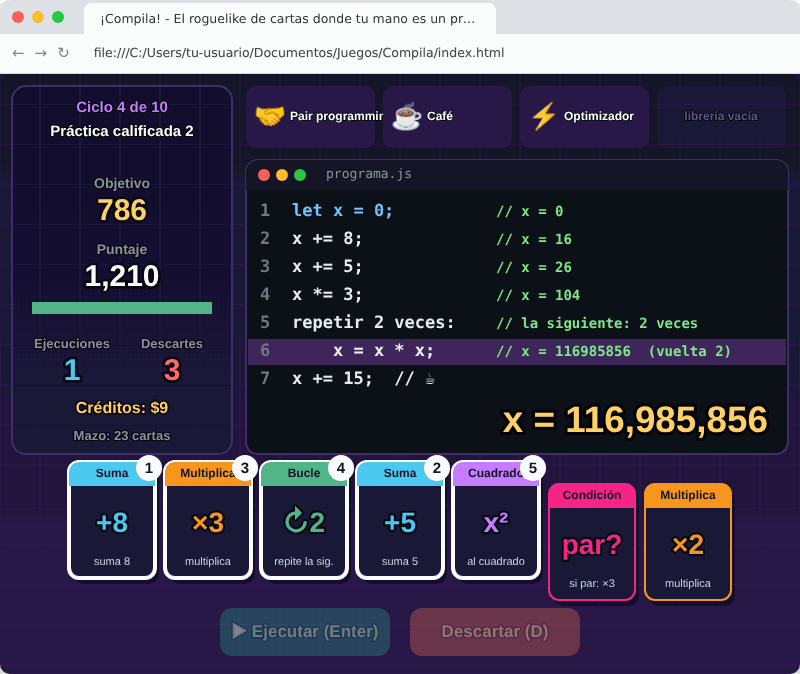

# 🧠 ¡Compila! — El roguelike de cartas donde tu mano es un programa

Cada carta es una instrucción (`x += 7`, `x *= 3`, `x = x * x`, `repetir 2 veces`, `if (x % 2 == 0) x *= 3`). Elige hasta 5: **el orden en que las eliges es el orden en que se ejecutan**. Mira tu programa correr línea a línea, supera las prácticas y los parciales, compra librerías (☕ Café, 🤝 Pair programming, 🔁 Recursión, 🤖 Copiloto IA…) y gradúate en 10 ciclos.

Pensado para estudiantes de **Ingeniería de Sistemas e Informática**: practica la "prueba de escritorio" (flujo de ejecución y valor de las variables) sin darte cuenta.

- ▶️ **Jugar:** abre [`index.html`](index.html) (ratón, dedo o teclado: 1-8, ENTER, D).
- 📘 **Informe paso a paso:** [Markdown](informe/Informe_Compila.md) · [PDF](informe/Informe_Compila.pdf) · [Word](informe/Informe_Compila.docx)
- 🛟 **Código de cada paso:** carpeta [`pasos/`](pasos/)
