<!-- solo-github -->
# Informe de creación del videojuego «¡Compila!»

**Un roguelike de cartas donde tu mano es un programa: aprende a pensar como programador jugando. Explicado paso a paso y línea por línea.**

> 📄 Este mismo informe está también en **PDF** (`Informe_Compila.pdf`) y en **Word** (`Informe_Compila.docx`) dentro de esta carpeta.
> 🎮 El juego terminado está en la carpeta de arriba: abre `../index.html` en tu navegador para jugar.
<!-- /solo-github -->

# 1. Presentación del proyecto

## 1.1 ¿Qué es ¡Compila!?

**¡Compila!** es un videojuego 2D de cartas para el navegador (ordenador o móvil) del género **roguelike de cartas**, el género que más ha crecido en los últimos años. Su idea es nueva: **cada carta es una instrucción de programación** (`x += 7`, `x *= 3`, `x = x * x`, un bucle `repetir 2 veces`, un condicional `if (x % 2 == 0) x *= 3`) y **tu mano es un programa**. Eliges hasta 5 cartas; **el orden en que las eliges es el orden en que se ejecutan**. Al pulsar *Ejecutar*, el programa corre **línea a línea** en un editor de código, mientras ves cómo cambia el valor de `x` y el número crece y crece.

Con el resultado de tus programas debes superar los exámenes de cada **ciclo** de la carrera (*Práctica calificada 1*, *Práctica calificada 2* y un *Examen parcial* con reglas especiales), comprar **librerías** que rompen las reglas (☕ Café, 🤝 Pair programming, 🔁 Recursión, 🤖 Copiloto IA…) y **graduarte en 10 ciclos**.

<p align="center">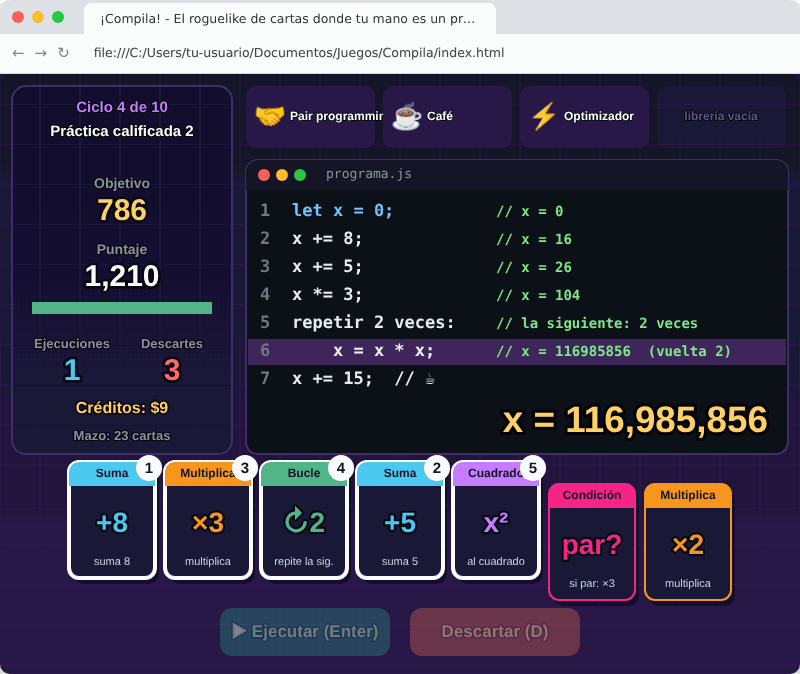</p>

<p align="center"><em>Figura 1. ¡Compila! en plena partida (ciclo 4, con Pair programming, Café y Optimizador): un programa de 5 cartas con un bucle antes del cuadrado se ejecuta línea a línea y x se dispara.</em></p>

## 1.2 La problemática que resuelve

Este proyecto se pensó para estudiantes de **Ingeniería de Sistemas e Informática** y, en concreto, para el contexto de una universidad como la **Universidad Continental**. Uno de los problemas más conocidos en estas carreras es que **los primeros cursos de programación se hacen muy cuesta arriba**: muchos estudiantes no tienen todavía el "modelo mental" de cómo se ejecuta un programa. Las dificultades típicas son:

- **El flujo de ejecución:** entender que las instrucciones se ejecutan **una detrás de otra, en orden**, y que cambiar el orden cambia el resultado.
- **El estado de las variables:** saber cuánto vale una variable en cada línea (lo que en clase se llama **prueba de escritorio**).
- **Bucles y condicionales:** imaginar qué pasa cuando algo se repite o cuando el programa "decide".
- **Crecimiento de los números:** intuir por qué algo que se eleva al cuadrado se dispara (la base de la **complejidad algorítmica**, el famoso O(n²)), o qué es un **desbordamiento** (*overflow*).

Los ejercicios de papel son necesarios, pero se sienten como tarea. **¡Compila! convierte la prueba de escritorio en un juego adictivo:** cada jugada obliga a predecir el valor de `x` según el orden de las instrucciones, y el editor muestra la ejecución real línea a línea con comentarios (`// x = 21`), exactamente como lo haría un depurador. El jugador practica decenas de "pruebas de escritorio" por partida **sin darse cuenta**, porque quiere batir su récord.

<p align="center">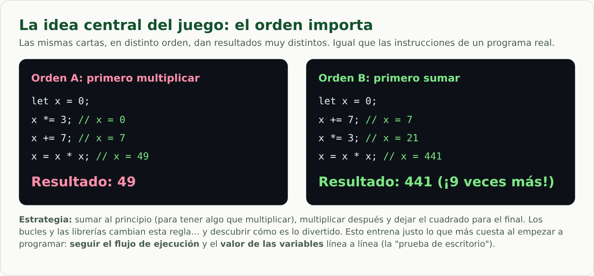</p>

<p align="center"><em>Figura 2. La idea central del juego: las mismas tres cartas dan 49 o 441 según su orden.</em></p>

**¿Cómo podría usarse en la universidad?**

- Como **práctica libre** para los cursos introductorios de programación (funciona en el móvil, sin instalar nada).
- Como **actividad de inicio de clase**: "¿Quién consigue el programa más grande con esta mano?".
- Como **competencia entre secciones o en la semana de la carrera**, con el récord como marcador.
- Como **proyecto de ejemplo** para enseñar estructuras de datos (mazo como *pila*, mano como *lista*), algoritmos (barajado de Fisher-Yates) y máquinas de estados.

> ℹ️ Es un proyecto académico independiente: no es un producto oficial de ninguna universidad, ni usa sus logotipos o marcas.

## 1.3 Cómo se juega

| Acción | Ratón / dedo | Teclado |
|---|---|---|
| Elegir / soltar una carta (el orden de elección = orden de ejecución) | Clic en la carta | 1 a 8 |
| Ejecutar el programa | Botón **▶ Ejecutar** | ENTER |
| Descartar las cartas elegidas y robar otras | Botón **Descartar** | D |
| Comprar una librería | Clic en ella en la tienda | — |
| Empezar / volver a jugar | Clic | ESPACIO |

**Reglas:**

- Cada programa empieza con `let x = 0;`. El **resultado** del programa (el valor final de `x`) se suma a tu **puntaje**.
- Cada examen tiene un **objetivo**. Tienes **4 ejecuciones** y **3 descartes** para alcanzarlo. Si no llegas: **desaprobado** y vuelves a empezar la carrera.
- Los objetivos crecen un 70 % cada ciclo (crecimiento exponencial): necesitarás programas cada vez mejores… y librerías.
- El tercer examen de cada ciclo es un **jefe** con una regla especial (por ejemplo, *"Las cartas x² no hacen nada"*).
- Al aprobar ganas **créditos** (más si te sobran ejecuciones) para la **tienda**.
- Si un número supera el máximo entero seguro de JavaScript (9 007 199 254 740 991) se produce un **overflow** y se queda en el tope.

| Carta | Código | Qué hace |
|---|---|---|
| Suma | `x += n;` | Suma n (de 1 a 10) |
| Multiplica | `x *= n;` | Multiplica por 2 o por 3 |
| Cuadrado | `x = x * x;` | Eleva al cuadrado: la más poderosa |
| Bucle | `repetir 2 veces:` | La siguiente carta se ejecuta 2 veces (dos bucles seguidos: ¡4 veces!) |
| Condición | `if (x % 2 == 0) x *= 3;` | Si x es par, lo multiplica por 3; si es impar, no hace nada |

<p align="center">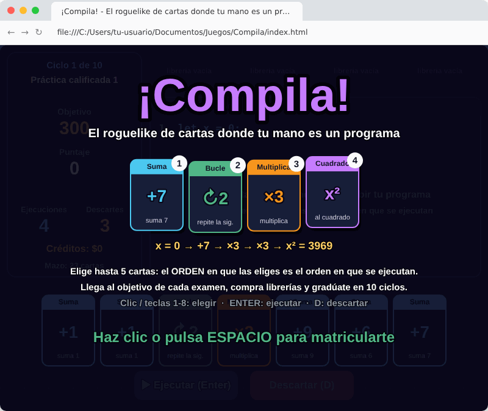</p>

<p align="center"><em>Figura 3. Pantalla de inicio con un programa de ejemplo: +7, bucle, ×3 y cuadrado dan 3969.</em></p>

## 1.4 ¿Por qué es divertido, adictivo y novedoso?

Los **roguelikes de cartas** (partidas cortas, mazo al azar, mejoras que se combinan y números que crecen de forma exagerada) son uno de los fenómenos más fuertes de los videojuegos recientes, con juegos independientes que han vendido millones de copias. ¡Compila! toma **las mecánicas que hacen que ese género enganche**…

<p align="center">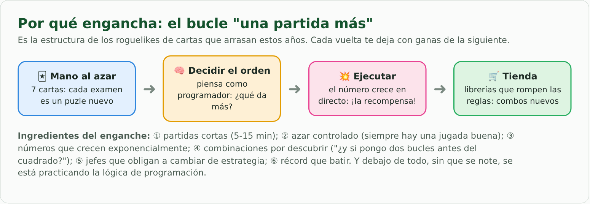</p>

<p align="center"><em>Figura 4. El bucle de "una partida más" y los ingredientes que lo hacen adictivo.</em></p>

…y les da una vuelta que no es habitual: **las cartas no son naipes ni ataques, son código**, y la puntuación sale de **ejecutar un programa de verdad** que se ve en un editor. Lo novedoso es:

- **El orden de selección es el orden de ejecución.** No basta con tener buenas cartas: hay que **pensar como un programador**.
- **Bucles y condicionales como cartas** que modifican a otras: combos como `+9 → ×3 → repetir → x²` (¡531 441!) se descubren jugando.
- **Un intérprete visible:** el programa se ejecuta línea a línea con comentarios, y la música sube de tono con cada paso.
- **Humor universitario:** prácticas calificadas, parciales, el *Profesor estricto*, el *Examen sorpresa*, librerías como el *Copiloto IA* o el *Café*… y la graduación.
- **Rejugable sin fin:** al graduarte puedes seguir en "maestría" con exámenes cada vez más grandes.

Probamos el equilibrio del juego con un programa que juega solo eligiendo siempre la mejor combinación posible: incluso jugando "perfecto" se gradúa aproximadamente en 1 de cada 3 carreras, normalmente cae en los jefes. Es decir: **fácil de aprender, difícil de dominar**, la fórmula de los juegos que enganchan.

## 1.5 Qué vas a aprender construyéndolo

Además de HTML, CSS y Canvas: **estructuras de datos** (listas como mazo y mano, objetos, funciones guardadas en objetos), el **algoritmo de barajado de Fisher-Yates**, cómo funciona un **intérprete**, **máquinas de estados**, interfaces con **botones y detección de clics**, ajuste del texto en líneas con `measureText`, **desbordamiento numérico**, efectos visuales y sonoros, y guardado del **récord**.

# 2. Antes de empezar

## 2.1 Lo que necesitas

| Qué | Para qué | Dónde conseguirlo | Precio |
|---|---|---|---|
| Un ordenador (Windows, Mac o Linux) | Escribir el código | — | — |
| Un navegador moderno: **Chrome**, **Edge** o **Firefox** | Ejecutar el juego | Ya lo tienes | Gratis |
| **Visual Studio Code** | Escribir los archivos | <https://code.visualstudio.com> | Gratis |

> 💡 Sin motores, sin librerías, sin instalar nada más: dos archivos de texto.

## 2.2 Instalar Visual Studio Code (5 minutos)

1. Entra en **<https://code.visualstudio.com>** y pulsa el botón de descarga.
2. Instálalo con las opciones por defecto (en Windows, marca **"Agregar acción 'Abrir con Code'"**).
3. Para ponerlo en español: `Ctrl + Shift + P` → **Configure Display Language** → **Español** → reinicia.

## 2.3 De dónde sale cada parte del juego

**No se ha descargado ni copiado ningún recurso:** todo se genera con el código de este informe.

| Parte | Cómo se hizo | De dónde sale / documentación |
|---|---|---|
| Página y lienzo | HTML5 `<canvas>` | [MDN – Canvas API](https://developer.mozilla.org/es/docs/Web/API/Canvas_API) |
| Lógica | JavaScript sin librerías | [MDN – JavaScript](https://developer.mozilla.org/es/docs/Web/JavaScript) |
| Cartas, editor, botones, tienda | Dibujados con rectángulos redondeados (`roundRect`), texto y círculos | Diseño propio |
| Iconos de las librerías y el birrete | Emojis estándar Unicode (los dibuja la fuente del sistema) | [Unicode Emoji](https://unicode.org/emoji/) |
| Paleta de colores | Elegida a mano (tonos "modo oscuro" de editor de código) | Inspirada en los temas oscuros de los editores |
| Barajado | Algoritmo de Fisher-Yates (Durstenfeld) | Algoritmo clásico de dominio público |
| Intérprete de cartas | Diseño propio para este juego | — |
| Límite de enteros | `Number.MAX_SAFE_INTEGER` | [MDN – MAX_SAFE_INTEGER](https://developer.mozilla.org/es/docs/Web/JavaScript/Reference/Global_Objects/Number/MAX_SAFE_INTEGER) |
| Sonidos | Sintetizados con la **Web Audio API** | [MDN – Web Audio API](https://developer.mozilla.org/es/docs/Web/API/Web_Audio_API) |
| Mecánicas del género (mano, descartes, jefes, tienda, comodines) | Ideas comunes del género roguelike de cartas (las mecánicas no tienen dueño; el código, las reglas concretas y el arte son propios) | — |
| Récord | `localStorage` | [MDN – localStorage](https://developer.mozilla.org/es/docs/Web/API/Window/localStorage) |
| Capturas de este informe | Tomadas automáticamente ejecutando cada paso del juego en Chromium | [Playwright](https://playwright.dev) |

## 2.4 Conceptos de programación que usaremos

Si ya has llevado un curso de programación, te sonarán. Si no, este resumen basta para seguir el informe.

**Variables, textos, números y booleanos:**

```javascript
let puntaje = 0;            // número que cambiará
const ANCHO = 800;          // valor fijo
let nombre = "Práctica 1";  // texto
let elegida = true;         // booleano (true / false)
```

**Objetos (cajas con apartados) y listas (arrays):**

```javascript
const carta = { tipo: "suma", n: 7 };    // un objeto
let mano = [carta, { tipo: "mult", n: 3 }]; // una lista de objetos
mano.push({ tipo: "cuadrado", n: 0 });   // añadir al final
mano.pop();                              // sacar el último
mano.splice(0, 1);                       // borrar 1 elemento en la posición 0
mano.indexOf(carta);                     // posición (o -1 si no está)
```

**Funciones, también guardadas dentro de objetos:**

```javascript
function duplicar(n) { return n * 2; }
const boton = { texto: "Ejecutar", accion: duplicar };
boton.accion(5);   // → 10
```

**Métodos de listas que usaremos mucho:**

```javascript
[1, 2, 3].map(function (n) { return n * 10; });   // → [10, 20, 30]
[1, 2, 3].filter(function (n) { return n > 1; }); // → [2, 3]
[1, 2, 3].some(function (n) { return n > 2; });   // → true
[3, 1, 2].sort(function (a, b) { return b - a; }); // → [3, 2, 1]
```

| Símbolo | Significa | Ejemplo |
|---|---|---|
| `===` / `!==` | ¿igual? / ¿distinto? | `fase === "tienda"` |
| `&&` / <code>&#124;&#124;</code> / `!` | y / o / no | `a && !b` |
| `%` | resto de la división | `7 % 2` → 1 (impar) |
| `cond ? a : b` | si cond, a; si no, b | `elegida ? "blanco" : "gris"` |
| `+=`, `-=`, `*=` | operar sobre lo que había | `x *= 3` |

## 2.5 Las coordenadas del lienzo

<p align="center">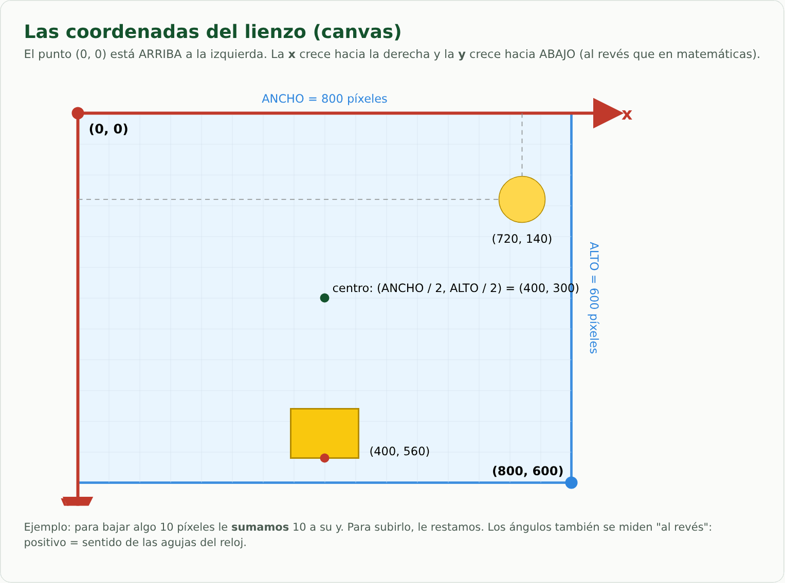</p>

<p align="center"><em>Figura 5. El lienzo de 800 × 600: (0, 0) arriba a la izquierda y la y crece hacia abajo.</em></p>

## 2.6 El bucle del juego

<p align="center">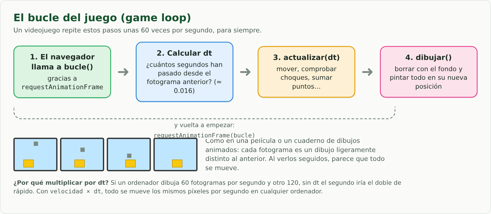</p>

<p align="center"><em>Figura 6. El bucle del juego: medir el tiempo, actualizar y dibujar unas 60 veces por segundo.</em></p>

## 2.7 La máquina de estados

El juego pasa por varias **fases**: menú, elegir cartas, ejecutando, tienda, fin y graduación. Guardar la fase en una variable y comprobarla en cada función es una técnica básica en el desarrollo de software (no solo de juegos).

<p align="center">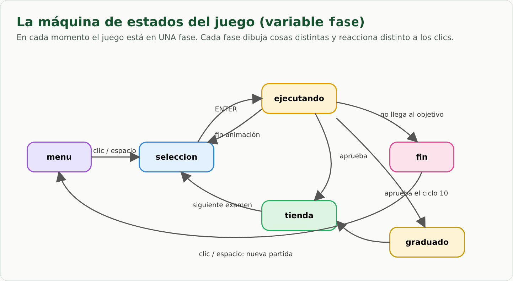</p>

<p align="center"><em>Figura 7. Las fases del juego y qué hace pasar de una a otra.</em></p>

## 2.8 Hoja de ruta: los 13 pasos

<p align="center">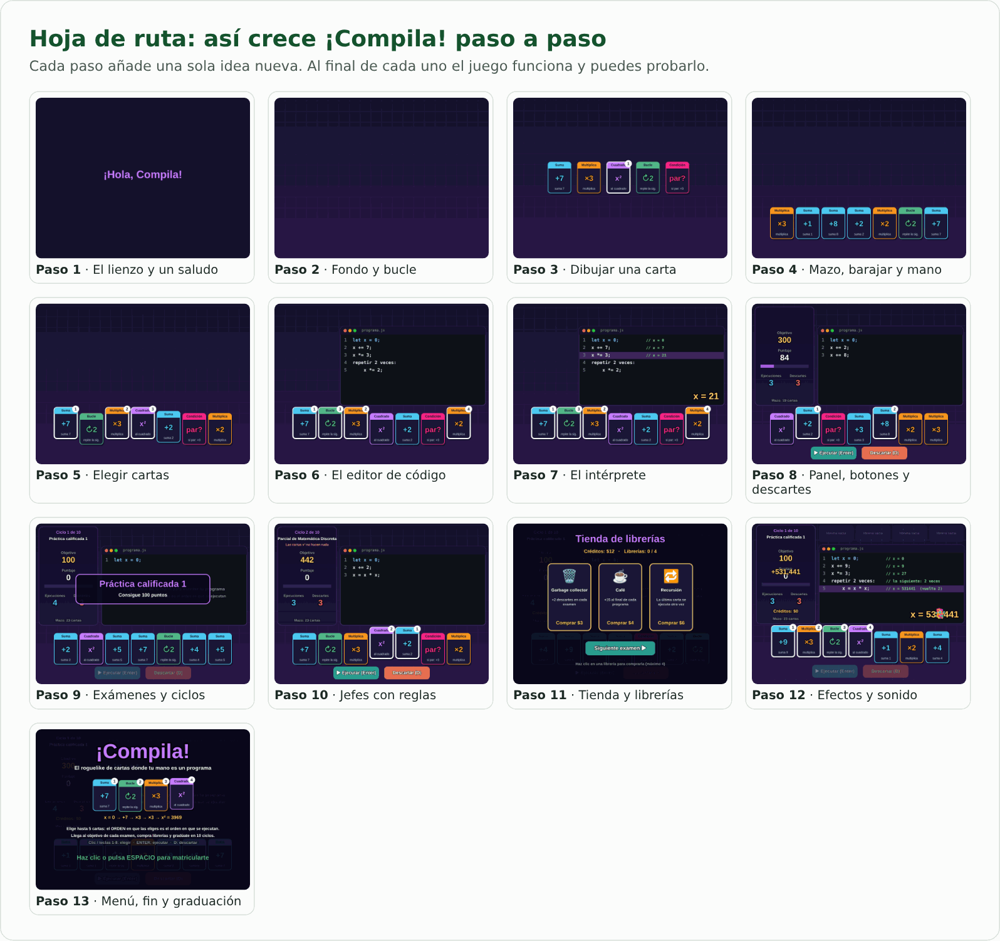</p>

<p align="center"><em>Figura 8. Cómo se ve el juego al terminar cada uno de los 13 pasos.</em></p>

## 2.9 Cómo leer los pasos de este informe

1. **Objetivo** del paso.
2. **Cambios en el código:** dónde escribir, imagen del editor con las líneas nuevas en **verde** (las que se borran en **rojo tachado**), **explicación de cada línea** y **código para copiar**.
3. **Resultado:** capturas reales del juego en ese paso.
4. **Pruébalo tú:** experimentos.

> 🛟 **Red de seguridad:** la carpeta `pasos/` tiene el código completo al final de cada paso (`pasos/paso01` … `pasos/paso13`).

# 3. Paso 0 · Preparar la carpeta y los archivos

1. Crea la carpeta **`Juegos/Compila`** (en Documentos, por ejemplo).
2. En **Visual Studio Code**: **Archivo → Abrir carpeta…** → **Compila**.
3. Crea dos archivos: **`index.html`** y **`juego.js`** (en minúsculas, sin espacios).

<p align="center">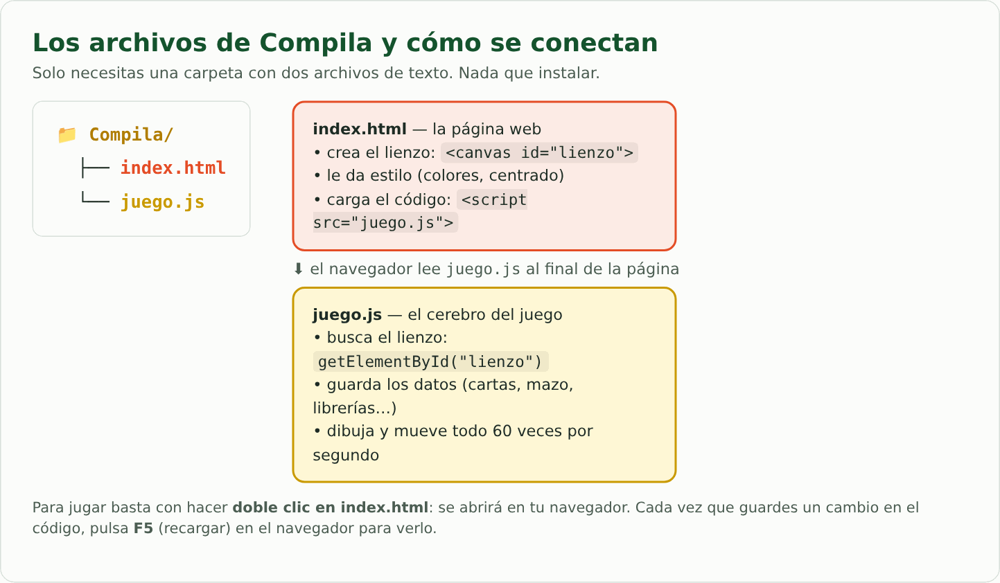</p>

<p align="center"><em>Figura 9. Los dos archivos del proyecto y cómo se conectan.</em></p>

<p align="center">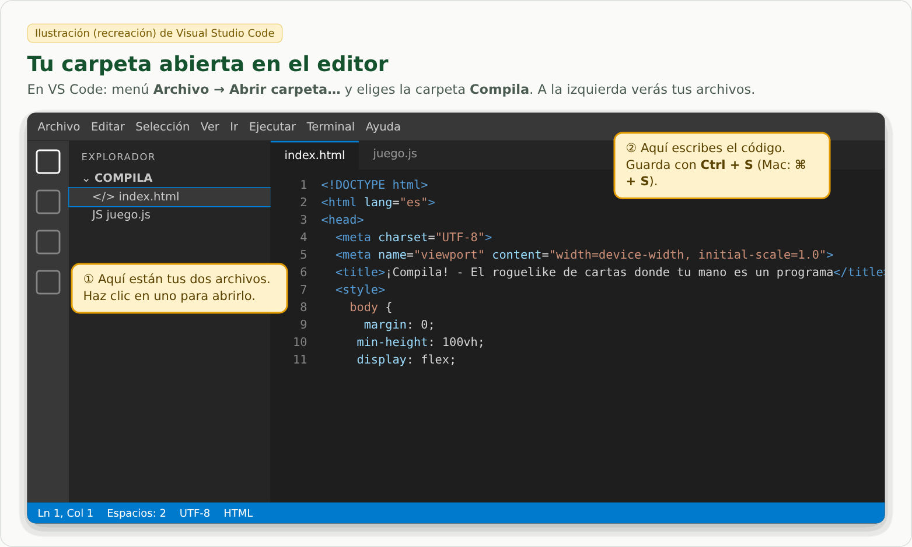</p>

<p align="center"><em>Figura 10. La carpeta abierta en Visual Studio Code (ilustración).</em></p>

<p align="center">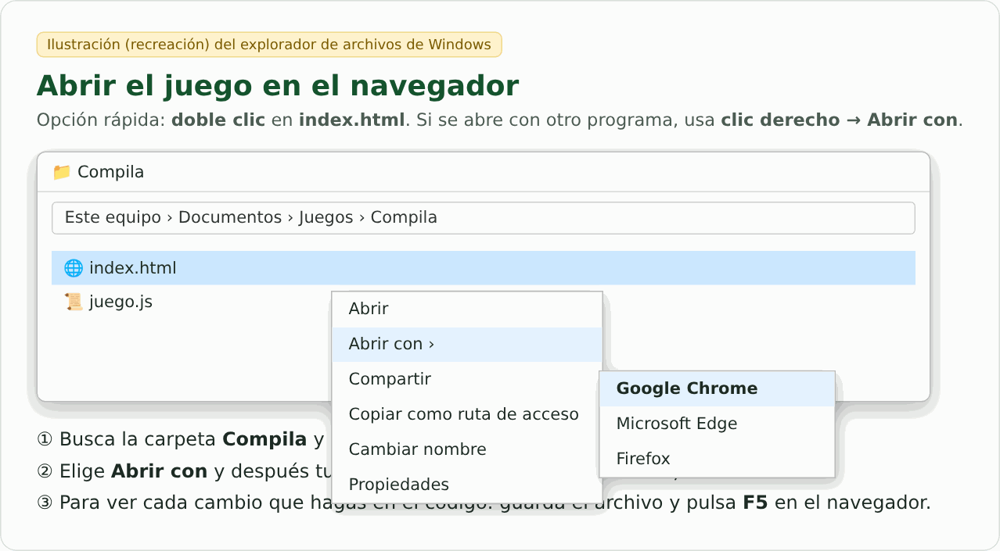</p>

<p align="center"><em>Figura 11. Abrir index.html con el navegador (ilustración).</em></p>

<p align="center">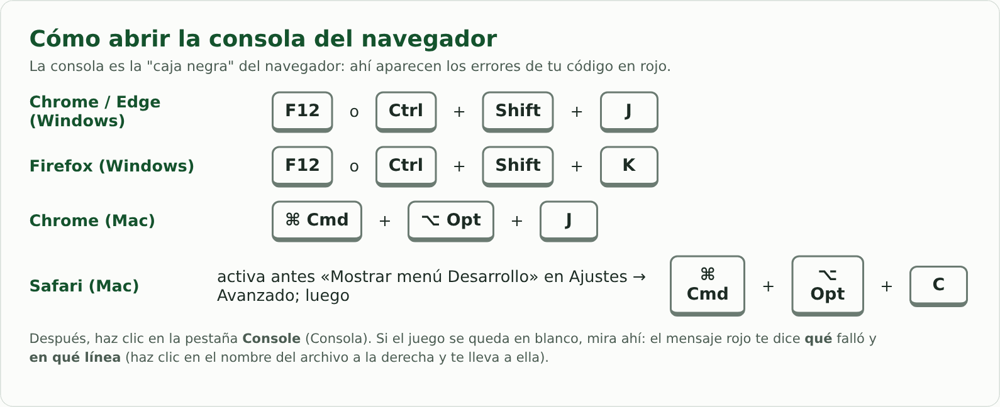</p>

<p align="center"><em>Figura 12. Cómo abrir la consola de errores.</em></p>

> 🔁 **Ciclo de trabajo:** escribir → guardar (`Ctrl + S`) → recargar el navegador (`F5`) → mirar.

# 4. Paso 1 · El lienzo y un saludo

**Objetivo:** crear la página web con un lienzo de 800 × 600 y comprobar que JavaScript dibuja en él.

#### Cambio 1 de 2 · Escribir el archivo completo en `index.html`

📄 Abre `index.html` (vacío) y escribe **todo** este código. Tiene 34 líneas.

<p align="center">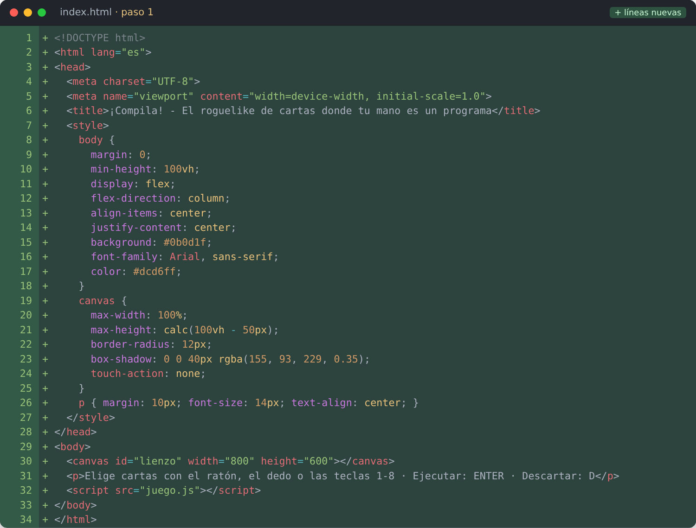</p>

<p align="center"><em>Figura 13. Paso 1: código nuevo en index.html. Lo verde es lo que escribes; lo gris ya lo tenías.</em></p>

**Explicación línea por línea:**


> **La "partida de nacimiento" de la página.** Estas primeras líneas le dicen al navegador qué tipo de documento es y en qué idioma está.

- **Línea 1** · `<!DOCTYPE html>`  
  → Declara que este archivo es una página web moderna (HTML5). Siempre va en la primera línea.
- **Línea 2** · `<html lang="es">`  
  → Abre el documento HTML e indica que el idioma es español (lang="es"). Ayuda a los lectores de pantalla y a los traductores.
- **Línea 3** · `<head>`  
  → Abre la cabecera: aquí va información SOBRE la página (título, estilos...), no lo que se ve dentro de ella.
- **Línea 4** · `<meta charset="UTF-8">`  
  → Usa la codificación UTF-8 para que se vean bien las tildes, la ñ y los signos ¡ ¿.
- **Línea 5** · `<meta name="viewport" content="width=device-width, initial-scale=1.0">`  
  → Hace que en móviles la página use el ancho real de la pantalla en lugar de verse diminuta.
- **Línea 6** · `<title>¡Compila! - El roguelike de cartas donde tu mano es un programa</title>`  
  → El texto que aparece en la pestaña del navegador.

> **Los estilos (CSS).** Entre `<style>` y `</style>` decimos cómo se ve la página: colores, centrado y tamaño del lienzo.

- **Línea 7** · `<style>`  
  → Abre el bloque de estilos CSS.
- **Línea 8** · `body {`  
  → Empieza las reglas para el cuerpo (body) de la página: todo lo que se ve.
- **Línea 9** · `margin: 0;`  
  → Quita el margen blanco que los navegadores ponen por defecto alrededor de la página.
- **Línea 10** · `min-height: 100vh;`  
  → Hace que el cuerpo mida como mínimo el 100 % del alto de la ventana (vh = "viewport height").
- **Línea 11** · `display: flex;`  
  → Activa "flexbox", un sistema para colocar elementos fácilmente.
- **Línea 12** · `flex-direction: column;`  
  → Coloca los elementos uno debajo de otro (en columna): primero el lienzo y debajo el texto de ayuda.
- **Línea 13** · `align-items: center;`  
  → Centra los elementos horizontalmente.
- **Línea 14** · `justify-content: center;`  
  → Centra los elementos verticalmente.
- **Línea 15** · `background: #0b0d1f;`  
  → Color de fondo de la página: un azul noche muy oscuro, como un editor de código en modo oscuro.
- **Línea 16** · `font-family: Arial, sans-serif;`  
  → Tipo de letra de la página: Arial (o, si no existe, cualquier letra sin adornos).
- **Línea 17** · `color: #dcd6ff;`  
  → Color del texto: un lila muy claro.
- **Línea 18** · `}`  
  → Cierra la llave `{` que se abrió más arriba: aquí termina ese bloque.
- **Línea 19** · `canvas {`  
  → Empieza las reglas para el lienzo (canvas), que es donde se dibuja el juego.
- **Línea 20** · `max-width: 100%;`  
  → El lienzo nunca será más ancho que la ventana (así cabe en móviles).
- **Línea 21** · `max-height: calc(100vh - 50px);`  
  → Ni más alto que la ventana menos 50 píxeles (dejamos sitio para el texto de ayuda).
- **Línea 22** · `border-radius: 12px;`  
  → Redondea las esquinas del lienzo 12 píxeles.
- **Línea 23** · `box-shadow: 0 0 40px rgba(155, 93, 229, 0.35);`  
  → Añade un resplandor morado alrededor del lienzo.
- **Línea 24** · `touch-action: none;`  
  → En pantallas táctiles evita que arrastrar el dedo mueva o haga zoom en la página.
- **Línea 25** · `}`  
  → Cierra la llave `{` que se abrió más arriba: aquí termina ese bloque.
- **Línea 26** · `p { margin: 10px; font-size: 14px; text-align: center; }`  
  → Reglas para los párrafos (p): un poco de margen y letra de 14 píxeles.
- **Línea 27** · `</style>`  
  → Cierra el bloque de estilos.
- **Línea 28** · `</head>`  
  → Cierra la cabecera.

> **El contenido visible.** Dentro de `<body>` está lo que se ve: el lienzo, una línea de ayuda y la orden de cargar nuestro código.

- **Línea 29** · `<body>`  
  → Abre el cuerpo: todo lo que hay aquí dentro se ve en la página.
- **Línea 30** · `<canvas id="lienzo" width="800" height="600"></canvas>`  
  → Crea el lienzo de dibujo. id="lienzo" es su nombre para encontrarlo desde JavaScript. Mide 800 × 600 píxeles.
- **Línea 31** · `<p>Elige cartas con el ratón, el dedo o las teclas 1-8 · Ejecutar: ENTER · Descartar: D...`  
  → Un párrafo con la ayuda de los controles, debajo del lienzo.
- **Línea 32** · `<script src="juego.js"></script>`  
  → Carga y ejecuta nuestro archivo juego.js. Va al final para que el lienzo ya exista cuando el código lo busque.
- **Línea 33** · `</body>`  
  → Cierra el cuerpo.
- **Línea 34** · `</html>`  
  → Cierra el documento HTML.

**Código para copiar** (o mejor, ¡escríbelo tú para aprender!):

```html
<!DOCTYPE html>
<html lang="es">
<head>
  <meta charset="UTF-8">
  <meta name="viewport" content="width=device-width, initial-scale=1.0">
  <title>¡Compila! - El roguelike de cartas donde tu mano es un programa</title>
  <style>
    body {
      margin: 0;
      min-height: 100vh;
      display: flex;
      flex-direction: column;
      align-items: center;
      justify-content: center;
      background: #0b0d1f;
      font-family: Arial, sans-serif;
      color: #dcd6ff;
    }
    canvas {
      max-width: 100%;
      max-height: calc(100vh - 50px);
      border-radius: 12px;
      box-shadow: 0 0 40px rgba(155, 93, 229, 0.35);
      touch-action: none;
    }
    p { margin: 10px; font-size: 14px; text-align: center; }
  </style>
</head>
<body>
  <canvas id="lienzo" width="800" height="600"></canvas>
  <p>Elige cartas con el ratón, el dedo o las teclas 1-8 · Ejecutar: ENTER · Descartar: D</p>
  <script src="juego.js"></script>
</body>
</html>
```

#### Cambio 2 de 2 · Escribir el archivo completo en `juego.js`

📄 Abre `juego.js` (vacío) y escribe **todo** este código. Tiene 16 líneas.

<p align="center">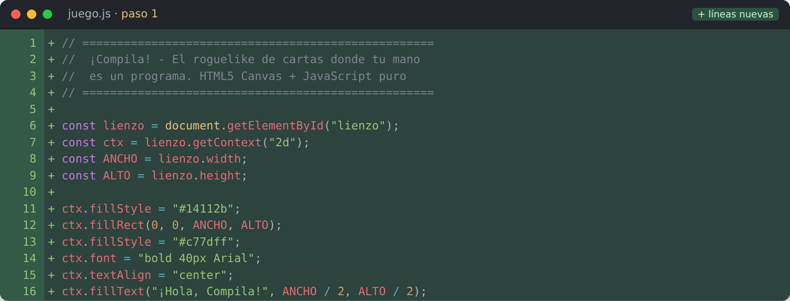</p>

<p align="center"><em>Figura 14. Paso 1: código nuevo en juego.js. Lo verde es lo que escribes; lo gris ya lo tenías.</em></p>

**Explicación línea por línea:**

- **Línea 1** · `// ===================================================`  
  → Comentario decorativo (una línea de signos =). El navegador lo ignora.
- **Línea 2** · `//  ¡Compila! - El roguelike de cartas donde tu mano`  
  → Comentario: el navegador lo ignora. Sirve para que las personas entendamos el código («¡Compila! - El roguelike de cartas donde tu mano»).
- **Línea 3** · `//  es un programa. HTML5 Canvas + JavaScript puro`  
  → Comentario: el navegador lo ignora. Sirve para que las personas entendamos el código («es un programa. HTML5 Canvas + JavaScript puro»).
- **Línea 4** · `// ===================================================`  
  → Comentario decorativo (una línea de signos =). El navegador lo ignora.

> **El lienzo y el pincel.** Como en todo juego con canvas: buscamos el lienzo del HTML y pedimos su contexto 2D, el objeto con todas las órdenes de dibujo.

- **Línea 6** · `const lienzo = document.getElementById("lienzo");`  
  → Busca en la página el elemento con id="lienzo" y lo guarda en la constante lienzo.
- **Línea 7** · `const ctx = lienzo.getContext("2d");`  
  → Pide al lienzo su "contexto 2D": el pincel con el que dibujaremos. Por costumbre se llama ctx.
- **Línea 8** · `const ANCHO = lienzo.width;`  
  → Ancho del lienzo (800 píxeles), guardado en una constante para usarlo en todo el código.
- **Línea 9** · `const ALTO = lienzo.height;`  
  → Alto del lienzo (600 píxeles).

> **Prueba de vida.** Pintamos el fondo y un saludo para comprobar que el HTML y el JavaScript están conectados. En el paso 2 borraremos estas líneas.

- **Línea 11** · `ctx.fillStyle = "#14112b";`  
  → Color de relleno: azul noche (formato hexadecimal #RRGGBB).
- **Línea 12** · `ctx.fillRect(0, 0, ANCHO, ALTO);`  
  → Pinta todo el lienzo: un rectángulo desde (0, 0) con todo el ancho y alto.
- **Línea 13** · `ctx.fillStyle = "#c77dff";`  
  → Color del texto: morado claro.
- **Línea 14** · `ctx.font = "bold 40px Arial";`  
  → Letra: negrita, 40 píxeles, Arial.
- **Línea 15** · `ctx.textAlign = "center";`  
  → Centrar el texto horizontalmente en el punto que le demos.
- **Línea 16** · `ctx.fillText("¡Hola, Compila!", ANCHO / 2, ALTO / 2);`  
  → Escribe el saludo en el centro del lienzo.

**Código para copiar** (o mejor, ¡escríbelo tú para aprender!):

```javascript
// ===================================================
//  ¡Compila! - El roguelike de cartas donde tu mano
//  es un programa. HTML5 Canvas + JavaScript puro
// ===================================================

const lienzo = document.getElementById("lienzo");
const ctx = lienzo.getContext("2d");
const ANCHO = lienzo.width;
const ALTO = lienzo.height;

ctx.fillStyle = "#14112b";
ctx.fillRect(0, 0, ANCHO, ALTO);
ctx.fillStyle = "#c77dff";
ctx.font = "bold 40px Arial";
ctx.textAlign = "center";
ctx.fillText("¡Hola, Compila!", ANCHO / 2, ALTO / 2);
```

### Resultado del paso 1

<p align="center">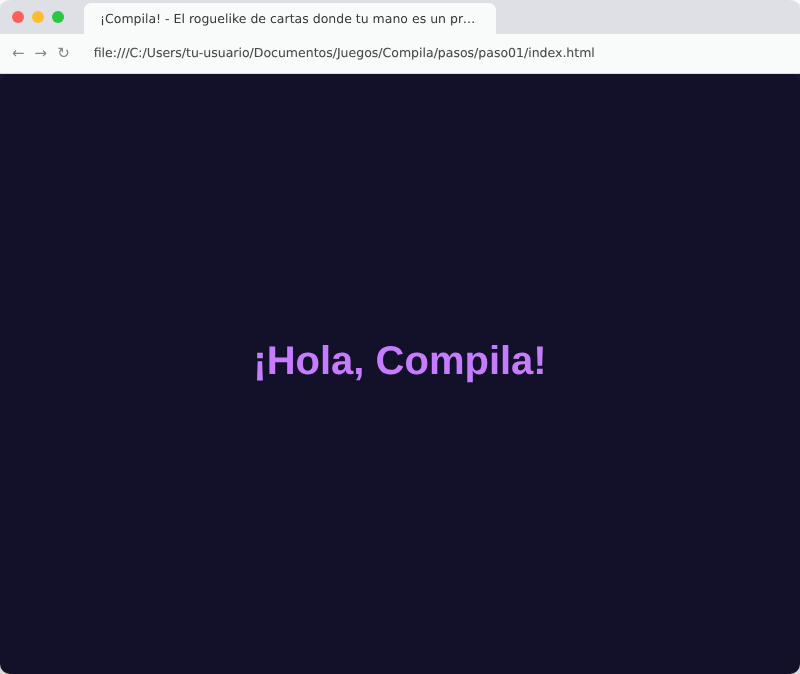</p>

<p align="center"><em>Figura 15. El lienzo azul noche con el saludo.</em></p>

# 5. Paso 2 · El fondo y el bucle del juego

**Objetivo:** un fondo con degradado y una cuadrícula que se desplaza despacio (ambiente de "programar de madrugada"), y el bucle del juego.

**Qué aprenderás:** degradados, dibujar muchas líneas en un solo trazo, el operador `%` para animaciones que se repiten y `requestAnimationFrame`.

#### Cambio 1 de 1 · Cambiar (reemplazar) código en `juego.js`

🗑️ **Primero, borra las líneas 11 a 16 de tu archivo `juego.js`** (están justo debajo de `const ALTO = lienzo.height;`). En la imagen aparecen en rojo y tachadas:

<p align="center">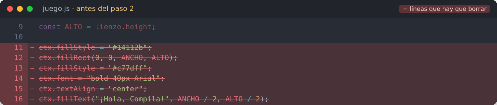</p>

<p align="center"><em>Figura 16. Paso 2: líneas que se borran de juego.js</em></p>

Estas son las líneas que desaparecen:

```javascript
ctx.fillStyle = "#14112b";
ctx.fillRect(0, 0, ANCHO, ALTO);
ctx.fillStyle = "#c77dff";
ctx.font = "bold 40px Arial";
ctx.textAlign = "center";
ctx.fillText("¡Hola, Compila!", ANCHO / 2, ALTO / 2);
```

✏️ **Después, en ese mismo sitio, escribe las líneas nuevas** (quedan en las líneas 11 a 57 del archivo terminado).

##### Parte 1 de 2 (líneas 11 a 51)

<p align="center">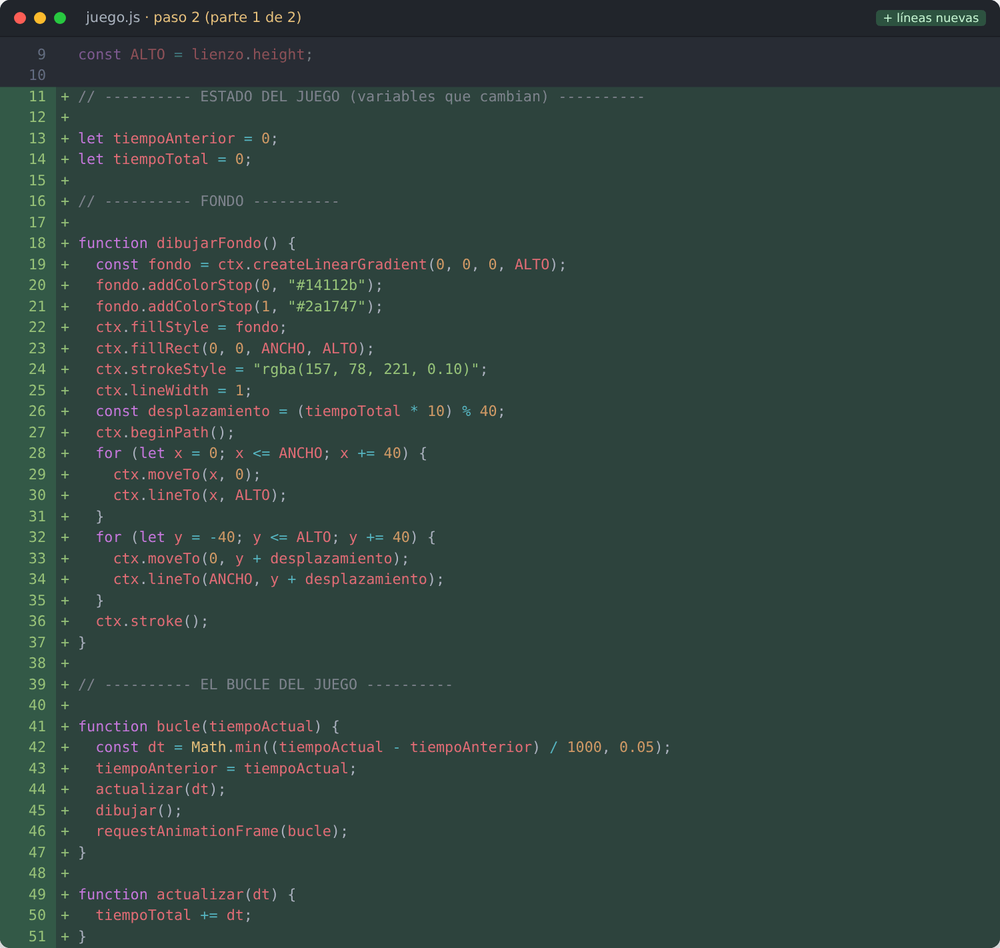</p>

<p align="center"><em>Figura 17. Paso 2: código nuevo en juego.js (parte 1 de 2). Lo verde es lo que escribes; lo gris ya lo tenías.</em></p>

**Explicación línea por línea:**

- **Línea 11** · `// ---------- ESTADO DEL JUEGO (variables que cambian) ----------`  
  → Comentario que sirve de título de sección: «ESTADO DEL JUEGO (variables que cambian)». El navegador lo ignora; nos ayuda a ordenar el código.
- **Línea 13** · `let tiempoAnterior = 0;`  
  → Momento (en milisegundos) del fotograma anterior.
- **Línea 14** · `let tiempoTotal = 0;`  
  → Segundos que lleva el juego funcionando (para animaciones).
- **Línea 16** · `// ---------- FONDO ----------`  
  → Comentario que sirve de título de sección: «FONDO». El navegador lo ignora; nos ayuda a ordenar el código.

> **El fondo.** Un degradado de azul noche a morado con una cuadrícula suave que se desplaza despacio: ambiente de "programar de madrugada".

- **Línea 18** · `function dibujarFondo() {`  
  → Declara dibujarFondo.
- **Línea 19** · `const fondo = ctx.createLinearGradient(0, 0, 0, ALTO);`  
  → Degradado vertical.
- **Línea 20** · `fondo.addColorStop(0, "#14112b");`  
  → Arriba, azul noche.
- **Línea 21** · `fondo.addColorStop(1, "#2a1747");`  
  → Abajo, morado oscuro.
- **Línea 22** · `ctx.fillStyle = fondo;`  
  → Elige el color de relleno: `fondo`.
- **Línea 23** · `ctx.fillRect(0, 0, ANCHO, ALTO);`  
  → Pintamos todo (y borramos el fotograma anterior).
- **Línea 24** · `ctx.strokeStyle = "rgba(157, 78, 221, 0.10)";`  
  → Líneas de la cuadrícula: morado casi transparente.
- **Línea 25** · `ctx.lineWidth = 1;`  
  → Grosor de las líneas: `1` píxeles.
- **Línea 26** · `const desplazamiento = (tiempoTotal * 10) % 40;`  
  → Desplazamiento: avanza 10 píxeles por segundo y vuelve a empezar cada 40 (con %).
- **Línea 27** · `ctx.beginPath();`  
  → Empieza un trazo nuevo, para que esta figura no se mezcle con la anterior.
- **Línea 28** · `for (let x = 0; x <= ANCHO; x += 40) {`  
  → Líneas verticales cada 40 píxeles.
- **Línea 29** · `ctx.moveTo(x, 0);`  
  → Coloca el lápiz, sin pintar, en el punto `(x, 0)`.
- **Línea 30** · `ctx.lineTo(x, ALTO);`  
  → Traza una línea recta hasta el punto `(x, ALTO)`.
- **Línea 31** · `}`  
  → Cierra la llave `{` que se abrió más arriba: aquí termina ese bloque.
- **Línea 32** · `for (let y = -40; y <= ALTO; y += 40) {`  
  → Líneas horizontales cada 40 píxeles, desplazadas (empezamos en -40 para cubrir el hueco de arriba).
- **Línea 33** · `ctx.moveTo(0, y + desplazamiento);`  
  → Coloca el lápiz, sin pintar, en el punto `(0, y + desplazamiento)`.
- **Línea 34** · `ctx.lineTo(ANCHO, y + desplazamiento);`  
  → Traza una línea recta hasta el punto `(ANCHO, y + desplazamiento)`.
- **Línea 35** · `}`  
  → Cierra la llave `{` que se abrió más arriba: aquí termina ese bloque.
- **Línea 36** · `ctx.stroke();`  
  → Dibujamos todas las líneas de una vez.
- **Línea 37** · `}`  
  → Cierra la llave `{` que se abrió más arriba: aquí termina ese bloque.
- **Línea 39** · `// ---------- EL BUCLE DEL JUEGO ----------`  
  → Comentario que sirve de título de sección: «EL BUCLE DEL JUEGO». El navegador lo ignora; nos ayuda a ordenar el código.
- **Línea 41** · `function bucle(tiempoActual) {`  
  → Declara bucle: el corazón del juego, unas 60 veces por segundo.
- **Línea 42** · `const dt = Math.min((tiempoActual - tiempoAnterior) / 1000, 0.05);`  
  → Segundos desde el fotograma anterior (máximo 0.05).
- **Línea 43** · `tiempoAnterior = tiempoActual;`  
  → Guardamos el tiempo actual.
- **Línea 44** · `actualizar(dt);`  
  → Actualizar y dibujar.
- **Línea 45** · `dibujar();`  
  → Dibujar el mundo.
- **Línea 46** · `requestAnimationFrame(bucle);`  
  → Siguiente fotograma.
- **Línea 47** · `}`  
  → Cierra la llave `{` que se abrió más arriba: aquí termina ese bloque.
- **Línea 49** · `function actualizar(dt) {`  
  → Declara actualizar.
- **Línea 50** · `tiempoTotal += dt;`  
  → Tiempo total.
- **Línea 51** · `}`  
  → Cierra la llave `{` que se abrió más arriba: aquí termina ese bloque.

**Código para copiar** (o mejor, ¡escríbelo tú para aprender!):

```javascript
// ---------- ESTADO DEL JUEGO (variables que cambian) ----------

let tiempoAnterior = 0;
let tiempoTotal = 0;

// ---------- FONDO ----------

function dibujarFondo() {
  const fondo = ctx.createLinearGradient(0, 0, 0, ALTO);
  fondo.addColorStop(0, "#14112b");
  fondo.addColorStop(1, "#2a1747");
  ctx.fillStyle = fondo;
  ctx.fillRect(0, 0, ANCHO, ALTO);
  ctx.strokeStyle = "rgba(157, 78, 221, 0.10)";
  ctx.lineWidth = 1;
  const desplazamiento = (tiempoTotal * 10) % 40;
  ctx.beginPath();
  for (let x = 0; x <= ANCHO; x += 40) {
    ctx.moveTo(x, 0);
    ctx.lineTo(x, ALTO);
  }
  for (let y = -40; y <= ALTO; y += 40) {
    ctx.moveTo(0, y + desplazamiento);
    ctx.lineTo(ANCHO, y + desplazamiento);
  }
  ctx.stroke();
}

// ---------- EL BUCLE DEL JUEGO ----------

function bucle(tiempoActual) {
  const dt = Math.min((tiempoActual - tiempoAnterior) / 1000, 0.05);
  tiempoAnterior = tiempoActual;
  actualizar(dt);
  dibujar();
  requestAnimationFrame(bucle);
}

function actualizar(dt) {
  tiempoTotal += dt;
}
```

##### Parte 2 de 2 (líneas 53 a 57)

<p align="center">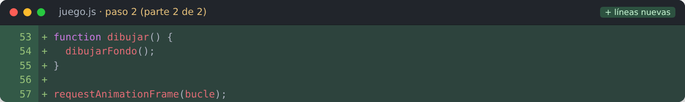</p>

<p align="center"><em>Figura 18. Paso 2: código nuevo en juego.js (parte 2 de 2). Lo verde es lo que escribes; lo gris ya lo tenías.</em></p>

**Explicación línea por línea:**

- **Línea 53** · `function dibujar() {`  
  → Declara dibujar: de atrás hacia delante.
- **Línea 54** · `dibujarFondo();`  
  → El fondo.
- **Línea 55** · `}`  
  → Cierra la llave `{` que se abrió más arriba: aquí termina ese bloque.
- **Línea 57** · `requestAnimationFrame(bucle);`  
  → ¡Arranca el juego!

**Código para copiar** (o mejor, ¡escríbelo tú para aprender!):

```javascript
function dibujar() {
  dibujarFondo();
}

requestAnimationFrame(bucle);
```

### Resultado del paso 2

<p align="center">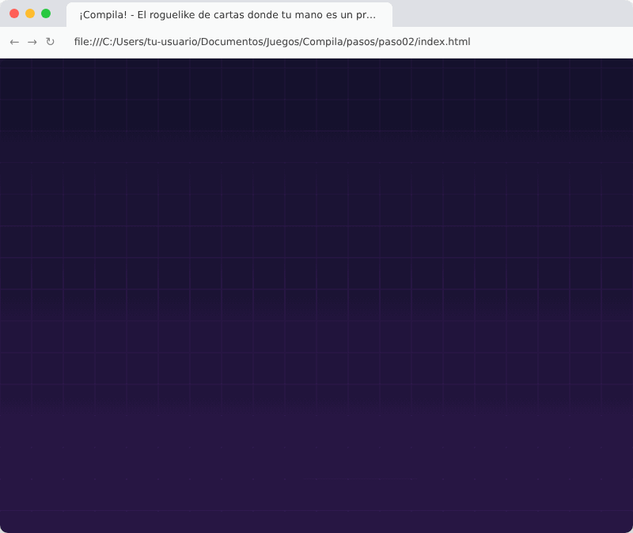</p>

<p align="center"><em>Figura 19. El fondo: degradado de azul noche a morado con una cuadrícula que baja lentamente.</em></p>

### Pruébalo tú

- Cambia `+= 40` por `+= 20` en los dos bucles: cuadrícula más fina.
- Cambia `tiempoTotal * 10` por `tiempoTotal * 100`: ¡efecto "viaje a toda velocidad"!

# 6. Paso 3 · Dibujar una carta

**Objetivo:** definir los cinco tipos de carta y una función que dibuje cualquier carta, con su color, su símbolo y su descripción.

**Qué aprenderás:** objetos de configuración, funciones que devuelven textos según el tipo, `roundRect` con esquinas diferentes y a dibujar en capas (sombra, cuerpo, franja, textos).

#### Cambio 1 de 3 · Añadir código en `juego.js`

📍 **Dónde:** justo **debajo** de la línea `const ALTO = lienzo.height;` (en el archivo terminado de este paso es la línea 9). Las líneas nuevas son de la 11 a la 21.

<p align="center">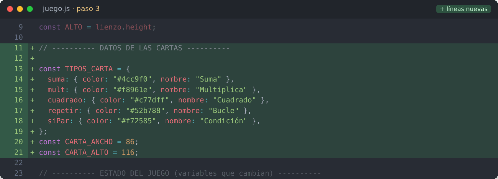</p>

<p align="center"><em>Figura 20. Paso 3: código nuevo en juego.js. Lo verde es lo que escribes; lo gris ya lo tenías.</em></p>

**Explicación línea por línea:**

- **Línea 11** · `// ---------- DATOS DE LAS CARTAS ----------`  
  → Comentario que sirve de título de sección: «DATOS DE LAS CARTAS». El navegador lo ignora; nos ayuda a ordenar el código.

> **Los cinco tipos de carta.** Cada carta es una instrucción de programación. Guardamos el color y el nombre de cada tipo en un objeto, para cambiarlos fácilmente en un solo sitio.

- **Línea 13** · `const TIPOS_CARTA = {`  
  → Crea el objeto TIPOS_CARTA: un apartado por cada tipo, con su color y su nombre.
- **Línea 14** · `suma: { color: "#4cc9f0", nombre: "Suma" },`  
  → Suma: x += n (azul claro).
- **Línea 15** · `mult: { color: "#f8961e", nombre: "Multiplica" },`  
  → Multiplicación: x *= n (naranja).
- **Línea 16** · `cuadrado: { color: "#c77dff", nombre: "Cuadrado" },`  
  → Cuadrado: x = x * x (morado). La más poderosa.
- **Línea 17** · `repetir: { color: "#52b788", nombre: "Bucle" },`  
  → Bucle: repite la siguiente carta (verde).
- **Línea 18** · `siPar: { color: "#f72585", nombre: "Condición" },`  
  → Condicional: si x es par, la multiplica por 3 (rosa).
- **Línea 19** · `};`  
  → Cierra la llave del objeto y termina la instrucción.
- **Línea 20** · `const CARTA_ANCHO = 86;`  
  → Ancho de una carta en píxeles.
- **Línea 21** · `const CARTA_ALTO = 116;`  
  → Alto de una carta en píxeles.

**Código para copiar** (o mejor, ¡escríbelo tú para aprender!):

```javascript
// ---------- DATOS DE LAS CARTAS ----------

const TIPOS_CARTA = {
  suma: { color: "#4cc9f0", nombre: "Suma" },
  mult: { color: "#f8961e", nombre: "Multiplica" },
  cuadrado: { color: "#c77dff", nombre: "Cuadrado" },
  repetir: { color: "#52b788", nombre: "Bucle" },
  siPar: { color: "#f72585", nombre: "Condición" },
};
const CARTA_ANCHO = 86;
const CARTA_ALTO = 116;
```

#### Cambio 2 de 3 · Añadir código en `juego.js`

📍 **Dónde:** justo **debajo** de la línea `let tiempoTotal = 0;` (en el archivo terminado de este paso es la línea 26). Las líneas nuevas son de la 28 a la 101.

##### Parte 1 de 2 (líneas 28 a 64)

<p align="center">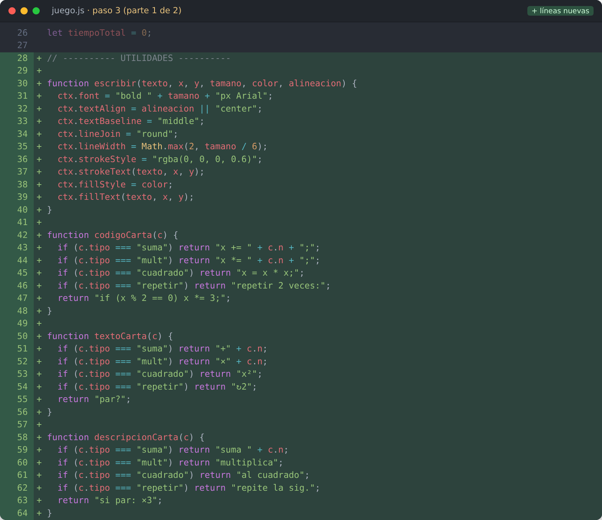</p>

<p align="center"><em>Figura 21. Paso 3: código nuevo en juego.js (parte 1 de 2). Lo verde es lo que escribes; lo gris ya lo tenías.</em></p>

**Explicación línea por línea:**

- **Línea 28** · `// ---------- UTILIDADES ----------`  
  → Comentario que sirve de título de sección: «UTILIDADES». El navegador lo ignora; nos ayuda a ordenar el código.

> **Escribir texto con borde.** Una función de ayuda para escribir textos que se lean bien sobre cualquier fondo.

- **Línea 30** · `function escribir(texto, x, y, tamano, color, alineacion) {`  
  → Declara la función escribir: texto, posición, tamaño, color y alineación (opcional).
- **Línea 31** · `ctx.font = "bold " + tamano + "px Arial";`  
  → Letra en negrita del tamaño indicado.
- **Línea 32** · `ctx.textAlign = alineacion || "center";`  
  → Alineación horizontal (por defecto, centrado).
- **Línea 33** · `ctx.textBaseline = "middle";`  
  → La y será el centro vertical del texto.
- **Línea 34** · `ctx.lineJoin = "round";`  
  → Esquinas del borde redondeadas.
- **Línea 35** · `ctx.lineWidth = Math.max(2, tamano / 6);`  
  → Grosor del borde proporcional al tamaño.
- **Línea 36** · `ctx.strokeStyle = "rgba(0, 0, 0, 0.6)";`  
  → Borde oscuro semitransparente.
- **Línea 37** · `ctx.strokeText(texto, x, y);`  
  → Dibuja el borde.
- **Línea 38** · `ctx.fillStyle = color;`  
  → Color del relleno.
- **Línea 39** · `ctx.fillText(texto, x, y);`  
  → Dibuja el relleno.
- **Línea 40** · `}`  
  → Cierra la llave `{` que se abrió más arriba: aquí termina ese bloque.

> **El texto de cada carta.** Tres funciones que, según el tipo de carta, devuelven su código, su símbolo grande y una descripción corta.

- **Línea 42** · `function codigoCarta(c) {`  
  → Declara codigoCarta: devuelve la línea de código JavaScript que representa la carta.
- **Línea 43** · `if (c.tipo === "suma") return "x += " + c.n + ";";`  
  → Si es de suma, por ejemplo "x += 7;".
- **Línea 44** · `if (c.tipo === "mult") return "x *= " + c.n + ";";`  
  → Si es de multiplicar, por ejemplo "x *= 3;".
- **Línea 45** · `if (c.tipo === "cuadrado") return "x = x * x;";`  
  → Si es de cuadrado.
- **Línea 46** · `if (c.tipo === "repetir") return "repetir 2 veces:";`  
  → Si es un bucle.
- **Línea 47** · `return "if (x % 2 == 0) x *= 3;";`  
  → Si no es ninguna de las anteriores, es el condicional. % es el resto de dividir: x % 2 == 0 significa "x es par".
- **Línea 48** · `}`  
  → Cierra la llave `{` que se abrió más arriba: aquí termina ese bloque.
- **Línea 50** · `function textoCarta(c) {`  
  → Declara textoCarta: el símbolo grande que se ve en el centro de la carta.
- **Línea 51** · `if (c.tipo === "suma") return "+" + c.n;`  
  → Suma: "+7".
- **Línea 52** · `if (c.tipo === "mult") return "×" + c.n;`  
  → Multiplicación: "×3".
- **Línea 53** · `if (c.tipo === "cuadrado") return "x²";`  
  → Cuadrado: "x²".
- **Línea 54** · `if (c.tipo === "repetir") return "↻2";`  
  → Bucle: una flecha circular y un 2.
- **Línea 55** · `return "par?";`  
  → Condicional.
- **Línea 56** · `}`  
  → Cierra la llave `{` que se abrió más arriba: aquí termina ese bloque.
- **Línea 58** · `function descripcionCarta(c) {`  
  → Declara descripcionCarta: una explicación cortita para la parte de abajo de la carta.
- **Línea 59** · `if (c.tipo === "suma") return "suma " + c.n;`  
  → Suma.
- **Línea 60** · `if (c.tipo === "mult") return "multiplica";`  
  → Multiplicación.
- **Línea 61** · `if (c.tipo === "cuadrado") return "al cuadrado";`  
  → Cuadrado.
- **Línea 62** · `if (c.tipo === "repetir") return "repite la sig.";`  
  → Bucle.
- **Línea 63** · `return "si par: ×3";`  
  → Condicional.
- **Línea 64** · `}`  
  → Cierra la llave `{` que se abrió más arriba: aquí termina ese bloque.

**Código para copiar** (o mejor, ¡escríbelo tú para aprender!):

```javascript
// ---------- UTILIDADES ----------

function escribir(texto, x, y, tamano, color, alineacion) {
  ctx.font = "bold " + tamano + "px Arial";
  ctx.textAlign = alineacion || "center";
  ctx.textBaseline = "middle";
  ctx.lineJoin = "round";
  ctx.lineWidth = Math.max(2, tamano / 6);
  ctx.strokeStyle = "rgba(0, 0, 0, 0.6)";
  ctx.strokeText(texto, x, y);
  ctx.fillStyle = color;
  ctx.fillText(texto, x, y);
}

function codigoCarta(c) {
  if (c.tipo === "suma") return "x += " + c.n + ";";
  if (c.tipo === "mult") return "x *= " + c.n + ";";
  if (c.tipo === "cuadrado") return "x = x * x;";
  if (c.tipo === "repetir") return "repetir 2 veces:";
  return "if (x % 2 == 0) x *= 3;";
}

function textoCarta(c) {
  if (c.tipo === "suma") return "+" + c.n;
  if (c.tipo === "mult") return "×" + c.n;
  if (c.tipo === "cuadrado") return "x²";
  if (c.tipo === "repetir") return "↻2";
  return "par?";
}

function descripcionCarta(c) {
  if (c.tipo === "suma") return "suma " + c.n;
  if (c.tipo === "mult") return "multiplica";
  if (c.tipo === "cuadrado") return "al cuadrado";
  if (c.tipo === "repetir") return "repite la sig.";
  return "si par: ×3";
}
```

##### Parte 2 de 2 (líneas 66 a 101)

<p align="center">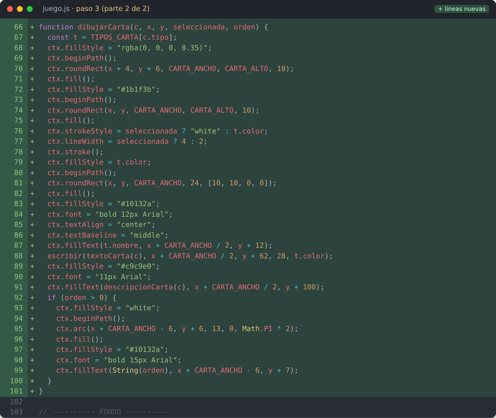</p>

<p align="center"><em>Figura 22. Paso 3: código nuevo en juego.js (parte 2 de 2). Lo verde es lo que escribes; lo gris ya lo tenías.</em></p>

**Explicación línea por línea:**


> **Dibujar una carta.** Cuerpo oscuro, borde y franja de su color, nombre del tipo, símbolo grande y descripción. Si está elegida, el borde es blanco y lleva un circulito con su número de orden.

- **Línea 66** · `function dibujarCarta(c, x, y, seleccionada, orden) {`  
  → Declara dibujarCarta: la carta, su posición, si está seleccionada y su número de orden (0 = sin número).
- **Línea 67** · `const t = TIPOS_CARTA[c.tipo];`  
  → Datos del tipo de la carta (color y nombre).
- **Línea 68** · `ctx.fillStyle = "rgba(0, 0, 0, 0.35)";`  
  → Sombra: negro semitransparente.
- **Línea 69** · `ctx.beginPath();`  
  → Empieza un trazo nuevo, para que esta figura no se mezcle con la anterior.
- **Línea 70** · `ctx.roundRect(x + 4, y + 6, CARTA_ANCHO, CARTA_ALTO, 10);`  
  → La sombra es la misma forma, desplazada 4 a la derecha y 6 hacia abajo.
- **Línea 71** · `ctx.fill();`  
  → Rellena la figura que acabamos de trazar con el color de `fillStyle`.
- **Línea 72** · `ctx.fillStyle = "#1b1f3b";`  
  → Cuerpo de la carta: azul muy oscuro.
- **Línea 73** · `ctx.beginPath();`  
  → Empieza un trazo nuevo, para que esta figura no se mezcle con la anterior.
- **Línea 74** · `ctx.roundRect(x, y, CARTA_ANCHO, CARTA_ALTO, 10);`  
  → Rectángulo con esquinas redondeadas (radio 10).
- **Línea 75** · `ctx.fill();`  
  → Rellena la figura que acabamos de trazar con el color de `fillStyle`.
- **Línea 76** · `ctx.strokeStyle = seleccionada ? "white" : t.color;`  
  → Borde blanco si está seleccionada; si no, de su color. (condición ? sí : no)
- **Línea 77** · `ctx.lineWidth = seleccionada ? 4 : 2;`  
  → Borde más grueso si está seleccionada.
- **Línea 78** · `ctx.stroke();`  
  → Dibuja el contorno (la línea) de la figura con el color de `strokeStyle`.
- **Línea 79** · `ctx.fillStyle = t.color;`  
  → Franja superior del color del tipo.
- **Línea 80** · `ctx.beginPath();`  
  → Empieza un trazo nuevo, para que esta figura no se mezcle con la anterior.
- **Línea 81** · `ctx.roundRect(x, y, CARTA_ANCHO, 24, [10, 10, 0, 0]);`  
  → Rectángulo con solo las esquinas de arriba redondeadas: [10, 10, 0, 0] = arriba-izq, arriba-der, abajo-der, abajo-izq.
- **Línea 82** · `ctx.fill();`  
  → Rellena la figura que acabamos de trazar con el color de `fillStyle`.
- **Línea 83** · `ctx.fillStyle = "#10132a";`  
  → Texto oscuro para el nombre del tipo.
- **Línea 84** · `ctx.font = "bold 12px Arial";`  
  → Letra pequeña en negrita.
- **Línea 85** · `ctx.textAlign = "center";`  
  → Centrado.
- **Línea 86** · `ctx.textBaseline = "middle";`  
  → Alineación vertical del texto: con `"middle"` la y que demos será el centro del texto.
- **Línea 87** · `ctx.fillText(t.nombre, x + CARTA_ANCHO / 2, y + 12);`  
  → Escribe el nombre del tipo dentro de la franja.
- **Línea 88** · `escribir(textoCarta(c), x + CARTA_ANCHO / 2, y + 62, 28, t.color);`  
  → Símbolo grande en el centro, del color del tipo.
- **Línea 89** · `ctx.fillStyle = "#c9c9e0";`  
  → Descripción pequeña abajo, gris claro.
- **Línea 90** · `ctx.font = "11px Arial";`  
  → Elige la letra (estilo, tamaño en píxeles y tipo): `"11px Arial"`.
- **Línea 91** · `ctx.fillText(descripcionCarta(c), x + CARTA_ANCHO / 2, y + 100);`  
  → Escribe la descripción corta debajo del símbolo.
- **Línea 92** · `if (orden > 0) {`  
  → Si tiene número de orden (orden mayor que 0)…
- **Línea 93** · `ctx.fillStyle = "white";`  
  → …circulito blanco en la esquina superior derecha…
- **Línea 94** · `ctx.beginPath();`  
  → Empieza un trazo nuevo, para que esta figura no se mezcle con la anterior.
- **Línea 95** · `ctx.arc(x + CARTA_ANCHO - 6, y + 6, 13, 0, Math.PI * 2);`  
  → Traza un círculo o arco: centro x, centro y, radio, ángulo inicial y ángulo final → `x + CARTA_ANCHO - 6, y + 6, 13, 0, Math.PI * 2`.
- **Línea 96** · `ctx.fill();`  
  → Rellena la figura que acabamos de trazar con el color de `fillStyle`.
- **Línea 97** · `ctx.fillStyle = "#10132a";`  
  → …con el número dentro, oscuro.
- **Línea 98** · `ctx.font = "bold 15px Arial";`  
  → Elige la letra (estilo, tamaño en píxeles y tipo): `"bold 15px Arial"`.
- **Línea 99** · `ctx.fillText(String(orden), x + CARTA_ANCHO - 6, y + 7);`  
  → Escribe el texto `String(orden)` en la posición x = `x + CARTA_ANCHO - 6`, y = `y + 7`.
- **Línea 100** · `}`  
  → Cierra la llave `{` que se abrió más arriba: aquí termina ese bloque.
- **Línea 101** · `}`  
  → Cierra la llave `{` que se abrió más arriba: aquí termina ese bloque.

**Código para copiar** (o mejor, ¡escríbelo tú para aprender!):

```javascript
function dibujarCarta(c, x, y, seleccionada, orden) {
  const t = TIPOS_CARTA[c.tipo];
  ctx.fillStyle = "rgba(0, 0, 0, 0.35)";
  ctx.beginPath();
  ctx.roundRect(x + 4, y + 6, CARTA_ANCHO, CARTA_ALTO, 10);
  ctx.fill();
  ctx.fillStyle = "#1b1f3b";
  ctx.beginPath();
  ctx.roundRect(x, y, CARTA_ANCHO, CARTA_ALTO, 10);
  ctx.fill();
  ctx.strokeStyle = seleccionada ? "white" : t.color;
  ctx.lineWidth = seleccionada ? 4 : 2;
  ctx.stroke();
  ctx.fillStyle = t.color;
  ctx.beginPath();
  ctx.roundRect(x, y, CARTA_ANCHO, 24, [10, 10, 0, 0]);
  ctx.fill();
  ctx.fillStyle = "#10132a";
  ctx.font = "bold 12px Arial";
  ctx.textAlign = "center";
  ctx.textBaseline = "middle";
  ctx.fillText(t.nombre, x + CARTA_ANCHO / 2, y + 12);
  escribir(textoCarta(c), x + CARTA_ANCHO / 2, y + 62, 28, t.color);
  ctx.fillStyle = "#c9c9e0";
  ctx.font = "11px Arial";
  ctx.fillText(descripcionCarta(c), x + CARTA_ANCHO / 2, y + 100);
  if (orden > 0) {
    ctx.fillStyle = "white";
    ctx.beginPath();
    ctx.arc(x + CARTA_ANCHO - 6, y + 6, 13, 0, Math.PI * 2);
    ctx.fill();
    ctx.fillStyle = "#10132a";
    ctx.font = "bold 15px Arial";
    ctx.fillText(String(orden), x + CARTA_ANCHO - 6, y + 7);
  }
}
```

#### Cambio 3 de 3 · Añadir código en `juego.js`

📍 **Dónde:** justo **debajo** de la línea `dibujarFondo();` (en el archivo terminado de este paso es la línea 141). Las líneas nuevas son de la 142 a la 146.

<p align="center">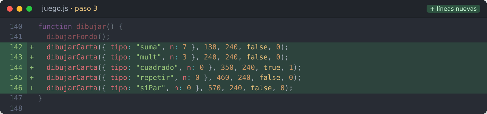</p>

<p align="center"><em>Figura 23. Paso 3: código nuevo en juego.js. Lo verde es lo que escribes; lo gris ya lo tenías.</em></p>

**Explicación línea por línea:**

- **Línea 142** · `dibujarCarta({ tipo: "suma", n: 7 }, 130, 240, false, 0);`  
  → CARTAS DE PRUEBA (las borraremos en el paso 4): una de cada tipo.
- **Línea 143** · `dibujarCarta({ tipo: "mult", n: 3 }, 240, 240, false, 0);`  
  → Una de multiplicación.
- **Línea 144** · `dibujarCarta({ tipo: "cuadrado", n: 0 }, 350, 240, true, 1);`  
  → Una de cuadrado, dibujada como elegida (borde blanco y número 1).
- **Línea 145** · `dibujarCarta({ tipo: "repetir", n: 0 }, 460, 240, false, 0);`  
  → Un bucle.
- **Línea 146** · `dibujarCarta({ tipo: "siPar", n: 0 }, 570, 240, false, 0);`  
  → Un condicional.

**Código para copiar** (o mejor, ¡escríbelo tú para aprender!):

```javascript
  dibujarCarta({ tipo: "suma", n: 7 }, 130, 240, false, 0);
  dibujarCarta({ tipo: "mult", n: 3 }, 240, 240, false, 0);
  dibujarCarta({ tipo: "cuadrado", n: 0 }, 350, 240, true, 1);
  dibujarCarta({ tipo: "repetir", n: 0 }, 460, 240, false, 0);
  dibujarCarta({ tipo: "siPar", n: 0 }, 570, 240, false, 0);
```

### Resultado del paso 3

<p align="center">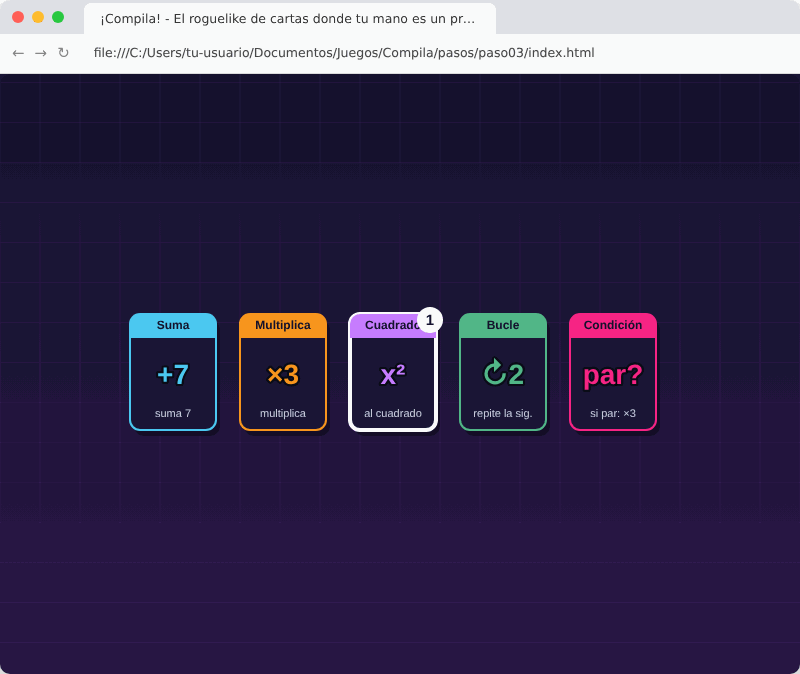</p>

<p align="center"><em>Figura 24. Una carta de cada tipo. La del centro se dibuja "elegida": borde blanco y número de orden 1.</em></p>

### Pruébalo tú

- Cambia el color de `cuadrado` en `TIPOS_CARTA` por `"#ffd166"`.
- Cambia `CARTA_ANCHO = 86` por `120`: todas las cartas se adaptan.

# 7. Paso 4 · El mazo, el barajado y la mano

**Objetivo:** crear un mazo de 30 cartas, barajarlo correctamente y robar 7 cartas que se dibujan centradas.

**Qué aprenderás:** construir listas con bucles, el **algoritmo de Fisher-Yates**, `push`/`pop` (el mazo funciona como una **pila**) y calcular posiciones centradas.

<p align="center">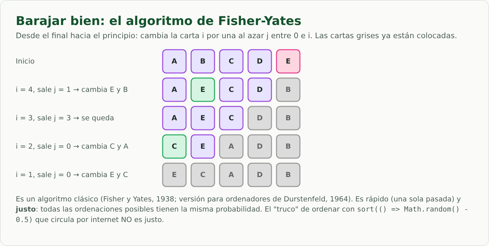</p>

<p align="center"><em>Figura 25. El algoritmo de Fisher-Yates paso a paso con 5 cartas.</em></p>

#### Cambio 1 de 5 · Añadir código en `juego.js`

📍 **Dónde:** justo **debajo** de la línea `const CARTA_ALTO = 116;` (en el archivo terminado de este paso es la línea 21). Las líneas nuevas son de la 22 a la 22.

<p align="center">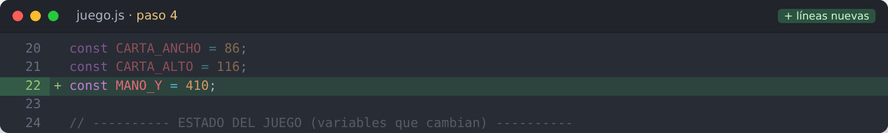</p>

<p align="center"><em>Figura 26. Paso 4: código nuevo en juego.js. Lo verde es lo que escribes; lo gris ya lo tenías.</em></p>

**Explicación línea por línea:**

- **Línea 22** · `const MANO_Y = 410;`  
  → Altura (y) a la que se dibuja la fila de cartas de la mano.

**Código para copiar** (o mejor, ¡escríbelo tú para aprender!):

```javascript
const MANO_Y = 410;
```

#### Cambio 2 de 5 · Añadir código en `juego.js`

📍 **Dónde:** justo **debajo** de la línea `let tiempoTotal = 0;` (en el archivo terminado de este paso es la línea 27). Las líneas nuevas son de la 28 a la 29.

<p align="center">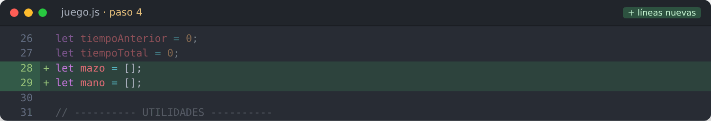</p>

<p align="center"><em>Figura 27. Paso 4: código nuevo en juego.js. Lo verde es lo que escribes; lo gris ya lo tenías.</em></p>

**Explicación línea por línea:**

- **Línea 28** · `let mazo = [];`  
  → El mazo: lista de cartas que quedan por robar.
- **Línea 29** · `let mano = [];`  
  → La mano: las cartas que tiene el jugador ahora.

**Código para copiar** (o mejor, ¡escríbelo tú para aprender!):

```javascript
let mazo = [];
let mano = [];
```

#### Cambio 3 de 5 · Añadir código en `juego.js`

📍 **Dónde:** justo **debajo** de la línea `}` que cierra el bloque `function dibujarCarta(c, x, y, seleccionada, orden) {` (en el archivo terminado de este paso es la línea 104). Las líneas nuevas son de la 106 a la 156.

##### Parte 1 de 2 (líneas 106 a 141)

<p align="center">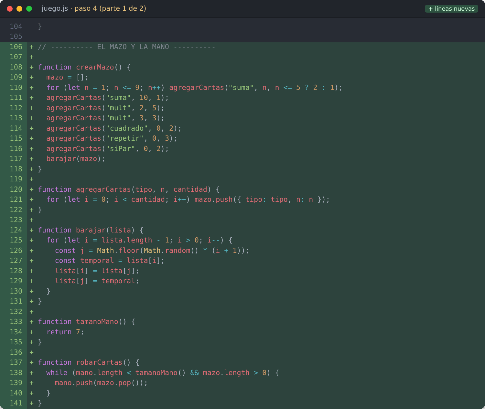</p>

<p align="center"><em>Figura 28. Paso 4: código nuevo en juego.js (parte 1 de 2). Lo verde es lo que escribes; lo gris ya lo tenías.</em></p>

**Explicación línea por línea:**

- **Línea 106** · `// ---------- EL MAZO Y LA MANO ----------`  
  → Comentario que sirve de título de sección: «EL MAZO Y LA MANO». El navegador lo ignora; nos ayuda a ordenar el código.

> **Crear el mazo.** El mazo tiene 30 cartas. Hay muchas sumas (las básicas), algunas multiplicaciones y pocas cartas "especiales". Al terminar, lo barajamos.

- **Línea 108** · `function crearMazo() {`  
  → Declara crearMazo.
- **Línea 109** · `mazo = [];`  
  → Empezamos con el mazo vacío.
- **Línea 110** · `for (let n = 1; n <= 9; n++) agregarCartas("suma", n, n <= 5 ? 2 : 1);`  
  → Sumas del 1 al 9: dos cartas de cada una del 1 al 5 y una del 6 al 9 (14 cartas).
- **Línea 111** · `agregarCartas("suma", 10, 1);`  
  → Una suma de 10.
- **Línea 112** · `agregarCartas("mult", 2, 5);`  
  → Cinco cartas de ×2.
- **Línea 113** · `agregarCartas("mult", 3, 3);`  
  → Tres cartas de ×3.
- **Línea 114** · `agregarCartas("cuadrado", 0, 2);`  
  → Dos cartas de cuadrado (el número n no se usa, ponemos 0).
- **Línea 115** · `agregarCartas("repetir", 0, 3);`  
  → Tres bucles.
- **Línea 116** · `agregarCartas("siPar", 0, 2);`  
  → Dos condicionales.
- **Línea 117** · `barajar(mazo);`  
  → Barajamos el mazo.
- **Línea 118** · `}`  
  → Cierra la llave `{` que se abrió más arriba: aquí termina ese bloque.
- **Línea 120** · `function agregarCartas(tipo, n, cantidad) {`  
  → Declara agregarCartas: añade al mazo "cantidad" cartas iguales.
- **Línea 121** · `for (let i = 0; i < cantidad; i++) mazo.push({ tipo: tipo, n: n });`  
  → Repite cantidad veces añadiendo una carta nueva (un objeto con su tipo y su número).
- **Línea 122** · `}`  
  → Cierra la llave `{` que se abrió más arriba: aquí termina ese bloque.

> **Barajar: el algoritmo de Fisher-Yates.** Recorremos la lista desde el final y cambiamos cada elemento por otro al azar de los que quedan delante. Es el método correcto para barajar: todas las ordenaciones salen con la misma probabilidad.

- **Línea 124** · `function barajar(lista) {`  
  → Declara barajar: recibe una lista y la desordena.
- **Línea 125** · `for (let i = lista.length - 1; i > 0; i--) {`  
  → Desde la última posición hasta la segunda.
- **Línea 126** · `const j = Math.floor(Math.random() * (i + 1));`  
  → Posición al azar entre 0 e i (incluida).
- **Línea 127** · `const temporal = lista[i];`  
  → Guardamos el elemento i en una variable temporal…
- **Línea 128** · `lista[i] = lista[j];`  
  → …ponemos el j en la posición i…
- **Línea 129** · `lista[j] = temporal;`  
  → …y el que guardamos, en la posición j. ¡Intercambio hecho!
- **Línea 130** · `}`  
  → Cierra la llave `{` que se abrió más arriba: aquí termina ese bloque.
- **Línea 131** · `}`  
  → Cierra la llave `{` que se abrió más arriba: aquí termina ese bloque.
- **Línea 133** · `function tamanoMano() {`  
  → Declara tamanoMano: cuántas cartas caben en la mano.
- **Línea 134** · `return 7;`  
  → Normalmente, 7.
- **Línea 135** · `}`  
  → Cierra la llave `{` que se abrió más arriba: aquí termina ese bloque.
- **Línea 137** · `function robarCartas() {`  
  → Declara robarCartas: completa la mano con cartas del mazo.
- **Línea 138** · `while (mano.length < tamanoMano() && mazo.length > 0) {`  
  → Mientras falten cartas en la mano Y queden en el mazo…
- **Línea 139** · `mano.push(mazo.pop());`  
  → …saca la última carta del mazo (pop) y métela en la mano (push).
- **Línea 140** · `}`  
  → Cierra la llave `{` que se abrió más arriba: aquí termina ese bloque.
- **Línea 141** · `}`  
  → Cierra la llave `{` que se abrió más arriba: aquí termina ese bloque.

**Código para copiar** (o mejor, ¡escríbelo tú para aprender!):

```javascript
// ---------- EL MAZO Y LA MANO ----------

function crearMazo() {
  mazo = [];
  for (let n = 1; n <= 9; n++) agregarCartas("suma", n, n <= 5 ? 2 : 1);
  agregarCartas("suma", 10, 1);
  agregarCartas("mult", 2, 5);
  agregarCartas("mult", 3, 3);
  agregarCartas("cuadrado", 0, 2);
  agregarCartas("repetir", 0, 3);
  agregarCartas("siPar", 0, 2);
  barajar(mazo);
}

function agregarCartas(tipo, n, cantidad) {
  for (let i = 0; i < cantidad; i++) mazo.push({ tipo: tipo, n: n });
}

function barajar(lista) {
  for (let i = lista.length - 1; i > 0; i--) {
    const j = Math.floor(Math.random() * (i + 1));
    const temporal = lista[i];
    lista[i] = lista[j];
    lista[j] = temporal;
  }
}

function tamanoMano() {
  return 7;
}

function robarCartas() {
  while (mano.length < tamanoMano() && mazo.length > 0) {
    mano.push(mazo.pop());
  }
}
```

##### Parte 2 de 2 (líneas 143 a 156)

<p align="center">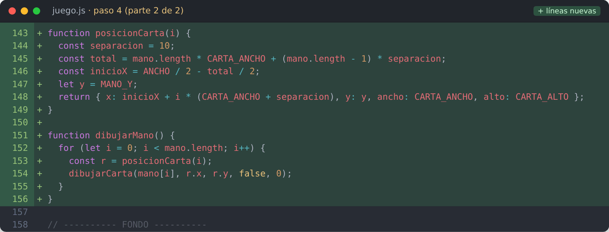</p>

<p align="center"><em>Figura 29. Paso 4: código nuevo en juego.js (parte 2 de 2). Lo verde es lo que escribes; lo gris ya lo tenías.</em></p>

**Explicación línea por línea:**


> **¿Dónde se dibuja cada carta?** Calculamos la posición para que la mano quede centrada. Las cartas elegidas suben 22 píxeles y la que está bajo el ratón, 8.

- **Línea 143** · `function posicionCarta(i) {`  
  → Declara posicionCarta: recibe la posición i en la mano y devuelve un rectángulo (x, y, ancho, alto).
- **Línea 144** · `const separacion = 10;`  
  → Espacio entre cartas.
- **Línea 145** · `const total = mano.length * CARTA_ANCHO + (mano.length - 1) * separacion;`  
  → Ancho total que ocupa la mano.
- **Línea 146** · `const inicioX = ANCHO / 2 - total / 2;`  
  → x de la primera carta para que todo quede centrado.
- **Línea 147** · `let y = MANO_Y;`  
  → y normal de la mano.
- **Línea 148** · `return { x: inicioX + i * (CARTA_ANCHO + separacion), y: y, ancho: CARTA_ANCHO, alto: C...`  
  → Devolvemos el rectángulo de la carta.
- **Línea 149** · `}`  
  → Cierra la llave `{` que se abrió más arriba: aquí termina ese bloque.
- **Línea 151** · `function dibujarMano() {`  
  → Declara dibujarMano.
- **Línea 152** · `for (let i = 0; i < mano.length; i++) {`  
  → Para cada carta de la mano…
- **Línea 153** · `const r = posicionCarta(i);`  
  → …calculamos su rectángulo…
- **Línea 154** · `dibujarCarta(mano[i], r.x, r.y, false, 0);`  
  → …y la dibujamos (de momento, sin selección).
- **Línea 155** · `}`  
  → Cierra la llave `{` que se abrió más arriba: aquí termina ese bloque.
- **Línea 156** · `}`  
  → Cierra la llave `{` que se abrió más arriba: aquí termina ese bloque.

**Código para copiar** (o mejor, ¡escríbelo tú para aprender!):

```javascript
function posicionCarta(i) {
  const separacion = 10;
  const total = mano.length * CARTA_ANCHO + (mano.length - 1) * separacion;
  const inicioX = ANCHO / 2 - total / 2;
  let y = MANO_Y;
  return { x: inicioX + i * (CARTA_ANCHO + separacion), y: y, ancho: CARTA_ANCHO, alto: CARTA_ALTO };
}

function dibujarMano() {
  for (let i = 0; i < mano.length; i++) {
    const r = posicionCarta(i);
    dibujarCarta(mano[i], r.x, r.y, false, 0);
  }
}
```

#### Cambio 4 de 5 · Cambiar (reemplazar) código en `juego.js`

🗑️ **Primero, borra las líneas 142 a 146 de tu archivo `juego.js`** (están justo debajo de `dibujarFondo();`). En la imagen aparecen en rojo y tachadas:

<p align="center">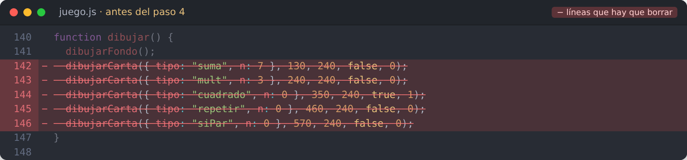</p>

<p align="center"><em>Figura 30. Paso 4: líneas que se borran de juego.js</em></p>

Estas son las líneas que desaparecen:

```javascript
  dibujarCarta({ tipo: "suma", n: 7 }, 130, 240, false, 0);
  dibujarCarta({ tipo: "mult", n: 3 }, 240, 240, false, 0);
  dibujarCarta({ tipo: "cuadrado", n: 0 }, 350, 240, true, 1);
  dibujarCarta({ tipo: "repetir", n: 0 }, 460, 240, false, 0);
  dibujarCarta({ tipo: "siPar", n: 0 }, 570, 240, false, 0);
```

✏️ **Después, en ese mismo sitio, escribe las líneas nuevas** (quedan en las líneas 197 a 197 del archivo terminado).

<p align="center">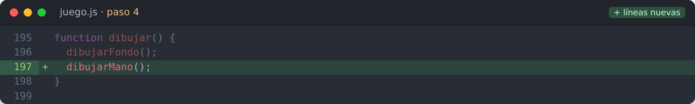</p>

<p align="center"><em>Figura 31. Paso 4: código nuevo en juego.js. Lo verde es lo que escribes; lo gris ya lo tenías.</em></p>

**Explicación línea por línea:**

- **Línea 197** · `dibujarMano();`  
  → La mano.

**Código para copiar** (o mejor, ¡escríbelo tú para aprender!):

```javascript
  dibujarMano();
```

#### Cambio 5 de 5 · Añadir código en `juego.js`

📍 **Dónde:** justo **debajo** de la línea `}` que cierra el bloque `function dibujar() {` (en el archivo terminado de este paso es la línea 198). Las líneas nuevas son de la 200 a la 201.

<p align="center">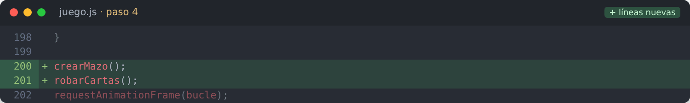</p>

<p align="center"><em>Figura 32. Paso 4: código nuevo en juego.js. Lo verde es lo que escribes; lo gris ya lo tenías.</em></p>

**Explicación línea por línea:**

- **Línea 200** · `crearMazo();`  
  → Preparamos el mazo y la mano para poder ver las cartas.
- **Línea 201** · `robarCartas();`  
  → Robamos la primera mano.

**Código para copiar** (o mejor, ¡escríbelo tú para aprender!):

```javascript
crearMazo();
robarCartas();
```

### Resultado del paso 4

<p align="center">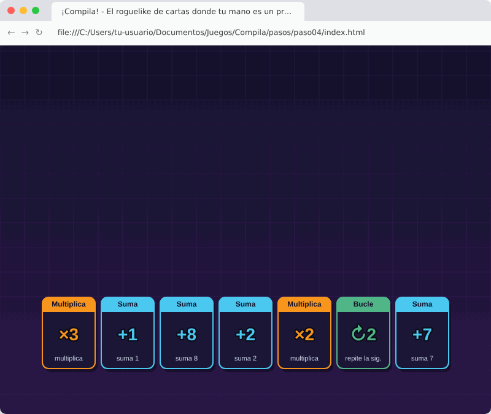</p>

<p align="center"><em>Figura 33. Una mano de 7 cartas robadas del mazo barajado. Cada vez que recargues la página, saldrá otra.</em></p>

### Pruébalo tú

- Cambia `return 7;` por `return 5;` en `tamanoMano`.
- Añade más cuadrados al mazo: `agregarCartas("cuadrado", 0, 6);`. ¿Se vuelve el juego demasiado fácil?

# 8. Paso 5 · Elegir cartas (ratón, dedo y teclado)

**Objetivo:** elegir y soltar cartas con clic, toque o teclas 1-8. Las elegidas suben y muestran su **número de orden**; la que está bajo el ratón se levanta un poco.

**Qué aprenderás:** detectar si un punto está dentro de un rectángulo, *pointer events*, convertir coordenadas de pantalla a coordenadas del juego, y por qué guardar las **posiciones** de las cartas en el orden de selección.

#### Cambio 1 de 5 · Añadir código en `juego.js`

📍 **Dónde:** justo **debajo** de la línea `let mano = [];` (en el archivo terminado de este paso es la línea 29). Las líneas nuevas son de la 30 a la 32.

<p align="center">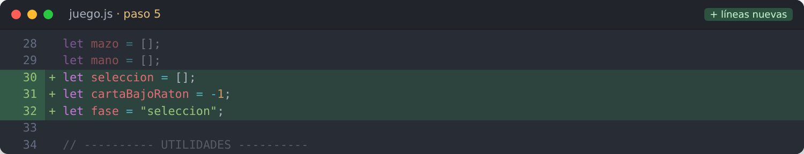</p>

<p align="center"><em>Figura 34. Paso 5: código nuevo en juego.js. Lo verde es lo que escribes; lo gris ya lo tenías.</em></p>

**Explicación línea por línea:**

- **Línea 30** · `let seleccion = [];`  
  → Las cartas elegidas para el programa: guardamos su POSICIÓN en la mano, en el orden en que se eligieron.
- **Línea 31** · `let cartaBajoRaton = -1;`  
  → Posición de la carta que está bajo el ratón (-1 = ninguna).
- **Línea 32** · `let fase = "seleccion";`  
  → Fase del juego: "seleccion" (eligiendo cartas). Más adelante habrá otras fases.

**Código para copiar** (o mejor, ¡escríbelo tú para aprender!):

```javascript
let seleccion = [];
let cartaBajoRaton = -1;
let fase = "seleccion";
```

#### Cambio 2 de 5 · Añadir código en `juego.js`

📍 **Dónde:** justo **debajo** de la línea `}` que cierra el bloque `function dibujarCarta(c, x, y, seleccionada, orden) {` (en el archivo terminado de este paso es la línea 107). Las líneas nuevas son de la 109 a la 111.

<p align="center">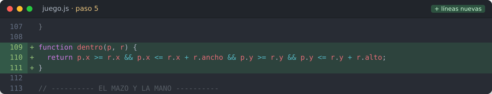</p>

<p align="center"><em>Figura 35. Paso 5: código nuevo en juego.js. Lo verde es lo que escribes; lo gris ya lo tenías.</em></p>

**Explicación línea por línea:**


> **¿Un punto está dentro de un rectángulo?** La usaremos para saber si el ratón está sobre una carta o un botón. Todo rectángulo del juego tendrá x, y, ancho y alto.

- **Línea 109** · `function dentro(p, r) {`  
  → Declara la función dentro: recibe un punto p y un rectángulo r. Devuelve true o false.
- **Línea 110** · `return p.x >= r.x && p.x <= r.x + r.ancho && p.y >= r.y && p.y <= r.y + r.alto;`  
  → Está dentro si su x está entre el borde izquierdo y el derecho Y su y entre el de arriba y el de abajo.
- **Línea 111** · `}`  
  → Cierra la llave `{` que se abrió más arriba: aquí termina ese bloque.

**Código para copiar** (o mejor, ¡escríbelo tú para aprender!):

```javascript
function dentro(p, r) {
  return p.x >= r.x && p.x <= r.x + r.ancho && p.y >= r.y && p.y <= r.y + r.alto;
}
```

#### Cambio 3 de 5 · Añadir código en `juego.js`

📍 **Dónde:** justo **debajo** de la línea `let y = MANO_Y;` (en el archivo terminado de este paso es la línea 154). Las líneas nuevas son de la 155 a la 156.

<p align="center">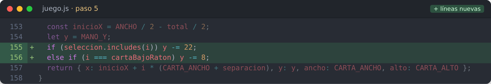</p>

<p align="center"><em>Figura 36. Paso 5: código nuevo en juego.js. Lo verde es lo que escribes; lo gris ya lo tenías.</em></p>

**Explicación línea por línea:**

- **Línea 155** · `if (seleccion.includes(i)) y -= 22;`  
  → Si está elegida (su posición aparece en la lista seleccion), sube 22 píxeles.
- **Línea 156** · `else if (i === cartaBajoRaton) y -= 8;`  
  → Si no, pero está bajo el ratón, sube 8.

**Código para copiar** (o mejor, ¡escríbelo tú para aprender!):

```javascript
  if (seleccion.includes(i)) y -= 22;
  else if (i === cartaBajoRaton) y -= 8;
```

#### Cambio 4 de 5 · Cambiar (reemplazar) código en `juego.js`

🗑️ **Primero, borra la línea 154 de tu archivo `juego.js`** (están justo debajo de `const r = posicionCarta(i);`). En la imagen aparecen en rojo y tachadas:

<p align="center">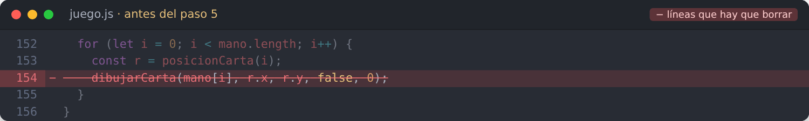</p>

<p align="center"><em>Figura 37. Paso 5: líneas que se borran de juego.js</em></p>

Estas son las líneas que desaparecen:

```javascript
    dibujarCarta(mano[i], r.x, r.y, false, 0);
```

✏️ **Después, en ese mismo sitio, escribe las líneas nuevas** (quedan en las líneas 163 a 164 del archivo terminado).

<p align="center">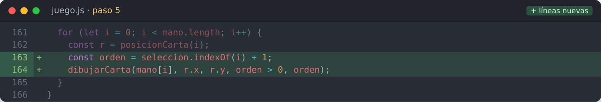</p>

<p align="center"><em>Figura 38. Paso 5: código nuevo en juego.js. Lo verde es lo que escribes; lo gris ya lo tenías.</em></p>

**Explicación línea por línea:**

- **Línea 163** · `const orden = seleccion.indexOf(i) + 1;`  
  → …buscamos su número de orden: su posición en la selección + 1 (si no está elegida, indexOf da -1 y el orden queda 0)…
- **Línea 164** · `dibujarCarta(mano[i], r.x, r.y, orden > 0, orden);`  
  → …y la dibujamos.

**Código para copiar** (o mejor, ¡escríbelo tú para aprender!):

```javascript
    const orden = seleccion.indexOf(i) + 1;
    dibujarCarta(mano[i], r.x, r.y, orden > 0, orden);
```

#### Cambio 5 de 5 · Añadir código en `juego.js`

📍 **Dónde:** justo **debajo** de la línea `}` que cierra el bloque `function dibujarMano() {` (en el archivo terminado de este paso es la línea 166). Las líneas nuevas son de la 168 a la 214.

##### Parte 1 de 2 (líneas 168 a 205)

<p align="center">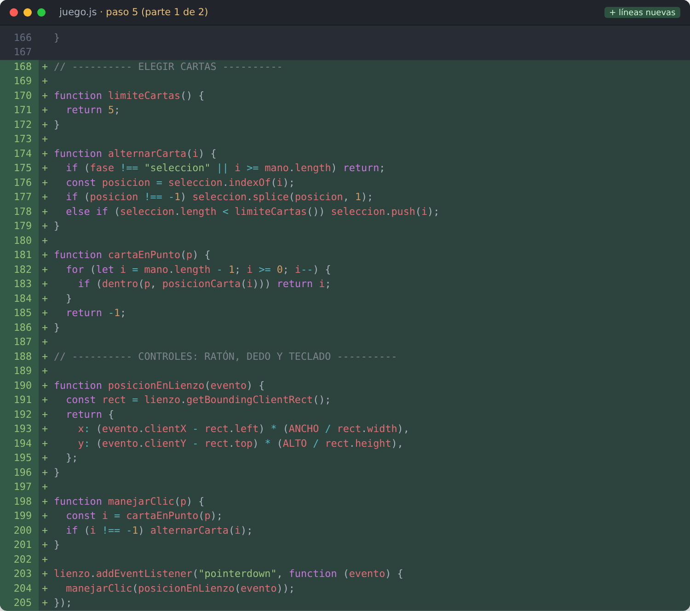</p>

<p align="center"><em>Figura 39. Paso 5: código nuevo en juego.js (parte 1 de 2). Lo verde es lo que escribes; lo gris ya lo tenías.</em></p>

**Explicación línea por línea:**

- **Línea 168** · `// ---------- ELEGIR CARTAS ----------`  
  → Comentario que sirve de título de sección: «ELEGIR CARTAS». El navegador lo ignora; nos ayuda a ordenar el código.
- **Línea 170** · `function limiteCartas() {`  
  → Declara limiteCartas: el máximo de cartas en un programa.
- **Línea 171** · `return 5;`  
  → Normalmente, 5.
- **Línea 172** · `}`  
  → Cierra la llave `{` que se abrió más arriba: aquí termina ese bloque.

> **Elegir o soltar una carta.** Si ya estaba elegida, la quitamos del programa; si no, la añadimos AL FINAL. Por eso el orden en que haces clic es el orden en que se ejecutará el programa.

- **Línea 174** · `function alternarCarta(i) {`  
  → Declara alternarCarta: recibe la posición i de la carta en la mano.
- **Línea 175** · `if (fase !== "seleccion" || i >= mano.length) return;`  
  → Solo se puede elegir en la fase de selección y si la carta existe.
- **Línea 176** · `const posicion = seleccion.indexOf(i);`  
  → ¿En qué posición de la selección está? (-1 si no está).
- **Línea 177** · `if (posicion !== -1) seleccion.splice(posicion, 1);`  
  → Si ya estaba elegida, la quitamos (splice borra 1 elemento en esa posición).
- **Línea 178** · `else if (seleccion.length < limiteCartas()) seleccion.push(i);`  
  → Si no estaba y aún caben más, la añadimos al final.
- **Línea 179** · `}`  
  → Cierra la llave `{` que se abrió más arriba: aquí termina ese bloque.
- **Línea 181** · `function cartaEnPunto(p) {`  
  → Declara cartaEnPunto: devuelve la posición de la carta que hay en el punto p, o -1 si no hay ninguna.
- **Línea 182** · `for (let i = mano.length - 1; i >= 0; i--) {`  
  → Miramos de la última a la primera (las de la derecha se dibujan encima).
- **Línea 183** · `if (dentro(p, posicionCarta(i))) return i;`  
  → Si el punto está dentro de esa carta, devolvemos su posición.
- **Línea 184** · `}`  
  → Cierra la llave `{` que se abrió más arriba: aquí termina ese bloque.
- **Línea 185** · `return -1;`  
  → No había ninguna.
- **Línea 186** · `}`  
  → Cierra la llave `{` que se abrió más arriba: aquí termina ese bloque.
- **Línea 188** · `// ---------- CONTROLES: RATÓN, DEDO Y TECLADO ----------`  
  → Comentario que sirve de título de sección: «CONTROLES: RATÓN, DEDO Y TECLADO». El navegador lo ignora; nos ayuda a ordenar el código.
- **Línea 190** · `function posicionEnLienzo(evento) {`  
  → Declara posicionEnLienzo: convierte la posición del ratón en pantalla a coordenadas del juego (0-800, 0-600), aunque el lienzo se vea más pequeño.
- **Línea 191** · `const rect = lienzo.getBoundingClientRect();`  
  → Dónde está el lienzo en la pantalla y cuánto mide.
- **Línea 192** · `return {`  
  → Restamos su esquina y escalamos.
- **Línea 193** · `x: (evento.clientX - rect.left) * (ANCHO / rect.width),`  
  → x: restamos el borde izquierdo y escalamos al ancho del juego.
- **Línea 194** · `y: (evento.clientY - rect.top) * (ALTO / rect.height),`  
  → y: igual en vertical.
- **Línea 195** · `};`  
  → Cierra la llave del objeto y termina la instrucción.
- **Línea 196** · `}`  
  → Cierra la llave `{` que se abrió más arriba: aquí termina ese bloque.

> **Gestionar un clic.** Según la fase, un clic hace cosas distintas: empezar, comprar, pulsar un botón o elegir una carta.

- **Línea 198** · `function manejarClic(p) {`  
  → Declara manejarClic.
- **Línea 199** · `const i = cartaEnPunto(p);`  
  → Si no, ¿se pulsó una carta?
- **Línea 200** · `if (i !== -1) alternarCarta(i);`  
  → Si había carta, la elegimos o soltamos.
- **Línea 201** · `}`  
  → Cierra la llave `{` que se abrió más arriba: aquí termina ese bloque.
- **Línea 203** · `lienzo.addEventListener("pointerdown", function (evento) {`  
  → Al hacer clic o tocar el lienzo…
- **Línea 204** · `manejarClic(posicionEnLienzo(evento));`  
  → …gestionamos el clic en esa posición.
- **Línea 205** · `});`  
  → Cierra la llave de la función, el paréntesis de la llamada y termina la instrucción con `;`.

**Código para copiar** (o mejor, ¡escríbelo tú para aprender!):

```javascript
// ---------- ELEGIR CARTAS ----------

function limiteCartas() {
  return 5;
}

function alternarCarta(i) {
  if (fase !== "seleccion" || i >= mano.length) return;
  const posicion = seleccion.indexOf(i);
  if (posicion !== -1) seleccion.splice(posicion, 1);
  else if (seleccion.length < limiteCartas()) seleccion.push(i);
}

function cartaEnPunto(p) {
  for (let i = mano.length - 1; i >= 0; i--) {
    if (dentro(p, posicionCarta(i))) return i;
  }
  return -1;
}

// ---------- CONTROLES: RATÓN, DEDO Y TECLADO ----------

function posicionEnLienzo(evento) {
  const rect = lienzo.getBoundingClientRect();
  return {
    x: (evento.clientX - rect.left) * (ANCHO / rect.width),
    y: (evento.clientY - rect.top) * (ALTO / rect.height),
  };
}

function manejarClic(p) {
  const i = cartaEnPunto(p);
  if (i !== -1) alternarCarta(i);
}

lienzo.addEventListener("pointerdown", function (evento) {
  manejarClic(posicionEnLienzo(evento));
});
```

##### Parte 2 de 2 (líneas 207 a 214)

<p align="center">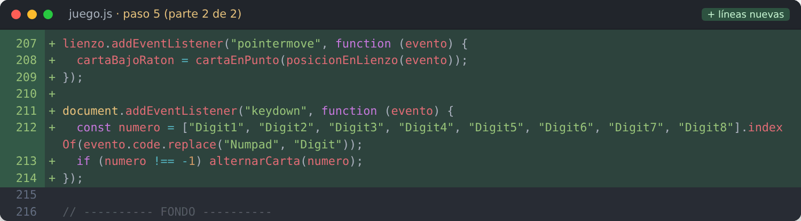</p>

<p align="center"><em>Figura 40. Paso 5: código nuevo en juego.js (parte 2 de 2). Lo verde es lo que escribes; lo gris ya lo tenías.</em></p>

**Explicación línea por línea:**

- **Línea 207** · `lienzo.addEventListener("pointermove", function (evento) {`  
  → Al mover el ratón sobre el lienzo…
- **Línea 208** · `cartaBajoRaton = cartaEnPunto(posicionEnLienzo(evento));`  
  → …apuntamos qué carta hay debajo (para levantarla un poco).
- **Línea 209** · `});`  
  → Cierra la llave de la función, el paréntesis de la llamada y termina la instrucción con `;`.
- **Línea 211** · `document.addEventListener("keydown", function (evento) {`  
  → Al pulsar una tecla…
- **Línea 212** · `const numero = ["Digit1", "Digit2", "Digit3", "Digit4", "Digit5", "Digit6", "Digit7", "...`  
  → Las teclas 1 a 8 (del teclado normal o numérico) eligen la carta 1 a 8. replace convierte "Numpad3" en "Digit3".
- **Línea 213** · `if (numero !== -1) alternarCarta(numero);`  
  → Si era un número, elegimos esa carta.
- **Línea 214** · `});`  
  → Cierra la llave de la función, el paréntesis de la llamada y termina la instrucción con `;`.

**Código para copiar** (o mejor, ¡escríbelo tú para aprender!):

```javascript
lienzo.addEventListener("pointermove", function (evento) {
  cartaBajoRaton = cartaEnPunto(posicionEnLienzo(evento));
});

document.addEventListener("keydown", function (evento) {
  const numero = ["Digit1", "Digit2", "Digit3", "Digit4", "Digit5", "Digit6", "Digit7", "Digit8"].indexOf(evento.code.replace("Numpad", "Digit"));
  if (numero !== -1) alternarCarta(numero);
});
```

### Resultado del paso 5

<p align="center">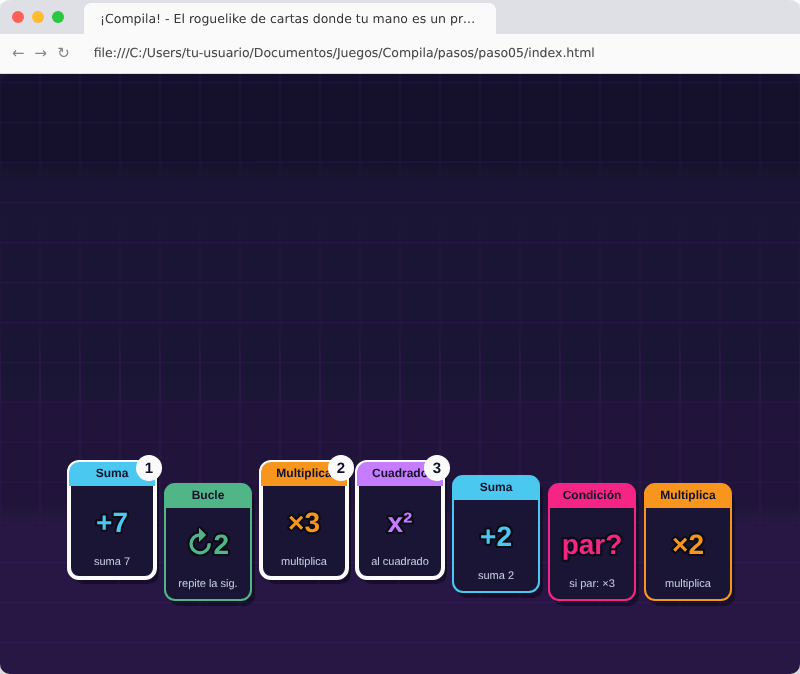</p>

<p align="center"><em>Figura 41. Tres cartas elegidas (1: +7, 2: ×3, 3: x²) y el ratón sobre la quinta carta, que se levanta un poco.</em></p>

# 9. Paso 6 · El editor de código

**Objetivo:** convertir las cartas elegidas en un **programa** que se ve en un panel con aspecto de editor de código, con números de línea y sangría dentro de los bucles.

#### Cambio 1 de 3 · Añadir código en `juego.js`

📍 **Dónde:** justo **debajo** de la línea `const MANO_Y = 410;` (en el archivo terminado de este paso es la línea 22). Las líneas nuevas son de la 23 a la 23.

<p align="center">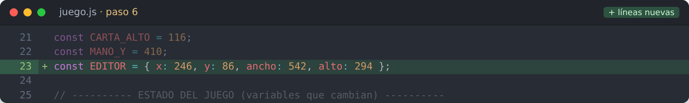</p>

<p align="center"><em>Figura 42. Paso 6: código nuevo en juego.js. Lo verde es lo que escribes; lo gris ya lo tenías.</em></p>

**Explicación línea por línea:**

- **Línea 23** · `const EDITOR = { x: 246, y: 86, ancho: 542, alto: 294 };`  
  → Posición y tamaño del panel del editor de código (donde se ve el programa).

**Código para copiar** (o mejor, ¡escríbelo tú para aprender!):

```javascript
const EDITOR = { x: 246, y: 86, ancho: 542, alto: 294 };
```

#### Cambio 2 de 3 · Añadir código en `juego.js`

📍 **Dónde:** justo **debajo** de la línea `}` que cierra el bloque `function cartaEnPunto(p) {` (en el archivo terminado de este paso es la línea 187). Las líneas nuevas son de la 189 a la 238.

##### Parte 1 de 2 (líneas 189 a 219)

<p align="center">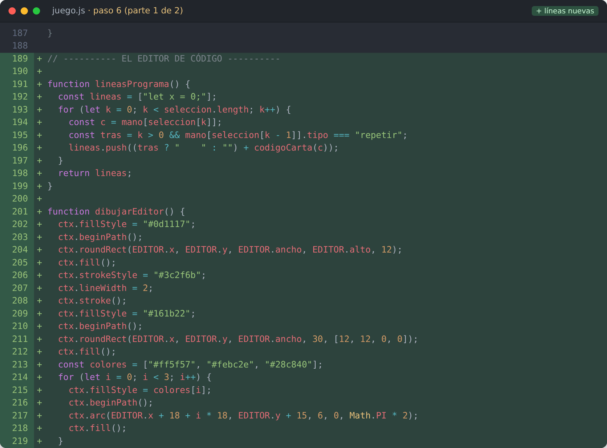</p>

<p align="center"><em>Figura 43. Paso 6: código nuevo en juego.js (parte 1 de 2). Lo verde es lo que escribes; lo gris ya lo tenías.</em></p>

**Explicación línea por línea:**

- **Línea 189** · `// ---------- EL EDITOR DE CÓDIGO ----------`  
  → Comentario que sirve de título de sección: «EL EDITOR DE CÓDIGO». El navegador lo ignora; nos ayuda a ordenar el código.

> **Las líneas del programa.** Convertimos las cartas elegidas en líneas de código. Si una carta va detrás de un bucle, la sangramos (le ponemos espacios delante), como se hace al programar.

- **Línea 191** · `function lineasPrograma() {`  
  → Declara lineasPrograma: devuelve la lista de líneas de texto del programa elegido.
- **Línea 192** · `const lineas = ["let x = 0;"];`  
  → Todo programa empieza declarando la variable x con valor 0.
- **Línea 193** · `for (let k = 0; k < seleccion.length; k++) {`  
  → Para cada posición elegida (k es el orden: 0, 1, 2…)…
- **Línea 194** · `const c = mano[seleccion[k]];`  
  → …la carta correspondiente…
- **Línea 195** · `const tras = k > 0 && mano[seleccion[k - 1]].tipo === "repetir";`  
  → …¿la carta anterior era un bucle? (solo si k > 0).
- **Línea 196** · `lineas.push((tras ? "    " : "") + codigoCarta(c));`  
  → Añadimos su código, con 4 espacios delante si va dentro del bucle.
- **Línea 197** · `}`  
  → Cierra la llave `{` que se abrió más arriba: aquí termina ese bloque.
- **Línea 198** · `return lineas;`  
  → Devolvemos las líneas.
- **Línea 199** · `}`  
  → Cierra la llave `{` que se abrió más arriba: aquí termina ese bloque.

> **Dibujar el editor.** Imita un editor de código real: barra de título con tres puntos, números de línea y código en letra monoespaciada.

- **Línea 201** · `function dibujarEditor() {`  
  → Declara dibujarEditor.
- **Línea 202** · `ctx.fillStyle = "#0d1117";`  
  → Fondo del editor (casi negro, como GitHub en modo oscuro).
- **Línea 203** · `ctx.beginPath();`  
  → Empieza un trazo nuevo, para que esta figura no se mezcle con la anterior.
- **Línea 204** · `ctx.roundRect(EDITOR.x, EDITOR.y, EDITOR.ancho, EDITOR.alto, 12);`  
  → Rectángulo redondeado del tamaño de EDITOR.
- **Línea 205** · `ctx.fill();`  
  → Rellena la figura que acabamos de trazar con el color de `fillStyle`.
- **Línea 206** · `ctx.strokeStyle = "#3c2f6b";`  
  → Borde morado oscuro.
- **Línea 207** · `ctx.lineWidth = 2;`  
  → Grosor de las líneas: `2` píxeles.
- **Línea 208** · `ctx.stroke();`  
  → Dibuja el contorno (la línea) de la figura con el color de `strokeStyle`.
- **Línea 209** · `ctx.fillStyle = "#161b22";`  
  → Barra de título.
- **Línea 210** · `ctx.beginPath();`  
  → Empieza un trazo nuevo, para que esta figura no se mezcle con la anterior.
- **Línea 211** · `ctx.roundRect(EDITOR.x, EDITOR.y, EDITOR.ancho, 30, [12, 12, 0, 0]);`  
  → Traza un rectángulo con esquinas redondeadas: x, y, ancho, alto y radio de las esquinas → `EDITOR.x, EDITOR.y, EDITOR.ancho, 30, [12, 12, 0, 0]`.
- **Línea 212** · `ctx.fill();`  
  → Rellena la figura que acabamos de trazar con el color de `fillStyle`.
- **Línea 213** · `const colores = ["#ff5f57", "#febc2e", "#28c840"];`  
  → Los tres puntos de colores de la ventana (rojo, amarillo, verde).
- **Línea 214** · `for (let i = 0; i < 3; i++) {`  
  → Un círculo por color, separados 18 píxeles.
- **Línea 215** · `ctx.fillStyle = colores[i];`  
  → Elige el color de relleno: `colores[i]`.
- **Línea 216** · `ctx.beginPath();`  
  → Empieza un trazo nuevo, para que esta figura no se mezcle con la anterior.
- **Línea 217** · `ctx.arc(EDITOR.x + 18 + i * 18, EDITOR.y + 15, 6, 0, Math.PI * 2);`  
  → Traza un círculo o arco: centro x, centro y, radio, ángulo inicial y ángulo final → `EDITOR.x + 18 + i * 18, EDITOR.y + 15, 6, 0, Math.PI * 2`.
- **Línea 218** · `ctx.fill();`  
  → Rellena la figura que acabamos de trazar con el color de `fillStyle`.
- **Línea 219** · `}`  
  → Cierra la llave `{` que se abrió más arriba: aquí termina ese bloque.

**Código para copiar** (o mejor, ¡escríbelo tú para aprender!):

```javascript
// ---------- EL EDITOR DE CÓDIGO ----------

function lineasPrograma() {
  const lineas = ["let x = 0;"];
  for (let k = 0; k < seleccion.length; k++) {
    const c = mano[seleccion[k]];
    const tras = k > 0 && mano[seleccion[k - 1]].tipo === "repetir";
    lineas.push((tras ? "    " : "") + codigoCarta(c));
  }
  return lineas;
}

function dibujarEditor() {
  ctx.fillStyle = "#0d1117";
  ctx.beginPath();
  ctx.roundRect(EDITOR.x, EDITOR.y, EDITOR.ancho, EDITOR.alto, 12);
  ctx.fill();
  ctx.strokeStyle = "#3c2f6b";
  ctx.lineWidth = 2;
  ctx.stroke();
  ctx.fillStyle = "#161b22";
  ctx.beginPath();
  ctx.roundRect(EDITOR.x, EDITOR.y, EDITOR.ancho, 30, [12, 12, 0, 0]);
  ctx.fill();
  const colores = ["#ff5f57", "#febc2e", "#28c840"];
  for (let i = 0; i < 3; i++) {
    ctx.fillStyle = colores[i];
    ctx.beginPath();
    ctx.arc(EDITOR.x + 18 + i * 18, EDITOR.y + 15, 6, 0, Math.PI * 2);
    ctx.fill();
  }
```

##### Parte 2 de 2 (líneas 220 a 238)

<p align="center">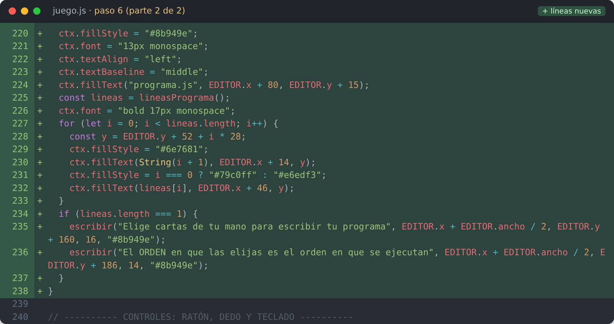</p>

<p align="center"><em>Figura 44. Paso 6: código nuevo en juego.js (parte 2 de 2). Lo verde es lo que escribes; lo gris ya lo tenías.</em></p>

**Explicación línea por línea:**

- **Línea 220** · `ctx.fillStyle = "#8b949e";`  
  → Nombre del archivo en la barra.
- **Línea 221** · `ctx.font = "13px monospace";`  
  → Elige la letra (estilo, tamaño en píxeles y tipo): `"13px monospace"`.
- **Línea 222** · `ctx.textAlign = "left";`  
  → Alineación horizontal del texto respecto al punto que demos: `"left"`.
- **Línea 223** · `ctx.textBaseline = "middle";`  
  → Alineación vertical del texto: con `"middle"` la y que demos será el centro del texto.
- **Línea 224** · `ctx.fillText("programa.js", EDITOR.x + 80, EDITOR.y + 15);`  
  → Escribe el texto `"programa.js"` en la posición x = `EDITOR.x + 80`, y = `EDITOR.y + 15`.
- **Línea 225** · `const lineas = lineasPrograma();`  
  → Las líneas a mostrar: las del programa elegido.
- **Línea 226** · `ctx.font = "bold 17px monospace";`  
  → Letra monoespaciada (todas las letras miden lo mismo), como en los editores de código.
- **Línea 227** · `for (let i = 0; i < lineas.length; i++) {`  
  → Para cada línea…
- **Línea 228** · `const y = EDITOR.y + 52 + i * 28;`  
  → …su altura: 28 píxeles por línea, empezando debajo de la barra.
- **Línea 229** · `ctx.fillStyle = "#6e7681";`  
  → Número de línea en gris (empiezan en 1).
- **Línea 230** · `ctx.fillText(String(i + 1), EDITOR.x + 14, y);`  
  → Escribe el número de línea a la izquierda.
- **Línea 231** · `ctx.fillStyle = i === 0 ? "#79c0ff" : "#e6edf3";`  
  → El código: la primera línea en azul (es la declaración); el resto en blanco.
- **Línea 232** · `ctx.fillText(lineas[i], EDITOR.x + 46, y);`  
  → Escribe el código de la línea.
- **Línea 233** · `}`  
  → Cierra la llave `{` que se abrió más arriba: aquí termina ese bloque.
- **Línea 234** · `if (lineas.length === 1) {`  
  → Si no hay ninguna carta elegida, una ayuda.
- **Línea 235** · `escribir("Elige cartas de tu mano para escribir tu programa", EDITOR.x + EDITOR.ancho /...`  
  → Primera línea de ayuda, en gris.
- **Línea 236** · `escribir("El ORDEN en que las elijas es el orden en que se ejecutan", EDITOR.x + EDITOR...`  
  → Segunda línea de ayuda.
- **Línea 237** · `}`  
  → Cierra la llave `{` que se abrió más arriba: aquí termina ese bloque.
- **Línea 238** · `}`  
  → Cierra la llave `{` que se abrió más arriba: aquí termina ese bloque.

**Código para copiar** (o mejor, ¡escríbelo tú para aprender!):

```javascript
  ctx.fillStyle = "#8b949e";
  ctx.font = "13px monospace";
  ctx.textAlign = "left";
  ctx.textBaseline = "middle";
  ctx.fillText("programa.js", EDITOR.x + 80, EDITOR.y + 15);
  const lineas = lineasPrograma();
  ctx.font = "bold 17px monospace";
  for (let i = 0; i < lineas.length; i++) {
    const y = EDITOR.y + 52 + i * 28;
    ctx.fillStyle = "#6e7681";
    ctx.fillText(String(i + 1), EDITOR.x + 14, y);
    ctx.fillStyle = i === 0 ? "#79c0ff" : "#e6edf3";
    ctx.fillText(lineas[i], EDITOR.x + 46, y);
  }
  if (lineas.length === 1) {
    escribir("Elige cartas de tu mano para escribir tu programa", EDITOR.x + EDITOR.ancho / 2, EDITOR.y + 160, 16, "#8b949e");
    escribir("El ORDEN en que las elijas es el orden en que se ejecutan", EDITOR.x + EDITOR.ancho / 2, EDITOR.y + 186, 14, "#8b949e");
  }
}
```

#### Cambio 3 de 3 · Añadir código en `juego.js`

📍 **Dónde:** justo **debajo** de la línea `dibujarFondo();` (en el archivo terminado de este paso es la línea 306). Las líneas nuevas son de la 307 a la 307.

<p align="center">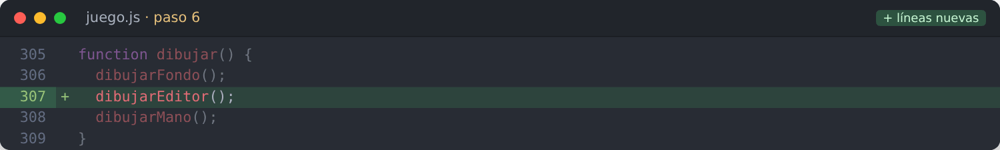</p>

<p align="center"><em>Figura 45. Paso 6: código nuevo en juego.js. Lo verde es lo que escribes; lo gris ya lo tenías.</em></p>

**Explicación línea por línea:**

- **Línea 307** · `dibujarEditor();`  
  → El editor.

**Código para copiar** (o mejor, ¡escríbelo tú para aprender!):

```javascript
  dibujarEditor();
```

### Resultado del paso 6

<p align="center">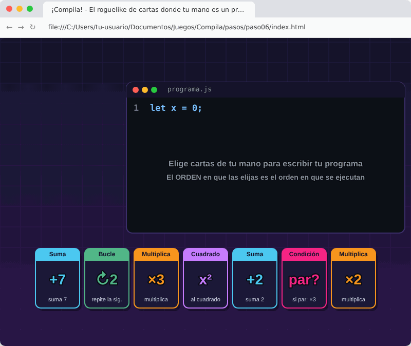</p>

<p align="center"><em>Figura 46. Sin cartas elegidas, el editor solo tiene la línea let x = 0; y una ayuda.</em></p>

<p align="center">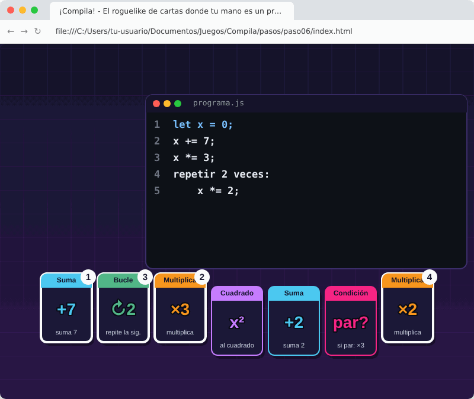</p>

<p align="center"><em>Figura 47. Con +7, ×3, bucle y ×2 elegidos, el editor muestra el programa. La línea después del bucle aparece sangrada.</em></p>

# 10. Paso 7 · El intérprete: ¡ejecutar el programa!

**Objetivo:** el corazón del juego. Al pulsar ENTER, un **intérprete** calcula el programa y una animación lo muestra **línea a línea**, con el valor de x en comentarios verdes y en grande.

**Qué aprenderás:** cómo funciona un intérprete, cómo se ejecuta un bucle por dentro, el **desbordamiento** (overflow), separar el **cálculo** de la **animación**, y borrar elementos de una lista sin estropear las posiciones.

<p align="center">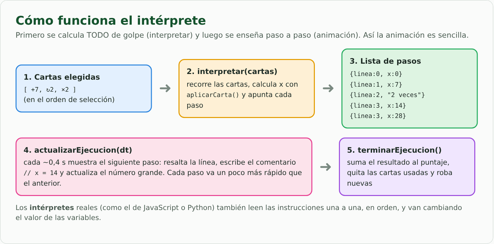</p>

<p align="center"><em>Figura 48. Del programa elegido a la animación: cómo trabajan interpretar() y actualizarEjecucion().</em></p>

#### Cambio 1 de 8 · Añadir código en `juego.js`

📍 **Dónde:** justo **debajo** de la línea `let fase = "seleccion";` (en el archivo terminado de este paso es la línea 33). Las líneas nuevas son de la 34 a la 34.

<p align="center">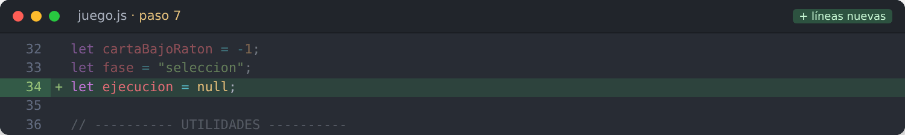</p>

<p align="center"><em>Figura 49. Paso 7: código nuevo en juego.js. Lo verde es lo que escribes; lo gris ya lo tenías.</em></p>

**Explicación línea por línea:**

- **Línea 34** · `let ejecucion = null;`  
  → La ejecución en curso (el programa que se está "corriendo" paso a paso). null = ninguna.

**Código para copiar** (o mejor, ¡escríbelo tú para aprender!):

```javascript
let ejecucion = null;
```

#### Cambio 2 de 8 · Cambiar (reemplazar) código en `juego.js`

🗑️ **Primero, borra la línea 225 de tu archivo `juego.js`** (están justo debajo de `ctx.fillText("programa.js", EDITOR.x + 80, EDITOR.y + 15);`). En la imagen aparecen en rojo y tachadas:

<p align="center">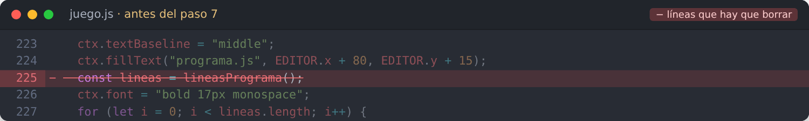</p>

<p align="center"><em>Figura 50. Paso 7: líneas que se borran de juego.js</em></p>

Estas son las líneas que desaparecen:

```javascript
  const lineas = lineasPrograma();
```

✏️ **Después, en ese mismo sitio, escribe las líneas nuevas** (quedan en las líneas 226 a 226 del archivo terminado).

<p align="center"></p>

<p align="center"><em>Figura 51. Paso 7: código nuevo en juego.js. Lo verde es lo que escribes; lo gris ya lo tenías.</em></p>

**Explicación línea por línea:**

- **Línea 226** · `const lineas = fase === "ejecutando" ? ejecucion.lineas : lineasPrograma();`  
  → Si se está ejecutando, mostramos las líneas de la ejecución; si no, las del programa elegido.

**Código para copiar** (o mejor, ¡escríbelo tú para aprender!):

```javascript
  const lineas = fase === "ejecutando" ? ejecucion.lineas : lineasPrograma();
```

#### Cambio 3 de 8 · Añadir código en `juego.js`

📍 **Dónde:** justo **debajo** de la línea `const y = EDITOR.y + 52 + i * 28;` (en el archivo terminado de este paso es la línea 229). Las líneas nuevas son de la 230 a la 233.

<p align="center"></p>

<p align="center"><em>Figura 52. Paso 7: código nuevo en juego.js. Lo verde es lo que escribes; lo gris ya lo tenías.</em></p>

**Explicación línea por línea:**

- **Línea 230** · `if (fase === "ejecutando" && i === ejecucion.lineaActual) {`  
  → Si es la línea que se está ejecutando, la resaltamos con una franja morada.
- **Línea 231** · `ctx.fillStyle = "rgba(157, 78, 221, 0.35)";`  
  → Elige el color de relleno: `"rgba(157, 78, 221, 0.35)"`.
- **Línea 232** · `ctx.fillRect(EDITOR.x + 2, y - 13, EDITOR.ancho - 4, 26);`  
  → Pinta un rectángulo relleno. Los números son x, y (esquina superior izquierda), ancho y alto: `EDITOR.x + 2, y - 13, EDITOR.ancho - 4, 26`.
- **Línea 233** · `}`  
  → Cierra la llave `{` que se abrió más arriba: aquí termina ese bloque.

**Código para copiar** (o mejor, ¡escríbelo tú para aprender!):

```javascript
    if (fase === "ejecutando" && i === ejecucion.lineaActual) {
      ctx.fillStyle = "rgba(157, 78, 221, 0.35)";
      ctx.fillRect(EDITOR.x + 2, y - 13, EDITOR.ancho - 4, 26);
    }
```

#### Cambio 4 de 8 · Añadir código en `juego.js`

📍 **Dónde:** justo **debajo** de la línea `ctx.fillText(lineas[i], EDITOR.x + 46, y);` (en el archivo terminado de este paso es la línea 237). Las líneas nuevas son de la 238 a la 244.

<p align="center"></p>

<p align="center"><em>Figura 53. Paso 7: código nuevo en juego.js. Lo verde es lo que escribes; lo gris ya lo tenías.</em></p>

**Explicación línea por línea:**

- **Línea 238** · `if (fase === "ejecutando" && ejecucion.comentarios[i]) {`  
  → Si la ejecución ya tiene un comentario para esta línea, lo escribimos a la derecha en verde, como un comentario de código.
- **Línea 239** · `const anchoCodigo = ctx.measureText(lineas[i]).width;`  
  → Medimos cuánto ocupa el código de la línea (measureText) para poner el comentario detrás, sin pisarlo.
- **Línea 240** · `ctx.fillStyle = "#7ee787";`  
  → Verde, como los comentarios en los editores.
- **Línea 241** · `ctx.font = "bold 14px monospace";`  
  → Letra un poco más pequeña para que los comentarios largos quepan.
- **Línea 242** · `ctx.fillText("// " + ejecucion.comentarios[i], EDITOR.x + Math.max(250, 66 + anchoCodig...`  
  → Lo escribimos a 20 píxeles del final del código (o en la columna 250 si el código es corto).
- **Línea 243** · `ctx.font = "bold 17px monospace";`  
  → Volvemos a la letra del código para la siguiente línea.
- **Línea 244** · `}`  
  → Cierra la llave `{` que se abrió más arriba: aquí termina ese bloque.

**Código para copiar** (o mejor, ¡escríbelo tú para aprender!):

```javascript
    if (fase === "ejecutando" && ejecucion.comentarios[i]) {
      const anchoCodigo = ctx.measureText(lineas[i]).width;
      ctx.fillStyle = "#7ee787";
      ctx.font = "bold 14px monospace";
      ctx.fillText("// " + ejecucion.comentarios[i], EDITOR.x + Math.max(250, 66 + anchoCodigo), y);
      ctx.font = "bold 17px monospace";
    }
```

#### Cambio 5 de 8 · Añadir código en `juego.js`

📍 **Dónde:** justo **debajo** de la línea `}` que cierra el bloque `if (lineas.length === 1) {` (en el archivo terminado de este paso es la línea 249). Las líneas nuevas son de la 250 a la 252.

<p align="center"></p>

<p align="center"><em>Figura 54. Paso 7: código nuevo en juego.js. Lo verde es lo que escribes; lo gris ya lo tenías.</em></p>

**Explicación línea por línea:**

- **Línea 250** · `if (fase === "ejecutando") {`  
  → Si se está ejecutando, mostramos el valor de x en grande abajo a la derecha.
- **Línea 251** · `escribir("x = " + ejecucion.x, EDITOR.x + EDITOR.ancho - 20, EDITOR.y + EDITOR.alto - 3...`  
  → El valor actual de x.
- **Línea 252** · `}`  
  → Cierra la llave `{` que se abrió más arriba: aquí termina ese bloque.

**Código para copiar** (o mejor, ¡escríbelo tú para aprender!):

```javascript
  if (fase === "ejecutando") {
    escribir("x = " + ejecucion.x, EDITOR.x + EDITOR.ancho - 20, EDITOR.y + EDITOR.alto - 32, 34, "#ffd166", "right");
  }
```

#### Cambio 6 de 8 · Añadir código en `juego.js`

📍 **Dónde:** justo **debajo** de la línea `}` que cierra el bloque `function dibujarEditor() {` (en el archivo terminado de este paso es la línea 253). Las líneas nuevas son de la 255 a la 334.

##### Parte 1 de 3 (líneas 255 a 290)

<p align="center"></p>

<p align="center"><em>Figura 55. Paso 7: código nuevo en juego.js (parte 1 de 3). Lo verde es lo que escribes; lo gris ya lo tenías.</em></p>

**Explicación línea por línea:**

- **Línea 255** · `// ---------- EL INTÉRPRETE: EJECUTAR EL PROGRAMA ----------`  
  → Comentario que sirve de título de sección: «EL INTÉRPRETE: EJECUTAR EL PROGRAMA». El navegador lo ignora; nos ayuda a ordenar el código.

> **Aplicar una carta.** Recibe una carta y el valor de x, y devuelve el nuevo valor de x. ¡Esto es exactamente lo que hace un ordenador con cada instrucción!

- **Línea 257** · `function aplicarCarta(c, x) {`  
  → Declara aplicarCarta.
- **Línea 258** · `if (c.tipo === "suma") return x + c.n;`  
  → Suma: x + n.
- **Línea 259** · `if (c.tipo === "mult") return x * c.n;`  
  → Multiplicación: x × n.
- **Línea 260** · `if (c.tipo === "cuadrado") return x * x;`  
  → Cuadrado: x × x.
- **Línea 261** · `if (c.tipo === "siPar") return x % 2 === 0 ? x * 3 : x;`  
  → Condicional: si x es par (resto de dividir entre 2 igual a 0), x × 3; si no, x se queda igual.
- **Línea 262** · `return x;`  
  → Cualquier otra (el bucle) no cambia x.
- **Línea 263** · `}`  
  → Cierra la llave `{` que se abrió más arriba: aquí termina ese bloque.

> **El desbordamiento (overflow).** Los números de un ordenador tienen un límite. En JavaScript, el mayor entero que se guarda sin errores es Number.MAX_SAFE_INTEGER (9.007.199.254.740.991). Si un programa se pasa, lo dejamos en ese tope: ¡igual que les pasa a los programas de verdad!

- **Línea 265** · `function limitar(x) {`  
  → Declara limitar: devuelve x, pero nunca más que el tope.
- **Línea 266** · `return Math.min(x, Number.MAX_SAFE_INTEGER);`  
  → Math.min elige el menor de los dos.
- **Línea 267** · `}`  
  → Cierra la llave `{` que se abrió más arriba: aquí termina ese bloque.

> **El intérprete.** Esta función "ejecuta" el programa entero de una vez y apunta cada paso (qué línea, qué comentario y cuánto vale x) en una lista. Luego la animación mostrará esos pasos uno a uno. Los programas reales que ejecutan código (intérpretes) funcionan con la misma idea.

- **Línea 269** · `function interpretar(cartas) {`  
  → Declara interpretar: recibe la lista de cartas en orden.
- **Línea 270** · `const lineas = ["let x = 0;"];`  
  → Las líneas que se verán en el editor.
- **Línea 271** · `const pasos = [{ linea: 0, comentario: "x = 0", x: 0 }];`  
  → Los pasos de la ejecución. El primero: la línea 0 deja x = 0.
- **Línea 272** · `let x = 0;`  
  → La variable del programa.
- **Línea 273** · `let veces = 1;`  
  → Cuántas veces hay que ejecutar la siguiente carta (los bucles lo multiplican).
- **Línea 274** · `for (const c of cartas) {`  
  → Para cada carta, en orden…
- **Línea 275** · `lineas.push((veces > 1 ? "    " : "") + codigoCarta(c));`  
  → …añadimos su línea (sangrada si va dentro de un bucle)…
- **Línea 276** · `const linea = lineas.length - 1;`  
  → …y guardamos el número de esa línea.
- **Línea 277** · `if (c.tipo === "repetir") {`  
  → Si es un bucle…
- **Línea 278** · `veces *= 2;`  
  → …la siguiente carta se ejecutará el doble de veces (dos bucles seguidos: ¡4 veces!)…
- **Línea 279** · `pasos.push({ linea: linea, comentario: "la siguiente: " + veces + " veces", x: x });`  
  → …apuntamos el paso…
- **Línea 280** · `continue;`  
  → …y pasamos a la siguiente carta sin hacer nada más.
- **Línea 281** · `}`  
  → Cierra la llave `{` que se abrió más arriba: aquí termina ese bloque.
- **Línea 282** · `for (let k = 0; k < veces; k++) {`  
  → Ejecutamos la carta tantas veces como diga "veces".
- **Línea 283** · `x = limitar(aplicarCarta(c, x));`  
  → Calculamos el nuevo valor de x (sin pasarnos del tope).
- **Línea 284** · `const tope = x === Number.MAX_SAFE_INTEGER ? "  ¡overflow!" : "";`  
  → ¿Llegó al tope? Lo avisaremos en el comentario.
- **Línea 285** · `pasos.push({ linea: linea, comentario: "x = " + x + (veces > 1 ? "  (vuelta " + (k + 1)...`  
  → Apuntamos el paso. Si se repite, añadimos el número de vuelta.
- **Línea 286** · `}`  
  → Cierra la llave `{` que se abrió más arriba: aquí termina ese bloque.
- **Línea 287** · `veces = 1;`  
  → Después de una carta normal, se acaba el efecto de los bucles.
- **Línea 288** · `}`  
  → Cierra la llave `{` que se abrió más arriba: aquí termina ese bloque.
- **Línea 289** · `return { lineas: lineas, pasos: pasos, resultado: x };`  
  → Devolvemos un objeto con las líneas, los pasos y el resultado final.
- **Línea 290** · `}`  
  → Cierra la llave `{` que se abrió más arriba: aquí termina ese bloque.

**Código para copiar** (o mejor, ¡escríbelo tú para aprender!):

```javascript
// ---------- EL INTÉRPRETE: EJECUTAR EL PROGRAMA ----------

function aplicarCarta(c, x) {
  if (c.tipo === "suma") return x + c.n;
  if (c.tipo === "mult") return x * c.n;
  if (c.tipo === "cuadrado") return x * x;
  if (c.tipo === "siPar") return x % 2 === 0 ? x * 3 : x;
  return x;
}

function limitar(x) {
  return Math.min(x, Number.MAX_SAFE_INTEGER);
}

function interpretar(cartas) {
  const lineas = ["let x = 0;"];
  const pasos = [{ linea: 0, comentario: "x = 0", x: 0 }];
  let x = 0;
  let veces = 1;
  for (const c of cartas) {
    lineas.push((veces > 1 ? "    " : "") + codigoCarta(c));
    const linea = lineas.length - 1;
    if (c.tipo === "repetir") {
      veces *= 2;
      pasos.push({ linea: linea, comentario: "la siguiente: " + veces + " veces", x: x });
      continue;
    }
    for (let k = 0; k < veces; k++) {
      x = limitar(aplicarCarta(c, x));
      const tope = x === Number.MAX_SAFE_INTEGER ? "  ¡overflow!" : "";
      pasos.push({ linea: linea, comentario: "x = " + x + (veces > 1 ? "  (vuelta " + (k + 1) + ")" : "") + tope, x: x });
    }
    veces = 1;
  }
  return { lineas: lineas, pasos: pasos, resultado: x };
}
```

##### Parte 2 de 3 (líneas 292 a 328)

<p align="center"></p>

<p align="center"><em>Figura 56. Paso 7: código nuevo en juego.js (parte 2 de 3). Lo verde es lo que escribes; lo gris ya lo tenías.</em></p>

**Explicación línea por línea:**


> **Ejecutar.** Al pulsar ENTER (o el botón), interpretamos el programa elegido y pasamos a la fase "ejecutando", donde la animación irá mostrando los pasos.

- **Línea 292** · `function ejecutar() {`  
  → Declara ejecutar.
- **Línea 293** · `if (fase !== "seleccion" || seleccion.length === 0) return;`  
  → Solo si estamos eligiendo y hay al menos una carta elegida.
- **Línea 294** · `const cartas = seleccion.map(function (i) { return mano[i]; });`  
  → Convertimos las posiciones elegidas en cartas: map crea una lista nueva aplicando la función a cada elemento.
- **Línea 295** · `ejecucion = interpretar(cartas);`  
  → Interpretamos el programa.
- **Línea 296** · `ejecucion.indice = 0;`  
  → Siguiente paso a mostrar: el 0.
- **Línea 297** · `ejecucion.tiempo = 0;`  
  → Tiempo hasta el siguiente paso (0 = enseguida).
- **Línea 298** · `ejecucion.comentarios = [];`  
  → Comentarios visibles de cada línea (al principio, ninguno).
- **Línea 299** · `ejecucion.lineaActual = -1;`  
  → Línea resaltada (-1 = ninguna).
- **Línea 300** · `ejecucion.x = 0;`  
  → Valor de x que se muestra.
- **Línea 301** · `ejecucion.terminada = false;`  
  → ¿Ya se mostraron todos los pasos?
- **Línea 302** · `fase = "ejecutando";`  
  → Cambiamos de fase.
- **Línea 303** · `}`  
  → Cierra la llave `{` que se abrió más arriba: aquí termina ese bloque.

> **La animación de la ejecución.** Cada cierto tiempo mostramos el siguiente paso. Cuantos más pasos lleva, más rápido va (¡da emoción!). Al acabar, esperamos un segundo para que se vea el resultado.

- **Línea 305** · `function actualizarEjecucion(dt) {`  
  → Declara actualizarEjecucion.
- **Línea 306** · `if (fase !== "ejecutando") return;`  
  → Solo funciona en la fase "ejecutando".
- **Línea 307** · `ejecucion.tiempo -= dt;`  
  → Descontamos el tiempo.
- **Línea 308** · `if (ejecucion.tiempo > 0) return;`  
  → Si aún no toca el siguiente paso, salimos.
- **Línea 309** · `if (ejecucion.indice < ejecucion.pasos.length) {`  
  → Si quedan pasos por mostrar…
- **Línea 310** · `const p = ejecucion.pasos[ejecucion.indice];`  
  → …tomamos el siguiente…
- **Línea 311** · `ejecucion.comentarios[p.linea] = p.comentario;`  
  → …ponemos su comentario en su línea…
- **Línea 312** · `ejecucion.lineaActual = p.linea;`  
  → …resaltamos esa línea…
- **Línea 313** · `ejecucion.x = p.x;`  
  → …mostramos el nuevo valor de x…
- **Línea 314** · `ejecucion.indice += 1;`  
  → …avanzamos al siguiente…
- **Línea 315** · `ejecucion.tiempo = Math.max(0.18, 0.5 - ejecucion.indice * 0.04);`  
  → …y esperamos un poco: 0.5 s al principio, cada vez menos, pero nunca menos de 0.18 s.
- **Línea 316** · `} else if (!ejecucion.terminada) {`  
  → Si ya se mostraron todos los pasos (y aún no lo habíamos marcado)…
- **Línea 317** · `ejecucion.terminada = true;`  
  → …lo marcamos…
- **Línea 318** · `ejecucion.tiempo = 1;`  
  → …y dejamos el resultado 1 segundo en pantalla.
- **Línea 319** · `} else {`  
  → Si ya pasó también ese segundo…
- **Línea 320** · `terminarEjecucion();`  
  → …terminamos la ejecución.
- **Línea 321** · `}`  
  → Cierra la llave `{` que se abrió más arriba: aquí termina ese bloque.
- **Línea 322** · `}`  
  → Cierra la llave `{` que se abrió más arriba: aquí termina ese bloque.
- **Línea 324** · `function terminarEjecucion() {`  
  → Declara terminarEjecucion.
- **Línea 325** · `quitarSeleccionadas();`  
  → Quitamos de la mano las cartas usadas…
- **Línea 326** · `robarCartas();`  
  → …y robamos nuevas.
- **Línea 327** · `fase = "seleccion";`  
  → Volvemos a la fase de elegir.
- **Línea 328** · `}`  
  → Cierra la llave `{` que se abrió más arriba: aquí termina ese bloque.

**Código para copiar** (o mejor, ¡escríbelo tú para aprender!):

```javascript
function ejecutar() {
  if (fase !== "seleccion" || seleccion.length === 0) return;
  const cartas = seleccion.map(function (i) { return mano[i]; });
  ejecucion = interpretar(cartas);
  ejecucion.indice = 0;
  ejecucion.tiempo = 0;
  ejecucion.comentarios = [];
  ejecucion.lineaActual = -1;
  ejecucion.x = 0;
  ejecucion.terminada = false;
  fase = "ejecutando";
}

function actualizarEjecucion(dt) {
  if (fase !== "ejecutando") return;
  ejecucion.tiempo -= dt;
  if (ejecucion.tiempo > 0) return;
  if (ejecucion.indice < ejecucion.pasos.length) {
    const p = ejecucion.pasos[ejecucion.indice];
    ejecucion.comentarios[p.linea] = p.comentario;
    ejecucion.lineaActual = p.linea;
    ejecucion.x = p.x;
    ejecucion.indice += 1;
    ejecucion.tiempo = Math.max(0.18, 0.5 - ejecucion.indice * 0.04);
  } else if (!ejecucion.terminada) {
    ejecucion.terminada = true;
    ejecucion.tiempo = 1;
  } else {
    terminarEjecucion();
  }
}

function terminarEjecucion() {
  quitarSeleccionadas();
  robarCartas();
  fase = "seleccion";
}
```

##### Parte 3 de 3 (líneas 330 a 334)

<p align="center"></p>

<p align="center"><em>Figura 57. Paso 7: código nuevo en juego.js (parte 3 de 3). Lo verde es lo que escribes; lo gris ya lo tenías.</em></p>

**Explicación línea por línea:**


> **Quitar las cartas elegidas de la mano.** Las borramos de MAYOR a menor posición: si borráramos primero la 0, todas las demás se moverían un puesto y borraríamos las cartas equivocadas.

- **Línea 330** · `function quitarSeleccionadas() {`  
  → Declara quitarSeleccionadas.
- **Línea 331** · `const ordenadas = seleccion.slice().sort(function (a, b) { return b - a; });`  
  → Copia de la selección (slice) ordenada de mayor a menor (sort con b - a).
- **Línea 332** · `for (const i of ordenadas) mano.splice(i, 1);`  
  → Borramos cada una de la mano.
- **Línea 333** · `seleccion = [];`  
  → Ya no hay nada elegido.
- **Línea 334** · `}`  
  → Cierra la llave `{` que se abrió más arriba: aquí termina ese bloque.

**Código para copiar** (o mejor, ¡escríbelo tú para aprender!):

```javascript
function quitarSeleccionadas() {
  const ordenadas = seleccion.slice().sort(function (a, b) { return b - a; });
  for (const i of ordenadas) mano.splice(i, 1);
  seleccion = [];
}
```

#### Cambio 7 de 8 · Añadir código en `juego.js`

📍 **Dónde:** justo **debajo** de la línea `if (numero !== -1) alternarCarta(numero);` (en el archivo terminado de este paso es la línea 361). Las líneas nuevas son de la 362 a la 362.

<p align="center"></p>

<p align="center"><em>Figura 58. Paso 7: código nuevo en juego.js. Lo verde es lo que escribes; lo gris ya lo tenías.</em></p>

**Explicación línea por línea:**

- **Línea 362** · `if (evento.code === "Enter" || evento.code === "NumpadEnter") ejecutar();`  
  → ENTER ejecuta el programa.

**Código para copiar** (o mejor, ¡escríbelo tú para aprender!):

```javascript
  if (evento.code === "Enter" || evento.code === "NumpadEnter") ejecutar();
```

#### Cambio 8 de 8 · Añadir código en `juego.js`

📍 **Dónde:** justo **debajo** de la línea `tiempoTotal += dt;` (en el archivo terminado de este paso es la línea 399). Las líneas nuevas son de la 400 a la 400.

<p align="center"></p>

<p align="center"><em>Figura 59. Paso 7: código nuevo en juego.js. Lo verde es lo que escribes; lo gris ya lo tenías.</em></p>

**Explicación línea por línea:**

- **Línea 400** · `actualizarEjecucion(dt);`  
  → Avanza la animación de la ejecución.

**Código para copiar** (o mejor, ¡escríbelo tú para aprender!):

```javascript
  actualizarEjecucion(dt);
```

### Resultado del paso 7

<p align="center"></p>

<p align="center"><em>Figura 60. A mitad de la ejecución: la línea actual está resaltada y los comentarios muestran x en cada línea.</em></p>

<p align="center"></p>

<p align="center"><em>Figura 61. Ejecución terminada: el bucle hizo que x *= 2 se ejecutara dos veces (vuelta 1 y vuelta 2). Resultado: x = 84.</em></p>

Y aquí está la idea del juego en dos capturas: **las mismas dos cartas en distinto orden**:

<p align="center"></p>

<p align="center"><em>Figura 62. Primero +7 y luego ×3: x = 21.</em></p>

<p align="center"></p>

<p align="center"><em>Figura 63. Primero ×3 y luego +7: x = 7. ¡Multiplicar 0 por 3 da 0!</em></p>

### Pruébalo tú

- Cambia `0.5 - ejecucion.indice * 0.04` por `1.5`: ejecución a cámara lenta, ideal para explicar en clase.
- Elige dos bucles seguidos antes de una carta: ¿cuántas veces se ejecuta?

# 11. Paso 8 · Panel, botones y descartes

**Objetivo:** el panel de la izquierda (objetivo, puntaje con barra, ejecuciones y descartes), los botones **Ejecutar** y **Descartar**, y la acción de descartar.

**Qué aprenderás:** botones como **objetos con funciones dentro** (`accion` y `activo`), barras de progreso y límites de recursos.

#### Cambio 1 de 8 · Añadir código en `juego.js`

📍 **Dónde:** justo **debajo** de la línea `let ejecucion = null;` (en el archivo terminado de este paso es la línea 34). Las líneas nuevas son de la 35 a la 38.

<p align="center"></p>

<p align="center"><em>Figura 64. Paso 8: código nuevo en juego.js. Lo verde es lo que escribes; lo gris ya lo tenías.</em></p>

**Explicación línea por línea:**

- **Línea 35** · `let puntaje = 0;`  
  → Puntos acumulados en el examen actual.
- **Línea 36** · `let objetivo = 300;`  
  → Puntos que hay que alcanzar para aprobar.
- **Línea 37** · `let ejecuciones = 4;`  
  → Programas que aún se pueden ejecutar en este examen.
- **Línea 38** · `let descartes = 3;`  
  → Descartes que quedan en este examen.

**Código para copiar** (o mejor, ¡escríbelo tú para aprender!):

```javascript
let puntaje = 0;
let objetivo = 300;
let ejecuciones = 4;
let descartes = 3;
```

#### Cambio 2 de 8 · Añadir código en `juego.js`

📍 **Dónde:** justo **debajo** de la línea `if (fase !== "seleccion" || seleccion.length === 0) return;` (en el archivo terminado de este paso es la línea 297). Las líneas nuevas son de la 298 a la 299.

<p align="center"></p>

<p align="center"><em>Figura 65. Paso 8: código nuevo en juego.js. Lo verde es lo que escribes; lo gris ya lo tenías.</em></p>

**Explicación línea por línea:**

- **Línea 298** · `if (ejecuciones <= 0) return;`  
  → Y si quedan ejecuciones…
- **Línea 299** · `ejecuciones -= 1;`  
  → …gastamos una.

**Código para copiar** (o mejor, ¡escríbelo tú para aprender!):

```javascript
  if (ejecuciones <= 0) return;
  ejecuciones -= 1;
```

#### Cambio 3 de 8 · Añadir código en `juego.js`

📍 **Dónde:** justo **debajo** de la línea `function terminarEjecucion() {` (en el archivo terminado de este paso es la línea 330). Las líneas nuevas son de la 331 a la 331.

<p align="center"></p>

<p align="center"><em>Figura 66. Paso 8: código nuevo en juego.js. Lo verde es lo que escribes; lo gris ya lo tenías.</em></p>

**Explicación línea por línea:**

- **Línea 331** · `puntaje += ejecucion.resultado;`  
  → Sumamos el resultado al puntaje del examen.

**Código para copiar** (o mejor, ¡escríbelo tú para aprender!):

```javascript
  puntaje += ejecucion.resultado;
```

#### Cambio 4 de 8 · Añadir código en `juego.js`

📍 **Dónde:** justo **debajo** de la línea `}` que cierra el bloque `function quitarSeleccionadas() {` (en el archivo terminado de este paso es la línea 341). Las líneas nuevas son de la 343 a la 391.

##### Parte 1 de 2 (líneas 343 a 367)

<p align="center"></p>

<p align="center"><em>Figura 67. Paso 8: código nuevo en juego.js (parte 1 de 2). Lo verde es lo que escribes; lo gris ya lo tenías.</em></p>

**Explicación línea por línea:**

- **Línea 343** · `// ---------- PANEL, BOTONES Y DESCARTES ----------`  
  → Comentario que sirve de título de sección: «PANEL, BOTONES Y DESCARTES». El navegador lo ignora; nos ayuda a ordenar el código.

> **Descartar.** Si no te gustan tus cartas, puedes tirar las elegidas y robar otras. Hay pocos descartes: ¡úsalos con cabeza!

- **Línea 345** · `function descartar() {`  
  → Declara descartar.
- **Línea 346** · `if (fase !== "seleccion" || seleccion.length === 0 || descartes <= 0) return;`  
  → Solo eligiendo, con cartas elegidas y si quedan descartes.
- **Línea 347** · `descartes -= 1;`  
  → Gastamos un descarte.
- **Línea 348** · `quitarSeleccionadas();`  
  → Quitamos las elegidas…
- **Línea 349** · `robarCartas();`  
  → …y robamos nuevas.
- **Línea 350** · `}`  
  → Cierra la llave `{` que se abrió más arriba: aquí termina ese bloque.

> **Los botones.** Cada botón es un objeto con su rectángulo, texto, color, qué hace al pulsarlo (accion) y cuándo está activo. ¡Guardamos funciones dentro de objetos!

- **Línea 352** · `const botones = [`  
  → Lista de botones.
- **Línea 353** · `{ x: 220, y: 534, ancho: 170, alto: 48, texto: "▶ Ejecutar (Enter)", color: "#2a9d8f", ...`  
  → Botón Ejecutar: está activo si estamos eligiendo, hay cartas elegidas y quedan ejecuciones.
- **Línea 354** · `{ x: 410, y: 534, ancho: 170, alto: 48, texto: "Descartar (D)", color: "#e76f51", accio...`  
  → Botón Descartar: activo si estamos eligiendo, hay cartas elegidas y quedan descartes.
- **Línea 355** · `];`  
  → Cierra el corchete de la lista (array) y termina la instrucción.
- **Línea 357** · `function dibujarBotones() {`  
  → Declara dibujarBotones.
- **Línea 358** · `for (const b of botones) {`  
  → Para cada botón b…
- **Línea 359** · `ctx.globalAlpha = b.activo() ? 1 : 0.35;`  
  → …si no está activo, se ve semitransparente…
- **Línea 360** · `ctx.fillStyle = b.color;`  
  → …con su color…
- **Línea 361** · `ctx.beginPath();`  
  → Empieza un trazo nuevo, para que esta figura no se mezcle con la anterior.
- **Línea 362** · `ctx.roundRect(b.x, b.y, b.ancho, b.alto, 12);`  
  → Traza un rectángulo con esquinas redondeadas: x, y, ancho, alto y radio de las esquinas → `b.x, b.y, b.ancho, b.alto, 12`.
- **Línea 363** · `ctx.fill();`  
  → Rellena la figura que acabamos de trazar con el color de `fillStyle`.
- **Línea 364** · `escribir(b.texto, b.x + b.ancho / 2, b.y + b.alto / 2, 17, "white");`  
  → …y su texto en el centro.
- **Línea 365** · `}`  
  → Cierra la llave `{` que se abrió más arriba: aquí termina ese bloque.
- **Línea 366** · `ctx.globalAlpha = 1;`  
  → Opacidad normal.
- **Línea 367** · `}`  
  → Cierra la llave `{` que se abrió más arriba: aquí termina ese bloque.

**Código para copiar** (o mejor, ¡escríbelo tú para aprender!):

```javascript
// ---------- PANEL, BOTONES Y DESCARTES ----------

function descartar() {
  if (fase !== "seleccion" || seleccion.length === 0 || descartes <= 0) return;
  descartes -= 1;
  quitarSeleccionadas();
  robarCartas();
}

const botones = [
  { x: 220, y: 534, ancho: 170, alto: 48, texto: "▶ Ejecutar (Enter)", color: "#2a9d8f", accion: ejecutar, activo: function () { return fase === "seleccion" && seleccion.length > 0 && ejecuciones > 0; } },
  { x: 410, y: 534, ancho: 170, alto: 48, texto: "Descartar (D)", color: "#e76f51", accion: descartar, activo: function () { return fase === "seleccion" && seleccion.length > 0 && descartes > 0; } },
];

function dibujarBotones() {
  for (const b of botones) {
    ctx.globalAlpha = b.activo() ? 1 : 0.35;
    ctx.fillStyle = b.color;
    ctx.beginPath();
    ctx.roundRect(b.x, b.y, b.ancho, b.alto, 12);
    ctx.fill();
    escribir(b.texto, b.x + b.ancho / 2, b.y + b.alto / 2, 17, "white");
  }
  ctx.globalAlpha = 1;
}
```

##### Parte 2 de 2 (líneas 369 a 391)

<p align="center"></p>

<p align="center"><em>Figura 68. Paso 8: código nuevo en juego.js (parte 2 de 2). Lo verde es lo que escribes; lo gris ya lo tenías.</em></p>

**Explicación línea por línea:**


> **El panel de información.** A la izquierda: objetivo, puntaje con barra de progreso, ejecuciones y descartes que quedan.

- **Línea 369** · `function dibujarPanel() {`  
  → Declara dibujarPanel.
- **Línea 370** · `ctx.fillStyle = "rgba(20, 16, 48, 0.9)";`  
  → Fondo del panel.
- **Línea 371** · `ctx.beginPath();`  
  → Empieza un trazo nuevo, para que esta figura no se mezcle con la anterior.
- **Línea 372** · `ctx.roundRect(12, 12, 220, 368, 14);`  
  → Traza un rectángulo con esquinas redondeadas: x, y, ancho, alto y radio de las esquinas → `12, 12, 220, 368, 14`.
- **Línea 373** · `ctx.fill();`  
  → Rellena la figura que acabamos de trazar con el color de `fillStyle`.
- **Línea 374** · `ctx.strokeStyle = "#3c2f6b";`  
  → Borde morado.
- **Línea 375** · `ctx.lineWidth = 2;`  
  → Grosor de las líneas: `2` píxeles.
- **Línea 376** · `ctx.stroke();`  
  → Dibuja el contorno (la línea) de la figura con el color de `strokeStyle`.
- **Línea 377** · `escribir("Objetivo", 122, 110, 14, "#8b949e");`  
  → Título del objetivo.
- **Línea 378** · `escribir(String(objetivo), 122, 138, 30, "#ffd166");`  
  → El objetivo, grande.
- **Línea 379** · `escribir("Puntaje", 122, 176, 14, "#8b949e");`  
  → Título del puntaje.
- **Línea 380** · `escribir(String(puntaje), 122, 204, 30, "white");`  
  → El puntaje actual.
- **Línea 381** · `const progreso = Math.min(1, puntaje / objetivo);`  
  → Proporción conseguida (de 0 a 1, nunca más de 1).
- **Línea 382** · `ctx.fillStyle = "#2b2550";`  
  → Fondo de la barra.
- **Línea 383** · `ctx.fillRect(32, 228, 180, 12);`  
  → Pinta un rectángulo relleno. Los números son x, y (esquina superior izquierda), ancho y alto: `32, 228, 180, 12`.
- **Línea 384** · `ctx.fillStyle = progreso >= 1 ? "#52b788" : "#9d4edd";`  
  → Relleno de la barra: verde si ya se aprobó, morado si no.
- **Línea 385** · `ctx.fillRect(32, 228, 180 * progreso, 12);`  
  → Pinta un rectángulo relleno. Los números son x, y (esquina superior izquierda), ancho y alto: `32, 228, 180 * progreso, 12`.
- **Línea 386** · `escribir("Ejecuciones", 72, 270, 13, "#8b949e");`  
  → Ejecuciones restantes (azul) a la izquierda…
- **Línea 387** · `escribir(String(ejecuciones), 72, 298, 30, "#4cc9f0");`  
  → Número de ejecuciones en grande.
- **Línea 388** · `escribir("Descartes", 172, 270, 13, "#8b949e");`  
  → …y descartes restantes (rojo) a la derecha.
- **Línea 389** · `escribir(String(descartes), 172, 298, 30, "#ff6b6b");`  
  → Número de descartes en grande.
- **Línea 390** · `escribir("Mazo: " + mazo.length + " cartas", 122, 362, 13, "#8b949e");`  
  → Cartas que quedan en el mazo.
- **Línea 391** · `}`  
  → Cierra la llave `{` que se abrió más arriba: aquí termina ese bloque.

**Código para copiar** (o mejor, ¡escríbelo tú para aprender!):

```javascript
function dibujarPanel() {
  ctx.fillStyle = "rgba(20, 16, 48, 0.9)";
  ctx.beginPath();
  ctx.roundRect(12, 12, 220, 368, 14);
  ctx.fill();
  ctx.strokeStyle = "#3c2f6b";
  ctx.lineWidth = 2;
  ctx.stroke();
  escribir("Objetivo", 122, 110, 14, "#8b949e");
  escribir(String(objetivo), 122, 138, 30, "#ffd166");
  escribir("Puntaje", 122, 176, 14, "#8b949e");
  escribir(String(puntaje), 122, 204, 30, "white");
  const progreso = Math.min(1, puntaje / objetivo);
  ctx.fillStyle = "#2b2550";
  ctx.fillRect(32, 228, 180, 12);
  ctx.fillStyle = progreso >= 1 ? "#52b788" : "#9d4edd";
  ctx.fillRect(32, 228, 180 * progreso, 12);
  escribir("Ejecuciones", 72, 270, 13, "#8b949e");
  escribir(String(ejecuciones), 72, 298, 30, "#4cc9f0");
  escribir("Descartes", 172, 270, 13, "#8b949e");
  escribir(String(descartes), 172, 298, 30, "#ff6b6b");
  escribir("Mazo: " + mazo.length + " cartas", 122, 362, 13, "#8b949e");
}
```

#### Cambio 5 de 8 · Añadir código en `juego.js`

📍 **Dónde:** justo **debajo** de la línea `function manejarClic(p) {` (en el archivo terminado de este paso es la línea 403). Las líneas nuevas son de la 404 a la 409.

<p align="center"></p>

<p align="center"><em>Figura 69. Paso 8: código nuevo en juego.js. Lo verde es lo que escribes; lo gris ya lo tenías.</em></p>

**Explicación línea por línea:**

- **Línea 404** · `for (const b of botones) {`  
  → ¿Se pulsó algún botón activo?
- **Línea 405** · `if (dentro(p, b) && b.activo()) {`  
  → Si el clic está dentro del botón y el botón está activo…
- **Línea 406** · `b.accion();`  
  → Ejecutamos su acción y salimos.
- **Línea 407** · `return;`  
  → Sale de la función sin hacer nada más.
- **Línea 408** · `}`  
  → Cierra la llave `{` que se abrió más arriba: aquí termina ese bloque.
- **Línea 409** · `}`  
  → Cierra la llave `{` que se abrió más arriba: aquí termina ese bloque.

**Código para copiar** (o mejor, ¡escríbelo tú para aprender!):

```javascript
  for (const b of botones) {
    if (dentro(p, b) && b.activo()) {
      b.accion();
      return;
    }
  }
```

#### Cambio 6 de 8 · Añadir código en `juego.js`

📍 **Dónde:** justo **debajo** de la línea `if (evento.code === "Enter" || evento.code === "NumpadEnter") ejecutar();` (en el archivo terminado de este paso es la línea 425). Las líneas nuevas son de la 426 a la 426.

<p align="center"></p>

<p align="center"><em>Figura 70. Paso 8: código nuevo en juego.js. Lo verde es lo que escribes; lo gris ya lo tenías.</em></p>

**Explicación línea por línea:**

- **Línea 426** · `if (evento.code === "KeyD") descartar();`  
  → D descarta.

**Código para copiar** (o mejor, ¡escríbelo tú para aprender!):

```javascript
  if (evento.code === "KeyD") descartar();
```

#### Cambio 7 de 8 · Añadir código en `juego.js`

📍 **Dónde:** justo **debajo** de la línea `dibujarFondo();` (en el archivo terminado de este paso es la línea 468). Las líneas nuevas son de la 469 a la 469.

<p align="center"></p>

<p align="center"><em>Figura 71. Paso 8: código nuevo en juego.js. Lo verde es lo que escribes; lo gris ya lo tenías.</em></p>

**Explicación línea por línea:**

- **Línea 469** · `dibujarPanel();`  
  → El panel de información.

**Código para copiar** (o mejor, ¡escríbelo tú para aprender!):

```javascript
  dibujarPanel();
```

#### Cambio 8 de 8 · Añadir código en `juego.js`

📍 **Dónde:** justo **debajo** de la línea `dibujarMano();` (en el archivo terminado de este paso es la línea 471). Las líneas nuevas son de la 472 a la 472.

<p align="center"></p>

<p align="center"><em>Figura 72. Paso 8: código nuevo en juego.js. Lo verde es lo que escribes; lo gris ya lo tenías.</em></p>

**Explicación línea por línea:**

- **Línea 472** · `dibujarBotones();`  
  → Los botones.

**Código para copiar** (o mejor, ¡escríbelo tú para aprender!):

```javascript
  dibujarBotones();
```

### Resultado del paso 8

<p align="center"></p>

<p align="center"><em>Figura 73. Tras una ejecución: el puntaje sube a 84 y quedan 3 ejecuciones. Con cartas elegidas, los botones se activan.</em></p>

# 12. Paso 9 · Exámenes y ciclos

**Objetivo:** convertir la partida en una **carrera**: tres exámenes por ciclo, objetivos que crecen un 70 % por ciclo, aprobar o desaprobar, y mensajes grandes en el centro.

**Qué aprenderás:** **crecimiento exponencial** con `Math.pow`, encadenar funciones (`comprobarExamen → aprobarExamen → iniciarExamen`) y mostrar avisos temporales.

#### Cambio 1 de 8 · Añadir código en `juego.js`

📍 **Dónde:** justo **debajo** de la línea `const EDITOR = { x: 246, y: 86, ancho: 542, alto: 294 };` (en el archivo terminado de este paso es la línea 23). Las líneas nuevas son de la 24 a la 25.

<p align="center"></p>

<p align="center"><em>Figura 74. Paso 9: código nuevo en juego.js. Lo verde es lo que escribes; lo gris ya lo tenías.</em></p>

**Explicación línea por línea:**


> **Los exámenes de cada ciclo.** Cada ciclo de la carrera tiene tres exámenes. El tercero es un "jefe" con reglas especiales (paso 10).

- **Línea 24** · `const NOMBRES_EXAMEN = ["Práctica calificada 1", "Práctica calificada 2", "Examen parci...`  
  → Nombres de los tres exámenes del ciclo.
- **Línea 25** · `const BASE_OBJETIVO = [100, 160, 260];`  
  → Puntaje que hay que conseguir en cada examen del ciclo 1. En cada ciclo se multiplica por 1.7.

**Código para copiar** (o mejor, ¡escríbelo tú para aprender!):

```javascript
const NOMBRES_EXAMEN = ["Práctica calificada 1", "Práctica calificada 2", "Examen parcial"];
const BASE_OBJETIVO = [100, 160, 260];
```

#### Cambio 2 de 8 · Añadir código en `juego.js`

📍 **Dónde:** justo **debajo** de la línea `let descartes = 3;` (en el archivo terminado de este paso es la línea 40). Las líneas nuevas son de la 41 a la 43.

<p align="center"></p>

<p align="center"><em>Figura 75. Paso 9: código nuevo en juego.js. Lo verde es lo que escribes; lo gris ya lo tenías.</em></p>

**Explicación línea por línea:**

- **Línea 41** · `let ciclo = 1;`  
  → Ciclo de la carrera (empieza en 1; al pasar el 10 te gradúas).
- **Línea 42** · `let examen = 0;`  
  → Examen actual del ciclo: 0, 1 o 2.
- **Línea 43** · `let mensaje = { titulo: "", texto: "", color: "white", tiempo: 0 };`  
  → Mensaje grande del centro: título, texto, color y segundos que le quedan.

**Código para copiar** (o mejor, ¡escríbelo tú para aprender!):

```javascript
let ciclo = 1;
let examen = 0;
let mensaje = { titulo: "", texto: "", color: "white", tiempo: 0 };
```

#### Cambio 3 de 8 · Añadir código en `juego.js`

📍 **Dónde:** justo **debajo** de la línea `fase = "seleccion";` (en el archivo terminado de este paso es la línea 339). Las líneas nuevas son de la 340 a la 340.

<p align="center"></p>

<p align="center"><em>Figura 76. Paso 9: código nuevo en juego.js. Lo verde es lo que escribes; lo gris ya lo tenías.</em></p>

**Explicación línea por línea:**

- **Línea 340** · `comprobarExamen();`  
  → ¿Aprobó o suspendió?

**Código para copiar** (o mejor, ¡escríbelo tú para aprender!):

```javascript
  comprobarExamen();
```

#### Cambio 4 de 8 · Añadir código en `juego.js`

📍 **Dónde:** justo **debajo** de la línea `ctx.stroke();` (en el archivo terminado de este paso es la línea 382). Las líneas nuevas son de la 383 a la 384.

<p align="center"></p>

<p align="center"><em>Figura 77. Paso 9: código nuevo en juego.js. Lo verde es lo que escribes; lo gris ya lo tenías.</em></p>

**Explicación línea por línea:**

- **Línea 383** · `escribir("Ciclo " + ciclo + " de 10", 122, 34, 15, "#c77dff");`  
  → Ciclo de la carrera.
- **Línea 384** · `escribir(nombreExamen(), 122, 58, 15, "white");`  
  → Nombre del examen.

**Código para copiar** (o mejor, ¡escríbelo tú para aprender!):

```javascript
  escribir("Ciclo " + ciclo + " de 10", 122, 34, 15, "#c77dff");
  escribir(nombreExamen(), 122, 58, 15, "white");
```

#### Cambio 5 de 8 · Añadir código en `juego.js`

📍 **Dónde:** justo **debajo** de la línea `}` que cierra el bloque `function dibujarPanel() {` (en el archivo terminado de este paso es la línea 399). Las líneas nuevas son de la 401 a la 461.

##### Parte 1 de 2 (líneas 401 a 439)

<p align="center"></p>

<p align="center"><em>Figura 78. Paso 9: código nuevo en juego.js (parte 1 de 2). Lo verde es lo que escribes; lo gris ya lo tenías.</em></p>

**Explicación línea por línea:**

- **Línea 401** · `// ---------- EXÁMENES Y CICLOS ----------`  
  → Comentario que sirve de título de sección: «EXÁMENES Y CICLOS». El navegador lo ignora; nos ayuda a ordenar el código.
- **Línea 403** · `function nombreExamen() {`  
  → Declara nombreExamen: el nombre del examen actual.
- **Línea 404** · `return NOMBRES_EXAMEN[examen];`  
  → Si no, el nombre de la lista.
- **Línea 405** · `}`  
  → Cierra la llave `{` que se abrió más arriba: aquí termina ese bloque.

> **Empezar un examen.** Calculamos el objetivo (crece un 70 % cada ciclo: ¡crecimiento exponencial!), reiniciamos puntaje, ejecuciones y descartes, barajamos un mazo nuevo y robamos la mano.

- **Línea 407** · `function iniciarExamen() {`  
  → Declara iniciarExamen.
- **Línea 408** · `objetivo = Math.round(BASE_OBJETIVO[examen] * Math.pow(1.7, ciclo - 1));`  
  → Objetivo = base del examen × 1.7 elevado a (ciclo - 1). Math.pow(a, b) es "a elevado a b".
- **Línea 409** · `puntaje = 0;`  
  → Puntaje a 0.
- **Línea 410** · `ejecuciones = 4;`  
  → 4 ejecuciones y 3 descartes.
- **Línea 411** · `descartes = 3;`  
  → 3 descartes.
- **Línea 412** · `mano = [];`  
  → Mano y selección vacías.
- **Línea 413** · `seleccion = [];`  
  → Selección vacía.
- **Línea 414** · `crearMazo();`  
  → Mazo nuevo y barajado.
- **Línea 415** · `robarCartas();`  
  → Robamos la mano.
- **Línea 416** · `mostrarMensaje(nombreExamen(), "Consigue " + objetivo + " puntos", "#c77dff");`  
  → Anunciamos el examen.
- **Línea 417** · `}`  
  → Cierra la llave `{` que se abrió más arriba: aquí termina ese bloque.
- **Línea 419** · `function comprobarExamen() {`  
  → Declara comprobarExamen: ¿aprobado, suspendido o seguimos?
- **Línea 420** · `if (puntaje >= objetivo) aprobarExamen();`  
  → Si llegamos al objetivo: aprobado.
- **Línea 421** · `else if (ejecuciones <= 0 || mano.length === 0) desaprobar();`  
  → Si no, y no quedan ejecuciones (o no quedan cartas): desaprobado.
- **Línea 422** · `}`  
  → Cierra la llave `{` que se abrió más arriba: aquí termina ese bloque.
- **Línea 424** · `function aprobarExamen() {`  
  → Declara aprobarExamen.
- **Línea 425** · `examen += 1;`  
  → Pasamos al siguiente examen.
- **Línea 426** · `if (examen > 2) {`  
  → Si ya hicimos los tres, empieza el siguiente ciclo.
- **Línea 427** · `examen = 0;`  
  → Volvemos al primer examen…
- **Línea 428** · `ciclo += 1;`  
  → …del ciclo siguiente.
- **Línea 429** · `}`  
  → Cierra la llave `{` que se abrió más arriba: aquí termina ese bloque.
- **Línea 430** · `iniciarExamen();`  
  → Empezamos el siguiente examen.
- **Línea 431** · `mostrarMensaje("¡Aprobado!", "Siguiente: " + nombreExamen(), "#52b788");`  
  → Mensaje de aprobado (después de iniciarExamen para que no lo tape).
- **Línea 432** · `}`  
  → Cierra la llave `{` que se abrió más arriba: aquí termina ese bloque.
- **Línea 434** · `function desaprobar() {`  
  → Declara desaprobar.
- **Línea 435** · `mostrarMensaje("Desaprobado", "Vuelves a empezar la carrera", "#ff6b6b");`  
  → Aviso.
- **Línea 436** · `ciclo = 1;`  
  → Volvemos al ciclo 1, examen 0.
- **Línea 437** · `examen = 0;`  
  → Y al primer examen.
- **Línea 438** · `iniciarExamen();`  
  → Y empezamos otra vez.
- **Línea 439** · `}`  
  → Cierra la llave `{` que se abrió más arriba: aquí termina ese bloque.

**Código para copiar** (o mejor, ¡escríbelo tú para aprender!):

```javascript
// ---------- EXÁMENES Y CICLOS ----------

function nombreExamen() {
  return NOMBRES_EXAMEN[examen];
}

function iniciarExamen() {
  objetivo = Math.round(BASE_OBJETIVO[examen] * Math.pow(1.7, ciclo - 1));
  puntaje = 0;
  ejecuciones = 4;
  descartes = 3;
  mano = [];
  seleccion = [];
  crearMazo();
  robarCartas();
  mostrarMensaje(nombreExamen(), "Consigue " + objetivo + " puntos", "#c77dff");
}

function comprobarExamen() {
  if (puntaje >= objetivo) aprobarExamen();
  else if (ejecuciones <= 0 || mano.length === 0) desaprobar();
}

function aprobarExamen() {
  examen += 1;
  if (examen > 2) {
    examen = 0;
    ciclo += 1;
  }
  iniciarExamen();
  mostrarMensaje("¡Aprobado!", "Siguiente: " + nombreExamen(), "#52b788");
}

function desaprobar() {
  mostrarMensaje("Desaprobado", "Vuelves a empezar la carrera", "#ff6b6b");
  ciclo = 1;
  examen = 0;
  iniciarExamen();
}
```

##### Parte 2 de 2 (líneas 441 a 461)

<p align="center"></p>

<p align="center"><em>Figura 79. Paso 9: código nuevo en juego.js (parte 2 de 2). Lo verde es lo que escribes; lo gris ya lo tenías.</em></p>

**Explicación línea por línea:**

- **Línea 441** · `function mostrarMensaje(titulo, texto, color) {`  
  → Declara mostrarMensaje: un mensaje grande en el centro durante 2 segundos.
- **Línea 442** · `mensaje.titulo = titulo;`  
  → Guarda el título.
- **Línea 443** · `mensaje.texto = texto;`  
  → Guarda el texto.
- **Línea 444** · `mensaje.color = color;`  
  → Guarda el color.
- **Línea 445** · `mensaje.tiempo = 2;`  
  → Se verá 2 segundos.
- **Línea 446** · `}`  
  → Cierra la llave `{` que se abrió más arriba: aquí termina ese bloque.
- **Línea 448** · `function dibujarMensaje() {`  
  → Declara dibujarMensaje.
- **Línea 449** · `if (mensaje.tiempo <= 0) return;`  
  → Si se le acabó el tiempo, no se dibuja.
- **Línea 450** · `ctx.globalAlpha = Math.min(1, mensaje.tiempo * 2);`  
  → Se desvanece en el último medio segundo.
- **Línea 451** · `ctx.fillStyle = "rgba(10, 8, 30, 0.92)";`  
  → Caja oscura.
- **Línea 452** · `ctx.beginPath();`  
  → Empieza un trazo nuevo, para que esta figura no se mezcle con la anterior.
- **Línea 453** · `ctx.roundRect(ANCHO / 2 - 250, 190, 500, 110, 16);`  
  → Traza un rectángulo con esquinas redondeadas: x, y, ancho, alto y radio de las esquinas → `ANCHO / 2 - 250, 190, 500, 110, 16`.
- **Línea 454** · `ctx.fill();`  
  → Rellena la figura que acabamos de trazar con el color de `fillStyle`.
- **Línea 455** · `ctx.strokeStyle = mensaje.color;`  
  → Borde del color del mensaje.
- **Línea 456** · `ctx.lineWidth = 3;`  
  → Grosor de las líneas: `3` píxeles.
- **Línea 457** · `ctx.stroke();`  
  → Dibuja el contorno (la línea) de la figura con el color de `strokeStyle`.
- **Línea 458** · `escribir(mensaje.titulo, ANCHO / 2, 228, 34, mensaje.color);`  
  → Título grande del color del mensaje.
- **Línea 459** · `escribir(mensaje.texto, ANCHO / 2, 268, 18, "white");`  
  → Texto debajo.
- **Línea 460** · `ctx.globalAlpha = 1;`  
  → Opacidad normal.
- **Línea 461** · `}`  
  → Cierra la llave `{` que se abrió más arriba: aquí termina ese bloque.

**Código para copiar** (o mejor, ¡escríbelo tú para aprender!):

```javascript
function mostrarMensaje(titulo, texto, color) {
  mensaje.titulo = titulo;
  mensaje.texto = texto;
  mensaje.color = color;
  mensaje.tiempo = 2;
}

function dibujarMensaje() {
  if (mensaje.tiempo <= 0) return;
  ctx.globalAlpha = Math.min(1, mensaje.tiempo * 2);
  ctx.fillStyle = "rgba(10, 8, 30, 0.92)";
  ctx.beginPath();
  ctx.roundRect(ANCHO / 2 - 250, 190, 500, 110, 16);
  ctx.fill();
  ctx.strokeStyle = mensaje.color;
  ctx.lineWidth = 3;
  ctx.stroke();
  escribir(mensaje.titulo, ANCHO / 2, 228, 34, mensaje.color);
  escribir(mensaje.texto, ANCHO / 2, 268, 18, "white");
  ctx.globalAlpha = 1;
}
```

#### Cambio 6 de 8 · Añadir código en `juego.js`

📍 **Dónde:** justo **debajo** de la línea `actualizarEjecucion(dt);` (en el archivo terminado de este paso es la línea 534). Las líneas nuevas son de la 535 a la 535.

<p align="center"></p>

<p align="center"><em>Figura 80. Paso 9: código nuevo en juego.js. Lo verde es lo que escribes; lo gris ya lo tenías.</em></p>

**Explicación línea por línea:**

- **Línea 535** · `if (mensaje.tiempo > 0) mensaje.tiempo -= dt;`  
  → Descuenta el tiempo del mensaje.

**Código para copiar** (o mejor, ¡escríbelo tú para aprender!):

```javascript
  if (mensaje.tiempo > 0) mensaje.tiempo -= dt;
```

#### Cambio 7 de 8 · Añadir código en `juego.js`

📍 **Dónde:** justo **debajo** de la línea `dibujarBotones();` (en el archivo terminado de este paso es la línea 543). Las líneas nuevas son de la 544 a la 544.

<p align="center"></p>

<p align="center"><em>Figura 81. Paso 9: código nuevo en juego.js. Lo verde es lo que escribes; lo gris ya lo tenías.</em></p>

**Explicación línea por línea:**

- **Línea 544** · `dibujarMensaje();`  
  → El mensaje grande.

**Código para copiar** (o mejor, ¡escríbelo tú para aprender!):

```javascript
  dibujarMensaje();
```

#### Cambio 8 de 8 · Añadir código en `juego.js`

📍 **Dónde:** justo **debajo** de la línea `robarCartas();` (en el archivo terminado de este paso es la línea 548). Las líneas nuevas son de la 549 a la 549.

<p align="center"></p>

<p align="center"><em>Figura 82. Paso 9: código nuevo en juego.js. Lo verde es lo que escribes; lo gris ya lo tenías.</em></p>

**Explicación línea por línea:**

- **Línea 549** · `iniciarExamen();`  
  → Empezamos el primer examen.

**Código para copiar** (o mejor, ¡escríbelo tú para aprender!):

```javascript
iniciarExamen();
```

### Resultado del paso 9

<p align="center"></p>

<p align="center"><em>Figura 83. Al empezar: "Práctica calificada 1 · Consigue 100 puntos". El panel muestra el ciclo y el examen.</em></p>

<p align="center"></p>

<p align="center"><em>Figura 84. Al llegar al objetivo: ¡Aprobado! y pasamos a la Práctica calificada 2.</em></p>

### Pruébalo tú

- Cambia `1.7` por `1.3` en `iniciarExamen` para una carrera más relajada, o por `2.5` para modo "pesadilla".

# 13. Paso 10 · Jefes: exámenes con reglas especiales

**Objetivo:** el tercer examen de cada ciclo es un jefe al azar que cambia una regla: anula los cuadrados, quita ejecuciones o descartes, o limita el programa a 4 cartas.

#### Cambio 1 de 9 · Añadir código en `juego.js`

📍 **Dónde:** justo **debajo** de la línea `const BASE_OBJETIVO = [100, 160, 260];` (en el archivo terminado de este paso es la línea 25). Las líneas nuevas son de la 26 a la 31.

<p align="center"></p>

<p align="center"><em>Figura 85. Paso 10: código nuevo en juego.js. Lo verde es lo que escribes; lo gris ya lo tenías.</em></p>

**Explicación línea por línea:**


> **Los jefes: exámenes con reglas especiales.** Como en los juegos de cartas modernos, el último examen de cada ciclo cambia las reglas y obliga a pensar distinto.

- **Línea 26** · `const JEFES = [`  
  → Lista de jefes posibles. Cada uno tiene un id (para el código), un nombre y su regla (para el jugador).
- **Línea 27** · `{ id: "discreta", nombre: "Parcial de Matemática Discreta", regla: "Las cartas x² no ha...`  
  → Este anula las cartas de cuadrado.
- **Línea 28** · `{ id: "sorpresa", nombre: "Examen sorpresa", regla: "Solo tienes 3 ejecuciones" },`  
  → Este deja menos ejecuciones.
- **Línea 29** · `{ id: "estricto", nombre: "Profesor estricto", regla: "Máximo 4 cartas por programa" },`  
  → Este limita el tamaño del programa.
- **Línea 30** · `{ id: "sinDescartes", nombre: "Examen sin apuntes", regla: "No puedes descartar" },`  
  → Este quita los descartes.
- **Línea 31** · `];`  
  → Cierra el corchete de la lista (array) y termina la instrucción.

**Código para copiar** (o mejor, ¡escríbelo tú para aprender!):

```javascript
const JEFES = [
  { id: "discreta", nombre: "Parcial de Matemática Discreta", regla: "Las cartas x² no hacen nada" },
  { id: "sorpresa", nombre: "Examen sorpresa", regla: "Solo tienes 3 ejecuciones" },
  { id: "estricto", nombre: "Profesor estricto", regla: "Máximo 4 cartas por programa" },
  { id: "sinDescartes", nombre: "Examen sin apuntes", regla: "No puedes descartar" },
];
```

#### Cambio 2 de 9 · Añadir código en `juego.js`

📍 **Dónde:** justo **debajo** de la línea `let mensaje = { titulo: "", texto: "", color: "white", tiempo: 0 };` (en el archivo terminado de este paso es la línea 49). Las líneas nuevas son de la 50 a la 50.

<p align="center"></p>

<p align="center"><em>Figura 86. Paso 10: código nuevo en juego.js. Lo verde es lo que escribes; lo gris ya lo tenías.</em></p>

**Explicación línea por línea:**

- **Línea 50** · `let jefe = null;`  
  → El jefe del examen actual (null si es un examen normal).

**Código para copiar** (o mejor, ¡escríbelo tú para aprender!):

```javascript
let jefe = null;
```

#### Cambio 3 de 9 · Añadir código en `juego.js`

📍 **Dónde:** justo **debajo** de la línea `function limiteCartas() {` (en el archivo terminado de este paso es la línea 188). Las líneas nuevas son de la 189 a la 189.

<p align="center"></p>

<p align="center"><em>Figura 87. Paso 10: código nuevo en juego.js. Lo verde es lo que escribes; lo gris ya lo tenías.</em></p>

**Explicación línea por línea:**

- **Línea 189** · `if (jefeActivo("estricto")) return 4;`  
  → El "Profesor estricto" solo deja 4.

**Código para copiar** (o mejor, ¡escríbelo tú para aprender!):

```javascript
  if (jefeActivo("estricto")) return 4;
```

#### Cambio 4 de 9 · Cambiar (reemplazar) código en `juego.js`

🗑️ **Primero, borra la línea 269 de tu archivo `juego.js`** (están justo debajo de `if (c.tipo === "mult") return x * c.n;`). En la imagen aparecen en rojo y tachadas:

<p align="center"></p>

<p align="center"><em>Figura 88. Paso 10: líneas que se borran de juego.js</em></p>

Estas son las líneas que desaparecen:

```javascript
  if (c.tipo === "cuadrado") return x * x;
```

✏️ **Después, en ese mismo sitio, escribe las líneas nuevas** (quedan en las líneas 277 a 277 del archivo terminado).

<p align="center"></p>

<p align="center"><em>Figura 89. Paso 10: código nuevo en juego.js. Lo verde es lo que escribes; lo gris ya lo tenías.</em></p>

**Explicación línea por línea:**

- **Línea 277** · `if (c.tipo === "cuadrado") return jefeActivo("discreta") ? x : x * x;`  
  → Cuadrado: x × x… salvo en el Parcial de Matemática Discreta, donde no hace nada.

**Código para copiar** (o mejor, ¡escríbelo tú para aprender!):

```javascript
  if (c.tipo === "cuadrado") return jefeActivo("discreta") ? x : x * x;
```

#### Cambio 5 de 9 · Añadir código en `juego.js`

📍 **Dónde:** justo **debajo** de la línea `escribir(nombreExamen(), 122, 58, 15, "white");` (en el archivo terminado de este paso es la línea 392). Las líneas nuevas son de la 393 a la 393.

<p align="center"></p>

<p align="center"><em>Figura 90. Paso 10: código nuevo en juego.js. Lo verde es lo que escribes; lo gris ya lo tenías.</em></p>

**Explicación línea por línea:**

- **Línea 393** · `if (jefe) escribir(jefe.regla, 122, 80, 12, "#ff8fab");`  
  → Si hay jefe, su regla en rosa.

**Código para copiar** (o mejor, ¡escríbelo tú para aprender!):

```javascript
  if (jefe) escribir(jefe.regla, 122, 80, 12, "#ff8fab");
```

#### Cambio 6 de 9 · Añadir código en `juego.js`

📍 **Dónde:** justo **debajo** de la línea `function nombreExamen() {` (en el archivo terminado de este paso es la línea 412). Las líneas nuevas son de la 413 a la 413.

<p align="center"></p>

<p align="center"><em>Figura 91. Paso 10: código nuevo en juego.js. Lo verde es lo que escribes; lo gris ya lo tenías.</em></p>

**Explicación línea por línea:**

- **Línea 413** · `if (jefe) return jefe.nombre;`  
  → Si hay jefe, su nombre.

**Código para copiar** (o mejor, ¡escríbelo tú para aprender!):

```javascript
  if (jefe) return jefe.nombre;
```

#### Cambio 7 de 9 · Añadir código en `juego.js`

📍 **Dónde:** justo **debajo** de la línea `function iniciarExamen() {` (en el archivo terminado de este paso es la línea 417). Las líneas nuevas son de la 418 a la 418.

<p align="center"></p>

<p align="center"><em>Figura 92. Paso 10: código nuevo en juego.js. Lo verde es lo que escribes; lo gris ya lo tenías.</em></p>

**Explicación línea por línea:**

- **Línea 418** · `jefe = examen === 2 ? JEFES[Math.floor(Math.random() * JEFES.length)] : null;`  
  → En el examen 2 (el tercero) hay un jefe al azar; en los demás, ninguno.

**Código para copiar** (o mejor, ¡escríbelo tú para aprender!):

```javascript
  jefe = examen === 2 ? JEFES[Math.floor(Math.random() * JEFES.length)] : null;
```

#### Cambio 8 de 9 · Añadir código en `juego.js`

📍 **Dónde:** justo **debajo** de la línea `descartes = 3;` (en el archivo terminado de este paso es la línea 422). Las líneas nuevas son de la 423 a la 424.

<p align="center"></p>

<p align="center"><em>Figura 93. Paso 10: código nuevo en juego.js. Lo verde es lo que escribes; lo gris ya lo tenías.</em></p>

**Explicación línea por línea:**

- **Línea 423** · `if (jefeActivo("sorpresa")) ejecuciones = 3;`  
  → El examen sorpresa deja solo 3 ejecuciones.
- **Línea 424** · `if (jefeActivo("sinDescartes")) descartes = 0;`  
  → El examen sin apuntes no deja descartar.

**Código para copiar** (o mejor, ¡escríbelo tú para aprender!):

```javascript
  if (jefeActivo("sorpresa")) ejecuciones = 3;
  if (jefeActivo("sinDescartes")) descartes = 0;
```

#### Cambio 9 de 9 · Añadir código en `juego.js`

📍 **Dónde:** justo **debajo** de la línea `}` que cierra el bloque `function dibujarMensaje() {` (en el archivo terminado de este paso es la línea 474). Las líneas nuevas son de la 476 a la 478.

<p align="center"></p>

<p align="center"><em>Figura 94. Paso 10: código nuevo en juego.js. Lo verde es lo que escribes; lo gris ya lo tenías.</em></p>

**Explicación línea por línea:**

- **Línea 476** · `function jefeActivo(id) {`  
  → Declara jefeActivo: ¿el jefe actual es el del id indicado?
- **Línea 477** · `return jefe !== null && jefe.id === id;`  
  → Hay jefe Y su id coincide.
- **Línea 478** · `}`  
  → Cierra la llave `{` que se abrió más arriba: aquí termina ese bloque.

**Código para copiar** (o mejor, ¡escríbelo tú para aprender!):

```javascript
function jefeActivo(id) {
  return jefe !== null && jefe.id === id;
}
```

### Resultado del paso 10

<p align="center"></p>

<p align="center"><em>Figura 95. El Parcial de Matemática Discreta: su regla aparece en rosa en el panel.</em></p>

<p align="center"></p>

<p align="center"><em>Figura 96. En ese parcial, la carta x = x * x no cambia el valor: x se queda en 7.</em></p>

# 14. Paso 11 · La tienda y las librerías

**Objetivo:** al aprobar se ganan créditos; en la tienda se compran **librerías** que modifican el intérprete: sumas dobles, recursión, café, copiloto IA, más ejecuciones, más cartas…

**Qué aprenderás:** `filter`, `some` y `slice`, cortar texto en varias líneas con `measureText`, y cómo un mismo intérprete cambia su comportamiento según "configuraciones" activas (como los *plugins* de los programas reales).

#### Cambio 1 de 13 · Añadir código en `juego.js`

📍 **Dónde:** justo **debajo** de la línea `];` que cierra el bloque `const JEFES = [` (en el archivo terminado de este paso es la línea 31). Las líneas nuevas son de la 32 a la 41.

<p align="center"></p>

<p align="center"><em>Figura 97. Paso 11: código nuevo en juego.js. Lo verde es lo que escribes; lo gris ya lo tenías.</em></p>

**Explicación línea por línea:**


> **Las librerías: los "comodines" del juego.** Se compran en la tienda con créditos y cambian las reglas a tu favor. Combinarlas bien es la clave para llegar lejos.

- **Línea 32** · `const LIBRERIAS = [`  
  → Lista de todas las librerías: id, icono (un emoji), nombre, qué hace y precio en créditos.
- **Línea 33** · `{ id: "cafe", icono: "☕", nombre: "Café", texto: "+15 al final de cada programa", preci...`  
  → Café: suma 15 al final de cada programa.
- **Línea 34** · `{ id: "pair", icono: "🤝", nombre: "Pair programming", texto: "Las cartas de suma suman ...`  
  → Pair programming: las sumas valen el doble.
- **Línea 35** · `{ id: "recursion", icono: "🔁", nombre: "Recursión", texto: "La última carta se ejecuta ...`  
  → Recursión: la última carta se vuelve a ejecutar.
- **Línea 36** · `{ id: "git", icono: "🌿", nombre: "Git", texto: "+1 ejecución en cada examen", precio: 5 },`  
  → Git: una ejecución más por examen.
- **Línea 37** · `{ id: "gc", icono: "🗑️", nombre: "Garbage collector", texto: "+2 descartes en cada exam...`  
  → Garbage collector: dos descartes más.
- **Línea 38** · `{ id: "ia", icono: "🤖", nombre: "Copiloto IA", texto: "Multiplica el resultado final ×1...`  
  → Copiloto IA: multiplica el resultado final por 1.5.
- **Línea 39** · `{ id: "apuntes", icono: "📚", nombre: "Apuntes", texto: "+1 carta en la mano", precio: 5 },`  
  → Apuntes: una carta más en la mano.
- **Línea 40** · `{ id: "optimizador", icono: "⚡", nombre: "Optimizador", texto: "Las cartas ×n multiplic...`  
  → Optimizador: las multiplicaciones multiplican por uno más.
- **Línea 41** · `];`  
  → Cierra el corchete de la lista (array) y termina la instrucción.

**Código para copiar** (o mejor, ¡escríbelo tú para aprender!):

```javascript
const LIBRERIAS = [
  { id: "cafe", icono: "☕", nombre: "Café", texto: "+15 al final de cada programa", precio: 4 },
  { id: "pair", icono: "🤝", nombre: "Pair programming", texto: "Las cartas de suma suman el doble", precio: 6 },
  { id: "recursion", icono: "🔁", nombre: "Recursión", texto: "La última carta se ejecuta otra vez", precio: 6 },
  { id: "git", icono: "🌿", nombre: "Git", texto: "+1 ejecución en cada examen", precio: 5 },
  { id: "gc", icono: "🗑️", nombre: "Garbage collector", texto: "+2 descartes en cada examen", precio: 3 },
  { id: "ia", icono: "🤖", nombre: "Copiloto IA", texto: "Multiplica el resultado final ×1.5", precio: 8 },
  { id: "apuntes", icono: "📚", nombre: "Apuntes", texto: "+1 carta en la mano", precio: 5 },
  { id: "optimizador", icono: "⚡", nombre: "Optimizador", texto: "Las cartas ×n multiplican por n+1", precio: 7 },
];
```

#### Cambio 2 de 13 · Añadir código en `juego.js`

📍 **Dónde:** justo **debajo** de la línea `let jefe = null;` (en el archivo terminado de este paso es la línea 60). Las líneas nuevas son de la 61 a la 63.

<p align="center"></p>

<p align="center"><em>Figura 98. Paso 11: código nuevo en juego.js. Lo verde es lo que escribes; lo gris ya lo tenías.</em></p>

**Explicación línea por línea:**

- **Línea 61** · `let librerias = [];`  
  → Librerías que ha comprado el jugador (máximo 4).
- **Línea 62** · `let creditos = 0;`  
  → Créditos (el dinero del juego).
- **Línea 63** · `let ofertas = [];`  
  → Las librerías que se ofrecen en la tienda ahora mismo.

**Código para copiar** (o mejor, ¡escríbelo tú para aprender!):

```javascript
let librerias = [];
let creditos = 0;
let ofertas = [];
```

#### Cambio 3 de 13 · Añadir código en `juego.js`

📍 **Dónde:** justo **debajo** de la línea `function tamanoMano() {` (en el archivo terminado de este paso es la línea 171). Las líneas nuevas son de la 172 a la 172.

<p align="center"></p>

<p align="center"><em>Figura 99. Paso 11: código nuevo en juego.js. Lo verde es lo que escribes; lo gris ya lo tenías.</em></p>

**Explicación línea por línea:**

- **Línea 172** · `if (tieneLibreria("apuntes")) return 8;`  
  → Con la librería Apuntes, una más.

**Código para copiar** (o mejor, ¡escríbelo tú para aprender!):

```javascript
  if (tieneLibreria("apuntes")) return 8;
```

#### Cambio 4 de 13 · Cambiar (reemplazar) código en `juego.js`

🗑️ **Primero, borra las líneas 275 a 276 de tu archivo `juego.js`** (están justo debajo de `function aplicarCarta(c, x) {`). En la imagen aparecen en rojo y tachadas:

<p align="center"></p>

<p align="center"><em>Figura 100. Paso 11: líneas que se borran de juego.js</em></p>

Estas son las líneas que desaparecen:

```javascript
  if (c.tipo === "suma") return x + c.n;
  if (c.tipo === "mult") return x * c.n;
```

✏️ **Después, en ese mismo sitio, escribe las líneas nuevas** (quedan en las líneas 289 a 292 del archivo terminado).

<p align="center"></p>

<p align="center"><em>Figura 101. Paso 11: código nuevo en juego.js. Lo verde es lo que escribes; lo gris ya lo tenías.</em></p>

**Explicación línea por línea:**

- **Línea 289** · `const extraSuma = tieneLibreria("pair") ? 2 : 1;`  
  → Con Pair programming, las sumas valen el doble (multiplicador 2); si no, 1.
- **Línea 290** · `const extraMult = tieneLibreria("optimizador") ? 1 : 0;`  
  → Con Optimizador, las multiplicaciones multiplican por 1 más.
- **Línea 291** · `if (c.tipo === "suma") return x + c.n * extraSuma;`  
  → Suma: x + n (o el doble con Pair programming).
- **Línea 292** · `if (c.tipo === "mult") return x * (c.n + extraMult);`  
  → Multiplicación: x × n (o × (n + 1) con Optimizador).

**Código para copiar** (o mejor, ¡escríbelo tú para aprender!):

```javascript
  const extraSuma = tieneLibreria("pair") ? 2 : 1;
  const extraMult = tieneLibreria("optimizador") ? 1 : 0;
  if (c.tipo === "suma") return x + c.n * extraSuma;
  if (c.tipo === "mult") return x * (c.n + extraMult);
```

#### Cambio 5 de 13 · Añadir código en `juego.js`

📍 **Dónde:** justo **debajo** de la línea `}` que cierra el bloque `for (const c of cartas) {` (en el archivo terminado de este paso es la línea 321). Las líneas nuevas son de la 322 a la 337.

<p align="center"></p>

<p align="center"><em>Figura 102. Paso 11: código nuevo en juego.js. Lo verde es lo que escribes; lo gris ya lo tenías.</em></p>

**Explicación línea por línea:**

- **Línea 322** · `const ultima = cartas.filter(function (c) { return c.tipo !== "repetir"; }).pop();`  
  → Con Recursión: buscamos la última carta que no sea un bucle…
- **Línea 323** · `if (tieneLibreria("recursion") && ultima) {`  
  → …y si existe, la ejecutamos otra vez.
- **Línea 324** · `lineas.push(codigoCarta(ultima) + "  // 🔁");`  
  → Nueva línea en el editor.
- **Línea 325** · `x = limitar(aplicarCarta(ultima, x));`  
  → La ejecutamos otra vez (sin pasar del tope).
- **Línea 326** · `pasos.push({ linea: lineas.length - 1, comentario: "x = " + x, x: x });`  
  → Apuntamos el paso.
- **Línea 327** · `}`  
  → Cierra la llave `{` que se abrió más arriba: aquí termina ese bloque.
- **Línea 328** · `if (tieneLibreria("cafe")) {`  
  → Con Café: +15 al final.
- **Línea 329** · `lineas.push("x += 15;  // ☕");`  
  → Añadimos la línea del café al editor.
- **Línea 330** · `x = limitar(x + 15);`  
  → Sumamos 15 (sin pasar del tope).
- **Línea 331** · `pasos.push({ linea: lineas.length - 1, comentario: "x = " + x, x: x });`  
  → Apuntamos el paso.
- **Línea 332** · `}`  
  → Cierra la llave `{` que se abrió más arriba: aquí termina ese bloque.
- **Línea 333** · `if (tieneLibreria("ia")) {`  
  → Con Copiloto IA: ×1.5 al final (redondeado).
- **Línea 334** · `lineas.push("x = x * 1.5;  // 🤖");`  
  → Añadimos la línea del copiloto.
- **Línea 335** · `x = limitar(Math.round(x * 1.5));`  
  → Multiplicamos por 1.5 y redondeamos (sin pasar del tope).
- **Línea 336** · `pasos.push({ linea: lineas.length - 1, comentario: "x = " + x, x: x });`  
  → Apuntamos el paso.
- **Línea 337** · `}`  
  → Cierra la llave `{` que se abrió más arriba: aquí termina ese bloque.

**Código para copiar** (o mejor, ¡escríbelo tú para aprender!):

```javascript
  const ultima = cartas.filter(function (c) { return c.tipo !== "repetir"; }).pop();
  if (tieneLibreria("recursion") && ultima) {
    lineas.push(codigoCarta(ultima) + "  // 🔁");
    x = limitar(aplicarCarta(ultima, x));
    pasos.push({ linea: lineas.length - 1, comentario: "x = " + x, x: x });
  }
  if (tieneLibreria("cafe")) {
    lineas.push("x += 15;  // ☕");
    x = limitar(x + 15);
    pasos.push({ linea: lineas.length - 1, comentario: "x = " + x, x: x });
  }
  if (tieneLibreria("ia")) {
    lineas.push("x = x * 1.5;  // 🤖");
    x = limitar(Math.round(x * 1.5));
    pasos.push({ linea: lineas.length - 1, comentario: "x = " + x, x: x });
  }
```

#### Cambio 6 de 13 · Añadir código en `juego.js`

📍 **Dónde:** justo **debajo** de la línea `escribir(String(descartes), 172, 298, 30, "#ff6b6b");` (en el archivo terminado de este paso es la línea 438). Las líneas nuevas son de la 439 a la 439.

<p align="center"></p>

<p align="center"><em>Figura 103. Paso 11: código nuevo en juego.js. Lo verde es lo que escribes; lo gris ya lo tenías.</em></p>

**Explicación línea por línea:**

- **Línea 439** · `escribir("Créditos: $" + creditos, 122, 335, 16, "#ffd166");`  
  → Créditos.

**Código para copiar** (o mejor, ¡escríbelo tú para aprender!):

```javascript
  escribir("Créditos: $" + creditos, 122, 335, 16, "#ffd166");
```

#### Cambio 7 de 13 · Añadir código en `juego.js`

📍 **Dónde:** justo **debajo** de la línea `if (jefeActivo("sinDescartes")) descartes = 0;` (en el archivo terminado de este paso es la línea 457). Las líneas nuevas son de la 458 a la 459.

<p align="center"></p>

<p align="center"><em>Figura 104. Paso 11: código nuevo en juego.js. Lo verde es lo que escribes; lo gris ya lo tenías.</em></p>

**Explicación línea por línea:**

- **Línea 458** · `if (tieneLibreria("git")) ejecuciones += 1;`  
  → Git da una ejecución más.
- **Línea 459** · `if (tieneLibreria("gc") && !jefeActivo("sinDescartes")) descartes += 2;`  
  → Garbage collector da dos descartes más (salvo en el examen sin apuntes).

**Código para copiar** (o mejor, ¡escríbelo tú para aprender!):

```javascript
  if (tieneLibreria("git")) ejecuciones += 1;
  if (tieneLibreria("gc") && !jefeActivo("sinDescartes")) descartes += 2;
```

#### Cambio 8 de 13 · Añadir código en `juego.js`

📍 **Dónde:** justo **debajo** de la línea `function aprobarExamen() {` (en el archivo terminado de este paso es la línea 472). Las líneas nuevas son de la 473 a la 474.

<p align="center"></p>

<p align="center"><em>Figura 105. Paso 11: código nuevo en juego.js. Lo verde es lo que escribes; lo gris ya lo tenías.</em></p>

**Explicación línea por línea:**

- **Línea 473** · `const ganados = 3 + ejecuciones + (jefe ? 3 : 0);`  
  → Créditos ganados: 3 + las ejecuciones que sobraron (¡premio por ser eficiente!) + 3 si era un jefe.
- **Línea 474** · `creditos += ganados;`  
  → Los sumamos.

**Código para copiar** (o mejor, ¡escríbelo tú para aprender!):

```javascript
  const ganados = 3 + ejecuciones + (jefe ? 3 : 0);
  creditos += ganados;
```

#### Cambio 9 de 13 · Cambiar (reemplazar) código en `juego.js`

🗑️ **Primero, borra las líneas 443 a 444 de tu archivo `juego.js`** (están justo debajo de `}` que cierra el bloque `if (examen > 2) {`). En la imagen aparecen en rojo y tachadas:

<p align="center"></p>

<p align="center"><em>Figura 106. Paso 11: líneas que se borran de juego.js</em></p>

Estas son las líneas que desaparecen:

```javascript
  iniciarExamen();
  mostrarMensaje("¡Aprobado!", "Siguiente: " + nombreExamen(), "#52b788");
```

✏️ **Después, en ese mismo sitio, escribe las líneas nuevas** (quedan en las líneas 480 a 481 del archivo terminado).

<p align="center"></p>

<p align="center"><em>Figura 107. Paso 11: código nuevo en juego.js. Lo verde es lo que escribes; lo gris ya lo tenías.</em></p>

**Explicación línea por línea:**

- **Línea 480** · `abrirTienda();`  
  → Vamos a la tienda (con un mensaje de cuántos créditos ganamos).
- **Línea 481** · `mostrarMensaje("¡Aprobado!", "+$" + ganados + " créditos", "#52b788");`  
  → Mensaje con los créditos ganados.

**Código para copiar** (o mejor, ¡escríbelo tú para aprender!):

```javascript
  abrirTienda();
  mostrarMensaje("¡Aprobado!", "+$" + ganados + " créditos", "#52b788");
```

#### Cambio 10 de 13 · Añadir código en `juego.js`

📍 **Dónde:** justo **debajo** de la línea `}` que cierra el bloque `function jefeActivo(id) {` (en el archivo terminado de este paso es la línea 515). Las líneas nuevas son de la 517 a la 622.

##### Parte 1 de 3 (líneas 517 a 555)

<p align="center"></p>

<p align="center"><em>Figura 108. Paso 11: código nuevo en juego.js (parte 1 de 3). Lo verde es lo que escribes; lo gris ya lo tenías.</em></p>

**Explicación línea por línea:**

- **Línea 517** · `// ---------- TIENDA Y LIBRERÍAS ----------`  
  → Comentario que sirve de título de sección: «TIENDA Y LIBRERÍAS». El navegador lo ignora; nos ayuda a ordenar el código.
- **Línea 519** · `function tieneLibreria(id) {`  
  → Declara tieneLibreria: ¿el jugador tiene la librería con este id? some devuelve true si ALGUNA cumple la condición.
- **Línea 520** · `return librerias.some(function (l) { return l.id === id; });`  
  → Devuelve true si alguna librería tiene ese id.
- **Línea 521** · `}`  
  → Cierra la llave `{` que se abrió más arriba: aquí termina ese bloque.

> **Abrir la tienda.** Ofrecemos 3 librerías al azar de las que el jugador aún no tiene.

- **Línea 523** · `function abrirTienda() {`  
  → Declara abrirTienda.
- **Línea 524** · `const disponibles = LIBRERIAS.filter(function (l) { return !tieneLibreria(l.id); });`  
  → Las que no tiene: filter se queda con las que cumplen la condición.
- **Línea 525** · `barajar(disponibles);`  
  → Las barajamos (¡reutilizamos Fisher-Yates!).
- **Línea 526** · `ofertas = disponibles.slice(0, 3);`  
  → Nos quedamos con las 3 primeras (slice).
- **Línea 527** · `fase = "tienda";`  
  → Fase tienda.
- **Línea 528** · `}`  
  → Cierra la llave `{` que se abrió más arriba: aquí termina ese bloque.
- **Línea 530** · `function rectanguloOferta(i) {`  
  → Declara rectanguloOferta: dónde se dibuja la oferta número i.
- **Línea 531** · `return { x: 130 + i * 190, y: 150, ancho: 160, alto: 250 };`  
  → Las tres ofertas, separadas 190 píxeles en horizontal.
- **Línea 532** · `}`  
  → Cierra la llave `{` que se abrió más arriba: aquí termina ese bloque.
- **Línea 534** · `const BOTON_CONTINUAR = { x: 270, y: 440, ancho: 260, alto: 52 };`  
  → Botón para salir de la tienda.
- **Línea 536** · `function clicTienda(p) {`  
  → Declara clicTienda: qué pasa al hacer clic en la tienda.
- **Línea 537** · `for (let i = 0; i < ofertas.length; i++) {`  
  → ¿Se hizo clic en alguna oferta?
- **Línea 538** · `if (dentro(p, rectanguloOferta(i))) comprar(ofertas[i]);`  
  → Si el clic está dentro de la oferta i, intentamos comprarla.
- **Línea 539** · `}`  
  → Cierra la llave `{` que se abrió más arriba: aquí termina ese bloque.
- **Línea 540** · `if (dentro(p, BOTON_CONTINUAR)) salirTienda();`  
  → Si se hizo clic en Continuar, salimos de la tienda.
- **Línea 541** · `}`  
  → Cierra la llave `{` que se abrió más arriba: aquí termina ese bloque.
- **Línea 543** · `function comprar(oferta) {`  
  → Declara comprar.
- **Línea 544** · `if (creditos < oferta.precio || librerias.length >= 4) {`  
  → Si no hay dinero suficiente o ya tiene 4 librerías, no se puede.
- **Línea 545** · `return;`  
  → Sale de la función sin hacer nada más.
- **Línea 546** · `}`  
  → Cierra la llave `{` que se abrió más arriba: aquí termina ese bloque.
- **Línea 547** · `creditos -= oferta.precio;`  
  → Pagamos…
- **Línea 548** · `librerias.push(oferta);`  
  → …la añadimos a nuestras librerías…
- **Línea 549** · `ofertas = ofertas.filter(function (o) { return o !== oferta; });`  
  → …y la quitamos de las ofertas.
- **Línea 550** · `}`  
  → Cierra la llave `{` que se abrió más arriba: aquí termina ese bloque.
- **Línea 552** · `function salirTienda() {`  
  → Declara salirTienda: empieza el siguiente examen.
- **Línea 553** · `fase = "seleccion";`  
  → Volvemos a la fase de elegir cartas…
- **Línea 554** · `iniciarExamen();`  
  → …y empieza el siguiente examen.
- **Línea 555** · `}`  
  → Cierra la llave `{` que se abrió más arriba: aquí termina ese bloque.

**Código para copiar** (o mejor, ¡escríbelo tú para aprender!):

```javascript
// ---------- TIENDA Y LIBRERÍAS ----------

function tieneLibreria(id) {
  return librerias.some(function (l) { return l.id === id; });
}

function abrirTienda() {
  const disponibles = LIBRERIAS.filter(function (l) { return !tieneLibreria(l.id); });
  barajar(disponibles);
  ofertas = disponibles.slice(0, 3);
  fase = "tienda";
}

function rectanguloOferta(i) {
  return { x: 130 + i * 190, y: 150, ancho: 160, alto: 250 };
}

const BOTON_CONTINUAR = { x: 270, y: 440, ancho: 260, alto: 52 };

function clicTienda(p) {
  for (let i = 0; i < ofertas.length; i++) {
    if (dentro(p, rectanguloOferta(i))) comprar(ofertas[i]);
  }
  if (dentro(p, BOTON_CONTINUAR)) salirTienda();
}

function comprar(oferta) {
  if (creditos < oferta.precio || librerias.length >= 4) {
    return;
  }
  creditos -= oferta.precio;
  librerias.push(oferta);
  ofertas = ofertas.filter(function (o) { return o !== oferta; });
}

function salirTienda() {
  fase = "seleccion";
  iniciarExamen();
}
```

##### Parte 2 de 3 (líneas 557 a 596)

<p align="center"></p>

<p align="center"><em>Figura 109. Paso 11: código nuevo en juego.js (parte 2 de 3). Lo verde es lo que escribes; lo gris ya lo tenías.</em></p>

**Explicación línea por línea:**


> **Escribir un párrafo que no se salga.** El canvas no corta el texto en líneas solo: lo hacemos nosotros palabra a palabra, midiendo con measureText.

- **Línea 557** · `function escribirParrafo(texto, x, y, anchoMax, tamano, color) {`  
  → Declara escribirParrafo: texto, posición del centro, ancho máximo, tamaño y color.
- **Línea 558** · `ctx.font = "bold " + tamano + "px Arial";`  
  → Letra para poder medir.
- **Línea 559** · `const palabras = texto.split(" ");`  
  → Separamos el texto en palabras (split por espacios).
- **Línea 560** · `let linea = "";`  
  → Línea que estamos formando.
- **Línea 561** · `for (const palabra of palabras) {`  
  → Para cada palabra…
- **Línea 562** · `const prueba = linea ? linea + " " + palabra : palabra;`  
  → …probamos a añadirla a la línea…
- **Línea 563** · `if (ctx.measureText(prueba).width > anchoMax && linea) {`  
  → …si ya no cabe (y la línea no está vacía), escribimos la línea y bajamos.
- **Línea 564** · `escribir(linea, x, y, tamano, color);`  
  → Escribimos la línea completa.
- **Línea 565** · `y += tamano + 4;`  
  → Bajamos una línea (el tamaño de la letra más 4 píxeles).
- **Línea 566** · `linea = palabra;`  
  → La nueva línea empieza con la palabra que no cabía.
- **Línea 567** · `} else {`  
  → Cierra el bloque anterior y abre el bloque «si no» (`else`): se ejecuta cuando la condición NO se cumple.
- **Línea 568** · `linea = prueba;`  
  → Si cabe, la línea crece.
- **Línea 569** · `}`  
  → Cierra la llave `{` que se abrió más arriba: aquí termina ese bloque.
- **Línea 570** · `}`  
  → Cierra la llave `{` que se abrió más arriba: aquí termina ese bloque.
- **Línea 571** · `escribir(linea, x, y, tamano, color);`  
  → Escribimos la última línea.
- **Línea 572** · `}`  
  → Cierra la llave `{` que se abrió más arriba: aquí termina ese bloque.

> **Dibujar la tienda.** Una capa oscura con las tres ofertas y el botón de continuar.

- **Línea 574** · `function dibujarTienda() {`  
  → Declara dibujarTienda.
- **Línea 575** · `ctx.fillStyle = "rgba(8, 6, 24, 0.9)";`  
  → Capa oscura.
- **Línea 576** · `ctx.fillRect(0, 0, ANCHO, ALTO);`  
  → Pinta un rectángulo relleno. Los números son x, y (esquina superior izquierda), ancho y alto: `0, 0, ANCHO, ALTO`.
- **Línea 577** · `escribir("Tienda de librerías", ANCHO / 2, 60, 38, "#c77dff");`  
  → Título.
- **Línea 578** · `escribir("Créditos: $" + creditos + "   ·   Librerías: " + librerias.length + " / 4", A...`  
  → Créditos y librerías.
- **Línea 579** · `for (let i = 0; i < ofertas.length; i++) {`  
  → Para cada oferta…
- **Línea 580** · `const r = rectanguloOferta(i);`  
  → …su rectángulo y sus datos…
- **Línea 581** · `const o = ofertas[i];`  
  → Datos de la oferta.
- **Línea 582** · `const puede = creditos >= o.precio && librerias.length < 4;`  
  → …¿se puede pagar?
- **Línea 583** · `ctx.fillStyle = "#1b1f3b";`  
  → Tarjeta.
- **Línea 584** · `ctx.beginPath();`  
  → Empieza un trazo nuevo, para que esta figura no se mezcle con la anterior.
- **Línea 585** · `ctx.roundRect(r.x, r.y, r.ancho, r.alto, 14);`  
  → Traza un rectángulo con esquinas redondeadas: x, y, ancho, alto y radio de las esquinas → `r.x, r.y, r.ancho, r.alto, 14`.
- **Línea 586** · `ctx.fill();`  
  → Rellena la figura que acabamos de trazar con el color de `fillStyle`.
- **Línea 587** · `ctx.strokeStyle = puede ? "#ffd166" : "#555";`  
  → Borde dorado si se puede comprar; gris si no.
- **Línea 588** · `ctx.lineWidth = 3;`  
  → Grosor de las líneas: `3` píxeles.
- **Línea 589** · `ctx.stroke();`  
  → Dibuja el contorno (la línea) de la figura con el color de `strokeStyle`.
- **Línea 590** · `ctx.font = "48px Arial";`  
  → Icono (emoji) grande.
- **Línea 591** · `ctx.textAlign = "center";`  
  → Alineación horizontal del texto respecto al punto que demos: `"center"`.
- **Línea 592** · `ctx.fillText(o.icono, r.x + r.ancho / 2, r.y + 50);`  
  → Dibuja el emoji de la librería.
- **Línea 593** · `escribir(o.nombre, r.x + r.ancho / 2, r.y + 100, 16, "white");`  
  → Nombre.
- **Línea 594** · `escribirParrafo(o.texto, r.x + r.ancho / 2, r.y + 135, r.ancho - 20, 13, "#c9c9e0");`  
  → Descripción en varias líneas.
- **Línea 595** · `escribir("Comprar $" + o.precio, r.x + r.ancho / 2, r.y + r.alto - 28, 18, puede ? "#ff...`  
  → Precio abajo.
- **Línea 596** · `}`  
  → Cierra la llave `{` que se abrió más arriba: aquí termina ese bloque.

**Código para copiar** (o mejor, ¡escríbelo tú para aprender!):

```javascript
function escribirParrafo(texto, x, y, anchoMax, tamano, color) {
  ctx.font = "bold " + tamano + "px Arial";
  const palabras = texto.split(" ");
  let linea = "";
  for (const palabra of palabras) {
    const prueba = linea ? linea + " " + palabra : palabra;
    if (ctx.measureText(prueba).width > anchoMax && linea) {
      escribir(linea, x, y, tamano, color);
      y += tamano + 4;
      linea = palabra;
    } else {
      linea = prueba;
    }
  }
  escribir(linea, x, y, tamano, color);
}

function dibujarTienda() {
  ctx.fillStyle = "rgba(8, 6, 24, 0.9)";
  ctx.fillRect(0, 0, ANCHO, ALTO);
  escribir("Tienda de librerías", ANCHO / 2, 60, 38, "#c77dff");
  escribir("Créditos: $" + creditos + "   ·   Librerías: " + librerias.length + " / 4", ANCHO / 2, 105, 18, "#ffd166");
  for (let i = 0; i < ofertas.length; i++) {
    const r = rectanguloOferta(i);
    const o = ofertas[i];
    const puede = creditos >= o.precio && librerias.length < 4;
    ctx.fillStyle = "#1b1f3b";
    ctx.beginPath();
    ctx.roundRect(r.x, r.y, r.ancho, r.alto, 14);
    ctx.fill();
    ctx.strokeStyle = puede ? "#ffd166" : "#555";
    ctx.lineWidth = 3;
    ctx.stroke();
    ctx.font = "48px Arial";
    ctx.textAlign = "center";
    ctx.fillText(o.icono, r.x + r.ancho / 2, r.y + 50);
    escribir(o.nombre, r.x + r.ancho / 2, r.y + 100, 16, "white");
    escribirParrafo(o.texto, r.x + r.ancho / 2, r.y + 135, r.ancho - 20, 13, "#c9c9e0");
    escribir("Comprar $" + o.precio, r.x + r.ancho / 2, r.y + r.alto - 28, 18, puede ? "#ffd166" : "#777");
  }
```

##### Parte 3 de 3 (líneas 597 a 622)

<p align="center"></p>

<p align="center"><em>Figura 110. Paso 11: código nuevo en juego.js (parte 3 de 3). Lo verde es lo que escribes; lo gris ya lo tenías.</em></p>

**Explicación línea por línea:**

- **Línea 597** · `ctx.fillStyle = "#2a9d8f";`  
  → Botón continuar.
- **Línea 598** · `ctx.beginPath();`  
  → Empieza un trazo nuevo, para que esta figura no se mezcle con la anterior.
- **Línea 599** · `ctx.roundRect(BOTON_CONTINUAR.x, BOTON_CONTINUAR.y, BOTON_CONTINUAR.ancho, BOTON_CONTIN...`  
  → Traza un rectángulo con esquinas redondeadas: x, y, ancho, alto y radio de las esquinas → `BOTON_CONTINUAR.x, BOTON_CONTINUAR.y, BOTON_CONTINUAR.ancho, BOTON_CONTINUAR.alto, 12`.
- **Línea 600** · `ctx.fill();`  
  → Rellena la figura que acabamos de trazar con el color de `fillStyle`.
- **Línea 601** · `escribir("Siguiente examen ▶", ANCHO / 2, BOTON_CONTINUAR.y + 26, 20, "white");`  
  → Su texto.
- **Línea 602** · `escribir("Haz clic en una librería para comprarla (máximo 4)", ANCHO / 2, 525, 14, "#8b...`  
  → Ayuda.
- **Línea 603** · `}`  
  → Cierra la llave `{` que se abrió más arriba: aquí termina ese bloque.
- **Línea 605** · `function dibujarLibrerias() {`  
  → Declara dibujarLibrerias: los 4 huecos de librerías arriba a la derecha.
- **Línea 606** · `for (let i = 0; i < 4; i++) {`  
  → Para cada hueco (0 a 3)…
- **Línea 607** · `const x = 246 + i * 137;`  
  → …su x…
- **Línea 608** · `const l = librerias[i];`  
  → …su librería (o undefined si está vacío).
- **Línea 609** · `ctx.fillStyle = l ? "#241d4f" : "rgba(36, 29, 79, 0.4)";`  
  → Fondo del hueco: más claro si está ocupado.
- **Línea 610** · `ctx.beginPath();`  
  → Empieza un trazo nuevo, para que esta figura no se mezcle con la anterior.
- **Línea 611** · `ctx.roundRect(x, 12, 129, 62, 10);`  
  → Traza un rectángulo con esquinas redondeadas: x, y, ancho, alto y radio de las esquinas → `x, 12, 129, 62, 10`.
- **Línea 612** · `ctx.fill();`  
  → Rellena la figura que acabamos de trazar con el color de `fillStyle`.
- **Línea 613** · `if (!l) {`  
  → Si está vacío, un texto gris y pasamos al siguiente.
- **Línea 614** · `escribir("librería vacía", x + 64, 43, 12, "#5c5488");`  
  → Texto del hueco vacío.
- **Línea 615** · `continue;`  
  → Salta directamente a la siguiente vuelta del bucle.
- **Línea 616** · `}`  
  → Cierra la llave `{` que se abrió más arriba: aquí termina ese bloque.
- **Línea 617** · `ctx.font = "26px Arial";`  
  → Icono a la izquierda.
- **Línea 618** · `ctx.textAlign = "center";`  
  → Alineación horizontal del texto respecto al punto que demos: `"center"`.
- **Línea 619** · `ctx.fillText(l.icono, x + 24, 44);`  
  → Dibuja el emoji.
- **Línea 620** · `escribir(l.nombre, x + 44, 43, 12, "white", "left");`  
  → Nombre a la derecha (alineado a la izquierda).
- **Línea 621** · `}`  
  → Cierra la llave `{` que se abrió más arriba: aquí termina ese bloque.
- **Línea 622** · `}`  
  → Cierra la llave `{` que se abrió más arriba: aquí termina ese bloque.

**Código para copiar** (o mejor, ¡escríbelo tú para aprender!):

```javascript
  ctx.fillStyle = "#2a9d8f";
  ctx.beginPath();
  ctx.roundRect(BOTON_CONTINUAR.x, BOTON_CONTINUAR.y, BOTON_CONTINUAR.ancho, BOTON_CONTINUAR.alto, 12);
  ctx.fill();
  escribir("Siguiente examen ▶", ANCHO / 2, BOTON_CONTINUAR.y + 26, 20, "white");
  escribir("Haz clic en una librería para comprarla (máximo 4)", ANCHO / 2, 525, 14, "#8b949e");
}

function dibujarLibrerias() {
  for (let i = 0; i < 4; i++) {
    const x = 246 + i * 137;
    const l = librerias[i];
    ctx.fillStyle = l ? "#241d4f" : "rgba(36, 29, 79, 0.4)";
    ctx.beginPath();
    ctx.roundRect(x, 12, 129, 62, 10);
    ctx.fill();
    if (!l) {
      escribir("librería vacía", x + 64, 43, 12, "#5c5488");
      continue;
    }
    ctx.font = "26px Arial";
    ctx.textAlign = "center";
    ctx.fillText(l.icono, x + 24, 44);
    escribir(l.nombre, x + 44, 43, 12, "white", "left");
  }
}
```

#### Cambio 11 de 13 · Añadir código en `juego.js`

📍 **Dónde:** justo **debajo** de la línea `function manejarClic(p) {` (en el archivo terminado de este paso es la línea 634). Las líneas nuevas son de la 635 a la 638.

<p align="center"></p>

<p align="center"><em>Figura 111. Paso 11: código nuevo en juego.js. Lo verde es lo que escribes; lo gris ya lo tenías.</em></p>

**Explicación línea por línea:**

- **Línea 635** · `if (fase === "tienda") {`  
  → En la tienda, la tienda decide.
- **Línea 636** · `clicTienda(p);`  
  → Le pasa el clic a la tienda…
- **Línea 637** · `return;`  
  → Sale de la función sin hacer nada más.
- **Línea 638** · `}`  
  → Cierra la llave `{` que se abrió más arriba: aquí termina ese bloque.

**Código para copiar** (o mejor, ¡escríbelo tú para aprender!):

```javascript
  if (fase === "tienda") {
    clicTienda(p);
    return;
  }
```

#### Cambio 12 de 13 · Añadir código en `juego.js`

📍 **Dónde:** justo **debajo** de la línea `dibujarFondo();` (en el archivo terminado de este paso es la línea 704). Las líneas nuevas son de la 705 a la 705.

<p align="center"></p>

<p align="center"><em>Figura 112. Paso 11: código nuevo en juego.js. Lo verde es lo que escribes; lo gris ya lo tenías.</em></p>

**Explicación línea por línea:**

- **Línea 705** · `dibujarLibrerias();`  
  → Los huecos de librerías.

**Código para copiar** (o mejor, ¡escríbelo tú para aprender!):

```javascript
  dibujarLibrerias();
```

#### Cambio 13 de 13 · Añadir código en `juego.js`

📍 **Dónde:** justo **debajo** de la línea `dibujarMensaje();` (en el archivo terminado de este paso es la línea 710). Las líneas nuevas son de la 711 a la 711.

<p align="center"></p>

<p align="center"><em>Figura 113. Paso 11: código nuevo en juego.js. Lo verde es lo que escribes; lo gris ya lo tenías.</em></p>

**Explicación línea por línea:**

- **Línea 711** · `if (fase === "tienda") dibujarTienda();`  
  → La tienda (encima de todo).

**Código para copiar** (o mejor, ¡escríbelo tú para aprender!):

```javascript
  if (fase === "tienda") dibujarTienda();
```

### Resultado del paso 11

<p align="center"></p>

<p align="center"><em>Figura 114. La tienda: tres librerías al azar. Las que se pueden pagar tienen borde dorado.</em></p>

<p align="center"></p>

<p align="center"><em>Figura 115. Con Café, Recursión y Copiloto IA, el programa +7, ×3 tiene tres líneas extra: 21 → 63 → 78 → 117.</em></p>

### Pruébalo tú

- Inventa tu propia librería: añádela a `LIBRERIAS` y su efecto en `interpretar` o `aplicarCarta`. Por ejemplo, *"Stack Overflow: +100 si el programa tiene 5 cartas"*.

# 15. Paso 12 · Efectos: partículas, contador, temblor y sonido

**Objetivo:** el "jugo" que hace adictivo al juego: el número late con cada paso, la música sube de tono, el resultado explota en partículas, la pantalla tiembla y el puntaje del panel sube como un contador (en la captura se ve "+531,441" subiendo sobre el panel).

**Qué aprenderás:** usar el **logaritmo** para escalar efectos, la interpolación (`puntajeMostrado` se acerca poco a poco al puntaje real) y la Web Audio API.

#### Cambio 1 de 18 · Añadir código en `juego.js`

📍 **Dónde:** justo **debajo** de la línea `let ofertas = [];` (en el archivo terminado de este paso es la línea 63). Las líneas nuevas son de la 64 a la 68.

<p align="center"></p>

<p align="center"><em>Figura 116. Paso 12: código nuevo en juego.js. Lo verde es lo que escribes; lo gris ya lo tenías.</em></p>

**Explicación línea por línea:**

- **Línea 64** · `let puntajeMostrado = 0;`  
  → Puntaje que se ve en pantalla: va subiendo poco a poco hasta el real (efecto "contador").
- **Línea 65** · `let particulas = [];`  
  → Lista de partículas.
- **Línea 66** · `let textosFlotantes = [];`  
  → Lista de textos flotantes.
- **Línea 67** · `let temblor = 0;`  
  → Intensidad del temblor de pantalla.
- **Línea 68** · `let audio = null;`  
  → Motor de sonido (se crea con el primer sonido).

**Código para copiar** (o mejor, ¡escríbelo tú para aprender!):

```javascript
let puntajeMostrado = 0;
let particulas = [];
let textosFlotantes = [];
let temblor = 0;
let audio = null;
```

#### Cambio 2 de 18 · Añadir código en `juego.js`

📍 **Dónde:** justo **debajo** de la línea `}` que cierra el bloque `function dentro(p, r) {` (en el archivo terminado de este paso es la línea 147). Las líneas nuevas son de la 149 a la 151.

<p align="center"></p>

<p align="center"><em>Figura 117. Paso 12: código nuevo en juego.js. Lo verde es lo que escribes; lo gris ya lo tenías.</em></p>

**Explicación línea por línea:**


> **Formatear números grandes.** En este juego los números crecen muchísimo. toLocaleString los escribe con separadores de miles para que se lean bien (1234567 → 1,234,567).

- **Línea 149** · `function formatear(n) {`  
  → Declara la función formatear.
- **Línea 150** · `return Math.round(n).toLocaleString("es-PE");`  
  → Redondea y escribe el número al estilo de Perú (es-PE).
- **Línea 151** · `}`  
  → Cierra la llave `{` que se abrió más arriba: aquí termina ese bloque.

**Código para copiar** (o mejor, ¡escríbelo tú para aprender!):

```javascript
function formatear(n) {
  return Math.round(n).toLocaleString("es-PE");
}
```

#### Cambio 3 de 18 · Añadir código en `juego.js`

📍 **Dónde:** justo **debajo** de la línea `else if (seleccion.length < limiteCartas()) seleccion.push(i);` (en el archivo terminado de este paso es la línea 220). Las líneas nuevas son de la 221 a la 221.

<p align="center"></p>

<p align="center"><em>Figura 118. Paso 12: código nuevo en juego.js. Lo verde es lo que escribes; lo gris ya lo tenías.</em></p>

**Explicación línea por línea:**

- **Línea 221** · `sonido(520 + seleccion.length * 60, 0.06, "triangle", 0.12);`  
  → Un "clic" suave.

**Código para copiar** (o mejor, ¡escríbelo tú para aprender!):

```javascript
  sonido(520 + seleccion.length * 60, 0.06, "triangle", 0.12);
```

#### Cambio 4 de 18 · Cambiar (reemplazar) código en `juego.js`

🗑️ **Primero, borra la línea 282 de tu archivo `juego.js`** (están justo debajo de `if (fase === "ejecutando") {`). En la imagen aparecen en rojo y tachadas:

<p align="center"></p>

<p align="center"><em>Figura 119. Paso 12: líneas que se borran de juego.js</em></p>

Estas son las líneas que desaparecen:

```javascript
    escribir("x = " + ejecucion.x, EDITOR.x + EDITOR.ancho - 20, EDITOR.y + EDITOR.alto - 32, 34, "#ffd166", "right");
```

✏️ **Después, en ese mismo sitio, escribe las líneas nuevas** (quedan en las líneas 292 a 293 del archivo terminado).

<p align="center"></p>

<p align="center"><em>Figura 120. Paso 12: código nuevo en juego.js. Lo verde es lo que escribes; lo gris ya lo tenías.</em></p>

**Explicación línea por línea:**

- **Línea 292** · `const tam = 34 * (1 + ejecucion.pop * 0.5);`  
  → Tamaño que "late": crece de golpe con cada paso (pop) y vuelve a su tamaño.
- **Línea 293** · `escribir("x = " + formatear(ejecucion.x), EDITOR.x + EDITOR.ancho - 20, EDITOR.y + EDIT...`  
  → El valor actual de x, con separadores de miles.

**Código para copiar** (o mejor, ¡escríbelo tú para aprender!):

```javascript
    const tam = 34 * (1 + ejecucion.pop * 0.5);
    escribir("x = " + formatear(ejecucion.x), EDITOR.x + EDITOR.ancho - 20, EDITOR.y + EDITOR.alto - 32, tam, "#ffd166", "right");
```

#### Cambio 5 de 18 · Añadir código en `juego.js`

📍 **Dónde:** justo **debajo** de la línea `ejecucion.terminada = false;` (en el archivo terminado de este paso es la línea 363). Las líneas nuevas son de la 364 a la 364.

<p align="center"></p>

<p align="center"><em>Figura 121. Paso 12: código nuevo en juego.js. Lo verde es lo que escribes; lo gris ya lo tenías.</em></p>

**Explicación línea por línea:**

- **Línea 364** · `ejecucion.pop = 0;`  
  → Efecto "pop" del número (0 = tamaño normal).

**Código para copiar** (o mejor, ¡escríbelo tú para aprender!):

```javascript
  ejecucion.pop = 0;
```

#### Cambio 6 de 18 · Añadir código en `juego.js`

📍 **Dónde:** justo **debajo** de la línea `ejecucion.tiempo = Math.max(0.18, 0.5 - ejecucion.indice * 0.04);` (en el archivo terminado de este paso es la línea 378). Las líneas nuevas son de la 379 a la 380.

<p align="center"></p>

<p align="center"><em>Figura 122. Paso 12: código nuevo en juego.js. Lo verde es lo que escribes; lo gris ya lo tenías.</em></p>

**Explicación línea por línea:**

- **Línea 379** · `ejecucion.pop = 1;`  
  → Efecto pop del número.
- **Línea 380** · `sonido(260 * Math.pow(1.12, ejecucion.indice), 0.12, "square", 0.07);`  
  → Una nota que sube con cada paso: multiplicar la frecuencia por 1.12 sube aproximadamente un tono.

**Código para copiar** (o mejor, ¡escríbelo tú para aprender!):

```javascript
    ejecucion.pop = 1;
    sonido(260 * Math.pow(1.12, ejecucion.indice), 0.12, "square", 0.07);
```

#### Cambio 7 de 18 · Añadir código en `juego.js`

📍 **Dónde:** justo **debajo** de la línea `ejecucion.tiempo = 1;` (en el archivo terminado de este paso es la línea 383). Las líneas nuevas son de la 384 a la 384.

<p align="center"></p>

<p align="center"><em>Figura 123. Paso 12: código nuevo en juego.js. Lo verde es lo que escribes; lo gris ya lo tenías.</em></p>

**Explicación línea por línea:**

- **Línea 384** · `celebrarResultado(ejecucion.resultado);`  
  → ¡Efectos según lo grande que sea el resultado!

**Código para copiar** (o mejor, ¡escríbelo tú para aprender!):

```javascript
    celebrarResultado(ejecucion.resultado);
```

#### Cambio 8 de 18 · Añadir código en `juego.js`

📍 **Dónde:** justo **debajo** de la línea `robarCartas();` (en el archivo terminado de este paso es la línea 410). Las líneas nuevas son de la 411 a la 411.

<p align="center"></p>

<p align="center"><em>Figura 124. Paso 12: código nuevo en juego.js. Lo verde es lo que escribes; lo gris ya lo tenías.</em></p>

**Explicación línea por línea:**

- **Línea 411** · `sonido(200, 0.15, "triangle", 0.12, 120);`  
  → Sonido de "barajar".

**Código para copiar** (o mejor, ¡escríbelo tú para aprender!):

```javascript
  sonido(200, 0.15, "triangle", 0.12, 120);
```

#### Cambio 9 de 18 · Cambiar (reemplazar) código en `juego.js`

🗑️ **Primero, borra la línea 427 de tu archivo `juego.js`** (están justo debajo de `escribir("Objetivo", 122, 110, 14, "#8b949e");`). En la imagen aparecen en rojo y tachadas:

<p align="center"></p>

<p align="center"><em>Figura 125. Paso 12: líneas que se borran de juego.js</em></p>

Estas son las líneas que desaparecen:

```javascript
  escribir(String(objetivo), 122, 138, 30, "#ffd166");
```

✏️ **Después, en ese mismo sitio, escribe las líneas nuevas** (quedan en las líneas 443 a 443 del archivo terminado).

<p align="center"></p>

<p align="center"><em>Figura 126. Paso 12: código nuevo en juego.js. Lo verde es lo que escribes; lo gris ya lo tenías.</em></p>

**Explicación línea por línea:**

- **Línea 443** · `escribir(formatear(objetivo), 122, 138, 30, "#ffd166");`  
  → El objetivo, grande y con separadores de miles.

**Código para copiar** (o mejor, ¡escríbelo tú para aprender!):

```javascript
  escribir(formatear(objetivo), 122, 138, 30, "#ffd166");
```

#### Cambio 10 de 18 · Cambiar (reemplazar) código en `juego.js`

🗑️ **Primero, borra las líneas 429 a 430 de tu archivo `juego.js`** (están justo debajo de `escribir("Puntaje", 122, 176, 14, "#8b949e");`). En la imagen aparecen en rojo y tachadas:

<p align="center"></p>

<p align="center"><em>Figura 127. Paso 12: líneas que se borran de juego.js</em></p>

Estas son las líneas que desaparecen:

```javascript
  escribir(String(puntaje), 122, 204, 30, "white");
  const progreso = Math.min(1, puntaje / objetivo);
```

✏️ **Después, en ese mismo sitio, escribe las líneas nuevas** (quedan en las líneas 445 a 446 del archivo terminado).

<p align="center"></p>

<p align="center"><em>Figura 128. Paso 12: código nuevo en juego.js. Lo verde es lo que escribes; lo gris ya lo tenías.</em></p>

**Explicación línea por línea:**

- **Línea 445** · `escribir(formatear(puntajeMostrado), 122, 204, 30, "white");`  
  → El puntaje que se ve (con efecto contador).
- **Línea 446** · `const progreso = Math.min(1, puntajeMostrado / objetivo);`  
  → Proporción conseguida (de 0 a 1, nunca más de 1).

**Código para copiar** (o mejor, ¡escríbelo tú para aprender!):

```javascript
  escribir(formatear(puntajeMostrado), 122, 204, 30, "white");
  const progreso = Math.min(1, puntajeMostrado / objetivo);
```

#### Cambio 11 de 18 · Añadir código en `juego.js`

📍 **Dónde:** justo **debajo** de la línea `puntaje = 0;` (en el archivo terminado de este paso es la línea 469). Las líneas nuevas son de la 470 a la 470.

<p align="center"></p>

<p align="center"><em>Figura 129. Paso 12: código nuevo en juego.js. Lo verde es lo que escribes; lo gris ya lo tenías.</em></p>

**Explicación línea por línea:**

- **Línea 470** · `puntajeMostrado = 0;`  
  → El contador visible también a 0.

**Código para copiar** (o mejor, ¡escríbelo tú para aprender!):

```javascript
  puntajeMostrado = 0;
```

#### Cambio 12 de 18 · Añadir código en `juego.js`

📍 **Dónde:** justo **debajo** de la línea `creditos += ganados;` (en el archivo terminado de este paso es la línea 491). Las líneas nuevas son de la 492 a la 494.

<p align="center"></p>

<p align="center"><em>Figura 130. Paso 12: código nuevo en juego.js. Lo verde es lo que escribes; lo gris ya lo tenías.</em></p>

**Explicación línea por línea:**

- **Línea 492** · `sonido(523, 0.15, "square", 0.1);`  
  → Fanfarria de tres notas.
- **Línea 493** · `setTimeout(function () { sonido(659, 0.15, "square", 0.1); }, 120);`  
  → Segunda nota, 120 ms después (setTimeout espera antes de ejecutar).
- **Línea 494** · `setTimeout(function () { sonido(784, 0.3, "square", 0.1); }, 240);`  
  → Tercera nota, más larga, a los 240 ms.

**Código para copiar** (o mejor, ¡escríbelo tú para aprender!):

```javascript
  sonido(523, 0.15, "square", 0.1);
  setTimeout(function () { sonido(659, 0.15, "square", 0.1); }, 120);
  setTimeout(function () { sonido(784, 0.3, "square", 0.1); }, 240);
```

#### Cambio 13 de 18 · Añadir código en `juego.js`

📍 **Dónde:** justo **debajo** de la línea `if (creditos < oferta.precio || librerias.length >= 4) {` (en el archivo terminado de este paso es la línea 564). Las líneas nuevas son de la 565 a la 565.

<p align="center"></p>

<p align="center"><em>Figura 131. Paso 12: código nuevo en juego.js. Lo verde es lo que escribes; lo gris ya lo tenías.</em></p>

**Explicación línea por línea:**

- **Línea 565** · `sonido(150, 0.2, "sawtooth", 0.1);`  
  → Sonido de "no".

**Código para copiar** (o mejor, ¡escríbelo tú para aprender!):

```javascript
    sonido(150, 0.2, "sawtooth", 0.1);
```

#### Cambio 14 de 18 · Añadir código en `juego.js`

📍 **Dónde:** justo **debajo** de la línea `ofertas = ofertas.filter(function (o) { return o !== oferta; });` (en el archivo terminado de este paso es la línea 570). Las líneas nuevas son de la 571 a la 571.

<p align="center"></p>

<p align="center"><em>Figura 132. Paso 12: código nuevo en juego.js. Lo verde es lo que escribes; lo gris ya lo tenías.</em></p>

**Explicación línea por línea:**

- **Línea 571** · `sonido(600, 0.2, "triangle", 0.15, 1200);`  
  → Sonido de compra (sube).

**Código para copiar** (o mejor, ¡escríbelo tú para aprender!):

```javascript
  sonido(600, 0.2, "triangle", 0.15, 1200);
```

#### Cambio 15 de 18 · Añadir código en `juego.js`

📍 **Dónde:** justo **debajo** de la línea `}` que cierra el bloque `function dibujarLibrerias() {` (en el archivo terminado de este paso es la línea 644). Las líneas nuevas son de la 646 a la 726.

##### Parte 1 de 3 (líneas 646 a 681)

<p align="center"></p>

<p align="center"><em>Figura 133. Paso 12: código nuevo en juego.js (parte 1 de 3). Lo verde es lo que escribes; lo gris ya lo tenías.</em></p>

**Explicación línea por línea:**

- **Línea 646** · `// ---------- EFECTOS: PARTÍCULAS, TEXTOS, SONIDO Y TEMBLOR ----------`  
  → Comentario que sirve de título de sección: «EFECTOS: PARTÍCULAS, TEXTOS, SONIDO Y TEMBLOR». El navegador lo ignora; nos ayuda a ordenar el código.

> **Celebrar el resultado.** Cuanto más grande el número, más partículas, más temblor y más alto el texto. Usamos el logaritmo (Math.log10 = "cuántas cifras tiene") para que no se vuelva exagerado con números enormes.

- **Línea 648** · `function celebrarResultado(valor) {`  
  → Declara celebrarResultado.
- **Línea 649** · `const cifras = Math.max(1, Math.log10(valor + 1));`  
  → Cifras aproximadas del número (al menos 1).
- **Línea 650** · `explosion(EDITOR.x + EDITOR.ancho - 90, EDITOR.y + EDITOR.alto - 32, Math.min(80, Math....`  
  → Partículas: más cuantas más cifras (máximo 80).
- **Línea 651** · `temblor = Math.min(14, cifras * 3);`  
  → Temblor proporcional (máximo 14 píxeles).
- **Línea 652** · `crearTextoFlotante("+" + formatear(valor), 122, 190, "#ffd166");`  
  → Texto flotante con el resultado.
- **Línea 653** · `sonido(110, 0.2 + cifras * 0.1, "sawtooth", 0.12, 55);`  
  → Sonido grave: más largo cuanto más grande.
- **Línea 654** · `}`  
  → Cierra la llave `{` que se abrió más arriba: aquí termina ese bloque.
- **Línea 656** · `function explosion(x, y, cantidad) {`  
  → Declara explosion: muchas partículas de colores desde un punto.
- **Línea 657** · `const colores = ["#4cc9f0", "#f8961e", "#c77dff", "#52b788", "#f72585", "#ffd166"];`  
  → Colores de las partículas (los de las cartas).
- **Línea 658** · `for (let i = 0; i < cantidad; i++) {`  
  → Una vuelta por partícula.
- **Línea 659** · `const angulo = Math.random() * Math.PI * 2;`  
  → Dirección al azar.
- **Línea 660** · `const rapidez = 80 + Math.random() * 260;`  
  → Rapidez al azar.
- **Línea 661** · `particulas.push({`  
  → Añadimos la partícula (velocidad con coseno y seno, algo hacia arriba).
- **Línea 662** · `x: x,`  
  → Posición inicial x.
- **Línea 663** · `y: y,`  
  → Posición inicial y.
- **Línea 664** · `vx: Math.cos(angulo) * rapidez,`  
  → Velocidad horizontal: coseno del ángulo por la rapidez.
- **Línea 665** · `vy: Math.sin(angulo) * rapidez - 120,`  
  → Velocidad vertical, con un empujón de 120 hacia arriba.
- **Línea 666** · `vida: 0.6 + Math.random() * 0.6,`  
  → Vida entre 0.6 y 1.2 segundos.
- **Línea 667** · `color: colores[Math.floor(Math.random() * colores.length)],`  
  → Un color al azar.
- **Línea 668** · `tam: 3 + Math.random() * 5,`  
  → Tamaño entre 3 y 8 píxeles.
- **Línea 669** · `});`  
  → Cierra la llave de la función, el paréntesis de la llamada y termina la instrucción con `;`.
- **Línea 670** · `}`  
  → Cierra la llave `{` que se abrió más arriba: aquí termina ese bloque.
- **Línea 671** · `}`  
  → Cierra la llave `{` que se abrió más arriba: aquí termina ese bloque.
- **Línea 673** · `function actualizarParticulas(dt) {`  
  → Declara actualizarParticulas.
- **Línea 674** · `for (const p of particulas) {`  
  → Para cada partícula…
- **Línea 675** · `p.x += p.vx * dt;`  
  → …avanza…
- **Línea 676** · `p.y += p.vy * dt;`  
  → Avanza en vertical.
- **Línea 677** · `p.vy += 500 * dt;`  
  → …cae por la gravedad…
- **Línea 678** · `p.vida -= dt;`  
  → …y pierde vida.
- **Línea 679** · `}`  
  → Cierra la llave `{` que se abrió más arriba: aquí termina ese bloque.
- **Línea 680** · `particulas = particulas.filter(function (p) { return p.vida > 0; });`  
  → Quitamos las que ya no tienen vida.
- **Línea 681** · `}`  
  → Cierra la llave `{` que se abrió más arriba: aquí termina ese bloque.

**Código para copiar** (o mejor, ¡escríbelo tú para aprender!):

```javascript
// ---------- EFECTOS: PARTÍCULAS, TEXTOS, SONIDO Y TEMBLOR ----------

function celebrarResultado(valor) {
  const cifras = Math.max(1, Math.log10(valor + 1));
  explosion(EDITOR.x + EDITOR.ancho - 90, EDITOR.y + EDITOR.alto - 32, Math.min(80, Math.round(cifras * 14)));
  temblor = Math.min(14, cifras * 3);
  crearTextoFlotante("+" + formatear(valor), 122, 190, "#ffd166");
  sonido(110, 0.2 + cifras * 0.1, "sawtooth", 0.12, 55);
}

function explosion(x, y, cantidad) {
  const colores = ["#4cc9f0", "#f8961e", "#c77dff", "#52b788", "#f72585", "#ffd166"];
  for (let i = 0; i < cantidad; i++) {
    const angulo = Math.random() * Math.PI * 2;
    const rapidez = 80 + Math.random() * 260;
    particulas.push({
      x: x,
      y: y,
      vx: Math.cos(angulo) * rapidez,
      vy: Math.sin(angulo) * rapidez - 120,
      vida: 0.6 + Math.random() * 0.6,
      color: colores[Math.floor(Math.random() * colores.length)],
      tam: 3 + Math.random() * 5,
    });
  }
}

function actualizarParticulas(dt) {
  for (const p of particulas) {
    p.x += p.vx * dt;
    p.y += p.vy * dt;
    p.vy += 500 * dt;
    p.vida -= dt;
  }
  particulas = particulas.filter(function (p) { return p.vida > 0; });
}
```

##### Parte 2 de 3 (líneas 683 a 710)

<p align="center"></p>

<p align="center"><em>Figura 134. Paso 12: código nuevo en juego.js (parte 2 de 3). Lo verde es lo que escribes; lo gris ya lo tenías.</em></p>

**Explicación línea por línea:**

- **Línea 683** · `function dibujarParticulas() {`  
  → Declara dibujarParticulas.
- **Línea 684** · `for (const p of particulas) {`  
  → Para cada partícula…
- **Línea 685** · `ctx.globalAlpha = Math.min(1, p.vida * 2);`  
  → …se desvanece al final de su vida…
- **Línea 686** · `ctx.fillStyle = p.color;`  
  → Elige el color de relleno: `p.color`.
- **Línea 687** · `ctx.fillRect(p.x - p.tam / 2, p.y - p.tam / 2, p.tam, p.tam);`  
  → …cuadradito centrado.
- **Línea 688** · `}`  
  → Cierra la llave `{` que se abrió más arriba: aquí termina ese bloque.
- **Línea 689** · `ctx.globalAlpha = 1;`  
  → Opacidad normal.
- **Línea 690** · `}`  
  → Cierra la llave `{` que se abrió más arriba: aquí termina ese bloque.
- **Línea 692** · `function crearTextoFlotante(texto, x, y, color) {`  
  → Declara crearTextoFlotante.
- **Línea 693** · `textosFlotantes.push({ texto: texto, x: x, y: y, color: color, vida: 1.4 });`  
  → Añade un texto con 1.4 segundos de vida.
- **Línea 694** · `}`  
  → Cierra la llave `{` que se abrió más arriba: aquí termina ese bloque.
- **Línea 696** · `function actualizarTextos(dt) {`  
  → Declara actualizarTextos.
- **Línea 697** · `for (const t of textosFlotantes) {`  
  → Cada texto sube y pierde vida.
- **Línea 698** · `t.y -= 40 * dt;`  
  → Sube 40 píxeles por segundo.
- **Línea 699** · `t.vida -= dt;`  
  → Pierde vida.
- **Línea 700** · `}`  
  → Cierra la llave `{` que se abrió más arriba: aquí termina ese bloque.
- **Línea 701** · `textosFlotantes = textosFlotantes.filter(function (t) { return t.vida > 0; });`  
  → Quitamos los que ya no tienen vida.
- **Línea 702** · `}`  
  → Cierra la llave `{` que se abrió más arriba: aquí termina ese bloque.
- **Línea 704** · `function dibujarTextos() {`  
  → Declara dibujarTextos.
- **Línea 705** · `for (const t of textosFlotantes) {`  
  → Cada texto, desvaneciéndose al final.
- **Línea 706** · `ctx.globalAlpha = Math.min(1, t.vida);`  
  → Opacidad según su vida.
- **Línea 707** · `escribir(t.texto, t.x, t.y, 26, t.color);`  
  → Lo escribimos grande.
- **Línea 708** · `}`  
  → Cierra la llave `{` que se abrió más arriba: aquí termina ese bloque.
- **Línea 709** · `ctx.globalAlpha = 1;`  
  → Opacidad normal.
- **Línea 710** · `}`  
  → Cierra la llave `{` que se abrió más arriba: aquí termina ese bloque.

**Código para copiar** (o mejor, ¡escríbelo tú para aprender!):

```javascript
function dibujarParticulas() {
  for (const p of particulas) {
    ctx.globalAlpha = Math.min(1, p.vida * 2);
    ctx.fillStyle = p.color;
    ctx.fillRect(p.x - p.tam / 2, p.y - p.tam / 2, p.tam, p.tam);
  }
  ctx.globalAlpha = 1;
}

function crearTextoFlotante(texto, x, y, color) {
  textosFlotantes.push({ texto: texto, x: x, y: y, color: color, vida: 1.4 });
}

function actualizarTextos(dt) {
  for (const t of textosFlotantes) {
    t.y -= 40 * dt;
    t.vida -= dt;
  }
  textosFlotantes = textosFlotantes.filter(function (t) { return t.vida > 0; });
}

function dibujarTextos() {
  for (const t of textosFlotantes) {
    ctx.globalAlpha = Math.min(1, t.vida);
    escribir(t.texto, t.x, t.y, 26, t.color);
  }
  ctx.globalAlpha = 1;
}
```

##### Parte 3 de 3 (líneas 712 a 726)

<p align="center"></p>

<p align="center"><em>Figura 135. Paso 12: código nuevo en juego.js (parte 3 de 3). Lo verde es lo que escribes; lo gris ya lo tenías.</em></p>

**Explicación línea por línea:**


> **Sonidos sintetizados.** El navegador fabrica las notas con un oscilador (Web Audio API). La frecuencia final opcional hace que la nota suba o baje.

- **Línea 712** · `function sonido(frecuencia, duracion, tipoOnda, volumen, frecuenciaFinal) {`  
  → Declara sonido: frecuencia, duración, forma de onda, volumen y frecuencia final (opcional).
- **Línea 713** · `if (!audio) audio = new (window.AudioContext || window.webkitAudioContext)();`  
  → Creamos el motor de sonido la primera vez.
- **Línea 714** · `if (audio.state === "suspended") audio.resume();`  
  → Lo reanudamos si el navegador lo había pausado.
- **Línea 715** · `const oscilador = audio.createOscillator();`  
  → El oscilador (el "instrumento").
- **Línea 716** · `const volumenNodo = audio.createGain();`  
  → El control de volumen.
- **Línea 717** · `oscilador.type = tipoOnda;`  
  → Forma de la onda.
- **Línea 718** · `oscilador.frequency.setValueAtTime(frecuencia, audio.currentTime);`  
  → Nota inicial.
- **Línea 719** · `if (frecuenciaFinal) oscilador.frequency.exponentialRampToValueAtTime(frecuenciaFinal, ...`  
  → Si hay frecuencia final, la nota se desliza hasta ella.
- **Línea 720** · `volumenNodo.gain.setValueAtTime(volumen, audio.currentTime);`  
  → Volumen inicial…
- **Línea 721** · `volumenNodo.gain.exponentialRampToValueAtTime(0.001, audio.currentTime + duracion);`  
  → …que se apaga suavemente.
- **Línea 722** · `oscilador.connect(volumenNodo);`  
  → Conexiones: oscilador → volumen → altavoces.
- **Línea 723** · `volumenNodo.connect(audio.destination);`  
  → Conecta el volumen a los altavoces.
- **Línea 724** · `oscilador.start();`  
  → Empieza y termina.
- **Línea 725** · `oscilador.stop(audio.currentTime + duracion);`  
  → Programa que se calle al acabar la duración.
- **Línea 726** · `}`  
  → Cierra la llave `{` que se abrió más arriba: aquí termina ese bloque.

**Código para copiar** (o mejor, ¡escríbelo tú para aprender!):

```javascript
function sonido(frecuencia, duracion, tipoOnda, volumen, frecuenciaFinal) {
  if (!audio) audio = new (window.AudioContext || window.webkitAudioContext)();
  if (audio.state === "suspended") audio.resume();
  const oscilador = audio.createOscillator();
  const volumenNodo = audio.createGain();
  oscilador.type = tipoOnda;
  oscilador.frequency.setValueAtTime(frecuencia, audio.currentTime);
  if (frecuenciaFinal) oscilador.frequency.exponentialRampToValueAtTime(frecuenciaFinal, audio.currentTime + duracion);
  volumenNodo.gain.setValueAtTime(volumen, audio.currentTime);
  volumenNodo.gain.exponentialRampToValueAtTime(0.001, audio.currentTime + duracion);
  oscilador.connect(volumenNodo);
  volumenNodo.connect(audio.destination);
  oscilador.start();
  oscilador.stop(audio.currentTime + duracion);
}
```

#### Cambio 16 de 18 · Añadir código en `juego.js`

📍 **Dónde:** justo **debajo** de la línea `if (mensaje.tiempo > 0) mensaje.tiempo -= dt;` (en el archivo terminado de este paso es la línea 804). Las líneas nuevas son de la 805 a la 810.

<p align="center"></p>

<p align="center"><em>Figura 136. Paso 12: código nuevo en juego.js. Lo verde es lo que escribes; lo gris ya lo tenías.</em></p>

**Explicación línea por línea:**

- **Línea 805** · `actualizarParticulas(dt);`  
  → Partículas y textos flotantes.
- **Línea 806** · `actualizarTextos(dt);`  
  → Mueve los textos flotantes.
- **Línea 807** · `temblor = Math.max(0, temblor - 30 * dt);`  
  → El temblor se calma.
- **Línea 808** · `if (ejecucion) ejecucion.pop = Math.max(0, ejecucion.pop - dt * 5);`  
  → El pop del número vuelve a 0.
- **Línea 809** · `puntajeMostrado += (puntaje - puntajeMostrado) * Math.min(1, dt * 6);`  
  → El puntaje visible se acerca al real un poco cada fotograma (efecto contador suave).
- **Línea 810** · `if (Math.abs(puntaje - puntajeMostrado) < 1) puntajeMostrado = puntaje;`  
  → Si ya está muy cerca, lo igualamos.

**Código para copiar** (o mejor, ¡escríbelo tú para aprender!):

```javascript
  actualizarParticulas(dt);
  actualizarTextos(dt);
  temblor = Math.max(0, temblor - 30 * dt);
  if (ejecucion) ejecucion.pop = Math.max(0, ejecucion.pop - dt * 5);
  puntajeMostrado += (puntaje - puntajeMostrado) * Math.min(1, dt * 6);
  if (Math.abs(puntaje - puntajeMostrado) < 1) puntajeMostrado = puntaje;
```

#### Cambio 17 de 18 · Añadir código en `juego.js`

📍 **Dónde:** justo **debajo** de la línea `function dibujar() {` (en el archivo terminado de este paso es la línea 813). Las líneas nuevas son de la 814 a la 815.

<p align="center"></p>

<p align="center"><em>Figura 137. Paso 12: código nuevo en juego.js. Lo verde es lo que escribes; lo gris ya lo tenías.</em></p>

**Explicación línea por línea:**

- **Línea 814** · `ctx.save();`  
  → Guardamos el pincel y aplicamos el temblor.
- **Línea 815** · `if (temblor > 0) ctx.translate((Math.random() - 0.5) * temblor, (Math.random() - 0.5) *...`  
  → Si hay temblor, movemos todo el dibujo un poco al azar.

**Código para copiar** (o mejor, ¡escríbelo tú para aprender!):

```javascript
  ctx.save();
  if (temblor > 0) ctx.translate((Math.random() - 0.5) * temblor, (Math.random() - 0.5) * temblor);
```

#### Cambio 18 de 18 · Añadir código en `juego.js`

📍 **Dónde:** justo **debajo** de la línea `dibujarBotones();` (en el archivo terminado de este paso es la línea 821). Las líneas nuevas son de la 822 a la 824.

<p align="center"></p>

<p align="center"><em>Figura 138. Paso 12: código nuevo en juego.js. Lo verde es lo que escribes; lo gris ya lo tenías.</em></p>

**Explicación línea por línea:**

- **Línea 822** · `dibujarParticulas();`  
  → Partículas y textos flotantes.
- **Línea 823** · `dibujarTextos();`  
  → Los textos flotantes.
- **Línea 824** · `ctx.restore();`  
  → Quitamos el temblor.

**Código para copiar** (o mejor, ¡escríbelo tú para aprender!):

```javascript
  dibujarParticulas();
  dibujarTextos();
  ctx.restore();
```

### Resultado del paso 12

<p align="center"></p>

<p align="center"><em>Figura 139. Combo +9, ×3, bucle, cuadrado: 9 → 27 → 729 → 531 441. Explosión de partículas y temblor.</em></p>

<p align="center"></p>

<p align="center"><em>Figura 140. Un instante después: 531 441 supera de sobra el objetivo de 100, el examen queda aprobado y se abre la tienda con los créditos ganados.</em></p>

> 🔊 Los sonidos no salen en las capturas: pruébalo con los altavoces encendidos. Cada paso de la ejecución suena un tono más agudo que el anterior.

# 16. Paso 13 · Menú, fin, graduación y récord

**Objetivo:** las pantallas de menú, fin (con un consejo de programación) y graduación, el récord guardado y el inicio de partida.

#### Cambio 1 de 12 · Añadir código en `juego.js`

📍 **Dónde:** justo **debajo** de la línea `];` que cierra el bloque `const LIBRERIAS = [` (en el archivo terminado de este paso es la línea 41). Las líneas nuevas son de la 42 a la 48.

<p align="center"></p>

<p align="center"><em>Figura 141. Paso 13: código nuevo en juego.js. Lo verde es lo que escribes; lo gris ya lo tenías.</em></p>

**Explicación línea por línea:**

- **Línea 42** · `const CONSEJOS = [`  
  → Consejos de programación para la pantalla final. Elegiremos uno al azar.
- **Línea 43** · `"El orden importa: (5 + 3) × 2 = 16, pero 5 × 2 + 3 = 13. En un programa, igual.",`  
  → Consejo 1: el orden importa.
- **Línea 44** · `"Elevar al cuadrado crece rapidísimo: por eso un algoritmo O(n²) se vuelve lento con mu...`  
  → Consejo 2: crecimiento cuadrático.
- **Línea 45** · `"Un bucle repite instrucciones: así un programa hace millones de cosas con pocas líneas.",`  
  → Consejo 3: los bucles.
- **Línea 46** · `"Un if hace que el programa decida: el mismo código da resultados distintos según los d...`  
  → Consejo 4: los condicionales.
- **Línea 47** · `"Seguir un programa línea a línea anotando las variables se llama 'prueba de escritorio...`  
  → Consejo 5: depurar.
- **Línea 48** · `];`  
  → Cierra el corchete de la lista (array) y termina la instrucción.

**Código para copiar** (o mejor, ¡escríbelo tú para aprender!):

```javascript
const CONSEJOS = [
  "El orden importa: (5 + 3) × 2 = 16, pero 5 × 2 + 3 = 13. En un programa, igual.",
  "Elevar al cuadrado crece rapidísimo: por eso un algoritmo O(n²) se vuelve lento con muchos datos.",
  "Un bucle repite instrucciones: así un programa hace millones de cosas con pocas líneas.",
  "Un if hace que el programa decida: el mismo código da resultados distintos según los datos.",
  "Seguir un programa línea a línea anotando las variables se llama 'prueba de escritorio'. ¡Acabas de hacer muchas!",
];
```

#### Cambio 2 de 12 · Cambiar (reemplazar) código en `juego.js`

🗑️ **Primero, borra la línea 51 de tu archivo `juego.js`** (están justo debajo de `let cartaBajoRaton = -1;`). En la imagen aparecen en rojo y tachadas:

<p align="center"></p>

<p align="center"><em>Figura 142. Paso 13: líneas que se borran de juego.js</em></p>

Estas son las líneas que desaparecen:

```javascript
let fase = "seleccion";
```

✏️ **Después, en ese mismo sitio, escribe las líneas nuevas** (quedan en las líneas 58 a 58 del archivo terminado).

<p align="center"></p>

<p align="center"><em>Figura 143. Paso 13: código nuevo en juego.js. Lo verde es lo que escribes; lo gris ya lo tenías.</em></p>

**Explicación línea por línea:**

- **Línea 58** · `let fase = "menu";`  
  → Fase del juego: "menu", "seleccion", "ejecutando", "tienda", "fin" o "graduado". Empezamos en el menú.

**Código para copiar** (o mejor, ¡escríbelo tú para aprender!):

```javascript
let fase = "menu";
```

#### Cambio 3 de 12 · Añadir código en `juego.js`

📍 **Dónde:** justo **debajo** de la línea `let audio = null;` (en el archivo terminado de este paso es la línea 75). Las líneas nuevas son de la 76 a la 81.

<p align="center"></p>

<p align="center"><em>Figura 144. Paso 13: código nuevo en juego.js. Lo verde es lo que escribes; lo gris ya lo tenías.</em></p>

**Explicación línea por línea:**

- **Línea 76** · `let record = 0;`  
  → Mejor resultado de un solo programa (el récord).
- **Línea 77** · `let nuevoRecord = false;`  
  → ¿Se batió el récord en esta partida?
- **Línea 78** · `let mejorEjecucion = 0;`  
  → Mejor resultado de esta partida.
- **Línea 79** · `let examenesAprobados = 0;`  
  → Exámenes aprobados en esta partida.
- **Línea 80** · `let graduado = false;`  
  → ¿Ya se ha graduado (pasado el ciclo 10)?
- **Línea 81** · `let consejoFinal = "";`  
  → Consejo elegido para la pantalla final.

**Código para copiar** (o mejor, ¡escríbelo tú para aprender!):

```javascript
let record = 0;
let nuevoRecord = false;
let mejorEjecucion = 0;
let examenesAprobados = 0;
let graduado = false;
let consejoFinal = "";
```

#### Cambio 4 de 12 · Añadir código en `juego.js`

📍 **Dónde:** justo **debajo** de la línea `puntaje += ejecucion.resultado;` (en el archivo terminado de este paso es la línea 404). Las líneas nuevas son de la 405 a la 405.

<p align="center"></p>

<p align="center"><em>Figura 145. Paso 13: código nuevo en juego.js. Lo verde es lo que escribes; lo gris ya lo tenías.</em></p>

**Explicación línea por línea:**

- **Línea 405** · `mejorEjecucion = Math.max(mejorEjecucion, ejecucion.resultado);`  
  → Si es el mejor programa de la partida, lo guardamos.

**Código para copiar** (o mejor, ¡escríbelo tú para aprender!):

```javascript
  mejorEjecucion = Math.max(mejorEjecucion, ejecucion.resultado);
```

#### Cambio 5 de 12 · Añadir código en `juego.js`

📍 **Dónde:** justo **debajo** de la línea `creditos += ganados;` (en el archivo terminado de este paso es la línea 505). Las líneas nuevas son de la 506 a la 506.

<p align="center"></p>

<p align="center"><em>Figura 146. Paso 13: código nuevo en juego.js. Lo verde es lo que escribes; lo gris ya lo tenías.</em></p>

**Explicación línea por línea:**

- **Línea 506** · `examenesAprobados += 1;`  
  → Un examen aprobado más.

**Código para copiar** (o mejor, ¡escríbelo tú para aprender!):

```javascript
  examenesAprobados += 1;
```

#### Cambio 6 de 12 · Añadir código en `juego.js`

📍 **Dónde:** justo **debajo** de la línea `}` que cierra el bloque `if (examen > 2) {` (en el archivo terminado de este paso es la línea 514). Las líneas nuevas son de la 515 a la 519.

<p align="center"></p>

<p align="center"><em>Figura 147. Paso 13: código nuevo en juego.js. Lo verde es lo que escribes; lo gris ya lo tenías.</em></p>

**Explicación línea por línea:**

- **Línea 515** · `if (ciclo === 11 && examen === 0 && !graduado) {`  
  → Al terminar el ciclo 10 (empezar el 11) por primera vez: ¡graduación!
- **Línea 516** · `graduado = true;`  
  → Apuntamos que ya se graduó (para no repetirlo).
- **Línea 517** · `fase = "graduado";`  
  → Pasamos a la pantalla de graduación.
- **Línea 518** · `return;`  
  → Sale de la función sin hacer nada más.
- **Línea 519** · `}`  
  → Cierra la llave `{` que se abrió más arriba: aquí termina ese bloque.

**Código para copiar** (o mejor, ¡escríbelo tú para aprender!):

```javascript
  if (ciclo === 11 && examen === 0 && !graduado) {
    graduado = true;
    fase = "graduado";
    return;
  }
```

#### Cambio 7 de 12 · Cambiar (reemplazar) código en `juego.js`

🗑️ **Primero, borra las líneas 505 a 508 de tu archivo `juego.js`** (están justo debajo de `function desaprobar() {`). En la imagen aparecen en rojo y tachadas:

<p align="center"></p>

<p align="center"><em>Figura 148. Paso 13: líneas que se borran de juego.js</em></p>

Estas son las líneas que desaparecen:

```javascript
  mostrarMensaje("Desaprobado", "Vuelves a empezar la carrera", "#ff6b6b");
  ciclo = 1;
  examen = 0;
  iniciarExamen();
```

✏️ **Después, en ese mismo sitio, escribe las líneas nuevas** (quedan en las líneas 525 a 525 del archivo terminado).

<p align="center"></p>

<p align="center"><em>Figura 149. Paso 13: código nuevo en juego.js. Lo verde es lo que escribes; lo gris ya lo tenías.</em></p>

**Explicación línea por línea:**

- **Línea 525** · `terminarPartida();`  
  → Se acabó la partida.

**Código para copiar** (o mejor, ¡escríbelo tú para aprender!):

```javascript
  terminarPartida();
```

#### Cambio 8 de 12 · Añadir código en `juego.js`

📍 **Dónde:** justo **debajo** de la línea `}` que cierra el bloque `function sonido(frecuencia, duracion, tipoOnda, volumen, frecuencia...` (en el archivo terminado de este paso es la línea 743). Las líneas nuevas son de la 745 a la 828.

##### Parte 1 de 3 (líneas 745 a 783)

<p align="center"></p>

<p align="center"><em>Figura 150. Paso 13: código nuevo en juego.js (parte 1 de 3). Lo verde es lo que escribes; lo gris ya lo tenías.</em></p>

**Explicación línea por línea:**

- **Línea 745** · `// ---------- ESTADOS: MENÚ, FIN Y GRADUACIÓN ----------`  
  → Comentario que sirve de título de sección: «ESTADOS: MENÚ, FIN Y GRADUACIÓN». El navegador lo ignora; nos ayuda a ordenar el código.

> **Empezar una partida (una "carrera").** Todo como al principio: ciclo 1, sin librerías ni créditos.

- **Línea 747** · `function empezarPartida() {`  
  → Declara empezarPartida.
- **Línea 748** · `ciclo = 1;`  
  → Ciclo 1.
- **Línea 749** · `examen = 0;`  
  → Primer examen.
- **Línea 750** · `librerias = [];`  
  → Sin librerías.
- **Línea 751** · `creditos = 0;`  
  → Sin créditos.
- **Línea 752** · `mejorEjecucion = 0;`  
  → Mejor programa a 0.
- **Línea 753** · `examenesAprobados = 0;`  
  → Exámenes aprobados a 0.
- **Línea 754** · `nuevoRecord = false;`  
  → Sin récord nuevo todavía.
- **Línea 755** · `graduado = false;`  
  → Aún no graduado.
- **Línea 756** · `fase = "seleccion";`  
  → Fase de selección y primer examen.
- **Línea 757** · `iniciarExamen();`  
  → Primer examen.
- **Línea 758** · `}`  
  → Cierra la llave `{` que se abrió más arriba: aquí termina ese bloque.
- **Línea 760** · `function terminarPartida() {`  
  → Declara terminarPartida.
- **Línea 761** · `fase = "fin";`  
  → Fase de fin.
- **Línea 762** · `consejoFinal = CONSEJOS[Math.floor(Math.random() * CONSEJOS.length)];`  
  → Consejo al azar.
- **Línea 763** · `if (mejorEjecucion > record) {`  
  → ¿Récord nuevo?
- **Línea 764** · `record = mejorEjecucion;`  
  → Guardamos el récord nuevo…
- **Línea 765** · `nuevoRecord = true;`  
  → …marcamos que es nuevo…
- **Línea 766** · `guardarRecord(record);`  
  → …y lo guardamos en el navegador.
- **Línea 767** · `}`  
  → Cierra la llave `{` que se abrió más arriba: aquí termina ese bloque.
- **Línea 768** · `sonido(300, 0.8, "sawtooth", 0.12, 80);`  
  → Sonido triste: nota que baja.
- **Línea 769** · `}`  
  → Cierra la llave `{` que se abrió más arriba: aquí termina ese bloque.

> **El récord en la memoria del navegador.** Igual que en los otros juegos: localStorage con try/catch por seguridad.

- **Línea 771** · `function leerRecord() {`  
  → Declara leerRecord.
- **Línea 772** · `try {`  
  → Abre un bloque `try` («intenta»): si algo de dentro falla, el programa no se detiene.
- **Línea 773** · `return Number(localStorage.getItem("compila_record")) || 0;`  
  → Lee "compila_record" y lo convierte a número (0 si no hay).
- **Línea 774** · `} catch (error) {`  
  → Si algo dentro del `try` falla, se ejecuta este bloque `catch` («atrapar») en lugar de romperse el juego.
- **Línea 775** · `return 0;`  
  → Si falla la lectura, devolvemos 0.
- **Línea 776** · `}`  
  → Cierra la llave `{` que se abrió más arriba: aquí termina ese bloque.
- **Línea 777** · `}`  
  → Cierra la llave `{` que se abrió más arriba: aquí termina ese bloque.
- **Línea 779** · `function guardarRecord(valor) {`  
  → Declara guardarRecord.
- **Línea 780** · `try {`  
  → Abre un bloque `try` («intenta»): si algo de dentro falla, el programa no se detiene.
- **Línea 781** · `localStorage.setItem("compila_record", String(valor));`  
  → Guarda el valor como texto.
- **Línea 782** · `} catch (error) {}`  
  → Si algo dentro del `try` falla, se ejecuta este bloque `catch` («atrapar») en lugar de romperse el juego.
- **Línea 783** · `}`  
  → Cierra la llave `{` que se abrió más arriba: aquí termina ese bloque.

**Código para copiar** (o mejor, ¡escríbelo tú para aprender!):

```javascript
// ---------- ESTADOS: MENÚ, FIN Y GRADUACIÓN ----------

function empezarPartida() {
  ciclo = 1;
  examen = 0;
  librerias = [];
  creditos = 0;
  mejorEjecucion = 0;
  examenesAprobados = 0;
  nuevoRecord = false;
  graduado = false;
  fase = "seleccion";
  iniciarExamen();
}

function terminarPartida() {
  fase = "fin";
  consejoFinal = CONSEJOS[Math.floor(Math.random() * CONSEJOS.length)];
  if (mejorEjecucion > record) {
    record = mejorEjecucion;
    nuevoRecord = true;
    guardarRecord(record);
  }
  sonido(300, 0.8, "sawtooth", 0.12, 80);
}

function leerRecord() {
  try {
    return Number(localStorage.getItem("compila_record")) || 0;
  } catch (error) {
    return 0;
  }
}

function guardarRecord(valor) {
  try {
    localStorage.setItem("compila_record", String(valor));
  } catch (error) {}
}
```

##### Parte 2 de 3 (líneas 785 a 814)

<p align="center"></p>

<p align="center"><em>Figura 151. Paso 13: código nuevo en juego.js (parte 2 de 3). Lo verde es lo que escribes; lo gris ya lo tenías.</em></p>

**Explicación línea por línea:**

- **Línea 785** · `function dibujarMenu() {`  
  → Declara dibujarMenu.
- **Línea 786** · `ctx.fillStyle = "rgba(8, 6, 24, 0.88)";`  
  → Capa oscura.
- **Línea 787** · `ctx.fillRect(0, 0, ANCHO, ALTO);`  
  → Pinta un rectángulo relleno. Los números son x, y (esquina superior izquierda), ancho y alto: `0, 0, ANCHO, ALTO`.
- **Línea 788** · `escribir("¡Compila!", ANCHO / 2, 85 + Math.sin(tiempoTotal * 2) * 5, 76, "#c77dff");`  
  → Título que "flota" (sube y baja con el seno del tiempo).
- **Línea 789** · `escribir("El roguelike de cartas donde tu mano es un programa", ANCHO / 2, 145, 20, "wh...`  
  → Lema.
- **Línea 790** · `const ejemplo = [{ tipo: "suma", n: 7 }, { tipo: "repetir", n: 0 }, { tipo: "mult", n: ...`  
  → Tres cartas de ejemplo que se mecen.
- **Línea 791** · `for (let i = 0; i < ejemplo.length; i++) {`  
  → Una vuelta por cada carta de ejemplo.
- **Línea 792** · `dibujarCarta(ejemplo[i], 214 + i * 96, 185 + Math.sin(tiempoTotal * 2 + i) * 6, false, ...`  
  → Cada una se mueve un poco arriba y abajo, desfasada.
- **Línea 793** · `}`  
  → Cierra la llave `{` que se abrió más arriba: aquí termina ese bloque.
- **Línea 794** · `escribir("x = 0 → +7 → ×3 → ×3 → x² = 3969", ANCHO / 2, 330, 18, "#ffd166");`  
  → Lo que hace ese programa de ejemplo.
- **Línea 795** · `escribir("Elige hasta 5 cartas: el ORDEN en que las eliges es el orden en que se ejecut...`  
  → Reglas en tres líneas.
- **Línea 796** · `escribir("Llega al objetivo de cada examen, compra librerías y gradúate en 10 ciclos.",...`  
  → Segunda línea de reglas.
- **Línea 797** · `escribir("Clic / teclas 1-8: elegir  ·  ENTER: ejecutar  ·  D: descartar", ANCHO / 2, 4...`  
  → Controles.
- **Línea 798** · `if (Math.sin(tiempoTotal * 5) > 0) escribir("Haz clic o pulsa ESPACIO para matricularte...`  
  → Llamada a empezar, parpadeando.
- **Línea 799** · `if (record > 0) escribir("Récord (mejor programa): " + formatear(record), ANCHO / 2, 52...`  
  → Récord si existe.
- **Línea 800** · `}`  
  → Cierra la llave `{` que se abrió más arriba: aquí termina ese bloque.
- **Línea 802** · `function dibujarFin() {`  
  → Declara dibujarFin.
- **Línea 803** · `ctx.fillStyle = "rgba(8, 6, 24, 0.9)";`  
  → Capa oscura.
- **Línea 804** · `ctx.fillRect(0, 0, ANCHO, ALTO);`  
  → Pinta un rectángulo relleno. Los números son x, y (esquina superior izquierda), ancho y alto: `0, 0, ANCHO, ALTO`.
- **Línea 805** · `escribir("Desaprobado", ANCHO / 2, 80, 56, "#ff6b6b");`  
  → Título.
- **Línea 806** · `escribir("Llegaste al ciclo " + ciclo + " · " + nombreExamen(), ANCHO / 2, 140, 22, "wh...`  
  → Hasta dónde llegó.
- **Línea 807** · `escribir("Exámenes aprobados: " + examenesAprobados, ANCHO / 2, 190, 20, "white");`  
  → Estadísticas.
- **Línea 808** · `escribir("Mejor programa: " + formatear(mejorEjecucion), ANCHO / 2, 225, 26, "#ffd166");`  
  → El mejor programa, destacado en dorado.
- **Línea 809** · `escribir(nuevoRecord ? "¡NUEVO RÉCORD!" : "Récord: " + formatear(record), ANCHO / 2, 26...`  
  → Récord nuevo o récord actual.
- **Línea 810** · `escribir("Librerías: " + (librerias.length ? librerias.map(function (l) { return l.icon...`  
  → Librerías usadas (map saca los iconos y join los une con espacios).
- **Línea 811** · `escribir("Consejo de programador:", ANCHO / 2, 360, 17, "#c77dff");`  
  → Consejo de programación.
- **Línea 812** · `escribirParrafo(consejoFinal, ANCHO / 2, 390, 620, 15, "#dcd6ff");`  
  → El consejo, en varias líneas si hace falta.
- **Línea 813** · `if (Math.sin(tiempoTotal * 5) > 0) escribir("Clic o ESPACIO para volver a matricularte"...`  
  → Volver a jugar.
- **Línea 814** · `}`  
  → Cierra la llave `{` que se abrió más arriba: aquí termina ese bloque.

**Código para copiar** (o mejor, ¡escríbelo tú para aprender!):

```javascript
function dibujarMenu() {
  ctx.fillStyle = "rgba(8, 6, 24, 0.88)";
  ctx.fillRect(0, 0, ANCHO, ALTO);
  escribir("¡Compila!", ANCHO / 2, 85 + Math.sin(tiempoTotal * 2) * 5, 76, "#c77dff");
  escribir("El roguelike de cartas donde tu mano es un programa", ANCHO / 2, 145, 20, "white");
  const ejemplo = [{ tipo: "suma", n: 7 }, { tipo: "repetir", n: 0 }, { tipo: "mult", n: 3 }, { tipo: "cuadrado", n: 0 }];
  for (let i = 0; i < ejemplo.length; i++) {
    dibujarCarta(ejemplo[i], 214 + i * 96, 185 + Math.sin(tiempoTotal * 2 + i) * 6, false, i + 1);
  }
  escribir("x = 0 → +7 → ×3 → ×3 → x² = 3969", ANCHO / 2, 330, 18, "#ffd166");
  escribir("Elige hasta 5 cartas: el ORDEN en que las eliges es el orden en que se ejecutan.", ANCHO / 2, 372, 15, "white");
  escribir("Llega al objetivo de cada examen, compra librerías y gradúate en 10 ciclos.", ANCHO / 2, 398, 15, "white");
  escribir("Clic / teclas 1-8: elegir  ·  ENTER: ejecutar  ·  D: descartar", ANCHO / 2, 424, 15, "#8b949e");
  if (Math.sin(tiempoTotal * 5) > 0) escribir("Haz clic o pulsa ESPACIO para matricularte", ANCHO / 2, 480, 24, "#52b788");
  if (record > 0) escribir("Récord (mejor programa): " + formatear(record), ANCHO / 2, 525, 17, "#ffd166");
}

function dibujarFin() {
  ctx.fillStyle = "rgba(8, 6, 24, 0.9)";
  ctx.fillRect(0, 0, ANCHO, ALTO);
  escribir("Desaprobado", ANCHO / 2, 80, 56, "#ff6b6b");
  escribir("Llegaste al ciclo " + ciclo + " · " + nombreExamen(), ANCHO / 2, 140, 22, "white");
  escribir("Exámenes aprobados: " + examenesAprobados, ANCHO / 2, 190, 20, "white");
  escribir("Mejor programa: " + formatear(mejorEjecucion), ANCHO / 2, 225, 26, "#ffd166");
  escribir(nuevoRecord ? "¡NUEVO RÉCORD!" : "Récord: " + formatear(record), ANCHO / 2, 262, 20, nuevoRecord ? "#52b788" : "#8b949e");
  escribir("Librerías: " + (librerias.length ? librerias.map(function (l) { return l.icono; }).join(" ") : "ninguna"), ANCHO / 2, 305, 20, "white");
  escribir("Consejo de programador:", ANCHO / 2, 360, 17, "#c77dff");
  escribirParrafo(consejoFinal, ANCHO / 2, 390, 620, 15, "#dcd6ff");
  if (Math.sin(tiempoTotal * 5) > 0) escribir("Clic o ESPACIO para volver a matricularte", ANCHO / 2, 490, 22, "#52b788");
}
```

##### Parte 3 de 3 (líneas 816 a 828)

<p align="center"></p>

<p align="center"><em>Figura 152. Paso 13: código nuevo en juego.js (parte 3 de 3). Lo verde es lo que escribes; lo gris ya lo tenías.</em></p>

**Explicación línea por línea:**

- **Línea 816** · `function dibujarGraduacion() {`  
  → Declara dibujarGraduacion.
- **Línea 817** · `ctx.fillStyle = "rgba(8, 6, 24, 0.9)";`  
  → Capa oscura.
- **Línea 818** · `ctx.fillRect(0, 0, ANCHO, ALTO);`  
  → Pinta un rectángulo relleno. Los números son x, y (esquina superior izquierda), ancho y alto: `0, 0, ANCHO, ALTO`.
- **Línea 819** · `ctx.font = "80px Arial";`  
  → Birrete (emoji) grande.
- **Línea 820** · `ctx.textAlign = "center";`  
  → Alineación horizontal del texto respecto al punto que demos: `"center"`.
- **Línea 821** · `ctx.fillText("🎓", ANCHO / 2, 120);`  
  → Dibuja el birrete.
- **Línea 822** · `escribir("¡Te graduaste!", ANCHO / 2, 210, 56, "#ffd166");`  
  → Titulares.
- **Línea 823** · `escribir("Ingeniería de Sistemas e Informática", ANCHO / 2, 262, 22, "white");`  
  → La carrera.
- **Línea 824** · `escribir("Mejor programa: " + formatear(mejorEjecucion), ANCHO / 2, 320, 24, "#c77dff");`  
  → El mejor programa.
- **Línea 825** · `escribir("¿Te atreves con la maestría? Los exámenes siguen creciendo…", ANCHO / 2, 380,...`  
  → Invitación a seguir (modo infinito).
- **Línea 826** · `if (Math.sin(tiempoTotal * 5) > 0) escribir("Clic o ESPACIO para continuar", ANCHO / 2,...`  
  → Invitación a continuar, parpadeando.
- **Línea 827** · `if (Math.random() < 0.3) explosion(Math.random() * ANCHO, -10, 3);`  
  → ¡Confeti continuo!
- **Línea 828** · `}`  
  → Cierra la llave `{` que se abrió más arriba: aquí termina ese bloque.

**Código para copiar** (o mejor, ¡escríbelo tú para aprender!):

```javascript
function dibujarGraduacion() {
  ctx.fillStyle = "rgba(8, 6, 24, 0.9)";
  ctx.fillRect(0, 0, ANCHO, ALTO);
  ctx.font = "80px Arial";
  ctx.textAlign = "center";
  ctx.fillText("🎓", ANCHO / 2, 120);
  escribir("¡Te graduaste!", ANCHO / 2, 210, 56, "#ffd166");
  escribir("Ingeniería de Sistemas e Informática", ANCHO / 2, 262, 22, "white");
  escribir("Mejor programa: " + formatear(mejorEjecucion), ANCHO / 2, 320, 24, "#c77dff");
  escribir("¿Te atreves con la maestría? Los exámenes siguen creciendo…", ANCHO / 2, 380, 17, "#dcd6ff");
  if (Math.sin(tiempoTotal * 5) > 0) escribir("Clic o ESPACIO para continuar", ANCHO / 2, 450, 22, "#52b788");
  if (Math.random() < 0.3) explosion(Math.random() * ANCHO, -10, 3);
}
```

#### Cambio 9 de 12 · Añadir código en `juego.js`

📍 **Dónde:** justo **debajo** de la línea `function manejarClic(p) {` (en el archivo terminado de este paso es la línea 840). Las líneas nuevas son de la 841 a la 848.

<p align="center"></p>

<p align="center"><em>Figura 153. Paso 13: código nuevo en juego.js. Lo verde es lo que escribes; lo gris ya lo tenías.</em></p>

**Explicación línea por línea:**

- **Línea 841** · `if (fase === "menu" || fase === "fin") {`  
  → En el menú o tras perder: empezar una partida.
- **Línea 842** · `empezarPartida();`  
  → Empieza la partida…
- **Línea 843** · `return;`  
  → Sale de la función sin hacer nada más.
- **Línea 844** · `}`  
  → Cierra la llave `{` que se abrió más arriba: aquí termina ese bloque.
- **Línea 845** · `if (fase === "graduado") {`  
  → Tras graduarse: a la tienda para seguir jugando.
- **Línea 846** · `abrirTienda();`  
  → Abre la tienda…
- **Línea 847** · `return;`  
  → Sale de la función sin hacer nada más.
- **Línea 848** · `}`  
  → Cierra la llave `{` que se abrió más arriba: aquí termina ese bloque.

**Código para copiar** (o mejor, ¡escríbelo tú para aprender!):

```javascript
  if (fase === "menu" || fase === "fin") {
    empezarPartida();
    return;
  }
  if (fase === "graduado") {
    abrirTienda();
    return;
  }
```

#### Cambio 10 de 12 · Añadir código en `juego.js`

📍 **Dónde:** justo **debajo** de la línea `if (evento.code === "KeyD") descartar();` (en el archivo terminado de este paso es la línea 875). Las líneas nuevas son de la 876 a la 877.

<p align="center"></p>

<p align="center"><em>Figura 154. Paso 13: código nuevo en juego.js. Lo verde es lo que escribes; lo gris ya lo tenías.</em></p>

**Explicación línea por línea:**

- **Línea 876** · `if (evento.code === "Space" && (fase === "menu" || fase === "fin" || fase === "graduado...`  
  → ESPACIO hace lo mismo que un clic en las pantallas de menú, fin y graduación.
- **Línea 877** · `if (evento.code === "Space") evento.preventDefault();`  
  → Que el espacio no haga scroll en la página.

**Código para copiar** (o mejor, ¡escríbelo tú para aprender!):

```javascript
  if (evento.code === "Space" && (fase === "menu" || fase === "fin" || fase === "graduado")) manejarClic({ x: 0, y: 0 });
  if (evento.code === "Space") evento.preventDefault();
```

#### Cambio 11 de 12 · Añadir código en `juego.js`

📍 **Dónde:** justo **debajo** de la línea `if (fase === "tienda") dibujarTienda();` (en el archivo terminado de este paso es la línea 938). Las líneas nuevas son de la 939 a la 942.

<p align="center"></p>

<p align="center"><em>Figura 155. Paso 13: código nuevo en juego.js. Lo verde es lo que escribes; lo gris ya lo tenías.</em></p>

**Explicación línea por línea:**

- **Línea 939** · `if (fase === "menu") dibujarMenu();`  
  → Menú, fin o graduación.
- **Línea 940** · `if (fase === "fin") dibujarFin();`  
  → Pantalla de fin.
- **Línea 941** · `if (fase === "graduado") dibujarGraduacion();`  
  → Pantalla de graduación.
- **Línea 942** · `if (fase === "graduado") dibujarParticulas();`  
  → En la graduación hay confeti: dibujamos las partículas encima.

**Código para copiar** (o mejor, ¡escríbelo tú para aprender!):

```javascript
  if (fase === "menu") dibujarMenu();
  if (fase === "fin") dibujarFin();
  if (fase === "graduado") dibujarGraduacion();
  if (fase === "graduado") dibujarParticulas();
```

#### Cambio 12 de 12 · Cambiar (reemplazar) código en `juego.js`

🗑️ **Primero, borra la línea 831 de tu archivo `juego.js`** (están justo debajo de `robarCartas();`). En la imagen aparecen en rojo y tachadas:

<p align="center"></p>

<p align="center"><em>Figura 156. Paso 13: líneas que se borran de juego.js</em></p>

Estas son las líneas que desaparecen:

```javascript
iniciarExamen();
```

✏️ **Después, en ese mismo sitio, escribe las líneas nuevas** (quedan en las líneas 947 a 947 del archivo terminado).

<p align="center"></p>

<p align="center"><em>Figura 157. Paso 13: código nuevo en juego.js. Lo verde es lo que escribes; lo gris ya lo tenías.</em></p>

**Explicación línea por línea:**

- **Línea 947** · `record = leerRecord();`  
  → Leemos el récord guardado.

**Código para copiar** (o mejor, ¡escríbelo tú para aprender!):

```javascript
record = leerRecord();
```

### Resultado del paso 13

<p align="center"></p>

<p align="center"><em>Figura 158. Menú de inicio.</em></p>

<p align="center"></p>

<p align="center"><em>Figura 159. Al matricularse empieza la Práctica calificada 1 del ciclo 1.</em></p>

<p align="center"></p>

<p align="center"><em>Figura 160. Pantalla de fin: hasta dónde llegaste, el mejor programa, las librerías y un consejo de programador.</em></p>

<p align="center"></p>

<p align="center"><em>Figura 161. ¡Graduación! Al aprobar el parcial del ciclo 10, con confeti.</em></p>

¡El juego está terminado! Otra captura de una partida:

<p align="center"></p>

<p align="center"><em>Figura 162. Ciclo 2 con la librería Git: eligiendo un programa con condicional y cuadrado.</em></p>

# 17. Errores comunes y cómo solucionarlos

## 17.1 Mayúsculas y minúsculas

JavaScript distingue mayúsculas: `tiempoTotal` y `tiempototal` son nombres distintos. Con esa sola letra mal escrita, el juego no dibuja nada:

<p align="center"></p>

<p align="center"><em>Figura 163. El lienzo vacío por un error de escritura en dibujarFondo.</em></p>

<p align="center"></p>

<p align="center"><em>Figura 164. El mensaje real de la consola: "tiempototal is not defined".</em></p>

## 17.2 Errores de lógica: el programa funciona… pero mal

Los errores más difíciles **no muestran ningún mensaje**. Si en `interpretar` olvidas la línea `veces = 1;`, el efecto del bucle no se acaba nunca y **todas** las cartas siguientes se repiten:

<p align="center"></p>

<p align="center"><em>Figura 165. Con el error: después del bucle, x *= 2 y también x += 7 se ejecutan dos veces (fíjate en las "vueltas"). Resultado incorrecto: 22.</em></p>

<p align="center"></p>

<p align="center"><em>Figura 166. El mismo programa con el código correcto: solo x *= 2 se repite y el resultado es 15.</em></p>

**Cómo encontrar estos errores:** haz tú mismo la "prueba de escritorio" en papel y compara con lo que muestra el juego (o usa `console.log(x)` para ver valores en la consola). ¡Es exactamente lo que el juego te enseña a hacer!

## 17.3 Otros fallos frecuentes

| Síntoma | Causa probable | Solución |
|---|---|---|
| *"Unexpected token"* o *"missing )"* | Falta o sobra un paréntesis, llave o coma | Revisa la línea de la consola y la anterior |
| *"... is not a function"* | Nombre mal escrito o paso incompleto | Compara con `pasos/pasoNN` |
| Al hacer clic se eligen cartas equivocadas | El lienzo se ve escalado y no usas `posicionEnLienzo` | Revisa el paso 5 |
| Se borran cartas que no elegiste | Borrar de menor a mayor posición en `quitarSeleccionadas` | Ordenar de mayor a menor (paso 7) |
| Los emojis se ven como cuadrados | El sistema no tiene fuente de emojis | Es solo estético; el juego funciona igual |
| Tildes con símbolos raros | Archivo no guardado en UTF-8 | VS Code → *Guardar con codificación → UTF-8* |

# 18. Cómo compartirlo y llevarlo a la universidad

**Publicarlo gratis con GitHub Pages:** crea un repositorio público, sube `index.html` y `juego.js`, y en **Settings → Pages** elige la rama **main** y la carpeta **/(root)**. En unos minutos tendrás un enlace `https://TU-USUARIO.github.io/compila/` que funciona en cualquier móvil: perfecto para compartir en el grupo de clase.

**Ideas para usarlo con compañeros:**

- **Torneo de récords:** todos juegan durante una semana; gana el mejor programa (la pantalla final lo muestra).
- **Reto del día:** fija una semilla de mano (todos con las mismas cartas) y compara quién llega más alto.
- **Ejercicio de clase:** dada una captura del editor, predecir el resultado antes de ejecutar.

# 19. Ideas para mejorar el juego

- **Modo semilla diaria:** la misma secuencia de cartas para todo el mundo cada día (ideal para competir).
- **Nuevas cartas:** `x -= n`, `x = x % 10`, `while (x < 100) x *= 2`, funciones que guardan un valor…
- **Más jefes:** "Examen en papel" (no se ven los comentarios mientras se ejecuta), "Laboratorio" (solo sumas y bucles)…
- **Tabla de récords online** para toda la carrera.
- **Mostrar la predicción** como modo fácil para principiantes.

# Anexo A · Mapa del código

<p align="center"></p>

<p align="center"><em>Figura 167. Todas las funciones del juego agrupadas por su tarea.</em></p>

# Anexo B · Código completo final

Los dos archivos completos tal como quedan al final del paso 13.

### Archivo `index.html` completo (34 líneas)

<p align="center"></p>

<p align="center"><em>Figura 168. index.html final, líneas 1 a 34</em></p>

### Archivo `juego.js` completo (948 líneas)

<p align="center"></p>

<p align="center"><em>Figura 169. juego.js final, líneas 1 a 50</em></p>

<p align="center"></p>

<p align="center"><em>Figura 170. juego.js final, líneas 51 a 100</em></p>

<p align="center"></p>

<p align="center"><em>Figura 171. juego.js final, líneas 101 a 150</em></p>

<p align="center"></p>

<p align="center"><em>Figura 172. juego.js final, líneas 151 a 200</em></p>

<p align="center"></p>

<p align="center"><em>Figura 173. juego.js final, líneas 201 a 250</em></p>

<p align="center"></p>

<p align="center"><em>Figura 174. juego.js final, líneas 251 a 300</em></p>

<p align="center"></p>

<p align="center"><em>Figura 175. juego.js final, líneas 301 a 350</em></p>

<p align="center"></p>

<p align="center"><em>Figura 176. juego.js final, líneas 351 a 400</em></p>

<p align="center"></p>

<p align="center"><em>Figura 177. juego.js final, líneas 401 a 450</em></p>

<p align="center"></p>

<p align="center"><em>Figura 178. juego.js final, líneas 451 a 500</em></p>

<p align="center"></p>

<p align="center"><em>Figura 179. juego.js final, líneas 501 a 550</em></p>

<p align="center"></p>

<p align="center"><em>Figura 180. juego.js final, líneas 551 a 600</em></p>

<p align="center"></p>

<p align="center"><em>Figura 181. juego.js final, líneas 601 a 650</em></p>

<p align="center"></p>

<p align="center"><em>Figura 182. juego.js final, líneas 651 a 700</em></p>

<p align="center"></p>

<p align="center"><em>Figura 183. juego.js final, líneas 701 a 750</em></p>

<p align="center"></p>

<p align="center"><em>Figura 184. juego.js final, líneas 751 a 800</em></p>

<p align="center"></p>

<p align="center"><em>Figura 185. juego.js final, líneas 801 a 850</em></p>

<p align="center"></p>

<p align="center"><em>Figura 186. juego.js final, líneas 851 a 900</em></p>

<p align="center"></p>

<p align="center"><em>Figura 187. juego.js final, líneas 901 a 948</em></p>

# Anexo C · Fuentes y referencias

- MDN Web Docs. *Canvas API*, *requestAnimationFrame*, *Pointer events*, *Web Audio API*, *localStorage*, *Number.MAX_SAFE_INTEGER*, *Array.prototype (map, filter, some, sort, splice)*. <https://developer.mozilla.org/es/>
- Durstenfeld, R. (1964). *Algorithm 235: Random permutation*. Communications of the ACM, 7(7), 420. (Versión para ordenadores del barajado de Fisher-Yates.)
- Knuth, D. E. *The Art of Computer Programming, Vol. 2: Seminumerical Algorithms* (barajado aleatorio).
- Visual Studio Code. <https://code.visualstudio.com>
- Playwright (capturas automáticas de este informe). <https://playwright.dev>

# Anexo D · Glosario

| Palabra | Significado |
|---|---|
| **Bucle** | Instrucción que repite otras. |
| **Condicional (if)** | Instrucción que solo se ejecuta si se cumple una condición. |
| **Desbordamiento (overflow)** | Cuando un número supera el máximo que el ordenador puede guardar con exactitud. |
| **Fisher-Yates** | Algoritmo para barajar una lista de forma justa. |
| **Intérprete** | Programa que lee y ejecuta instrucciones una a una. |
| **Máquina de estados** | Diseño en el que el programa está siempre en una "fase" y cambia de una a otra según eventos. |
| **Pila (stack)** | Estructura de datos donde se saca lo último que se metió (como el mazo con `pop`). |
| **Prueba de escritorio** | Seguir un programa a mano anotando el valor de las variables en cada línea. |
| **Roguelike** | Género de partidas cortas, generadas al azar, en las que al perder se empieza de nuevo. |
| **Sangría** | Espacios al principio de una línea para mostrar que está dentro de un bloque. |
