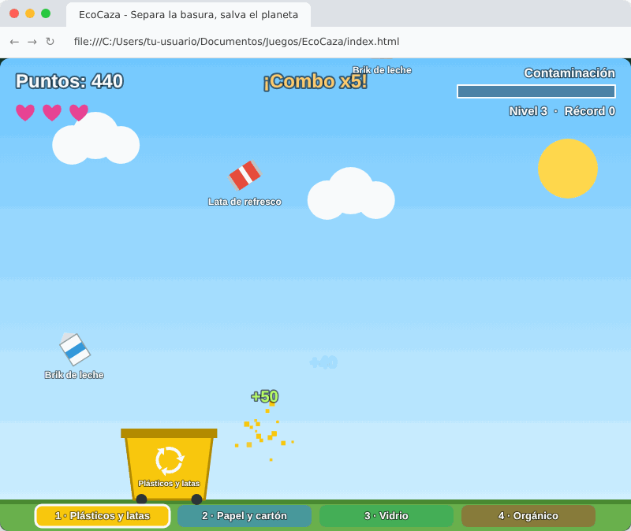

# ♻️ EcoCaza — Separa la basura, salva el planeta

Juego 2D para aprender a separar residuos. Mueve el contenedor (← → o ratón/dedo) y cámbialo de tipo (teclas 1-4 o botones) para atrapar cada residuo en el contenedor correcto: amarillo (plásticos y latas), azul (papel y cartón), verde (vidrio) y marrón (orgánico).

- ▶️ **Jugar:** abre [`index.html`](index.html) en el navegador.
- 📘 **Informe paso a paso:** [Markdown](informe/Informe_EcoCaza.md) · [PDF](informe/Informe_EcoCaza.pdf) · [Word](informe/Informe_EcoCaza.docx)
- 🛟 **Código de cada paso:** carpeta [`pasos/`](pasos/)
