<!-- solo-github -->
# Informe de creación del videojuego «EcoCaza»

**Un juego 2D para aprender a separar la basura, explicado paso a paso y línea por línea.**

> 📄 Este mismo informe está también en **PDF** (`Informe_EcoCaza.pdf`) y en **Word** (`Informe_EcoCaza.docx`) dentro de esta carpeta.
> 🎮 El juego terminado está en la carpeta de arriba: abre `../index.html` en tu navegador para jugar.
<!-- /solo-github -->

# 1. Presentación del proyecto

## 1.1 ¿Qué es EcoCaza?

**EcoCaza** es un videojuego en 2D que se juega en el navegador (Chrome, Edge, Firefox o Safari), en ordenador o en móvil. Del cielo caen residuos —botellas, latas, periódicos, cáscaras de plátano…— y tú controlas un **contenedor con ruedas** que puede transformarse en cuatro contenedores distintos: **amarillo** (plásticos y latas), **azul** (papel y cartón), **verde** (vidrio) y **marrón** (orgánico). Tu misión es atrapar cada residuo **con el contenedor correcto**.

<p align="center">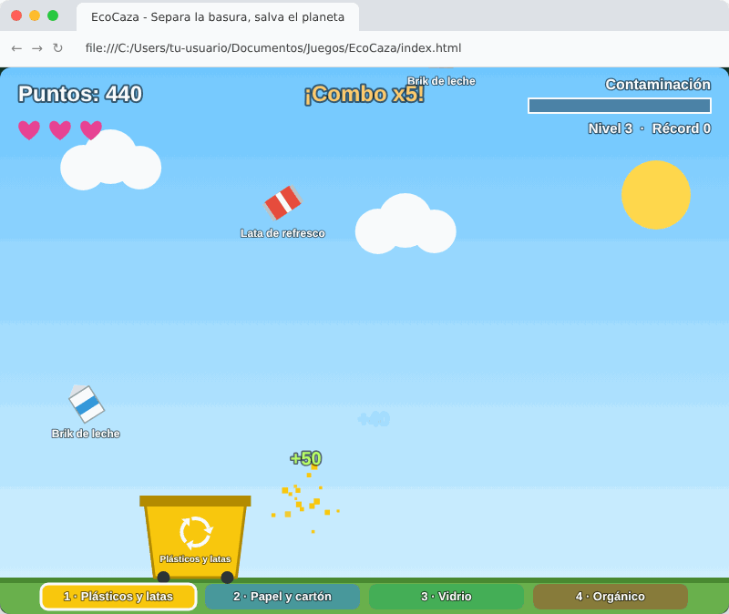</p>

<p align="center"><em>Figura 1. EcoCaza terminado, en plena partida (nivel 3). Arriba a la izquierda, los puntos y las vidas; arriba a la derecha, la barra de contaminación; abajo, los cuatro botones de contenedor.</em></p>

## 1.2 La problemática que resuelve

Casi todo el mundo quiere reciclar, pero **mucha gente duda** en el momento de tirar algo: ¿el brik de leche va al azul porque parece cartón? ¿La tapa del tarro de mermelada va con el vidrio? ¿Y la cáscara de plátano? Cuando un residuo va al contenedor equivocado, ocurren dos cosas malas:

1. **Ese residuo no se recicla**, porque la planta de reciclaje que lo recibe no sabe tratarlo.
2. **Puede estropear el resto**: un objeto que no corresponde "contamina" el lote y obliga a separarlo a mano o a desecharlo.

Las campañas informativas (carteles, folletos) se leen una vez y se olvidan. **EcoCaza convierte esa información en un reflejo**: el jugador decide en décimas de segundo a qué contenedor va cada cosa, una y otra vez, y cada error se corrige al instante con un consejo claro (por ejemplo: *"Aunque parezca cartón, el brik lleva plástico y aluminio: AMARILLO"*). Es la misma técnica con la que se aprende a teclear o a conducir: **repetición + respuesta inmediata**.

> 🌍 Los colores que usa el juego son los de España (amarillo, azul, verde y marrón). En otros países cambian: en el **paso 3** verás que los colores y nombres están en un único sitio del código, así que adaptarlo a tu ciudad es cuestión de cambiar 4 líneas.

## 1.3 Cómo se juega

| Acción | Teclado | Ratón / pantalla táctil |
|---|---|---|
| Mover el contenedor | ← → (o A / D) | Mover el ratón o arrastrar el dedo |
| Cambiar a contenedor amarillo (plásticos y latas) | 1 | Tocar el botón amarillo |
| Cambiar a contenedor azul (papel y cartón) | 2 | Tocar el botón azul |
| Cambiar a contenedor verde (vidrio) | 3 | Tocar el botón verde |
| Cambiar a contenedor marrón (orgánico) | 4 | Tocar el botón marrón |
| Empezar / volver a jugar | Espacio | Clic o toque en la pantalla |

**Reglas:**

- ✅ Residuo en el contenedor correcto → **puntos** (10, 20, 30… cuantos más aciertos seguidos, más vale cada uno, hasta ×5) y el planeta se limpia un poquito.
- ❌ Residuo en el contenedor equivocado → **pierdes una vida** (tienes 3) y aparece un **consejo** que explica dónde va.
- 🟫 Residuo que cae al suelo → el planeta se **contamina un 10 %**: el cielo se vuelve gris y la basura se queda tirada en el césped.
- La partida termina si te quedas **sin vidas** o si la contaminación llega al **100 %**.
- Cada 150 puntos subes de **nivel**: los residuos caen más rápido y más a menudo.

<p align="center"></p>

<p align="center"><em>Figura 2. Pantalla de inicio: el propio juego enseña qué residuos van en cada contenedor antes de empezar.</em></p>

## 1.4 ¿Por qué es divertido y novedoso?

- **El jugador se transforma, no elige un objeto.** En la mayoría de juegos de reciclaje se arrastra la basura hasta un contenedor quieto. En EcoCaza eres un solo contenedor que **cambia de tipo al vuelo**: hay que moverse y decidir a la vez, lo que lo hace rápido y emocionante.
- **Dos formas de perder que obligan a decidir.** Si dudas y dejas caer un residuo, contaminas el planeta; si te precipitas y fallas, pierdes una vida. Esa tensión es la que hace que quieras "una partida más".
- **El escenario reacciona.** El cielo se oscurece y la basura se acumula en el césped según juegas: ves el efecto de tus decisiones.
- **Aprende de sus errores.** Cada fallo muestra un consejo concreto y la pantalla final da tu precisión y un dato curioso.
- **Funciona en cualquier sitio.** No hay que instalar nada: es una página web. Sirve en el móvil con el dedo.

## 1.5 Qué vas a aprender construyéndolo

Al terminar este informe sabrás: crear una página web con un lienzo de dibujo (**HTML**), darle estilo (**CSS**), y programar en **JavaScript** variables, funciones, objetos, listas, condiciones y bucles; dibujar con el **Canvas API**; hacer un **bucle de juego**; leer el **teclado, el ratón y la pantalla táctil**; detectar **colisiones**; crear **partículas** y **sonidos** sin archivos; y guardar el **récord** en el navegador.

# 2. Antes de empezar

## 2.1 Lo que necesitas

| Qué | Para qué | Dónde conseguirlo | Precio |
|---|---|---|---|
| Un ordenador (Windows, Mac o Linux) | Escribir el código | — | — |
| Un navegador moderno: **Google Chrome**, **Microsoft Edge** o **Firefox** | Ejecutar (jugar) el juego | Ya lo tienes instalado casi seguro | Gratis |
| Un editor de código: **Visual Studio Code** (recomendado) | Escribir los archivos con colores y ayudas | <https://code.visualstudio.com> | Gratis |
| Este informe | Seguir los pasos | — | — |

> 💡 **No hace falta instalar Node, Python, ni motores de videojuegos.** Todo el juego son dos archivos de texto que el navegador entiende directamente. Si no puedes instalar VS Code, sirve incluso el Bloc de notas, aunque es más incómodo.

## 2.2 Instalar Visual Studio Code (5 minutos)

1. Entra en **<https://code.visualstudio.com>**.
2. Pulsa el botón grande de descarga (detecta solo si tienes Windows, Mac o Linux).
3. Abre el archivo descargado y acepta las opciones por defecto. En Windows, marca la casilla **"Agregar acción 'Abrir con Code' al menú contextual"**: te vendrá muy bien.
4. Ábrelo. Si quieres el programa en español: pulsa `Ctrl + Shift + P` (en Mac `⌘ + Shift + P`), escribe **Configure Display Language**, elige **Español** y reinicia.

## 2.3 De dónde sale cada parte del juego

Una pregunta muy importante en cualquier proyecto es **de dónde sale cada cosa** (para respetar derechos de autor y para poder modificarla). En EcoCaza **no se ha descargado ni copiado ningún recurso**: todo se crea con código escrito en este informe.

| Parte del juego | Cómo se hizo | De dónde sale / documentación |
|---|---|---|
| Página y lienzo | HTML5 `<canvas>` | Estándar web. Guía: [MDN – Canvas API](https://developer.mozilla.org/es/docs/Web/API/Canvas_API) |
| Estilo de la página | CSS (flexbox, sombras) | [MDN – CSS](https://developer.mozilla.org/es/docs/Web/CSS) |
| Lógica del juego | JavaScript sin librerías | [MDN – JavaScript](https://developer.mozilla.org/es/docs/Web/JavaScript) |
| Gráficos (contenedor, residuos, nubes, sol, corazones) | Dibujados con figuras simples del Canvas: rectángulos, círculos, líneas y curvas | Diseño propio para este juego. Órdenes: [MDN – CanvasRenderingContext2D](https://developer.mozilla.org/es/docs/Web/API/CanvasRenderingContext2D) |
| Animación | `requestAnimationFrame` | [MDN – requestAnimationFrame](https://developer.mozilla.org/es/docs/Web/API/Window/requestAnimationFrame) |
| Sonidos | Generados en directo con la **Web Audio API** (osciladores) | [MDN – Web Audio API](https://developer.mozilla.org/es/docs/Web/API/Web_Audio_API) |
| Tipografía | Arial, que ya viene en el ordenador | — |
| Colores | Elegidos a mano (estilo "flat"). Puedes buscar otros en <https://coolors.co> | — |
| Récord guardado | `localStorage` del navegador | [MDN – localStorage](https://developer.mozilla.org/es/docs/Web/API/Window/localStorage) |
| Qué residuo va en cada contenedor | Normas de separación en España | [Ecoembes](https://www.ecoembes.com) (envases y papel), [Ecovidrio](https://www.ecovidrio.es) (vidrio) y las guías de tu ayuntamiento |
| Idea y reglas del juego | Diseño original | — |
| Capturas de este informe | Hechas automáticamente ejecutando cada paso del juego en el navegador Chromium | Herramienta [Playwright](https://playwright.dev) |

## 2.4 Conceptos básicos de programación en 5 minutos

No necesitas saber programar para seguir el informe, pero conviene conocer estas siete palabras. Todas aparecen en el juego.

**1. Variable:** una caja con nombre donde guardamos un dato.

```javascript
let puntos = 0;        // let: el valor puede cambiar
puntos = puntos + 10;  // ahora puntos vale 10
const ANCHO = 800;     // const: el valor NO cambiará nunca
```

**2. Texto, número y booleano:** los tres tipos de datos más usados. Los textos van entre comillas.

```javascript
let nombre = "Botella";   // texto (string)
let vidas = 3;             // número
let jugando = true;        // booleano: true (sí) o false (no)
```

**3. Objeto:** una caja con apartados, cada uno con su nombre.

```javascript
const contenedor = { x: 400, tipo: "amarillo" };
contenedor.x = 450;              // cambiar un apartado
console.log(contenedor.tipo);    // leer un apartado → "amarillo"
```

**4. Array (lista):** varios datos en orden. Las posiciones empiezan en **0**.

```javascript
const colores = ["amarillo", "azul", "verde"];
colores[0];            // "amarillo"
colores.length;        // 3 (cuántos hay)
colores.push("marron"); // añade uno al final
```

**5. Función:** un conjunto de órdenes con nombre que podemos ejecutar cuando queramos.

```javascript
function saludar(nombre) {
  return "¡Hola, " + nombre + "!";
}
saludar("Ana");  // → "¡Hola, Ana!"
```

**6. Condición (`if`):** hacer algo solo si se cumple algo.

```javascript
if (vidas <= 0) {
  terminarPartida();
} else {
  seguirJugando();
}
```

**7. Bucle (`for`):** repetir algo varias veces.

```javascript
for (let i = 0; i < 3; i++) {   // i vale 0, luego 1, luego 2
  dibujarCorazon(i);
}
```

| Símbolo | Significa | Ejemplo |
|---|---|---|
| `=` | guardar un valor | `vidas = 3` |
| `===` | ¿es igual? | `tipo === "azul"` |
| `!==` | ¿es distinto? | `estado !== "jugando"` |
| `&&` | y además | `a && b` (las dos) |
| <code>&#124;&#124;</code> | o | `a` <code>&#124;&#124;</code> `b` (al menos una) |
| `!` | no | `!audio` (no existe audio) |
| `+=` / `-=` | sumar / restar a lo que había | `puntos += 10` |
| `//` | comentario (el ordenador lo ignora) | `// esto es una nota` |

## 2.5 Las coordenadas del lienzo

Para dibujar en el lienzo hay que decir **dónde**: con dos números, **x** (horizontal) e **y** (vertical). ¡Ojo! La **y crece hacia abajo**.

<p align="center">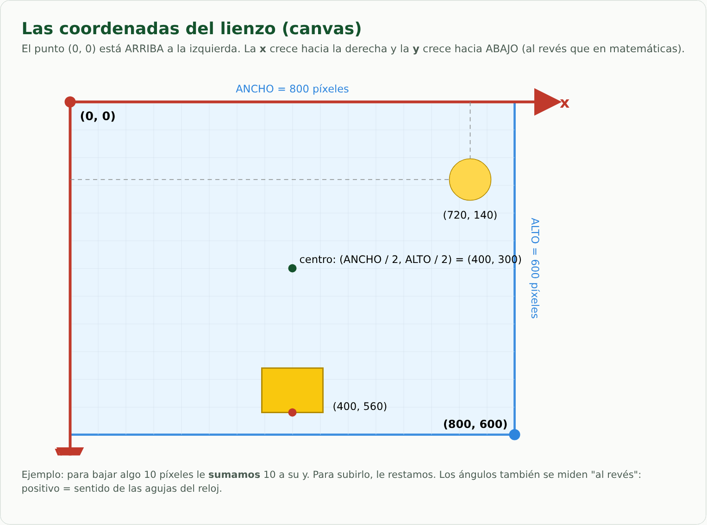</p>

<p align="center"><em>Figura 3. Sistema de coordenadas del canvas de 800 × 600 píxeles que usa EcoCaza.</em></p>

## 2.6 Los ángulos en radianes

Para girar cosas y dibujar círculos usaremos ángulos. JavaScript no usa grados, sino **radianes**.

<p align="center">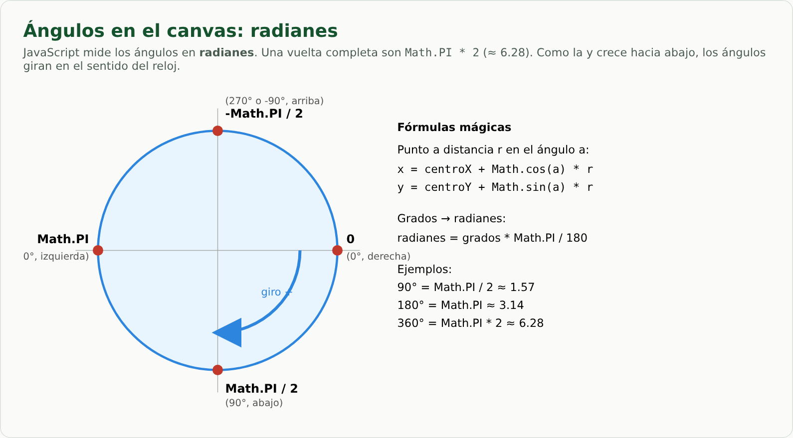</p>

<p align="center"><em>Figura 4. Equivalencia entre grados y radianes y las fórmulas de seno y coseno que usaremos.</em></p>

## 2.7 El bucle del juego

Todo videojuego es un bucle que se repite unas 60 veces por segundo. Entender esta imagen es entender cómo funcionan los videojuegos:

<p align="center">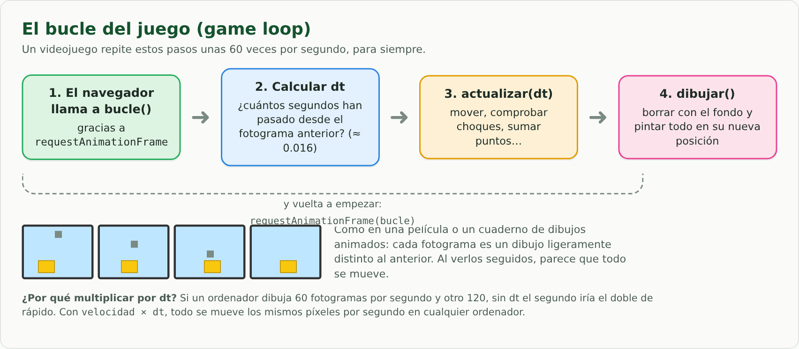</p>

<p align="center"><em>Figura 5. El bucle del juego: calcular el tiempo, actualizar y dibujar, una y otra vez.</em></p>

## 2.8 Hoja de ruta: los 13 pasos

Construiremos el juego en **13 pasos pequeños**. Después de cada uno el juego funciona y puedes verlo en el navegador. Así, si algo falla, sabes que el error está en lo último que escribiste.

<p align="center">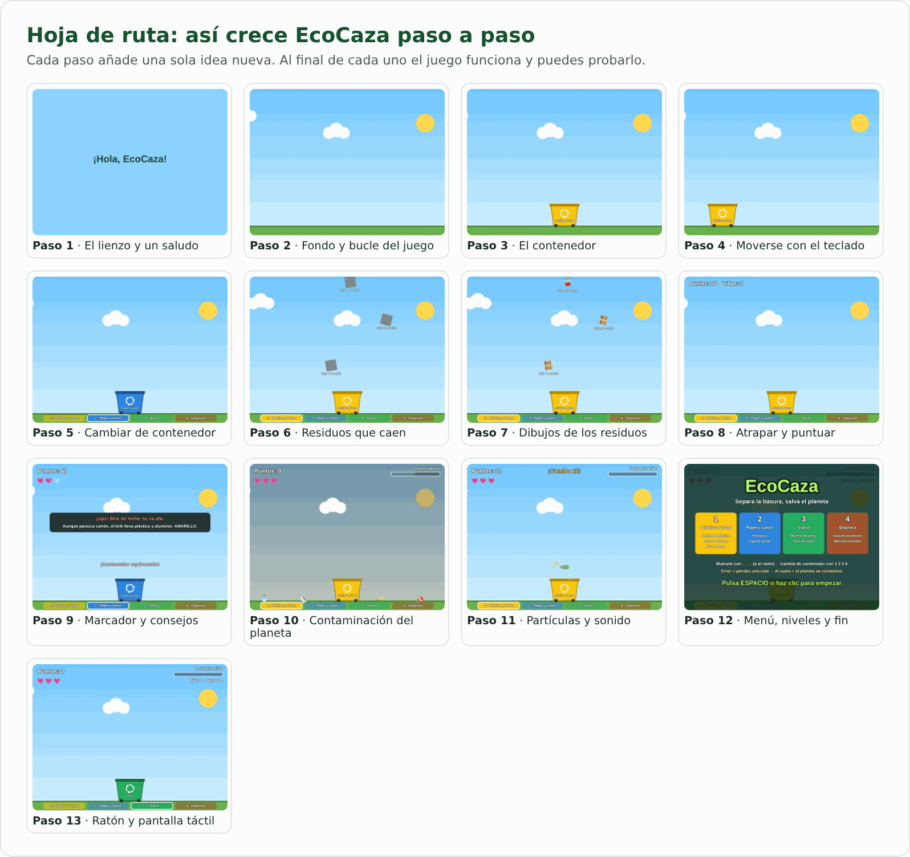</p>

<p align="center"><em>Figura 6. Cómo se ve el juego al terminar cada uno de los 13 pasos.</em></p>

## 2.9 Cómo leer los pasos de este informe

Cada paso tiene siempre las mismas partes:

1. **Objetivo:** qué vamos a conseguir.
2. **Cambios en el código:** dónde escribir, una **imagen del editor** con las líneas nuevas en **verde** (y las que hay que borrar en **rojo tachado**), la **explicación de cada línea** y el **código para copiar**.
3. **Resultado:** capturas reales de cómo debe verse tu juego.
4. **Pruébalo tú:** pequeños experimentos para entender mejor.

> 🛟 **Red de seguridad:** en la carpeta `pasos/` del proyecto tienes el código completo **tal y como queda al final de cada paso** (`pasos/paso01`, `pasos/paso02`…). Si te pierdes, compara tu archivo con el de esa carpeta o cópialo y sigue desde ahí.

> ⌨️ **Consejo:** escribe el código a mano en lugar de copiarlo. Tardarás un poco más, pero lo entenderás y lo recordarás mucho mejor. Los comentarios (`// ...`) puedes saltártelos.

# 3. Paso 0 · Preparar la carpeta y los archivos

**Objetivo:** tener la carpeta del proyecto con dos archivos vacíos, abierta en el editor.

1. En tu ordenador, ve a **Documentos** (o donde quieras guardar tus proyectos) y crea una carpeta llamada **`Juegos`**. Dentro de ella crea otra llamada **`EcoCaza`**.
2. Abre **Visual Studio Code** → menú **Archivo → Abrir carpeta…** → elige la carpeta **EcoCaza** → **Seleccionar carpeta**. (Si pregunta *"¿Confía en los autores?"*, responde que sí: la carpeta es tuya.)
3. En el panel izquierdo (el **Explorador**), pasa el ratón sobre el nombre **ECOCAZA** y pulsa el icono de **Nuevo archivo** (una hoja con un +). Escribe **`index.html`** y pulsa Enter.
4. Repite para crear un segundo archivo llamado **`juego.js`**.

> ⚠️ **Los nombres importan:** todo en minúsculas, sin espacios y con su extensión (`.html` y `.js`). En Windows, si creas los archivos desde el Explorador de archivos en vez de VS Code, asegúrate de que no se llamen `index.html.txt` (activa *Vista → Extensiones de nombre de archivo*).

<p align="center">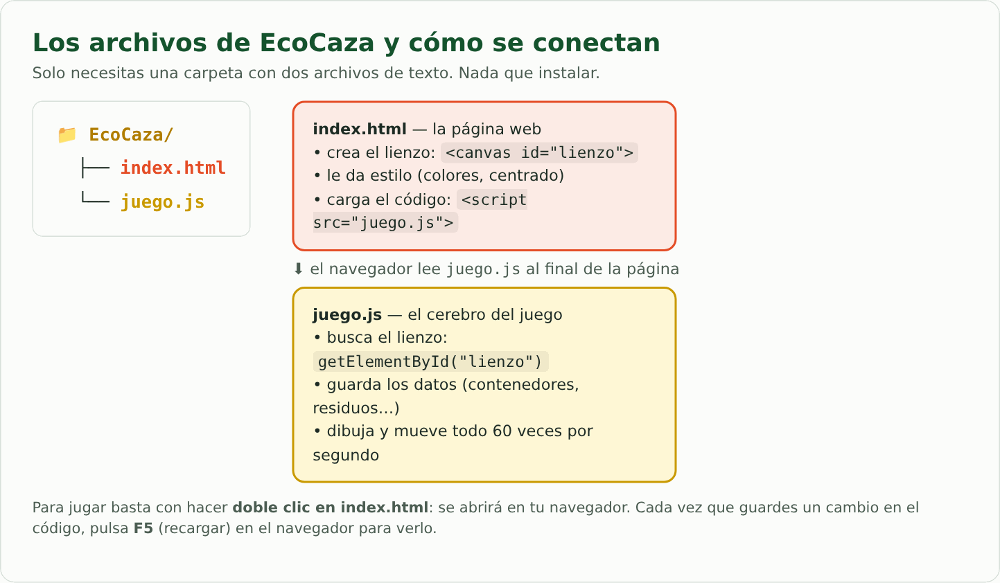</p>

<p align="center"><em>Figura 7. La carpeta del proyecto: solo dos archivos y cómo se relacionan.</em></p>

<p align="center">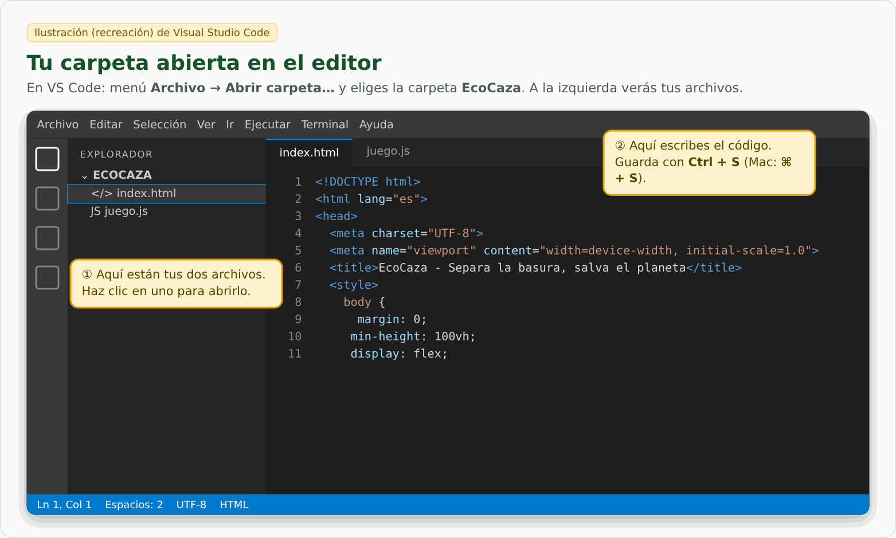</p>

<p align="center"><em>Figura 8. Así se ve la carpeta abierta en Visual Studio Code (ilustración).</em></p>

Cuando tengas código, para **ver el juego** abre `index.html` en el navegador:

<p align="center">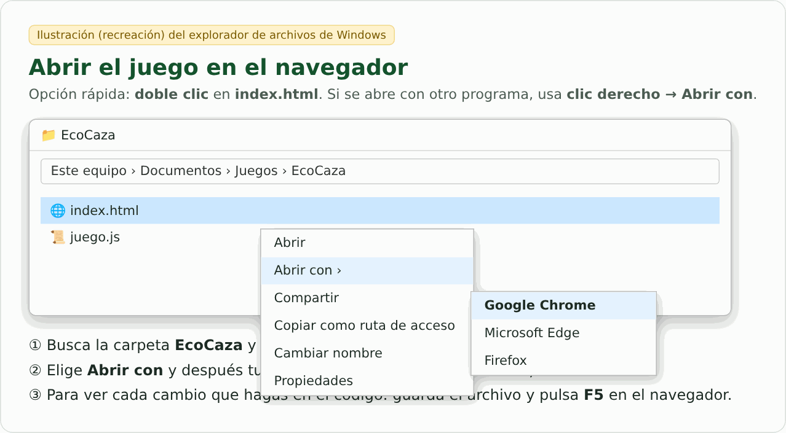</p>

<p align="center"><em>Figura 9. Abrir index.html con el navegador desde el explorador de archivos (ilustración).</em></p>

Y si alguna vez la pantalla se queda en blanco, la **consola** del navegador te dirá qué pasa:

<p align="center">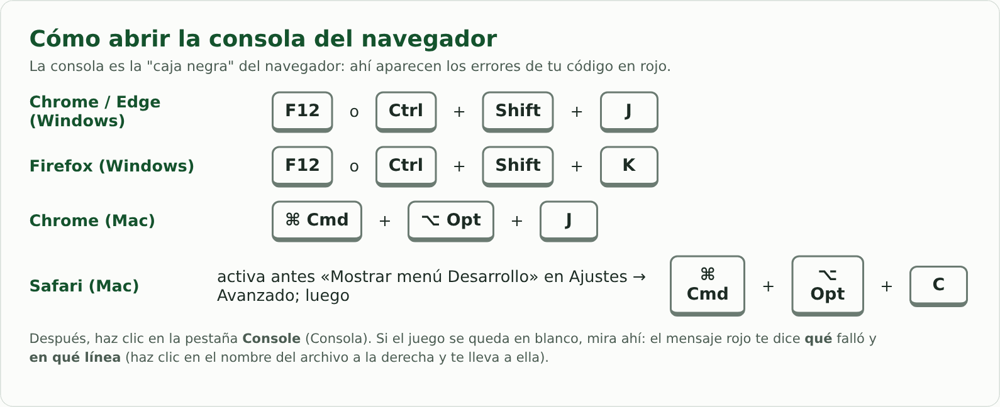</p>

<p align="center"><em>Figura 10. Atajos de teclado para abrir la consola de errores del navegador.</em></p>

> 🔁 **El ciclo de trabajo será siempre:** escribir código → guardar (`Ctrl + S`) → ir al navegador → recargar (`F5`) → mirar el resultado.

# 4. Paso 1 · El lienzo y un saludo

**Objetivo:** crear la página web con un lienzo de 800 × 600 píxeles y comprobar que nuestro JavaScript puede dibujar en él.

**Qué aprenderás:** la estructura de una página HTML, qué es el `<canvas>`, cómo se conecta un archivo `.js` y tus primeras órdenes de dibujo (`fillStyle`, `fillRect`, `fillText`).

El archivo `index.html` lo escribimos **una sola vez** y ya no lo tocaremos más: todo el juego vivirá en `juego.js`.

#### Cambio 1 de 2 · Escribir el archivo completo en `index.html`

📄 Abre `index.html` (vacío) y escribe **todo** este código. Tiene 34 líneas.

<p align="center">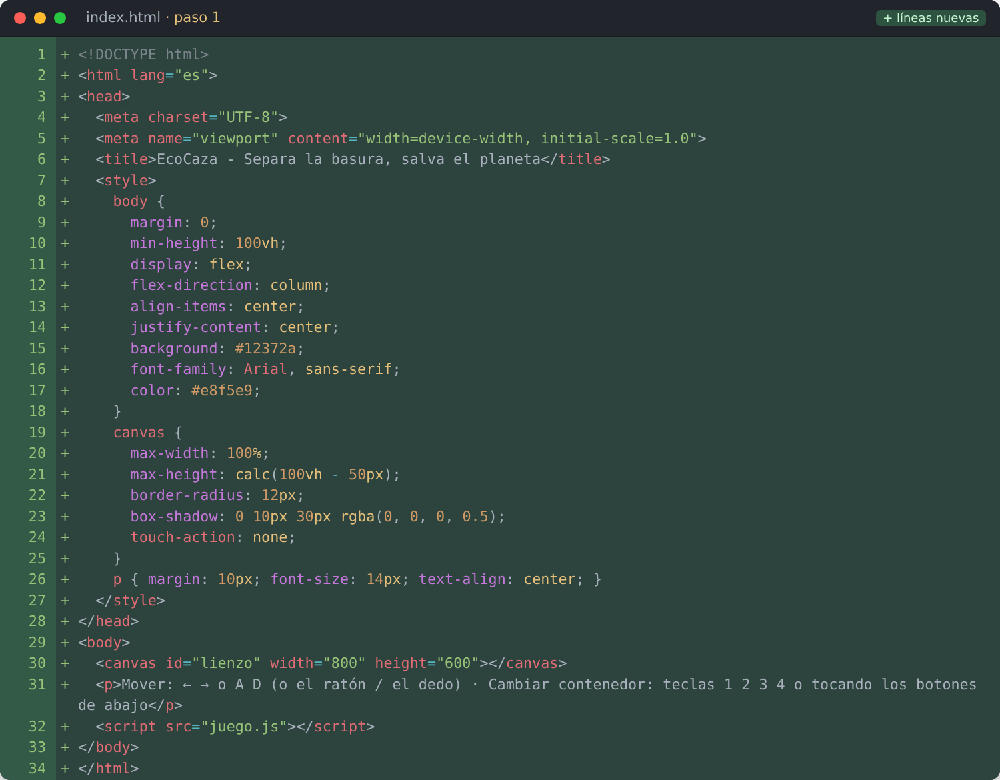</p>

<p align="center"><em>Figura 11. Paso 1: código nuevo en index.html. Lo verde es lo que escribes; lo gris ya lo tenías.</em></p>

**Explicación línea por línea:**


> **La "partida de nacimiento" de la página.** Estas primeras líneas le dicen al navegador qué tipo de documento es y en qué idioma está.

- **Línea 1** · `<!DOCTYPE html>`  
  → Declara que este archivo es una página web moderna (HTML5). Siempre va en la primera línea.
- **Línea 2** · `<html lang="es">`  
  → Abre el documento HTML e indica que el idioma es español (lang="es"). Ayuda a los lectores de pantalla y a los traductores.
- **Línea 3** · `<head>`  
  → Abre la cabecera: aquí va información SOBRE la página (título, estilos...), no lo que se ve dentro de ella.
- **Línea 4** · `<meta charset="UTF-8">`  
  → Usa la codificación UTF-8 para que se vean bien las tildes, la ñ y los signos ¡ ¿.
- **Línea 5** · `<meta name="viewport" content="width=device-width, initial-scale=1.0">`  
  → Hace que en móviles la página use el ancho real de la pantalla en lugar de verse diminuta.
- **Línea 6** · `<title>EcoCaza - Separa la basura, salva el planeta</title>`  
  → El texto que aparece en la pestaña del navegador.

> **Los estilos (CSS).** Entre `<style>` y `</style>` decimos cómo se ve la página: colores, centrado y tamaño del lienzo.

- **Línea 7** · `<style>`  
  → Abre el bloque de estilos CSS.
- **Línea 8** · `body {`  
  → Empieza las reglas para el cuerpo (body) de la página: todo lo que se ve.
- **Línea 9** · `margin: 0;`  
  → Quita el margen blanco que los navegadores ponen por defecto alrededor de la página.
- **Línea 10** · `min-height: 100vh;`  
  → Hace que el cuerpo mida como mínimo el 100 % del alto de la ventana (vh = "viewport height").
- **Línea 11** · `display: flex;`  
  → Activa "flexbox", un sistema para colocar elementos fácilmente.
- **Línea 12** · `flex-direction: column;`  
  → Coloca los elementos uno debajo de otro (en columna): primero el lienzo y debajo el texto de ayuda.
- **Línea 13** · `align-items: center;`  
  → Centra los elementos horizontalmente.
- **Línea 14** · `justify-content: center;`  
  → Centra los elementos verticalmente.
- **Línea 15** · `background: #12372a;`  
  → Color de fondo de la página: un verde muy oscuro.
- **Línea 16** · `font-family: Arial, sans-serif;`  
  → Tipo de letra de la página: Arial (o, si no existe, cualquier letra sin adornos).
- **Línea 17** · `color: #e8f5e9;`  
  → Color del texto: un verde casi blanco.
- **Línea 18** · `}`  
  → Cierra la llave `{` que se abrió más arriba: aquí termina ese bloque.
- **Línea 19** · `canvas {`  
  → Empieza las reglas para el lienzo (canvas), que es donde se dibuja el juego.
- **Línea 20** · `max-width: 100%;`  
  → El lienzo nunca será más ancho que la ventana (así cabe en móviles).
- **Línea 21** · `max-height: calc(100vh - 50px);`  
  → Ni más alto que la ventana menos 50 píxeles (dejamos sitio para el texto de ayuda).
- **Línea 22** · `border-radius: 12px;`  
  → Redondea las esquinas del lienzo 12 píxeles.
- **Línea 23** · `box-shadow: 0 10px 30px rgba(0, 0, 0, 0.5);`  
  → Añade una sombra suave debajo del lienzo para que parezca que "flota".
- **Línea 24** · `touch-action: none;`  
  → En pantallas táctiles evita que arrastrar el dedo mueva o haga zoom en la página.
- **Línea 25** · `}`  
  → Cierra la llave `{` que se abrió más arriba: aquí termina ese bloque.
- **Línea 26** · `p { margin: 10px; font-size: 14px; text-align: center; }`  
  → Reglas para los párrafos (p): un poco de margen y letra de 14 píxeles.
- **Línea 27** · `</style>`  
  → Cierra el bloque de estilos.
- **Línea 28** · `</head>`  
  → Cierra la cabecera.

> **El contenido visible.** Dentro de `<body>` está lo que se ve: el lienzo, una línea de ayuda y la orden de cargar nuestro código.

- **Línea 29** · `<body>`  
  → Abre el cuerpo: todo lo que hay aquí dentro se ve en la página.
- **Línea 30** · `<canvas id="lienzo" width="800" height="600"></canvas>`  
  → Crea el lienzo de dibujo. id="lienzo" es su nombre para encontrarlo desde JavaScript. Mide 800 × 600 píxeles.
- **Línea 31** · `<p>Mover: ← → o A D (o el ratón / el dedo) · Cambiar contenedor: teclas 1 2 3 4 o tocan...`  
  → Un párrafo con la ayuda de los controles, debajo del lienzo.
- **Línea 32** · `<script src="juego.js"></script>`  
  → Carga y ejecuta nuestro archivo juego.js. Va al final para que el lienzo ya exista cuando el código lo busque.
- **Línea 33** · `</body>`  
  → Cierra el cuerpo.
- **Línea 34** · `</html>`  
  → Cierra el documento HTML.

**Código para copiar** (o mejor, ¡escríbelo tú para aprender!):

```html
<!DOCTYPE html>
<html lang="es">
<head>
  <meta charset="UTF-8">
  <meta name="viewport" content="width=device-width, initial-scale=1.0">
  <title>EcoCaza - Separa la basura, salva el planeta</title>
  <style>
    body {
      margin: 0;
      min-height: 100vh;
      display: flex;
      flex-direction: column;
      align-items: center;
      justify-content: center;
      background: #12372a;
      font-family: Arial, sans-serif;
      color: #e8f5e9;
    }
    canvas {
      max-width: 100%;
      max-height: calc(100vh - 50px);
      border-radius: 12px;
      box-shadow: 0 10px 30px rgba(0, 0, 0, 0.5);
      touch-action: none;
    }
    p { margin: 10px; font-size: 14px; text-align: center; }
  </style>
</head>
<body>
  <canvas id="lienzo" width="800" height="600"></canvas>
  <p>Mover: ← → o A D (o el ratón / el dedo) · Cambiar contenedor: teclas 1 2 3 4 o tocando los botones de abajo</p>
  <script src="juego.js"></script>
</body>
</html>
```

#### Cambio 2 de 2 · Escribir el archivo completo en `juego.js`

📄 Abre `juego.js` (vacío) y escribe **todo** este código. Tiene 16 líneas.

<p align="center">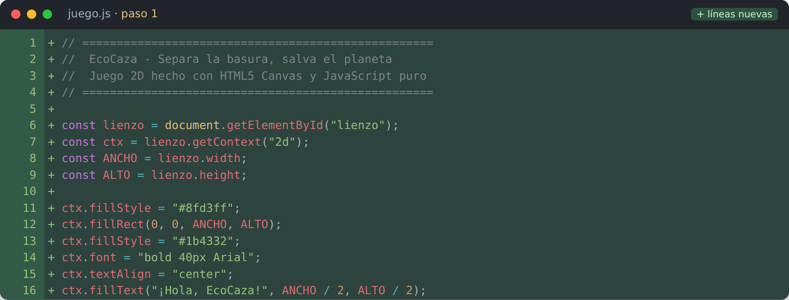</p>

<p align="center"><em>Figura 12. Paso 1: código nuevo en juego.js. Lo verde es lo que escribes; lo gris ya lo tenías.</em></p>

**Explicación línea por línea:**

- **Línea 1** · `// ===================================================`  
  → Comentario decorativo (una línea de signos =). El navegador lo ignora.
- **Línea 2** · `//  EcoCaza - Separa la basura, salva el planeta`  
  → Comentario: el navegador lo ignora. Sirve para que las personas entendamos el código («EcoCaza - Separa la basura, salva el planeta»).
- **Línea 3** · `//  Juego 2D hecho con HTML5 Canvas y JavaScript puro`  
  → Comentario: el navegador lo ignora. Sirve para que las personas entendamos el código («Juego 2D hecho con HTML5 Canvas y JavaScript puro»).
- **Línea 4** · `// ===================================================`  
  → Comentario decorativo (una línea de signos =). El navegador lo ignora.

> **El lienzo y el pincel.** Lo primero es conseguir el lienzo (canvas) que creamos en el HTML y su "pincel" (el contexto 2D): el objeto con el que dibujaremos todo.

- **Línea 6** · `const lienzo = document.getElementById("lienzo");`  
  → Busca en la página el elemento con id="lienzo" (nuestro canvas) y lo guarda en una constante llamada lienzo. Una constante (const) es una caja con nombre cuyo contenido no cambiará.
- **Línea 7** · `const ctx = lienzo.getContext("2d");`  
  → Pide al lienzo su "contexto 2D": un objeto que tiene todas las órdenes de dibujo (rectángulos, círculos, texto...). Por costumbre se llama ctx.
- **Línea 8** · `const ANCHO = lienzo.width;`  
  → Guarda el ancho del lienzo (800 píxeles, lo pusimos en el HTML) para no escribir el número a mano por todo el código.
- **Línea 9** · `const ALTO = lienzo.height;`  
  → Lo mismo con el alto (600 píxeles). Escribimos estas constantes en MAYÚSCULAS para recordar que son valores fijos.

> **Prueba de vida.** Antes de construir el juego comprobamos que el HTML y el JavaScript están bien conectados pintando un fondo y un saludo. En el paso 2 borraremos estas líneas.

- **Línea 11** · `ctx.fillStyle = "#8fd3ff";`  
  → Elige el color de relleno: celeste. Los colores se escriben en hexadecimal: # seguido de rojo, verde y azul (dos cifras cada uno, de 00 a ff).
- **Línea 12** · `ctx.fillRect(0, 0, ANCHO, ALTO);`  
  → Pinta un rectángulo relleno que empieza en la esquina superior izquierda (0, 0) y mide todo el ANCHO y todo el ALTO: es decir, pinta el lienzo entero.
- **Línea 13** · `ctx.fillStyle = "#1b4332";`  
  → Cambia el color de relleno a verde oscuro: lo usaremos para el texto.
- **Línea 14** · `ctx.font = "bold 40px Arial";`  
  → Elige la letra: negrita (bold), 40 píxeles de alto, tipo Arial.
- **Línea 15** · `ctx.textAlign = "center";`  
  → Indica que el texto se centre horizontalmente respecto al punto que le demos.
- **Línea 16** · `ctx.fillText("¡Hola, EcoCaza!", ANCHO / 2, ALTO / 2);`  
  → Escribe el saludo en el centro del lienzo: la mitad del ancho (ANCHO / 2) y la mitad del alto (ALTO / 2).

**Código para copiar** (o mejor, ¡escríbelo tú para aprender!):

```javascript
// ===================================================
//  EcoCaza - Separa la basura, salva el planeta
//  Juego 2D hecho con HTML5 Canvas y JavaScript puro
// ===================================================

const lienzo = document.getElementById("lienzo");
const ctx = lienzo.getContext("2d");
const ANCHO = lienzo.width;
const ALTO = lienzo.height;

ctx.fillStyle = "#8fd3ff";
ctx.fillRect(0, 0, ANCHO, ALTO);
ctx.fillStyle = "#1b4332";
ctx.font = "bold 40px Arial";
ctx.textAlign = "center";
ctx.fillText("¡Hola, EcoCaza!", ANCHO / 2, ALTO / 2);
```

### Resultado del paso 1

Guarda los dos archivos y abre `index.html` en el navegador. Deberías ver esto:

<p align="center">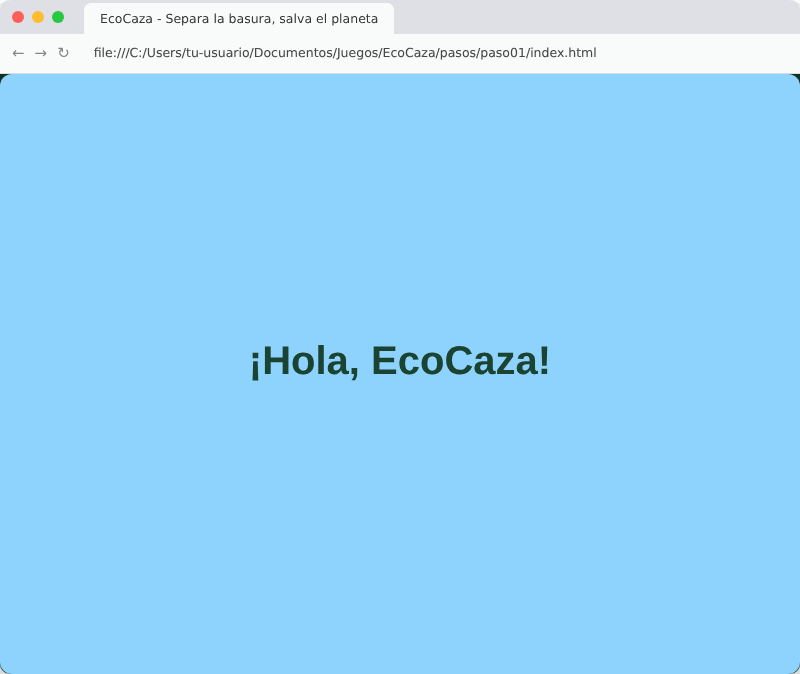</p>

<p align="center"><em>Figura 13. Resultado del paso 1: el lienzo pintado de celeste con el saludo en el centro.</em></p>

### Pruébalo tú

- Cambia `"#8fd3ff"` por `"orange"` o `"#ff69b4"` y recarga. ¡El fondo cambia de color!
- Cambia `ANCHO / 2, ALTO / 2` por `200, 100`. ¿Dónde aparece ahora el texto? (Recuerda el diagrama de coordenadas.)
- Si ves la página pero **no** el lienzo celeste, abre la consola (F12) y lee el error. Lo más típico es haber escrito mal `lienzo` en alguno de los dos archivos.

# 5. Paso 2 · El escenario y el bucle del juego

**Objetivo:** dibujar un cielo con degradado, un sol, nubes que se mueven y césped; y crear el **bucle del juego** que redibuja todo unas 60 veces por segundo.

**Qué aprenderás:** funciones, degradados (`createLinearGradient`), círculos (`arc`), el operador resto `%` para animaciones que se repiten, y `requestAnimationFrame`.

Primero **borramos** el saludo del paso 1 (ya cumplió su misión) y después añadimos el escenario y el bucle.

#### Cambio 1 de 1 · Cambiar (reemplazar) código en `juego.js`

🗑️ **Primero, borra las líneas 11 a 16 de tu archivo `juego.js`** (están justo debajo de `const ALTO = lienzo.height;`). En la imagen aparecen en rojo y tachadas:

<p align="center">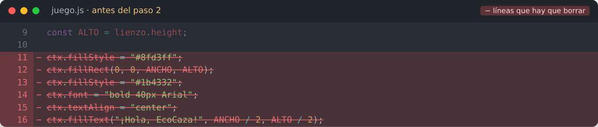</p>

<p align="center"><em>Figura 14. Paso 2: líneas que se borran de juego.js</em></p>

Estas son las líneas que desaparecen:

```javascript
ctx.fillStyle = "#8fd3ff";
ctx.fillRect(0, 0, ANCHO, ALTO);
ctx.fillStyle = "#1b4332";
ctx.font = "bold 40px Arial";
ctx.textAlign = "center";
ctx.fillText("¡Hola, EcoCaza!", ANCHO / 2, ALTO / 2);
```

✏️ **Después, en ese mismo sitio, escribe las líneas nuevas** (quedan en las líneas 11 a 69 del archivo terminado).

##### Parte 1 de 2 (líneas 11 a 51)

<p align="center">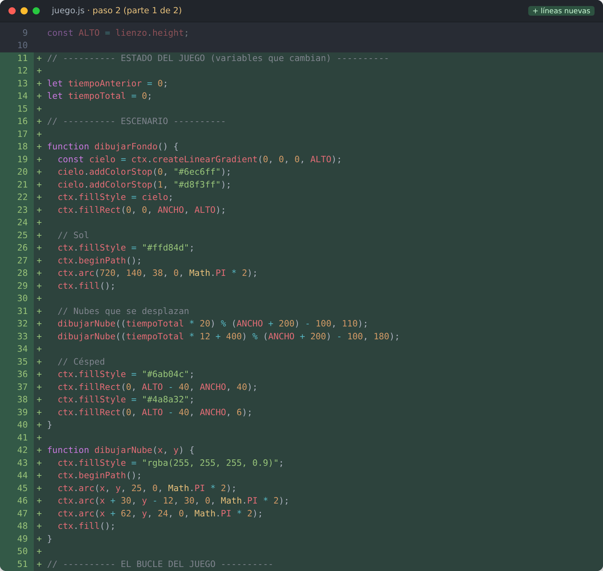</p>

<p align="center"><em>Figura 15. Paso 2: código nuevo en juego.js (parte 1 de 2). Lo verde es lo que escribes; lo gris ya lo tenías.</em></p>

**Explicación línea por línea:**

- **Línea 11** · `// ---------- ESTADO DEL JUEGO (variables que cambian) ----------`  
  → Comentario que sirve de título de sección: «ESTADO DEL JUEGO (variables que cambian)». El navegador lo ignora; nos ayuda a ordenar el código.

> **Variables del tiempo.** Usamos let (en lugar de const) porque su valor irá cambiando mientras jugamos.

- **Línea 13** · `let tiempoAnterior = 0;`  
  → Momento (en milisegundos) en que se dibujó el fotograma anterior. Sirve para medir cuánto tiempo pasa entre un fotograma y el siguiente.
- **Línea 14** · `let tiempoTotal = 0;`  
  → Segundos totales que lleva el juego funcionando. Lo usaremos para animar cosas, como las nubes.
- **Línea 16** · `// ---------- ESCENARIO ----------`  
  → Comentario que sirve de título de sección: «ESCENARIO». El navegador lo ignora; nos ayuda a ordenar el código.

> **El fondo del escenario.** Esta función dibuja el cielo, el sol, las nubes y el césped. La llamaremos en cada fotograma, así "borra" lo anterior y vuelve a pintar todo.

- **Línea 18** · `function dibujarFondo() {`  
  → Declara la función dibujarFondo (no tiene parámetros, por eso los paréntesis están vacíos).
- **Línea 19** · `const cielo = ctx.createLinearGradient(0, 0, 0, ALTO);`  
  → Crea un degradado lineal vertical: desde y = 0 (arriba) hasta y = ALTO (abajo). Los cuatro números son: x inicial, y inicial, x final, y final.
- **Línea 20** · `cielo.addColorStop(0, "#6ec6ff");`  
  → Color del degradado arriba del todo (posición 0): azul cielo.
- **Línea 21** · `cielo.addColorStop(1, "#d8f3ff");`  
  → Color abajo del todo (posición 1): celeste muy claro.
- **Línea 22** · `ctx.fillStyle = cielo;`  
  → Usa el degradado como "color" de relleno.
- **Línea 23** · `ctx.fillRect(0, 0, ANCHO, ALTO);`  
  → Pinta todo el lienzo con el degradado. Esto también borra lo que hubiera del fotograma anterior.
- **Línea 25** · `// Sol`  
  → Comentario: el navegador lo ignora. Sirve para que las personas entendamos el código («Sol»).
- **Línea 26** · `ctx.fillStyle = "#ffd84d";`  
  → Color amarillo para el sol.
- **Línea 27** · `ctx.beginPath();`  
  → Empieza un trazo nuevo. Siempre hay que llamarlo antes de dibujar una figura, para que no se mezcle con la anterior.
- **Línea 28** · `ctx.arc(720, 140, 38, 0, Math.PI * 2);`  
  → Traza un círculo: centro en (720, 140), radio 38. Los ángulos van de 0 a Math.PI * 2 (una vuelta completa en radianes).
- **Línea 29** · `ctx.fill();`  
  → Rellena la figura que acabamos de trazar con el color de `fillStyle`.
- **Línea 31** · `// Nubes que se desplazan`  
  → Comentario: el navegador lo ignora. Sirve para que las personas entendamos el código («Nubes que se desplazan»).
- **Línea 32** · `dibujarNube((tiempoTotal * 20) % (ANCHO + 200) - 100, 110);`  
  → Dibuja una nube. Su x avanza 20 píxeles por segundo. El operador % (resto de la división) hace que, al llegar al final, vuelva a empezar por la izquierda.
- **Línea 33** · `dibujarNube((tiempoTotal * 12 + 400) % (ANCHO + 200) - 100, 180);`  
  → Otra nube más lenta (12 px/s) que empieza 400 píxeles más adelante y a otra altura.
- **Línea 35** · `// Césped`  
  → Comentario: el navegador lo ignora. Sirve para que las personas entendamos el código («Césped»).
- **Línea 36** · `ctx.fillStyle = "#6ab04c";`  
  → Verde para el césped.
- **Línea 37** · `ctx.fillRect(0, ALTO - 40, ANCHO, 40);`  
  → Rectángulo de 40 píxeles de alto pegado al borde inferior.
- **Línea 38** · `ctx.fillStyle = "#4a8a32";`  
  → Verde más oscuro para el borde del césped.
- **Línea 39** · `ctx.fillRect(0, ALTO - 40, ANCHO, 6);`  
  → Una franja fina de 6 píxeles en la parte de arriba del césped (da sensación de profundidad).
- **Línea 40** · `}`  
  → Cierra la llave `{` que se abrió más arriba: aquí termina ese bloque.

> **Una nube hecha con tres círculos.**

- **Línea 42** · `function dibujarNube(x, y) {`  
  → Declara la función dibujarNube: recibe la posición x e y donde se dibujará.
- **Línea 43** · `ctx.fillStyle = "rgba(255, 255, 255, 0.9)";`  
  → Blanco casi opaco (90 %).
- **Línea 44** · `ctx.beginPath();`  
  → Empieza un trazo nuevo, para que esta figura no se mezcle con la anterior.
- **Línea 45** · `ctx.arc(x, y, 25, 0, Math.PI * 2);`  
  → Primer círculo de la nube, de radio 25.
- **Línea 46** · `ctx.arc(x + 30, y - 12, 30, 0, Math.PI * 2);`  
  → Segundo círculo, 30 píxeles a la derecha y 12 más arriba, un poco más grande (la "joroba" de la nube).
- **Línea 47** · `ctx.arc(x + 62, y, 24, 0, Math.PI * 2);`  
  → Tercer círculo, a la derecha del todo.
- **Línea 48** · `ctx.fill();`  
  → Rellena los tres círculos a la vez.
- **Línea 49** · `}`  
  → Cierra la llave `{` que se abrió más arriba: aquí termina ese bloque.
- **Línea 51** · `// ---------- EL BUCLE DEL JUEGO ----------`  
  → Comentario que sirve de título de sección: «EL BUCLE DEL JUEGO». El navegador lo ignora; nos ayuda a ordenar el código.

**Código para copiar** (o mejor, ¡escríbelo tú para aprender!):

```javascript
// ---------- ESTADO DEL JUEGO (variables que cambian) ----------

let tiempoAnterior = 0;
let tiempoTotal = 0;

// ---------- ESCENARIO ----------

function dibujarFondo() {
  const cielo = ctx.createLinearGradient(0, 0, 0, ALTO);
  cielo.addColorStop(0, "#6ec6ff");
  cielo.addColorStop(1, "#d8f3ff");
  ctx.fillStyle = cielo;
  ctx.fillRect(0, 0, ANCHO, ALTO);

  // Sol
  ctx.fillStyle = "#ffd84d";
  ctx.beginPath();
  ctx.arc(720, 140, 38, 0, Math.PI * 2);
  ctx.fill();

  // Nubes que se desplazan
  dibujarNube((tiempoTotal * 20) % (ANCHO + 200) - 100, 110);
  dibujarNube((tiempoTotal * 12 + 400) % (ANCHO + 200) - 100, 180);

  // Césped
  ctx.fillStyle = "#6ab04c";
  ctx.fillRect(0, ALTO - 40, ANCHO, 40);
  ctx.fillStyle = "#4a8a32";
  ctx.fillRect(0, ALTO - 40, ANCHO, 6);
}

function dibujarNube(x, y) {
  ctx.fillStyle = "rgba(255, 255, 255, 0.9)";
  ctx.beginPath();
  ctx.arc(x, y, 25, 0, Math.PI * 2);
  ctx.arc(x + 30, y - 12, 30, 0, Math.PI * 2);
  ctx.arc(x + 62, y, 24, 0, Math.PI * 2);
  ctx.fill();
}

// ---------- EL BUCLE DEL JUEGO ----------
```

##### Parte 2 de 2 (líneas 53 a 69)

<p align="center">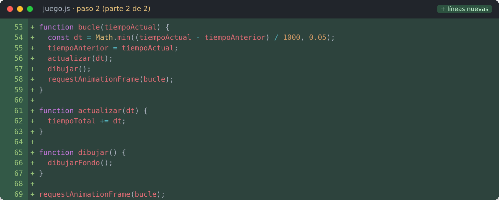</p>

<p align="center"><em>Figura 16. Paso 2: código nuevo en juego.js (parte 2 de 2). Lo verde es lo que escribes; lo gris ya lo tenías.</em></p>

**Explicación línea por línea:**


> **El corazón del juego: el bucle.** Un videojuego es como una película: muchas imágenes por segundo. En cada imagen (fotograma) hacemos dos cosas: actualizar (mover y calcular) y dibujar. requestAnimationFrame le pide al navegador que vuelva a llamar a bucle en el siguiente fotograma (unas 60 veces por segundo).

- **Línea 53** · `function bucle(tiempoActual) {`  
  → Declara la función bucle. El navegador le pasa tiempoActual: los milisegundos desde que se abrió la página.
- **Línea 54** · `const dt = Math.min((tiempoActual - tiempoAnterior) / 1000, 0.05);`  
  → dt = segundos desde el fotograma anterior (dividimos entre 1000 porque 1 segundo = 1000 ms). Si la pestaña estuvo en segundo plano, limitamos dt a 0.05 para que nada dé un salto enorme.
- **Línea 55** · `tiempoAnterior = tiempoActual;`  
  → Guardamos el tiempo de este fotograma para la próxima vez.
- **Línea 56** · `actualizar(dt);`  
  → Paso 1: actualizar el mundo.
- **Línea 57** · `dibujar();`  
  → Paso 2: dibujarlo.
- **Línea 58** · `requestAnimationFrame(bucle);`  
  → Pide al navegador que llame otra vez a bucle en el siguiente fotograma. ¡Así el bucle nunca termina!
- **Línea 59** · `}`  
  → Cierra la llave `{` que se abrió más arriba: aquí termina ese bloque.

> **Actualizar.** Aquí se llama, en orden, a todas las funciones que mueven o calculan cosas.

- **Línea 61** · `function actualizar(dt) {`  
  → Declara la función actualizar.
- **Línea 62** · `tiempoTotal += dt;`  
  → Suma el tiempo transcurrido al total.
- **Línea 63** · `}`  
  → Cierra la llave `{` que se abrió más arriba: aquí termina ese bloque.

> **Dibujar.** El orden importa: lo que se dibuja después queda encima. Primero el fondo, al final los menús.

- **Línea 65** · `function dibujar() {`  
  → Declara la función dibujar.
- **Línea 66** · `dibujarFondo();`  
  → 1) El fondo (también borra el fotograma anterior).
- **Línea 67** · `}`  
  → Cierra la llave `{` que se abrió más arriba: aquí termina ese bloque.
- **Línea 69** · `requestAnimationFrame(bucle);`  
  → ¡Arranca el juego! Pedimos el primer fotograma; a partir de aquí el bucle se repite solo.

**Código para copiar** (o mejor, ¡escríbelo tú para aprender!):

```javascript
function bucle(tiempoActual) {
  const dt = Math.min((tiempoActual - tiempoAnterior) / 1000, 0.05);
  tiempoAnterior = tiempoActual;
  actualizar(dt);
  dibujar();
  requestAnimationFrame(bucle);
}

function actualizar(dt) {
  tiempoTotal += dt;
}

function dibujar() {
  dibujarFondo();
}

requestAnimationFrame(bucle);
```

### Resultado del paso 2

<p align="center">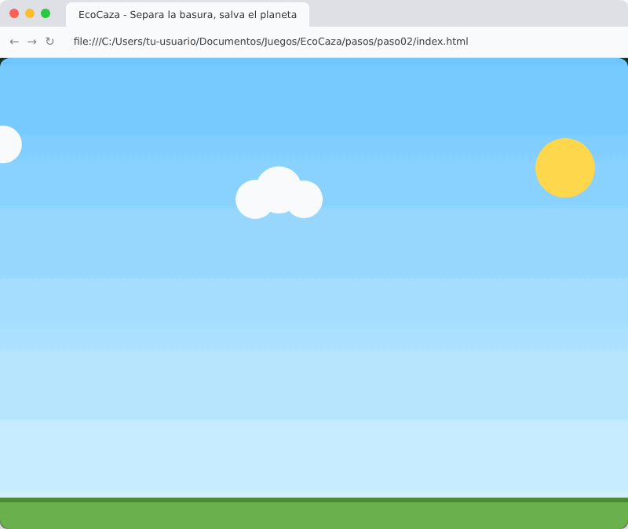</p>

<p align="center"><em>Figura 17. Resultado del paso 2: cielo con degradado, sol, dos nubes y césped.</em></p>

Las nubes se mueven despacio hacia la derecha. Esta segunda captura está tomada unos segundos más tarde:

<p align="center">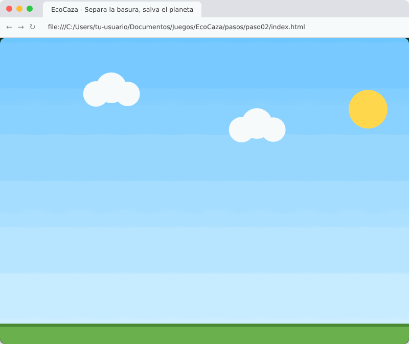</p>

<p align="center"><em>Figura 18. Unos segundos después: las nubes han avanzado. Cuando salen por la derecha, vuelven a entrar por la izquierda.</em></p>

### Pruébalo tú

- Cambia `tiempoTotal * 20` por `tiempoTotal * 200`: ¡nubes a toda velocidad!
- Cambia los colores del degradado para hacer un **atardecer** (`"#ff7e5f"` arriba y `"#feb47b"` abajo).
- Añade una tercera nube copiando una de las líneas `dibujarNube(...)` y cambiando sus números.

# 6. Paso 3 · El contenedor (el jugador)

**Objetivo:** guardar los datos de los cuatro tipos de contenedor y dibujar al protagonista: un contenedor con ruedas y el símbolo de reciclaje.

**Qué aprenderás:** objetos y arrays, `moveTo`/`lineTo` para hacer figuras con lados, bucles `for`, y a crear tu propia función reutilizable (`escribir`).

#### Cambio 1 de 4 · Añadir código en `juego.js`

📍 **Dónde:** justo **debajo** de la línea `const ALTO = lienzo.height;` (en el archivo terminado de este paso es la línea 9). Las líneas nuevas son de la 11 a la 19.

<p align="center">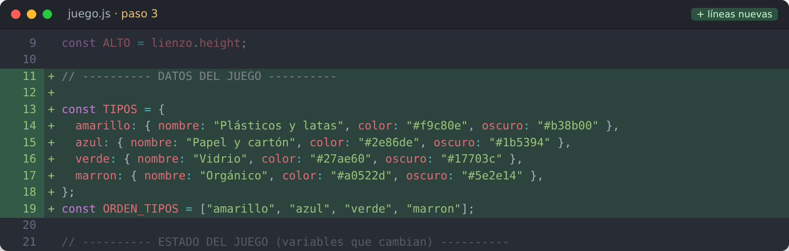</p>

<p align="center"><em>Figura 19. Paso 3: código nuevo en juego.js. Lo verde es lo que escribes; lo gris ya lo tenías.</em></p>

**Explicación línea por línea:**

- **Línea 11** · `// ---------- DATOS DEL JUEGO ----------`  
  → Comentario que sirve de título de sección: «DATOS DEL JUEGO». El navegador lo ignora; nos ayuda a ordenar el código.

> **Los cuatro contenedores.** Guardamos en un objeto la información de cada tipo de contenedor: su nombre y sus colores. Si algún día quieres cambiar un color, solo lo cambias aquí.

- **Línea 13** · `const TIPOS = {`  
  → Crea la constante TIPOS. Es un objeto: una caja con apartados, cada uno con su nombre (amarillo, azul, verde, marron) y sus datos entre llaves { }.
- **Línea 14** · `amarillo: { nombre: "Plásticos y latas", color: "#f9c80e", oscuro: "#b38b00" },`  
  → Datos del contenedor amarillo: el nombre que verá el jugador, su color principal y un color más oscuro para bordes y tapa.
- **Línea 15** · `azul: { nombre: "Papel y cartón", color: "#2e86de", oscuro: "#1b5394" },`  
  → Datos del contenedor azul (papel y cartón).
- **Línea 16** · `verde: { nombre: "Vidrio", color: "#27ae60", oscuro: "#17703c" },`  
  → Datos del contenedor verde (vidrio).
- **Línea 17** · `marron: { nombre: "Orgánico", color: "#a0522d", oscuro: "#5e2e14" },`  
  → Datos del contenedor marrón (orgánico = restos de comida). En el código escribimos marron sin tilde para evitar problemas al teclear.
- **Línea 18** · `};`  
  → Cierra la llave del objeto y termina la instrucción.
- **Línea 19** · `const ORDEN_TIPOS = ["amarillo", "azul", "verde", "marron"];`  
  → Una lista (array) con los cuatro tipos en orden. Los arrays se escriben entre corchetes [ ] y cada elemento tiene una posición: 0, 1, 2, 3. Así sabremos que la tecla 1 es el amarillo, la 2 el azul, etc.

**Código para copiar** (o mejor, ¡escríbelo tú para aprender!):

```javascript
// ---------- DATOS DEL JUEGO ----------

const TIPOS = {
  amarillo: { nombre: "Plásticos y latas", color: "#f9c80e", oscuro: "#b38b00" },
  azul: { nombre: "Papel y cartón", color: "#2e86de", oscuro: "#1b5394" },
  verde: { nombre: "Vidrio", color: "#27ae60", oscuro: "#17703c" },
  marron: { nombre: "Orgánico", color: "#a0522d", oscuro: "#5e2e14" },
};
const ORDEN_TIPOS = ["amarillo", "azul", "verde", "marron"];
```

#### Cambio 2 de 4 · Añadir código en `juego.js`

📍 **Dónde:** justo **debajo** de la línea `let tiempoTotal = 0;` (en el archivo terminado de este paso es la línea 24). Las líneas nuevas son de la 26 a la 46.

<p align="center">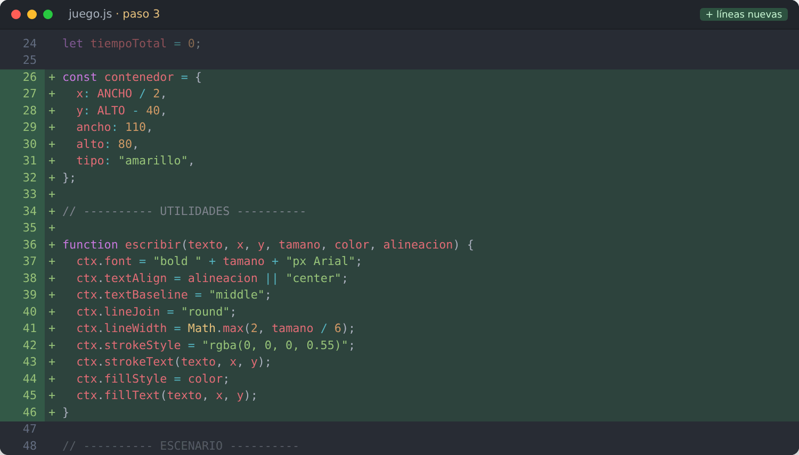</p>

<p align="center"><em>Figura 20. Paso 3: código nuevo en juego.js. Lo verde es lo que escribes; lo gris ya lo tenías.</em></p>

**Explicación línea por línea:**


> **El jugador: un contenedor con ruedas.** Guardamos todos sus datos juntos en un objeto.

- **Línea 26** · `const contenedor = {`  
  → Crea el objeto contenedor. Aunque es const, sus apartados (x, tipo...) sí pueden cambiar; lo que no cambia es que "contenedor" siempre es este mismo objeto.
- **Línea 27** · `x: ANCHO / 2,`  
  → Posición horizontal del CENTRO del contenedor: empieza en la mitad del lienzo.
- **Línea 28** · `y: ALTO - 40,`  
  → Posición vertical de la BASE del contenedor: 40 píxeles por encima del borde inferior, justo sobre el césped.
- **Línea 29** · `ancho: 110,`  
  → Ancho del contenedor en píxeles.
- **Línea 30** · `alto: 80,`  
  → Alto del contenedor en píxeles.
- **Línea 31** · `tipo: "amarillo",`  
  → Tipo de contenedor activo al empezar: el amarillo.
- **Línea 32** · `};`  
  → Cierra la llave del objeto y termina la instrucción.
- **Línea 34** · `// ---------- UTILIDADES ----------`  
  → Comentario que sirve de título de sección: «UTILIDADES». El navegador lo ignora; nos ayuda a ordenar el código.

> **Una función para escribir texto bonito.** Una función es un conjunto de órdenes con nombre que podemos usar muchas veces. Esta escribe un texto con borde oscuro para que se lea sobre cualquier fondo.

- **Línea 36** · `function escribir(texto, x, y, tamano, color, alineacion) {`  
  → Declara la función escribir. Entre paréntesis van sus "parámetros": los datos que le pasamos cada vez (el texto, la posición x e y, el tamaño, el color y la alineación).
- **Línea 37** · `ctx.font = "bold " + tamano + "px Arial";`  
  → Elige la letra: negrita, del tamaño indicado, Arial. Unimos textos con +: "bold " + 20 + "px Arial" da "bold 20px Arial".
- **Línea 38** · `ctx.textAlign = alineacion || "center";`  
  → Alineación horizontal. Si no nos pasan ninguna (alineacion vale undefined), el operador || elige "center".
- **Línea 39** · `ctx.textBaseline = "middle";`  
  → Alineación vertical: el punto y será el centro del texto.
- **Línea 40** · `ctx.lineJoin = "round";`  
  → Las esquinas del borde serán redondeadas (así no salen picos en letras como la M).
- **Línea 41** · `ctx.lineWidth = Math.max(2, tamano / 6);`  
  → Grosor del borde: una sexta parte del tamaño de la letra, pero nunca menos de 2 píxeles (Math.max elige el mayor).
- **Línea 42** · `ctx.strokeStyle = "rgba(0, 0, 0, 0.55)";`  
  → Color del borde: negro semitransparente. rgba = rojo, verde, azul y opacidad (0 = invisible, 1 = opaco).
- **Línea 43** · `ctx.strokeText(texto, x, y);`  
  → Dibuja solo el borde (contorno) del texto.
- **Línea 44** · `ctx.fillStyle = color;`  
  → Elige el color del relleno del texto.
- **Línea 45** · `ctx.fillText(texto, x, y);`  
  → Dibuja el relleno del texto encima del borde.
- **Línea 46** · `}`  
  → Cierra la llave `{` que se abrió más arriba: aquí termina ese bloque.

**Código para copiar** (o mejor, ¡escríbelo tú para aprender!):

```javascript
const contenedor = {
  x: ANCHO / 2,
  y: ALTO - 40,
  ancho: 110,
  alto: 80,
  tipo: "amarillo",
};

// ---------- UTILIDADES ----------

function escribir(texto, x, y, tamano, color, alineacion) {
  ctx.font = "bold " + tamano + "px Arial";
  ctx.textAlign = alineacion || "center";
  ctx.textBaseline = "middle";
  ctx.lineJoin = "round";
  ctx.lineWidth = Math.max(2, tamano / 6);
  ctx.strokeStyle = "rgba(0, 0, 0, 0.55)";
  ctx.strokeText(texto, x, y);
  ctx.fillStyle = color;
  ctx.fillText(texto, x, y);
}
```

#### Cambio 3 de 4 · Añadir código en `juego.js`

📍 **Dónde:** justo **debajo** de la línea `}` que cierra el bloque `function dibujarNube(x, y) {` (en el archivo terminado de este paso es la línea 81). Las líneas nuevas son de la 83 a la 140.

##### Parte 1 de 2 (líneas 83 a 119)

<p align="center">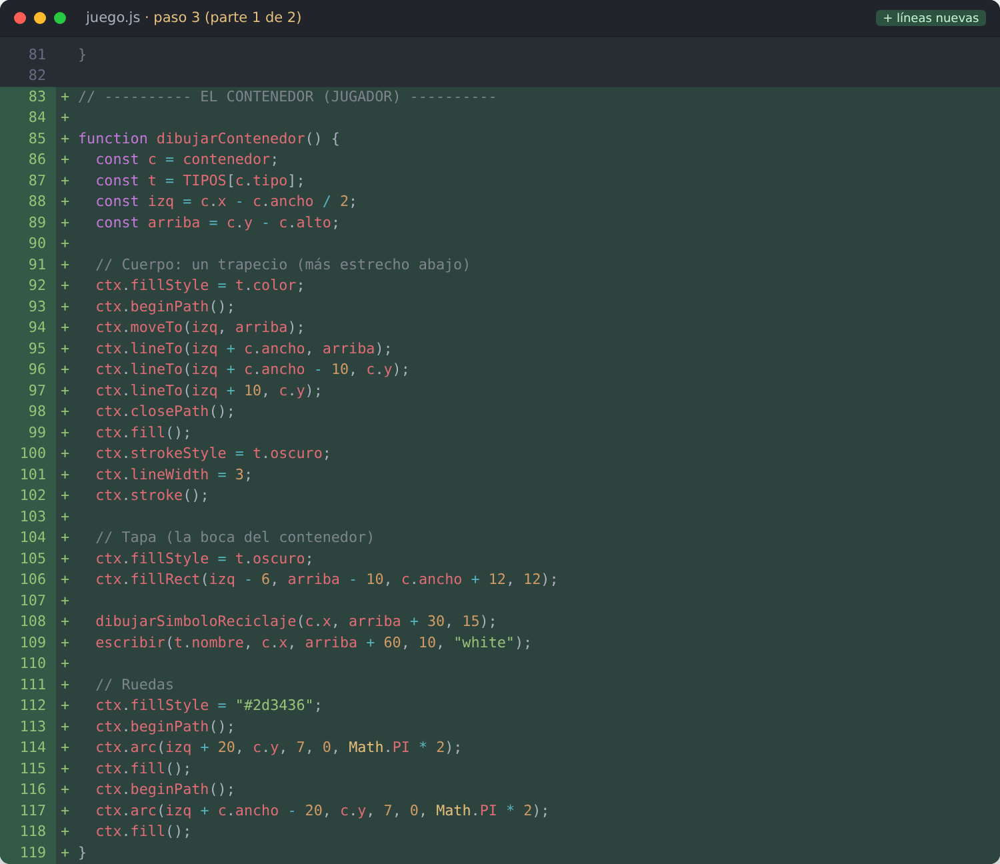</p>

<p align="center"><em>Figura 21. Paso 3: código nuevo en juego.js (parte 1 de 2). Lo verde es lo que escribes; lo gris ya lo tenías.</em></p>

**Explicación línea por línea:**

- **Línea 83** · `// ---------- EL CONTENEDOR (JUGADOR) ----------`  
  → Comentario que sirve de título de sección: «EL CONTENEDOR (JUGADOR)». El navegador lo ignora; nos ayuda a ordenar el código.

> **Dibujar el contenedor.** Lo construimos con figuras simples: un trapecio para el cuerpo, un rectángulo para la tapa, el símbolo de reciclaje, su nombre y dos ruedas.

- **Línea 85** · `function dibujarContenedor() {`  
  → Declara la función dibujarContenedor.
- **Línea 86** · `const c = contenedor;`  
  → Atajo: c es otro nombre para contenedor, así escribimos menos.
- **Línea 87** · `const t = TIPOS[c.tipo];`  
  → Busca en TIPOS los datos (nombre y colores) del tipo activo. Ej.: si c.tipo es "azul", t será TIPOS.azul.
- **Línea 88** · `const izq = c.x - c.ancho / 2;`  
  → Calcula el borde izquierdo: el centro menos la mitad del ancho.
- **Línea 89** · `const arriba = c.y - c.alto;`  
  → Calcula el borde de arriba: la base menos el alto (en el canvas, la y crece hacia ABAJO).
- **Línea 91** · `// Cuerpo: un trapecio (más estrecho abajo)`  
  → Comentario: el navegador lo ignora. Sirve para que las personas entendamos el código («Cuerpo: un trapecio (más estrecho abajo)»).
- **Línea 92** · `ctx.fillStyle = t.color;`  
  → El cuerpo se pinta del color del tipo activo.
- **Línea 93** · `ctx.beginPath();`  
  → Empieza un trazo nuevo, para que esta figura no se mezcle con la anterior.
- **Línea 94** · `ctx.moveTo(izq, arriba);`  
  → Coloca el lápiz (sin pintar) en la esquina superior izquierda.
- **Línea 95** · `ctx.lineTo(izq + c.ancho, arriba);`  
  → Traza una línea hasta la esquina superior derecha.
- **Línea 96** · `ctx.lineTo(izq + c.ancho - 10, c.y);`  
  → Baja hasta la esquina inferior derecha, 10 píxeles hacia dentro (por eso es un trapecio).
- **Línea 97** · `ctx.lineTo(izq + 10, c.y);`  
  → Va hasta la esquina inferior izquierda, también 10 píxeles hacia dentro.
- **Línea 98** · `ctx.closePath();`  
  → Cierra la figura volviendo al punto de inicio.
- **Línea 99** · `ctx.fill();`  
  → Rellena la figura que acabamos de trazar con el color de `fillStyle`.
- **Línea 100** · `ctx.strokeStyle = t.oscuro;`  
  → Elige el color oscuro del tipo para el borde.
- **Línea 101** · `ctx.lineWidth = 3;`  
  → El borde tendrá 3 píxeles de grosor.
- **Línea 102** · `ctx.stroke();`  
  → Dibuja el borde del trapecio.
- **Línea 104** · `// Tapa (la boca del contenedor)`  
  → Comentario: el navegador lo ignora. Sirve para que las personas entendamos el código («Tapa (la boca del contenedor)»).
- **Línea 105** · `ctx.fillStyle = t.oscuro;`  
  → La tapa usa el color oscuro.
- **Línea 106** · `ctx.fillRect(izq - 6, arriba - 10, c.ancho + 12, 12);`  
  → Rectángulo un poco más ancho que el cuerpo (6 píxeles por cada lado) y de 12 de alto, justo encima.
- **Línea 108** · `dibujarSimboloReciclaje(c.x, arriba + 30, 15);`  
  → Dibuja el símbolo de reciclaje en el centro, 30 píxeles por debajo de la boca, con radio 15.
- **Línea 109** · `escribir(t.nombre, c.x, arriba + 60, 10, "white");`  
  → Escribe el nombre del tipo (por ejemplo "Vidrio") en la parte baja del contenedor.
- **Línea 111** · `// Ruedas`  
  → Comentario: el navegador lo ignora. Sirve para que las personas entendamos el código («Ruedas»).
- **Línea 112** · `ctx.fillStyle = "#2d3436";`  
  → Gris casi negro para las ruedas.
- **Línea 113** · `ctx.beginPath();`  
  → Empieza un trazo nuevo, para que esta figura no se mezcle con la anterior.
- **Línea 114** · `ctx.arc(izq + 20, c.y, 7, 0, Math.PI * 2);`  
  → Rueda izquierda: círculo de radio 7 a 20 píxeles del borde izquierdo.
- **Línea 115** · `ctx.fill();`  
  → Rellena la figura que acabamos de trazar con el color de `fillStyle`.
- **Línea 116** · `ctx.beginPath();`  
  → Empieza un trazo nuevo, para que esta figura no se mezcle con la anterior.
- **Línea 117** · `ctx.arc(izq + c.ancho - 20, c.y, 7, 0, Math.PI * 2);`  
  → Rueda derecha.
- **Línea 118** · `ctx.fill();`  
  → Rellena la figura que acabamos de trazar con el color de `fillStyle`.
- **Línea 119** · `}`  
  → Cierra la llave `{` que se abrió más arriba: aquí termina ese bloque.

**Código para copiar** (o mejor, ¡escríbelo tú para aprender!):

```javascript
// ---------- EL CONTENEDOR (JUGADOR) ----------

function dibujarContenedor() {
  const c = contenedor;
  const t = TIPOS[c.tipo];
  const izq = c.x - c.ancho / 2;
  const arriba = c.y - c.alto;

  // Cuerpo: un trapecio (más estrecho abajo)
  ctx.fillStyle = t.color;
  ctx.beginPath();
  ctx.moveTo(izq, arriba);
  ctx.lineTo(izq + c.ancho, arriba);
  ctx.lineTo(izq + c.ancho - 10, c.y);
  ctx.lineTo(izq + 10, c.y);
  ctx.closePath();
  ctx.fill();
  ctx.strokeStyle = t.oscuro;
  ctx.lineWidth = 3;
  ctx.stroke();

  // Tapa (la boca del contenedor)
  ctx.fillStyle = t.oscuro;
  ctx.fillRect(izq - 6, arriba - 10, c.ancho + 12, 12);

  dibujarSimboloReciclaje(c.x, arriba + 30, 15);
  escribir(t.nombre, c.x, arriba + 60, 10, "white");

  // Ruedas
  ctx.fillStyle = "#2d3436";
  ctx.beginPath();
  ctx.arc(izq + 20, c.y, 7, 0, Math.PI * 2);
  ctx.fill();
  ctx.beginPath();
  ctx.arc(izq + c.ancho - 20, c.y, 7, 0, Math.PI * 2);
  ctx.fill();
}
```

##### Parte 2 de 2 (líneas 121 a 140)

<p align="center">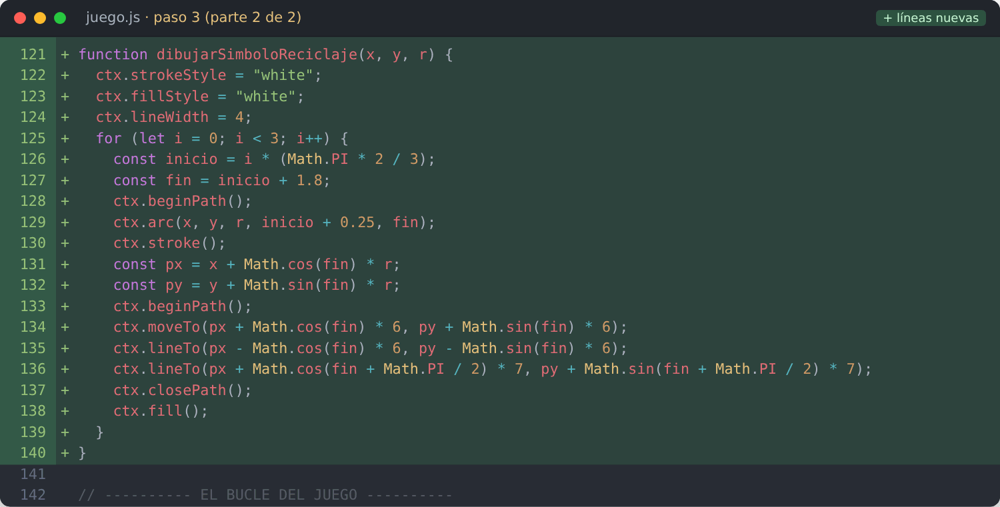</p>

<p align="center"><em>Figura 22. Paso 3: código nuevo en juego.js (parte 2 de 2). Lo verde es lo que escribes; lo gris ya lo tenías.</em></p>

**Explicación línea por línea:**


> **El símbolo de reciclaje.** Tres flechas que se persiguen en círculo. Cada flecha es un arco más un triángulo en la punta.

- **Línea 121** · `function dibujarSimboloReciclaje(x, y, r) {`  
  → Declara la función: recibe el centro (x, y) y el radio r del símbolo.
- **Línea 122** · `ctx.strokeStyle = "white";`  
  → Color blanco para las líneas.
- **Línea 123** · `ctx.fillStyle = "white";`  
  → Color blanco para las puntas de flecha.
- **Línea 124** · `ctx.lineWidth = 4;`  
  → Líneas de 4 píxeles de grosor.
- **Línea 125** · `for (let i = 0; i < 3; i++) {`  
  → Bucle for: repite el bloque 3 veces, con i = 0, luego 1, luego 2 (una vez por flecha).
- **Línea 126** · `const inicio = i * (Math.PI * 2 / 3);`  
  → Ángulo donde empieza esta flecha: un tercio de vuelta por cada flecha (Math.PI * 2 / 3 = 120 grados).
- **Línea 127** · `const fin = inicio + 1.8;`  
  → Ángulo donde termina el arco: 1.8 radianes (unos 100 grados) más allá.
- **Línea 128** · `ctx.beginPath();`  
  → Empieza un trazo nuevo, para que esta figura no se mezcle con la anterior.
- **Línea 129** · `ctx.arc(x, y, r, inicio + 0.25, fin);`  
  → Traza el arco de la flecha (empieza 0.25 radianes más tarde para dejar un hueco entre flechas).
- **Línea 130** · `ctx.stroke();`  
  → Dibuja el contorno (la línea) de la figura con el color de `strokeStyle`.
- **Línea 131** · `const px = x + Math.cos(fin) * r;`  
  → Calcula la x del final del arco. Con coseno y seno pasamos de "ángulo y radio" a coordenadas x, y.
- **Línea 132** · `const py = y + Math.sin(fin) * r;`  
  → Calcula la y del final del arco.
- **Línea 133** · `ctx.beginPath();`  
  → Empieza un trazo nuevo, para que esta figura no se mezcle con la anterior.
- **Línea 134** · `ctx.moveTo(px + Math.cos(fin) * 6, py + Math.sin(fin) * 6);`  
  → Primer vértice del triángulo: 6 píxeles hacia fuera del círculo.
- **Línea 135** · `ctx.lineTo(px - Math.cos(fin) * 6, py - Math.sin(fin) * 6);`  
  → Segundo vértice: 6 píxeles hacia dentro del círculo.
- **Línea 136** · `ctx.lineTo(px + Math.cos(fin + Math.PI / 2) * 7, py + Math.sin(fin + Math.PI / 2) * 7);`  
  → Tercer vértice (la punta): 7 píxeles en la dirección en la que avanza el arco (90 grados más, Math.PI / 2).
- **Línea 137** · `ctx.closePath();`  
  → Cierra la figura: une el último punto con el primero.
- **Línea 138** · `ctx.fill();`  
  → Rellena la figura que acabamos de trazar con el color de `fillStyle`.
- **Línea 139** · `}`  
  → Cierra la llave `{` que se abrió más arriba: aquí termina ese bloque.
- **Línea 140** · `}`  
  → Cierra la llave `{` que se abrió más arriba: aquí termina ese bloque.

**Código para copiar** (o mejor, ¡escríbelo tú para aprender!):

```javascript
function dibujarSimboloReciclaje(x, y, r) {
  ctx.strokeStyle = "white";
  ctx.fillStyle = "white";
  ctx.lineWidth = 4;
  for (let i = 0; i < 3; i++) {
    const inicio = i * (Math.PI * 2 / 3);
    const fin = inicio + 1.8;
    ctx.beginPath();
    ctx.arc(x, y, r, inicio + 0.25, fin);
    ctx.stroke();
    const px = x + Math.cos(fin) * r;
    const py = y + Math.sin(fin) * r;
    ctx.beginPath();
    ctx.moveTo(px + Math.cos(fin) * 6, py + Math.sin(fin) * 6);
    ctx.lineTo(px - Math.cos(fin) * 6, py - Math.sin(fin) * 6);
    ctx.lineTo(px + Math.cos(fin + Math.PI / 2) * 7, py + Math.sin(fin + Math.PI / 2) * 7);
    ctx.closePath();
    ctx.fill();
  }
}
```

#### Cambio 4 de 4 · Añadir código en `juego.js`

📍 **Dónde:** justo **debajo** de la línea `dibujarFondo();` (en el archivo terminado de este paso es la línea 157). Las líneas nuevas son de la 158 a la 158.

<p align="center">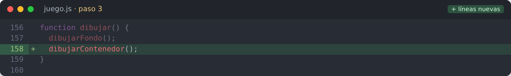</p>

<p align="center"><em>Figura 23. Paso 3: código nuevo en juego.js. Lo verde es lo que escribes; lo gris ya lo tenías.</em></p>

**Explicación línea por línea:**

- **Línea 158** · `dibujarContenedor();`  
  → 4) El contenedor (encima de los residuos).

**Código para copiar** (o mejor, ¡escríbelo tú para aprender!):

```javascript
  dibujarContenedor();
```

### Resultado del paso 3

<p align="center">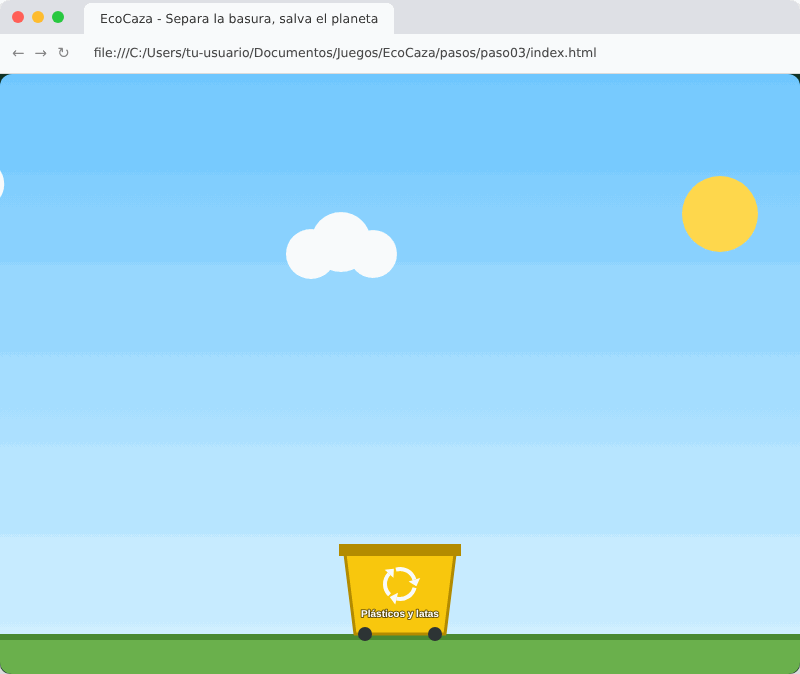</p>

<p align="center"><em>Figura 24. Resultado del paso 3: el contenedor amarillo aparece en el centro, sobre el césped.</em></p>

### Pruébalo tú

- Cambia `tipo: "amarillo"` por `tipo: "verde"` en el objeto `contenedor`. Recarga.
- Cambia `ancho: 110` por `ancho: 200`. El dibujo se adapta solo porque todo se calcula a partir de `c.ancho`.
- **Adáptalo a tu país:** si en tu ciudad el papel va en un contenedor gris, cambia el color del apartado `azul` en `TIPOS`.

# 7. Paso 4 · Mover el contenedor con el teclado

**Objetivo:** que el contenedor se mueva a izquierda y derecha con las flechas (o A y D) sin salirse de la pantalla.

**Qué aprenderás:** eventos de teclado (`keydown` y `keyup`), por qué guardamos las teclas en un objeto, y a mover cosas con **velocidad × dt**.

#### Cambio 1 de 4 · Añadir código en `juego.js`

📍 **Dónde:** justo **debajo** de la línea `alto: 80,` (en el archivo terminado de este paso es la línea 30). Las líneas nuevas son de la 31 a la 31.

<p align="center">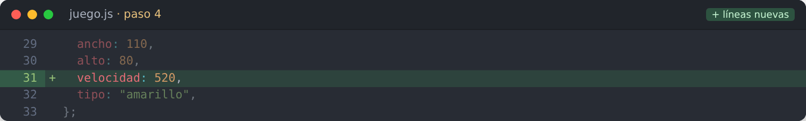</p>

<p align="center"><em>Figura 25. Paso 4: código nuevo en juego.js. Lo verde es lo que escribes; lo gris ya lo tenías.</em></p>

**Explicación línea por línea:**

- **Línea 31** · `velocidad: 520,`  
  → Velocidad al moverse: 520 píxeles por segundo.

**Código para copiar** (o mejor, ¡escríbelo tú para aprender!):

```javascript
  velocidad: 520,
```

#### Cambio 2 de 4 · Añadir código en `juego.js`

📍 **Dónde:** justo **debajo** de la línea `};` que cierra el bloque `const contenedor = {` (en el archivo terminado de este paso es la línea 33). Las líneas nuevas son de la 34 a la 34.

<p align="center">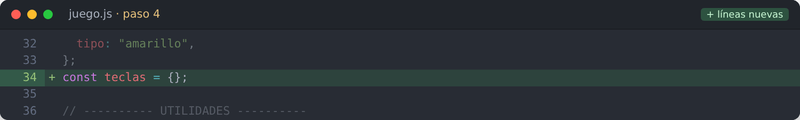</p>

<p align="center"><em>Figura 26. Paso 4: código nuevo en juego.js. Lo verde es lo que escribes; lo gris ya lo tenías.</em></p>

**Explicación línea por línea:**

- **Línea 34** · `const teclas = {};`  
  → Objeto vacío donde apuntaremos qué teclas están pulsadas ahora mismo. Por ejemplo: teclas["ArrowLeft"] valdrá true mientras la flecha izquierda esté pulsada.

**Código para copiar** (o mejor, ¡escríbelo tú para aprender!):

```javascript
const teclas = {};
```

#### Cambio 3 de 4 · Añadir código en `juego.js`

📍 **Dónde:** justo **debajo** de la línea `}` que cierra el bloque `function dibujarSimboloReciclaje(x, y, r) {` (en el archivo terminado de este paso es la línea 142). Las líneas nuevas son de la 144 a la 163.

<p align="center">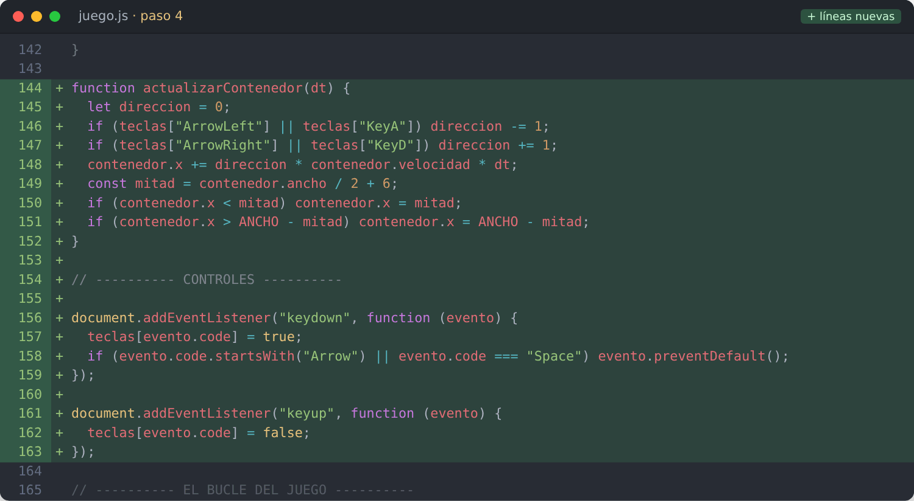</p>

<p align="center"><em>Figura 27. Paso 4: código nuevo en juego.js. Lo verde es lo que escribes; lo gris ya lo tenías.</em></p>

**Explicación línea por línea:**


> **Mover el contenedor con el teclado.** Cada fotograma miramos qué flechas están pulsadas y movemos el contenedor. Multiplicar por dt (los segundos que pasaron) hace que la velocidad sea la misma en ordenadores rápidos y lentos.

- **Línea 144** · `function actualizarContenedor(dt) {`  
  → Declara la función actualizarContenedor. dt es el tiempo (en segundos) desde el fotograma anterior, por ejemplo 0.016.
- **Línea 145** · `let direccion = 0;`  
  → Dirección del movimiento: -1 = izquierda, 0 = quieto, 1 = derecha. Empieza en 0.
- **Línea 146** · `if (teclas["ArrowLeft"] || teclas["KeyA"]) direccion -= 1;`  
  → Si está pulsada la flecha izquierda O (||) la tecla A, resta 1 a la dirección.
- **Línea 147** · `if (teclas["ArrowRight"] || teclas["KeyD"]) direccion += 1;`  
  → Si está pulsada la flecha derecha o la tecla D, suma 1. (Si pulsas las dos, se anulan y queda 0).
- **Línea 148** · `contenedor.x += direccion * contenedor.velocidad * dt;`  
  → Mueve el contenedor: distancia = dirección × velocidad × tiempo. Ej.: 1 × 520 × 0.016 = 8.3 píxeles a la derecha.
- **Línea 149** · `const mitad = contenedor.ancho / 2 + 6;`  
  → Media anchura del contenedor más la tapa: la distancia mínima al borde para que no se salga.
- **Línea 150** · `if (contenedor.x < mitad) contenedor.x = mitad;`  
  → Si se sale por la izquierda, lo devolvemos al límite.
- **Línea 151** · `if (contenedor.x > ANCHO - mitad) contenedor.x = ANCHO - mitad;`  
  → Si se sale por la derecha, también.
- **Línea 152** · `}`  
  → Cierra la llave `{` que se abrió más arriba: aquí termina ese bloque.
- **Línea 154** · `// ---------- CONTROLES ----------`  
  → Comentario que sirve de título de sección: «CONTROLES». El navegador lo ignora; nos ayuda a ordenar el código.

> **Escuchar el teclado.** addEventListener le dice al navegador: "cuando pase esto, ejecuta esta función". Apuntamos cada tecla al pulsarla (keydown) y la borramos al soltarla (keyup).

- **Línea 156** · `document.addEventListener("keydown", function (evento) {`  
  → Cuando se pulse una tecla en la página, ejecuta esta función. evento trae la información de la tecla pulsada.
- **Línea 157** · `teclas[evento.code] = true;`  
  → Apunta que esta tecla está pulsada. evento.code es el nombre de la tecla, como "ArrowLeft" o "KeyA".
- **Línea 158** · `if (evento.code.startsWith("Arrow") || evento.code === "Space") evento.preventDefault();`  
  → Evita que las flechas y el espacio hagan scroll en la página mientras jugamos.
- **Línea 159** · `});`  
  → Cierra la llave de la función, el paréntesis de la llamada y termina la instrucción con `;`.
- **Línea 161** · `document.addEventListener("keyup", function (evento) {`  
  → Cuando se suelte una tecla...
- **Línea 162** · `teclas[evento.code] = false;`  
  → ...apuntamos que ya no está pulsada.
- **Línea 163** · `});`  
  → Cierra la llave de la función, el paréntesis de la llamada y termina la instrucción con `;`.

**Código para copiar** (o mejor, ¡escríbelo tú para aprender!):

```javascript
function actualizarContenedor(dt) {
  let direccion = 0;
  if (teclas["ArrowLeft"] || teclas["KeyA"]) direccion -= 1;
  if (teclas["ArrowRight"] || teclas["KeyD"]) direccion += 1;
  contenedor.x += direccion * contenedor.velocidad * dt;
  const mitad = contenedor.ancho / 2 + 6;
  if (contenedor.x < mitad) contenedor.x = mitad;
  if (contenedor.x > ANCHO - mitad) contenedor.x = ANCHO - mitad;
}

// ---------- CONTROLES ----------

document.addEventListener("keydown", function (evento) {
  teclas[evento.code] = true;
  if (evento.code.startsWith("Arrow") || evento.code === "Space") evento.preventDefault();
});

document.addEventListener("keyup", function (evento) {
  teclas[evento.code] = false;
});
```

#### Cambio 4 de 4 · Añadir código en `juego.js`

📍 **Dónde:** justo **debajo** de la línea `tiempoTotal += dt;` (en el archivo terminado de este paso es la línea 176). Las líneas nuevas son de la 177 a la 177.

<p align="center">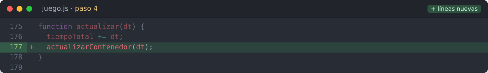</p>

<p align="center"><em>Figura 28. Paso 4: código nuevo en juego.js. Lo verde es lo que escribes; lo gris ya lo tenías.</em></p>

**Explicación línea por línea:**

- **Línea 177** · `actualizarContenedor(dt);`  
  → Mueve el contenedor.

**Código para copiar** (o mejor, ¡escríbelo tú para aprender!):

```javascript
  actualizarContenedor(dt);
```

### Resultado del paso 4

<p align="center">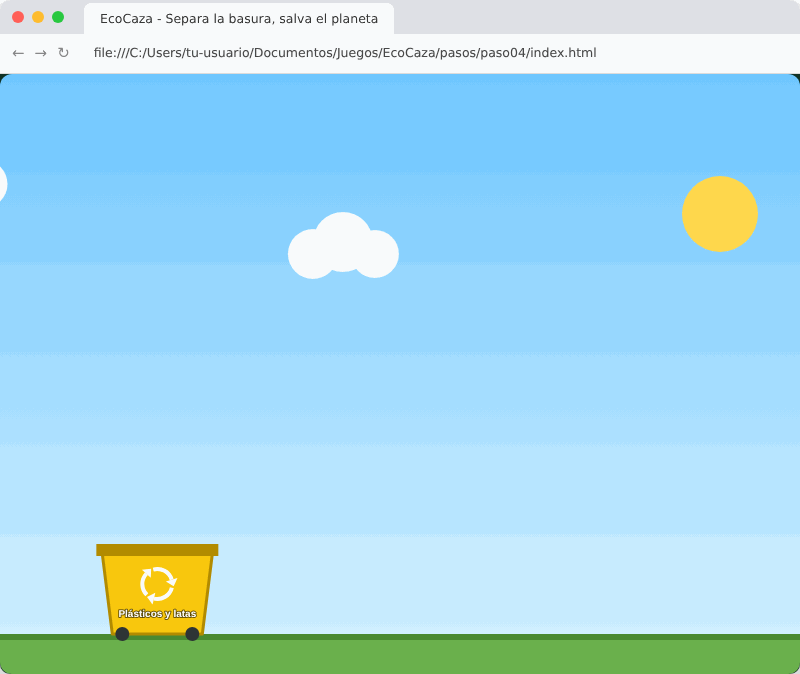</p>

<p align="center"><em>Figura 29. Tras mantener pulsada la flecha izquierda medio segundo, el contenedor se ha desplazado.</em></p>

<p align="center">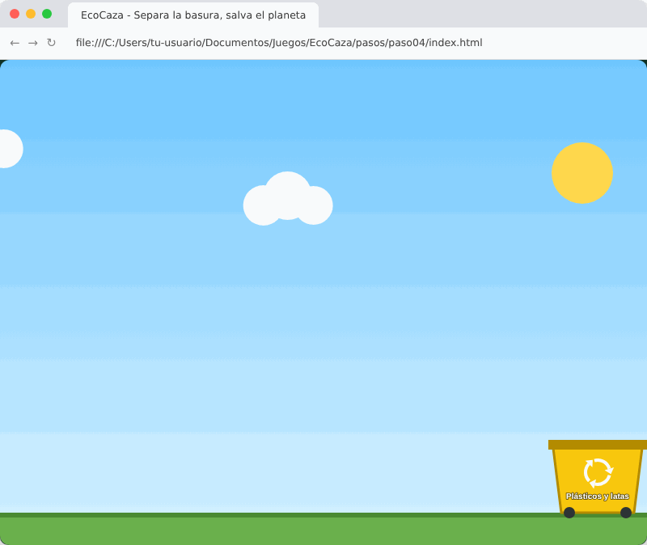</p>

<p align="center"><em>Figura 30. Si mantienes la flecha derecha, el contenedor se detiene en el borde: no se sale del lienzo.</em></p>

### Pruébalo tú

- Cambia `velocidad: 520` por `velocidad: 150` (¡qué lento!) o `1500` (¡qué rápido!).
- Comenta (pon `//` delante) las dos líneas de los límites y comprueba que el contenedor se escapa de la pantalla.

# 8. Paso 5 · Cambiar el tipo de contenedor

**Objetivo:** que las teclas 1, 2, 3 y 4 transformen el contenedor, con un pequeño salto, y mostrar una barra de botones con el tipo activo.

**Qué aprenderás:** `indexOf`, el operador `? :`, transparencia (`globalAlpha`), rectángulos redondeados y `save`/`translate`/`restore` para mover un dibujo entero.

#### Cambio 1 de 8 · Añadir código en `juego.js`

📍 **Dónde:** justo **debajo** de la línea `const ORDEN_TIPOS = ["amarillo", "azul", "verde", "marron"];` (en el archivo terminado de este paso es la línea 19). Las líneas nuevas son de la 20 a la 20.

<p align="center">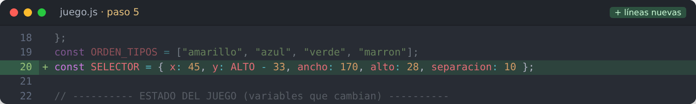</p>

<p align="center"><em>Figura 31. Paso 5: código nuevo en juego.js. Lo verde es lo que escribes; lo gris ya lo tenías.</em></p>

**Explicación línea por línea:**


> **Los botones del selector.** Medidas de la barra de botones que dibujaremos sobre el césped (sirve para ver qué contenedor está activo y, en el paso 13, para tocarlo con el dedo).

- **Línea 20** · `const SELECTOR = { x: 45, y: ALTO - 33, ancho: 170, alto: 28, separacion: 10 };`  
  → Objeto con la posición y el tamaño de los botones: x e y de la esquina del primer botón, ancho y alto de cada botón, y separación entre botones.

**Código para copiar** (o mejor, ¡escríbelo tú para aprender!):

```javascript
const SELECTOR = { x: 45, y: ALTO - 33, ancho: 170, alto: 28, separacion: 10 };
```

#### Cambio 2 de 8 · Añadir código en `juego.js`

📍 **Dónde:** justo **debajo** de la línea `tipo: "amarillo",` (en el archivo terminado de este paso es la línea 33). Las líneas nuevas son de la 34 a la 34.

<p align="center">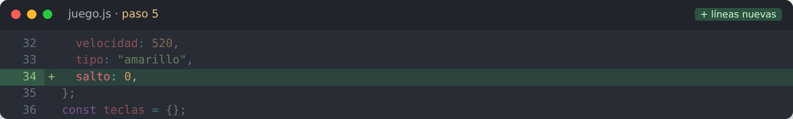</p>

<p align="center"><em>Figura 32. Paso 5: código nuevo en juego.js. Lo verde es lo que escribes; lo gris ya lo tenías.</em></p>

**Explicación línea por línea:**

- **Línea 34** · `salto: 0,`  
  → Temporizador del saltito que da el contenedor al cambiar de tipo (0 = no está saltando).

**Código para copiar** (o mejor, ¡escríbelo tú para aprender!):

```javascript
  salto: 0,
```

#### Cambio 3 de 8 · Añadir código en `juego.js`

📍 **Dónde:** justo **debajo** de la línea `const arriba = c.y - c.alto;` (en el archivo terminado de este paso es la línea 93). Las líneas nuevas son de la 94 a la 95.

<p align="center">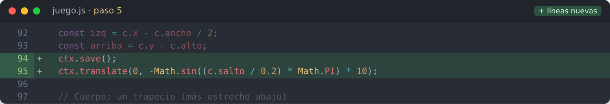</p>

<p align="center"><em>Figura 33. Paso 5: código nuevo en juego.js. Lo verde es lo que escribes; lo gris ya lo tenías.</em></p>

**Explicación línea por línea:**

- **Línea 94** · `ctx.save();`  
  → Guarda el estado del pincel antes de mover el dibujo por el saltito.
- **Línea 95** · `ctx.translate(0, -Math.sin((c.salto / 0.2) * Math.PI) * 10);`  
  → Sube el dibujo según el salto: Math.sin dibuja una curva que sube y baja suavemente, hasta 10 píxeles.

**Código para copiar** (o mejor, ¡escríbelo tú para aprender!):

```javascript
  ctx.save();
  ctx.translate(0, -Math.sin((c.salto / 0.2) * Math.PI) * 10);
```

#### Cambio 4 de 8 · Añadir código en `juego.js`

📍 **Dónde:** justo **debajo** de la línea `ctx.fill();` (en el archivo terminado de este paso es la línea 124). Las líneas nuevas son de la 125 a la 125.

<p align="center">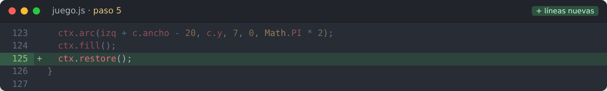</p>

<p align="center"><em>Figura 34. Paso 5: código nuevo en juego.js. Lo verde es lo que escribes; lo gris ya lo tenías.</em></p>

**Explicación línea por línea:**

- **Línea 125** · `ctx.restore();`  
  → Recupera el estado del pincel (deshace el movimiento del salto).

**Código para copiar** (o mejor, ¡escríbelo tú para aprender!):

```javascript
  ctx.restore();
```

#### Cambio 5 de 8 · Añadir código en `juego.js`

📍 **Dónde:** justo **debajo** de la línea `if (contenedor.x > ANCHO - mitad) contenedor.x = ANCHO - mitad;` (en el archivo terminado de este paso es la línea 156). Las líneas nuevas son de la 157 a la 157.

<p align="center">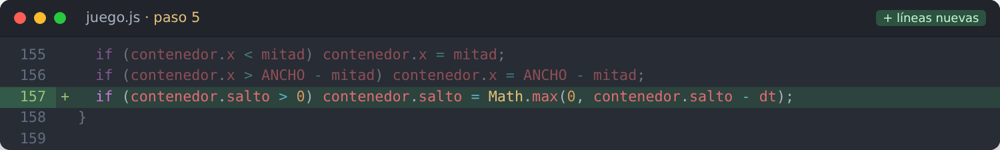</p>

<p align="center"><em>Figura 35. Paso 5: código nuevo en juego.js. Lo verde es lo que escribes; lo gris ya lo tenías.</em></p>

**Explicación línea por línea:**

- **Línea 157** · `if (contenedor.salto > 0) contenedor.salto = Math.max(0, contenedor.salto - dt);`  
  → Si está saltando, descuenta el tiempo del salto sin bajar de 0.

**Código para copiar** (o mejor, ¡escríbelo tú para aprender!):

```javascript
  if (contenedor.salto > 0) contenedor.salto = Math.max(0, contenedor.salto - dt);
```

#### Cambio 6 de 8 · Añadir código en `juego.js`

📍 **Dónde:** justo **debajo** de la línea `}` que cierra el bloque `function actualizarContenedor(dt) {` (en el archivo terminado de este paso es la línea 158). Las líneas nuevas son de la 160 a la 185.

<p align="center">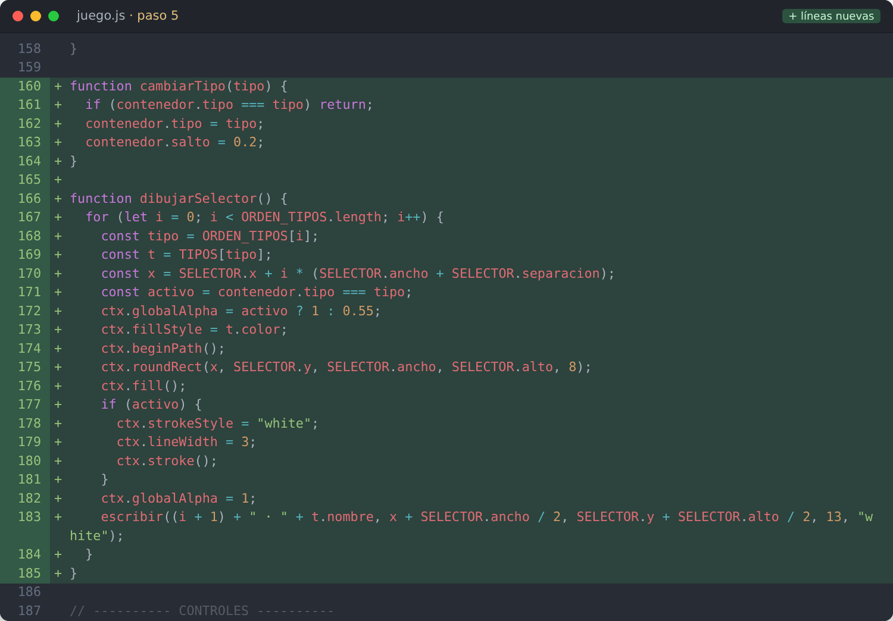</p>

<p align="center"><em>Figura 36. Paso 5: código nuevo en juego.js. Lo verde es lo que escribes; lo gris ya lo tenías.</em></p>

**Explicación línea por línea:**


> **Cambiar el tipo de contenedor.** Al pulsar 1, 2, 3 o 4 el contenedor cambia de color y da un saltito para que se note.

- **Línea 160** · `function cambiarTipo(tipo) {`  
  → Declara la función cambiarTipo, que recibe el nombre del tipo nuevo ("azul", "verde"...).
- **Línea 161** · `if (contenedor.tipo === tipo) return;`  
  → Si ya era ese tipo, no hacemos nada: return sale de la función inmediatamente. (=== significa "es exactamente igual a").
- **Línea 162** · `contenedor.tipo = tipo;`  
  → Guarda el tipo nuevo.
- **Línea 163** · `contenedor.salto = 0.2;`  
  → Empieza el saltito: durará 0.2 segundos.
- **Línea 164** · `}`  
  → Cierra la llave `{` que se abrió más arriba: aquí termina ese bloque.

> **Dibujar la barra de botones.** Cuatro botones sobre el césped; el activo se ve más intenso y con borde blanco.

- **Línea 166** · `function dibujarSelector() {`  
  → Declara la función dibujarSelector.
- **Línea 167** · `for (let i = 0; i < ORDEN_TIPOS.length; i++) {`  
  → Repite una vez por cada tipo (i = 0, 1, 2, 3). ORDEN_TIPOS.length es el número de elementos de la lista: 4.
- **Línea 168** · `const tipo = ORDEN_TIPOS[i];`  
  → El nombre del tipo de esta vuelta, por ejemplo "azul".
- **Línea 169** · `const t = TIPOS[tipo];`  
  → Sus datos (nombre y colores).
- **Línea 170** · `const x = SELECTOR.x + i * (SELECTOR.ancho + SELECTOR.separacion);`  
  → Posición x de este botón: el inicio más i veces (ancho + separación).
- **Línea 171** · `const activo = contenedor.tipo === tipo;`  
  → ¿Es este el tipo activo? Guarda true o false.
- **Línea 172** · `ctx.globalAlpha = activo ? 1 : 0.55;`  
  → Opacidad general: 1 (opaco) si está activo, 0.55 si no. La forma "condición ? A : B" elige A si se cumple y B si no.
- **Línea 173** · `ctx.fillStyle = t.color;`  
  → Color del botón.
- **Línea 174** · `ctx.beginPath();`  
  → Empieza un trazo nuevo, para que esta figura no se mezcle con la anterior.
- **Línea 175** · `ctx.roundRect(x, SELECTOR.y, SELECTOR.ancho, SELECTOR.alto, 8);`  
  → Traza un rectángulo con las esquinas redondeadas (radio 8).
- **Línea 176** · `ctx.fill();`  
  → Rellena la figura que acabamos de trazar con el color de `fillStyle`.
- **Línea 177** · `if (activo) {`  
  → Si es el activo...
- **Línea 178** · `ctx.strokeStyle = "white";`  
  → ...le ponemos un borde blanco de 3 píxeles.
- **Línea 179** · `ctx.lineWidth = 3;`  
  → Grosor de las líneas: `3` píxeles.
- **Línea 180** · `ctx.stroke();`  
  → Dibuja el contorno (la línea) de la figura con el color de `strokeStyle`.
- **Línea 181** · `}`  
  → Cierra la llave `{` que se abrió más arriba: aquí termina ese bloque.
- **Línea 182** · `ctx.globalAlpha = 1;`  
  → Volvemos a opacidad normal para lo siguiente que se dibuje.
- **Línea 183** · `escribir((i + 1) + " · " + t.nombre, x + SELECTOR.ancho / 2, SELECTOR.y + SELECTOR.alto...`  
  → Escribe en el centro del botón su número y su nombre, por ejemplo "2 · Papel y cartón".
- **Línea 184** · `}`  
  → Cierra la llave `{` que se abrió más arriba: aquí termina ese bloque.
- **Línea 185** · `}`  
  → Cierra la llave `{` que se abrió más arriba: aquí termina ese bloque.

**Código para copiar** (o mejor, ¡escríbelo tú para aprender!):

```javascript
function cambiarTipo(tipo) {
  if (contenedor.tipo === tipo) return;
  contenedor.tipo = tipo;
  contenedor.salto = 0.2;
}

function dibujarSelector() {
  for (let i = 0; i < ORDEN_TIPOS.length; i++) {
    const tipo = ORDEN_TIPOS[i];
    const t = TIPOS[tipo];
    const x = SELECTOR.x + i * (SELECTOR.ancho + SELECTOR.separacion);
    const activo = contenedor.tipo === tipo;
    ctx.globalAlpha = activo ? 1 : 0.55;
    ctx.fillStyle = t.color;
    ctx.beginPath();
    ctx.roundRect(x, SELECTOR.y, SELECTOR.ancho, SELECTOR.alto, 8);
    ctx.fill();
    if (activo) {
      ctx.strokeStyle = "white";
      ctx.lineWidth = 3;
      ctx.stroke();
    }
    ctx.globalAlpha = 1;
    escribir((i + 1) + " · " + t.nombre, x + SELECTOR.ancho / 2, SELECTOR.y + SELECTOR.alto / 2, 13, "white");
  }
}
```

#### Cambio 7 de 8 · Añadir código en `juego.js`

📍 **Dónde:** justo **debajo** de la línea `teclas[evento.code] = true;` (en el archivo terminado de este paso es la línea 190). Las líneas nuevas son de la 191 a la 192.

<p align="center">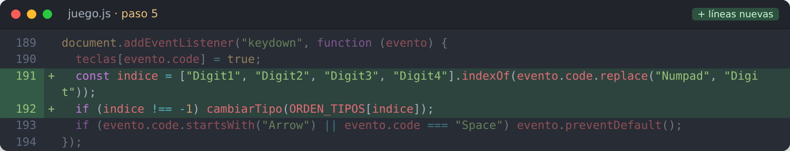</p>

<p align="center"><em>Figura 37. Paso 5: código nuevo en juego.js. Lo verde es lo que escribes; lo gris ya lo tenías.</em></p>

**Explicación línea por línea:**

- **Línea 191** · `const indice = ["Digit1", "Digit2", "Digit3", "Digit4"].indexOf(evento.code.replace("Nu...`  
  → Busca la tecla en la lista de números. "Numpad1" (teclado numérico) se convierte en "Digit1" con replace. indexOf da la posición (0 a 3) o -1 si no está.
- **Línea 192** · `if (indice !== -1) cambiarTipo(ORDEN_TIPOS[indice]);`  
  → Si era un número del 1 al 4 (es decir, el índice no es -1), cambiamos al tipo correspondiente.

**Código para copiar** (o mejor, ¡escríbelo tú para aprender!):

```javascript
  const indice = ["Digit1", "Digit2", "Digit3", "Digit4"].indexOf(evento.code.replace("Numpad", "Digit"));
  if (indice !== -1) cambiarTipo(ORDEN_TIPOS[indice]);
```

#### Cambio 8 de 8 · Añadir código en `juego.js`

📍 **Dónde:** justo **debajo** de la línea `dibujarContenedor();` (en el archivo terminado de este paso es la línea 217). Las líneas nuevas son de la 218 a la 218.

<p align="center">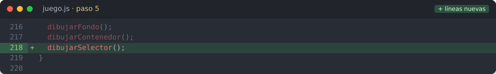</p>

<p align="center"><em>Figura 38. Paso 5: código nuevo en juego.js. Lo verde es lo que escribes; lo gris ya lo tenías.</em></p>

**Explicación línea por línea:**

- **Línea 218** · `dibujarSelector();`  
  → 8) Los botones del selector.

**Código para copiar** (o mejor, ¡escríbelo tú para aprender!):

```javascript
  dibujarSelector();
```

### Resultado del paso 5

<p align="center">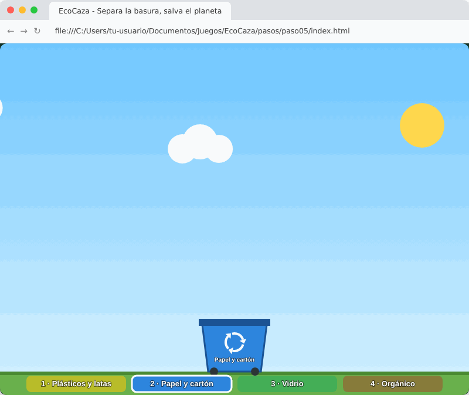</p>

<p align="center"><em>Figura 39. Tras pulsar 2: contenedor azul de papel y cartón. Abajo, su botón se ve brillante y con borde blanco.</em></p>

<p align="center">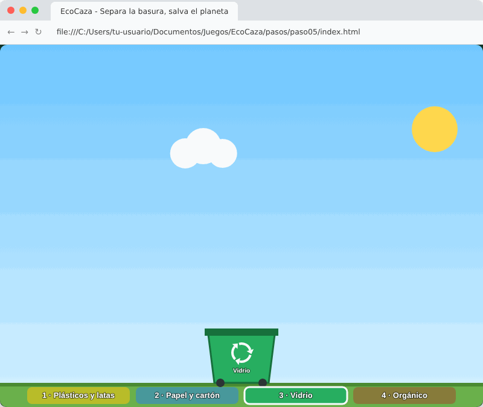</p>

<p align="center"><em>Figura 40. Justo al cambiar (aquí al verde, tecla 3) el contenedor da un saltito para que el cambio se note.</em></p>

<p align="center">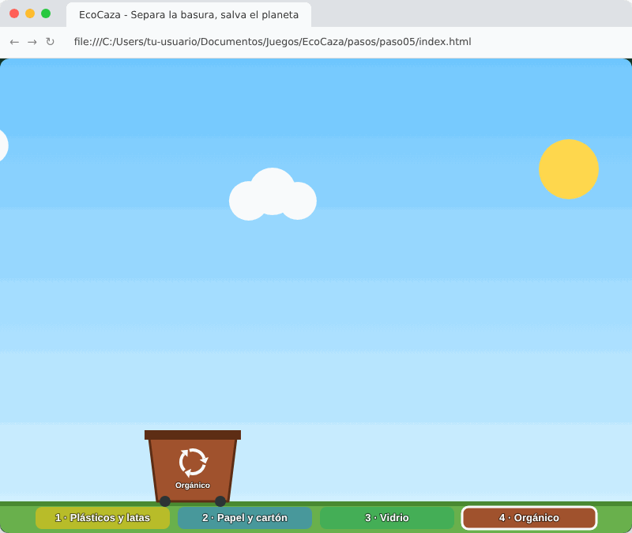</p>

<p align="center"><em>Figura 41. Contenedor marrón (tecla 4), después de moverlo un poco a la izquierda.</em></p>

### Pruébalo tú

- Cambia el `10` de `* 10` en la línea del `translate` por `40`: ¡salto de canguro!
- Cambia `0.55` por `0.2` en `globalAlpha` para que los botones inactivos se vean más apagados.

# 9. Paso 6 · Los residuos empiezan a caer

**Objetivo:** crear el catálogo de residuos y hacer que caigan desde arriba, en posiciones al azar, cada cierto tiempo.

**Qué aprenderás:** números aleatorios (`Math.random`), añadir y quitar elementos de una lista (`push` y `splice`), recorrer una lista al revés, y un **temporizador** con cuenta atrás.

Por ahora los dibujaremos como **cuadrados grises provisionales**. En programación es muy habitual hacer primero que algo *funcione* y después que *se vea bonito*.

#### Cambio 1 de 5 · Añadir código en `juego.js`

📍 **Dónde:** justo **debajo** de la línea `const SELECTOR = { x: 45, y: ALTO - 33, ancho: 170, alto: 28, separacion: 10 };` (en el archivo terminado de este paso es la línea 20). Las líneas nuevas son de la 22 a la 32.

<p align="center">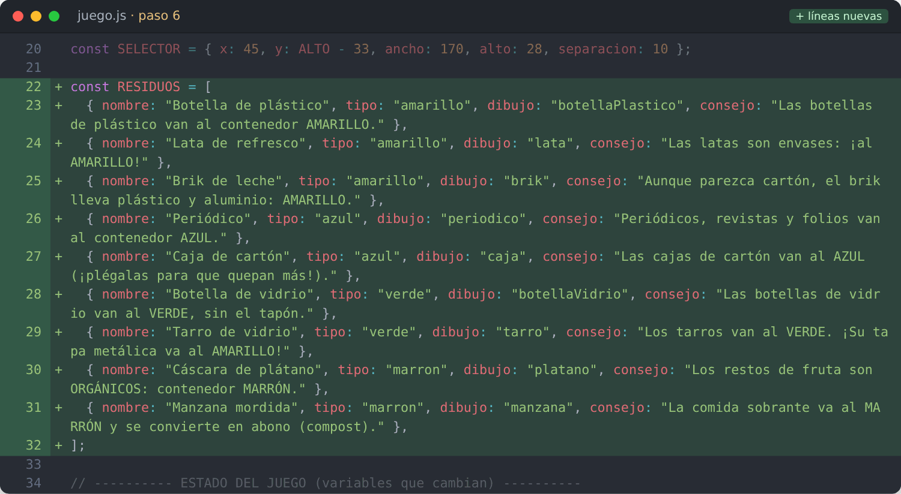</p>

<p align="center"><em>Figura 42. Paso 6: código nuevo en juego.js. Lo verde es lo que escribes; lo gris ya lo tenías.</em></p>

**Explicación línea por línea:**


> **El catálogo de residuos.** Cada residuo es un objeto con su nombre, el contenedor correcto, qué dibujo usar y un consejo educativo que aparecerá si el jugador se equivoca.

- **Línea 22** · `const RESIDUOS = [`  
  → Crea la lista RESIDUOS. Cada elemento es un objeto entre llaves con cuatro datos: nombre, tipo (contenedor correcto), dibujo (qué función lo dibuja) y consejo.
- **Línea 23** · `{ nombre: "Botella de plástico", tipo: "amarillo", dibujo: "botellaPlastico", consejo: ...`  
  → La botella de plástico va al amarillo.
- **Línea 24** · `{ nombre: "Lata de refresco", tipo: "amarillo", dibujo: "lata", consejo: "Las latas son...`  
  → La lata va al amarillo: es un envase metálico.
- **Línea 25** · `{ nombre: "Brik de leche", tipo: "amarillo", dibujo: "brik", consejo: "Aunque parezca c...`  
  → El brik es el error más típico: parece cartón pero lleva plástico y aluminio, por eso va al amarillo.
- **Línea 26** · `{ nombre: "Periódico", tipo: "azul", dibujo: "periodico", consejo: "Periódicos, revista...`  
  → El periódico va al azul.
- **Línea 27** · `{ nombre: "Caja de cartón", tipo: "azul", dibujo: "caja", consejo: "Las cajas de cartón...`  
  → La caja de cartón va al azul.
- **Línea 28** · `{ nombre: "Botella de vidrio", tipo: "verde", dibujo: "botellaVidrio", consejo: "Las bo...`  
  → La botella de vidrio va al verde.
- **Línea 29** · `{ nombre: "Tarro de vidrio", tipo: "verde", dibujo: "tarro", consejo: "Los tarros van a...`  
  → El tarro de vidrio va al verde (pero su tapa metálica iría al amarillo).
- **Línea 30** · `{ nombre: "Cáscara de plátano", tipo: "marron", dibujo: "platano", consejo: "Los restos...`  
  → La cáscara de plátano es orgánica: marrón.
- **Línea 31** · `{ nombre: "Manzana mordida", tipo: "marron", dibujo: "manzana", consejo: "La comida sob...`  
  → La manzana mordida también es orgánica.
- **Línea 32** · `];`  
  → Cierra el corchete de la lista (array) y termina la instrucción.

**Código para copiar** (o mejor, ¡escríbelo tú para aprender!):

```javascript
const RESIDUOS = [
  { nombre: "Botella de plástico", tipo: "amarillo", dibujo: "botellaPlastico", consejo: "Las botellas de plástico van al contenedor AMARILLO." },
  { nombre: "Lata de refresco", tipo: "amarillo", dibujo: "lata", consejo: "Las latas son envases: ¡al AMARILLO!" },
  { nombre: "Brik de leche", tipo: "amarillo", dibujo: "brik", consejo: "Aunque parezca cartón, el brik lleva plástico y aluminio: AMARILLO." },
  { nombre: "Periódico", tipo: "azul", dibujo: "periodico", consejo: "Periódicos, revistas y folios van al contenedor AZUL." },
  { nombre: "Caja de cartón", tipo: "azul", dibujo: "caja", consejo: "Las cajas de cartón van al AZUL (¡plégalas para que quepan más!)." },
  { nombre: "Botella de vidrio", tipo: "verde", dibujo: "botellaVidrio", consejo: "Las botellas de vidrio van al VERDE, sin el tapón." },
  { nombre: "Tarro de vidrio", tipo: "verde", dibujo: "tarro", consejo: "Los tarros van al VERDE. ¡Su tapa metálica va al AMARILLO!" },
  { nombre: "Cáscara de plátano", tipo: "marron", dibujo: "platano", consejo: "Los restos de fruta son ORGÁNICOS: contenedor MARRÓN." },
  { nombre: "Manzana mordida", tipo: "marron", dibujo: "manzana", consejo: "La comida sobrante va al MARRÓN y se convierte en abono (compost)." },
];
```

#### Cambio 2 de 5 · Añadir código en `juego.js`

📍 **Dónde:** justo **debajo** de la línea `const teclas = {};` (en el archivo terminado de este paso es la línea 48). Las líneas nuevas son de la 50 a la 53.

<p align="center">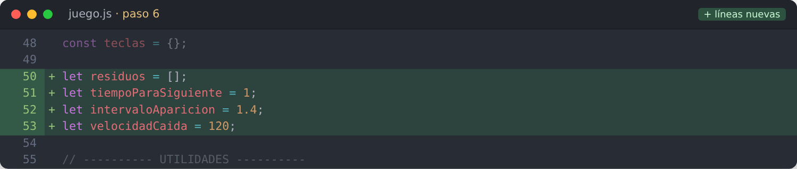</p>

<p align="center"><em>Figura 43. Paso 6: código nuevo en juego.js. Lo verde es lo que escribes; lo gris ya lo tenías.</em></p>

**Explicación línea por línea:**


> **Variables de los residuos que caen.**

- **Línea 50** · `let residuos = [];`  
  → Lista de residuos que están cayendo ahora mismo. Empieza vacía [ ].
- **Línea 51** · `let tiempoParaSiguiente = 1;`  
  → Segundos que faltan para que aparezca el siguiente residuo.
- **Línea 52** · `let intervaloAparicion = 1.4;`  
  → Cada cuántos segundos aparece un residuo nuevo.
- **Línea 53** · `let velocidadCaida = 120;`  
  → Velocidad base de caída, en píxeles por segundo.

**Código para copiar** (o mejor, ¡escríbelo tú para aprender!):

```javascript
let residuos = [];
let tiempoParaSiguiente = 1;
let intervaloAparicion = 1.4;
let velocidadCaida = 120;
```

#### Cambio 3 de 5 · Añadir código en `juego.js`

📍 **Dónde:** justo **debajo** de la línea `}` que cierra el bloque `function dibujarSelector() {` (en el archivo terminado de este paso es la línea 202). Las líneas nuevas son de la 204 a la 243.

<p align="center">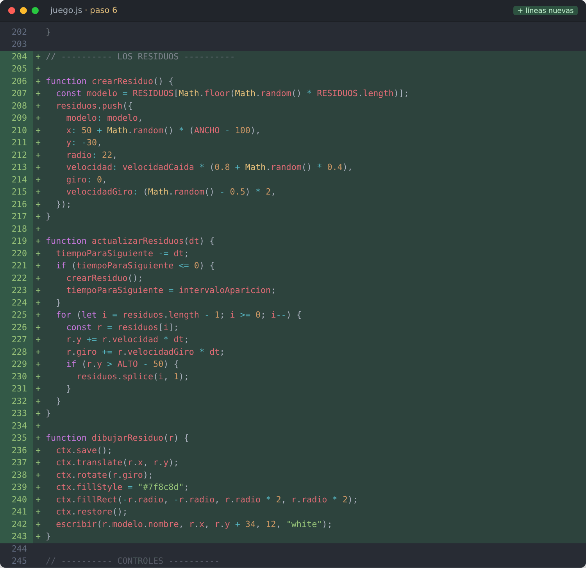</p>

<p align="center"><em>Figura 44. Paso 6: código nuevo en juego.js. Lo verde es lo que escribes; lo gris ya lo tenías.</em></p>

**Explicación línea por línea:**

- **Línea 204** · `// ---------- LOS RESIDUOS ----------`  
  → Comentario que sirve de título de sección: «LOS RESIDUOS». El navegador lo ignora; nos ayuda a ordenar el código.

> **Crear un residuo nuevo.** Elegimos uno del catálogo al azar y lo colocamos arriba, en una x aleatoria.

- **Línea 206** · `function crearResiduo() {`  
  → Declara la función crearResiduo.
- **Línea 207** · `const modelo = RESIDUOS[Math.floor(Math.random() * RESIDUOS.length)];`  
  → Math.random() da un número al azar entre 0 y 0.999... Al multiplicarlo por 9 (los residuos del catálogo) y redondear hacia abajo (Math.floor) obtenemos una posición entre 0 y 8.
- **Línea 208** · `residuos.push({`  
  → Añade (push) a la lista residuos un objeto nuevo con estos datos:
- **Línea 209** · `modelo: modelo,`  
  → Qué residuo del catálogo es (nombre, tipo, dibujo, consejo).
- **Línea 210** · `x: 50 + Math.random() * (ANCHO - 100),`  
  → Posición x al azar, dejando 50 píxeles de margen a cada lado.
- **Línea 211** · `y: -30,`  
  → Empieza un poco por encima del lienzo (y negativa), así aparece entrando desde arriba.
- **Línea 212** · `radio: 22,`  
  → Tamaño aproximado (radio) para calcular los choques.
- **Línea 213** · `velocidad: velocidadCaida * (0.8 + Math.random() * 0.4),`  
  → Velocidad de caída: la base multiplicada por un número entre 0.8 y 1.2 (así no todos caen igual).
- **Línea 214** · `giro: 0,`  
  → Ángulo de giro actual (empieza recto).
- **Línea 215** · `velocidadGiro: (Math.random() - 0.5) * 2,`  
  → Velocidad de giro al azar, entre -1 y 1 radianes por segundo (positivo = horario).
- **Línea 216** · `});`  
  → Cierra la llave de la función, el paréntesis de la llamada y termina la instrucción con `;`.
- **Línea 217** · `}`  
  → Cierra la llave `{` que se abrió más arriba: aquí termina ese bloque.

> **Mover los residuos.** Cada fotograma: si toca, creamos uno nuevo; después bajamos todos y quitamos los que llegan al suelo.

- **Línea 219** · `function actualizarResiduos(dt) {`  
  → Declara la función actualizarResiduos.
- **Línea 220** · `tiempoParaSiguiente -= dt;`  
  → Descuenta el tiempo que ha pasado.
- **Línea 221** · `if (tiempoParaSiguiente <= 0) {`  
  → Si ya llegó a 0 (o menos)...
- **Línea 222** · `crearResiduo();`  
  → ...creamos un residuo...
- **Línea 223** · `tiempoParaSiguiente = intervaloAparicion;`  
  → ...y volvemos a poner en marcha la cuenta atrás.
- **Línea 224** · `}`  
  → Cierra la llave `{` que se abrió más arriba: aquí termina ese bloque.
- **Línea 225** · `for (let i = residuos.length - 1; i >= 0; i--) {`  
  → Recorremos la lista AL REVÉS (desde el último hasta el primero). Así, si quitamos uno con splice, no nos saltamos el siguiente.
- **Línea 226** · `const r = residuos[i];`  
  → El residuo de esta vuelta.
- **Línea 227** · `r.y += r.velocidad * dt;`  
  → Baja según su velocidad y el tiempo transcurrido.
- **Línea 228** · `r.giro += r.velocidadGiro * dt;`  
  → Gira un poquito.
- **Línea 229** · `if (r.y > ALTO - 50) {`  
  → Si su centro llega a la altura del césped, ha caído al suelo.
- **Línea 230** · `residuos.splice(i, 1);`  
  → Lo quitamos de la lista.
- **Línea 231** · `}`  
  → Cierra la llave `{` que se abrió más arriba: aquí termina ese bloque.
- **Línea 232** · `}`  
  → Cierra la llave `{` que se abrió más arriba: aquí termina ese bloque.
- **Línea 233** · `}`  
  → Cierra la llave `{` que se abrió más arriba: aquí termina ese bloque.

> **Dibujar un residuo.** Movemos y giramos el "pincel" hasta la posición del residuo, dibujamos y lo dejamos como estaba.

- **Línea 235** · `function dibujarResiduo(r) {`  
  → Declara la función dibujarResiduo: recibe el residuo r que hay que dibujar.
- **Línea 236** · `ctx.save();`  
  → Guarda el estado del pincel.
- **Línea 237** · `ctx.translate(r.x, r.y);`  
  → Lleva el punto (0, 0) al centro del residuo.
- **Línea 238** · `ctx.rotate(r.giro);`  
  → Gira el pincel el ángulo del residuo.
- **Línea 239** · `ctx.fillStyle = "#7f8c8d";`  
  → DIBUJO PROVISIONAL: un cuadrado gris. En el paso 7 lo cambiaremos por dibujos de verdad.
- **Línea 240** · `ctx.fillRect(-r.radio, -r.radio, r.radio * 2, r.radio * 2);`  
  → Cuadrado centrado en (0, 0): empieza en (-radio, -radio) y mide 2 × radio de lado.
- **Línea 241** · `ctx.restore();`  
  → Deja el pincel como estaba.
- **Línea 242** · `escribir(r.modelo.nombre, r.x, r.y + 34, 12, "white");`  
  → Escribe el nombre debajo del residuo (34 píxeles más abajo) para que el jugador aprenda cómo se llama.
- **Línea 243** · `}`  
  → Cierra la llave `{` que se abrió más arriba: aquí termina ese bloque.

**Código para copiar** (o mejor, ¡escríbelo tú para aprender!):

```javascript
// ---------- LOS RESIDUOS ----------

function crearResiduo() {
  const modelo = RESIDUOS[Math.floor(Math.random() * RESIDUOS.length)];
  residuos.push({
    modelo: modelo,
    x: 50 + Math.random() * (ANCHO - 100),
    y: -30,
    radio: 22,
    velocidad: velocidadCaida * (0.8 + Math.random() * 0.4),
    giro: 0,
    velocidadGiro: (Math.random() - 0.5) * 2,
  });
}

function actualizarResiduos(dt) {
  tiempoParaSiguiente -= dt;
  if (tiempoParaSiguiente <= 0) {
    crearResiduo();
    tiempoParaSiguiente = intervaloAparicion;
  }
  for (let i = residuos.length - 1; i >= 0; i--) {
    const r = residuos[i];
    r.y += r.velocidad * dt;
    r.giro += r.velocidadGiro * dt;
    if (r.y > ALTO - 50) {
      residuos.splice(i, 1);
    }
  }
}

function dibujarResiduo(r) {
  ctx.save();
  ctx.translate(r.x, r.y);
  ctx.rotate(r.giro);
  ctx.fillStyle = "#7f8c8d";
  ctx.fillRect(-r.radio, -r.radio, r.radio * 2, r.radio * 2);
  ctx.restore();
  escribir(r.modelo.nombre, r.x, r.y + 34, 12, "white");
}
```

#### Cambio 4 de 5 · Añadir código en `juego.js`

📍 **Dónde:** justo **debajo** de la línea `actualizarContenedor(dt);` (en el archivo terminado de este paso es la línea 270). Las líneas nuevas son de la 271 a la 271.

<p align="center">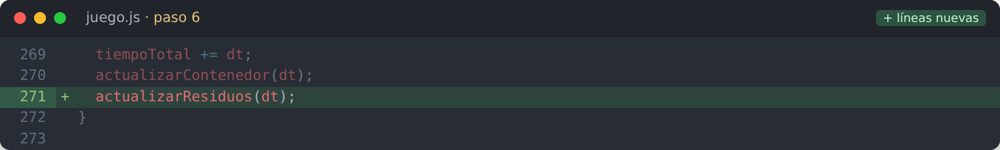</p>

<p align="center"><em>Figura 45. Paso 6: código nuevo en juego.js. Lo verde es lo que escribes; lo gris ya lo tenías.</em></p>

**Explicación línea por línea:**

- **Línea 271** · `actualizarResiduos(dt);`  
  → Crea y mueve los residuos.

**Código para copiar** (o mejor, ¡escríbelo tú para aprender!):

```javascript
  actualizarResiduos(dt);
```

#### Cambio 5 de 5 · Añadir código en `juego.js`

📍 **Dónde:** justo **debajo** de la línea `dibujarFondo();` (en el archivo terminado de este paso es la línea 275). Las líneas nuevas son de la 276 a la 276.

<p align="center">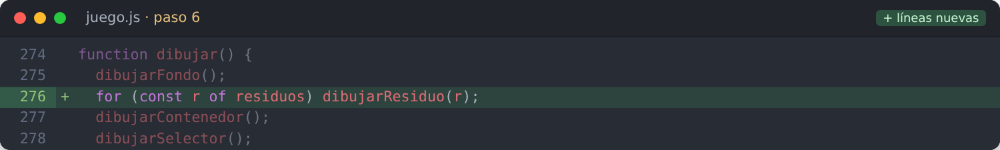</p>

<p align="center"><em>Figura 46. Paso 6: código nuevo en juego.js. Lo verde es lo que escribes; lo gris ya lo tenías.</em></p>

**Explicación línea por línea:**

- **Línea 276** · `for (const r of residuos) dibujarResiduo(r);`  
  → 3) Cada residuo que está cayendo.

**Código para copiar** (o mejor, ¡escríbelo tú para aprender!):

```javascript
  for (const r of residuos) dibujarResiduo(r);
```

### Resultado del paso 6

<p align="center">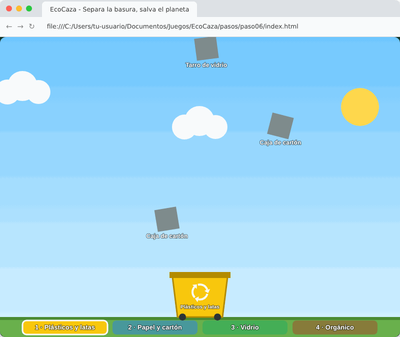</p>

<p align="center"><em>Figura 47. Resultado del paso 6: los residuos (aún cuadrados grises) caen girando, cada uno con su nombre debajo.</em></p>

### Pruébalo tú

- Cambia `intervaloAparicion = 1.4` por `0.3`: ¡lluvia de basura!
- Cambia `velocidadCaida = 120` por `40` para verlos caer a cámara lenta.

# 10. Paso 7 · Los dibujos de cada residuo

**Objetivo:** sustituir los cuadrados grises por dibujos reconocibles de cada residuo.

**Qué aprenderás:** a guardar **funciones dentro de un objeto** y llamarlas por su nombre, y a "pintar" objetos combinando figuras sencillas (como con piezas de construcción).

#### Cambio 1 de 2 · Cambiar (reemplazar) código en `juego.js`

🗑️ **Primero, borra las líneas 239 a 240 de tu archivo `juego.js`** (están justo debajo de `ctx.rotate(r.giro);`). En la imagen aparecen en rojo y tachadas:

<p align="center">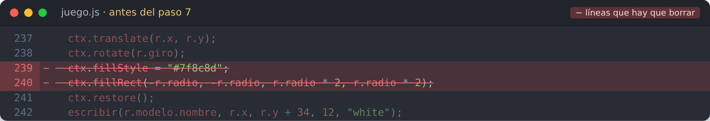</p>

<p align="center"><em>Figura 48. Paso 7: líneas que se borran de juego.js</em></p>

Estas son las líneas que desaparecen:

```javascript
  ctx.fillStyle = "#7f8c8d";
  ctx.fillRect(-r.radio, -r.radio, r.radio * 2, r.radio * 2);
```

✏️ **Después, en ese mismo sitio, escribe las líneas nuevas** (quedan en las líneas 239 a 239 del archivo terminado).

<p align="center">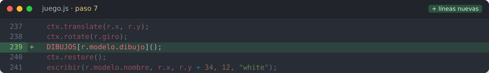</p>

<p align="center"><em>Figura 49. Paso 7: código nuevo en juego.js. Lo verde es lo que escribes; lo gris ya lo tenías.</em></p>

**Explicación línea por línea:**

- **Línea 239** · `DIBUJOS[r.modelo.dibujo]();`  
  → Llama a la función de dibujo de este residuo. Ej.: si r.modelo.dibujo es "lata", ejecuta DIBUJOS["lata"]().

**Código para copiar** (o mejor, ¡escríbelo tú para aprender!):

```javascript
  DIBUJOS[r.modelo.dibujo]();
```

#### Cambio 2 de 2 · Añadir código en `juego.js`

📍 **Dónde:** justo **debajo** de la línea `}` que cierra el bloque `function dibujarResiduo(r) {` (en el archivo terminado de este paso es la línea 242). Las líneas nuevas son de la 244 a la 354.

##### Parte 1 de 3 (líneas 244 a 282)

<p align="center">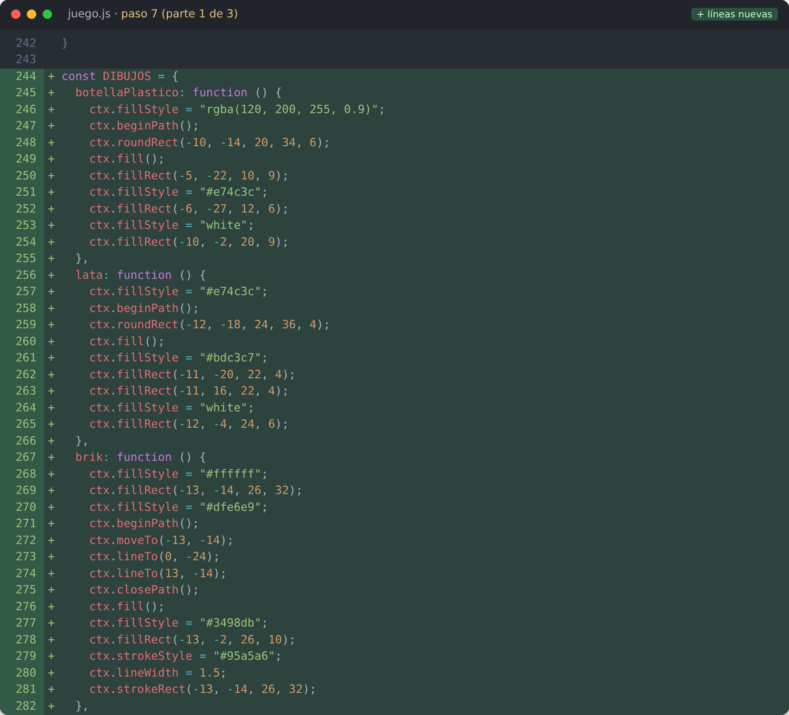</p>

<p align="center"><em>Figura 50. Paso 7: código nuevo en juego.js (parte 1 de 3). Lo verde es lo que escribes; lo gris ya lo tenías.</em></p>

**Explicación línea por línea:**


> **Los dibujos de cada residuo.** DIBUJOS es un objeto cuyos apartados son funciones. Todas dibujan alrededor del punto (0, 0), porque antes hemos movido el pincel con translate. Usamos solo rectángulos, círculos y líneas.

- **Línea 244** · `const DIBUJOS = {`  
  → Crea el objeto DIBUJOS. Cada apartado tiene el nombre del dibujo y como valor una función.
- **Línea 245** · `botellaPlastico: function () {`  
  → Dibujo de la botella de plástico.
- **Línea 246** · `ctx.fillStyle = "rgba(120, 200, 255, 0.9)";`  
  → Celeste semitransparente: parece plástico.
- **Línea 247** · `ctx.beginPath();`  
  → Empieza un trazo nuevo, para que esta figura no se mezcle con la anterior.
- **Línea 248** · `ctx.roundRect(-10, -14, 20, 34, 6);`  
  → Cuerpo de la botella: rectángulo redondeado de 20 × 34.
- **Línea 249** · `ctx.fill();`  
  → Rellena la figura que acabamos de trazar con el color de `fillStyle`.
- **Línea 250** · `ctx.fillRect(-5, -22, 10, 9);`  
  → Cuello de la botella (rectángulo estrecho arriba).
- **Línea 251** · `ctx.fillStyle = "#e74c3c";`  
  → Rojo para el tapón.
- **Línea 252** · `ctx.fillRect(-6, -27, 12, 6);`  
  → El tapón.
- **Línea 253** · `ctx.fillStyle = "white";`  
  → Blanco para la etiqueta.
- **Línea 254** · `ctx.fillRect(-10, -2, 20, 9);`  
  → La etiqueta, una franja en el centro.
- **Línea 255** · `},`  
  → Cierra este apartado del objeto. La coma indica que detrás viene otro apartado.
- **Línea 256** · `lata: function () {`  
  → Dibujo de la lata.
- **Línea 257** · `ctx.fillStyle = "#e74c3c";`  
  → Rojo para el cuerpo de la lata.
- **Línea 258** · `ctx.beginPath();`  
  → Empieza un trazo nuevo, para que esta figura no se mezcle con la anterior.
- **Línea 259** · `ctx.roundRect(-12, -18, 24, 36, 4);`  
  → Cuerpo de la lata con esquinas poco redondeadas.
- **Línea 260** · `ctx.fill();`  
  → Rellena la figura que acabamos de trazar con el color de `fillStyle`.
- **Línea 261** · `ctx.fillStyle = "#bdc3c7";`  
  → Gris metálico para la tapa.
- **Línea 262** · `ctx.fillRect(-11, -20, 22, 4);`  
  → Tapa superior.
- **Línea 263** · `ctx.fillRect(-11, 16, 22, 4);`  
  → Base inferior.
- **Línea 264** · `ctx.fillStyle = "white";`  
  → Blanco para la franja decorativa.
- **Línea 265** · `ctx.fillRect(-12, -4, 24, 6);`  
  → Franja horizontal en el centro.
- **Línea 266** · `},`  
  → Cierra este apartado del objeto. La coma indica que detrás viene otro apartado.
- **Línea 267** · `brik: function () {`  
  → Dibujo del brik de leche.
- **Línea 268** · `ctx.fillStyle = "#ffffff";`  
  → Blanco para el cuerpo.
- **Línea 269** · `ctx.fillRect(-13, -14, 26, 32);`  
  → Cuerpo rectangular.
- **Línea 270** · `ctx.fillStyle = "#dfe6e9";`  
  → Gris claro para el "tejado" del brik.
- **Línea 271** · `ctx.beginPath();`  
  → Empieza un trazo nuevo, para que esta figura no se mezcle con la anterior.
- **Línea 272** · `ctx.moveTo(-13, -14);`  
  → Esquina izquierda del tejado.
- **Línea 273** · `ctx.lineTo(0, -24);`  
  → Punta del tejado.
- **Línea 274** · `ctx.lineTo(13, -14);`  
  → Esquina derecha del tejado.
- **Línea 275** · `ctx.closePath();`  
  → Cierra la figura: une el último punto con el primero.
- **Línea 276** · `ctx.fill();`  
  → Rellena la figura que acabamos de trazar con el color de `fillStyle`.
- **Línea 277** · `ctx.fillStyle = "#3498db";`  
  → Azul para la franja con el dibujo.
- **Línea 278** · `ctx.fillRect(-13, -2, 26, 10);`  
  → Franja azul.
- **Línea 279** · `ctx.strokeStyle = "#95a5a6";`  
  → Gris para el contorno.
- **Línea 280** · `ctx.lineWidth = 1.5;`  
  → Grosor del contorno: 1.5 píxeles.
- **Línea 281** · `ctx.strokeRect(-13, -14, 26, 32);`  
  → Dibuja solo el contorno del rectángulo del cuerpo.
- **Línea 282** · `},`  
  → Cierra este apartado del objeto. La coma indica que detrás viene otro apartado.

**Código para copiar** (o mejor, ¡escríbelo tú para aprender!):

```javascript
const DIBUJOS = {
  botellaPlastico: function () {
    ctx.fillStyle = "rgba(120, 200, 255, 0.9)";
    ctx.beginPath();
    ctx.roundRect(-10, -14, 20, 34, 6);
    ctx.fill();
    ctx.fillRect(-5, -22, 10, 9);
    ctx.fillStyle = "#e74c3c";
    ctx.fillRect(-6, -27, 12, 6);
    ctx.fillStyle = "white";
    ctx.fillRect(-10, -2, 20, 9);
  },
  lata: function () {
    ctx.fillStyle = "#e74c3c";
    ctx.beginPath();
    ctx.roundRect(-12, -18, 24, 36, 4);
    ctx.fill();
    ctx.fillStyle = "#bdc3c7";
    ctx.fillRect(-11, -20, 22, 4);
    ctx.fillRect(-11, 16, 22, 4);
    ctx.fillStyle = "white";
    ctx.fillRect(-12, -4, 24, 6);
  },
  brik: function () {
    ctx.fillStyle = "#ffffff";
    ctx.fillRect(-13, -14, 26, 32);
    ctx.fillStyle = "#dfe6e9";
    ctx.beginPath();
    ctx.moveTo(-13, -14);
    ctx.lineTo(0, -24);
    ctx.lineTo(13, -14);
    ctx.closePath();
    ctx.fill();
    ctx.fillStyle = "#3498db";
    ctx.fillRect(-13, -2, 26, 10);
    ctx.strokeStyle = "#95a5a6";
    ctx.lineWidth = 1.5;
    ctx.strokeRect(-13, -14, 26, 32);
  },
```

##### Parte 2 de 3 (líneas 283 a 324)

<p align="center">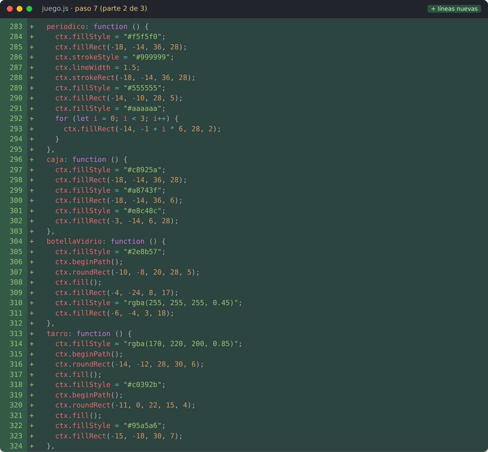</p>

<p align="center"><em>Figura 51. Paso 7: código nuevo en juego.js (parte 2 de 3). Lo verde es lo que escribes; lo gris ya lo tenías.</em></p>

**Explicación línea por línea:**

- **Línea 283** · `periodico: function () {`  
  → Dibujo del periódico.
- **Línea 284** · `ctx.fillStyle = "#f5f5f0";`  
  → Blanco roto (color papel).
- **Línea 285** · `ctx.fillRect(-18, -14, 36, 28);`  
  → La hoja.
- **Línea 286** · `ctx.strokeStyle = "#999999";`  
  → Gris para el borde.
- **Línea 287** · `ctx.lineWidth = 1.5;`  
  → Grosor de las líneas: `1.5` píxeles.
- **Línea 288** · `ctx.strokeRect(-18, -14, 36, 28);`  
  → Borde de la hoja.
- **Línea 289** · `ctx.fillStyle = "#555555";`  
  → Gris oscuro para el titular.
- **Línea 290** · `ctx.fillRect(-14, -10, 28, 5);`  
  → El titular (una barra gruesa arriba).
- **Línea 291** · `ctx.fillStyle = "#aaaaaa";`  
  → Gris claro para las líneas de texto.
- **Línea 292** · `for (let i = 0; i < 3; i++) {`  
  → Repite 3 veces para dibujar 3 líneas de texto.
- **Línea 293** · `ctx.fillRect(-14, -1 + i * 6, 28, 2);`  
  → Cada línea, 6 píxeles más abajo que la anterior.
- **Línea 294** · `}`  
  → Cierra la llave `{` que se abrió más arriba: aquí termina ese bloque.
- **Línea 295** · `},`  
  → Cierra este apartado del objeto. La coma indica que detrás viene otro apartado.
- **Línea 296** · `caja: function () {`  
  → Dibujo de la caja de cartón.
- **Línea 297** · `ctx.fillStyle = "#c8925a";`  
  → Marrón claro (color cartón).
- **Línea 298** · `ctx.fillRect(-18, -14, 36, 28);`  
  → La caja.
- **Línea 299** · `ctx.fillStyle = "#a8743f";`  
  → Marrón más oscuro para las solapas.
- **Línea 300** · `ctx.fillRect(-18, -14, 36, 6);`  
  → Solapas de arriba.
- **Línea 301** · `ctx.fillStyle = "#e8c48c";`  
  → Color de la cinta adhesiva.
- **Línea 302** · `ctx.fillRect(-3, -14, 6, 28);`  
  → Tira de cinta en el centro.
- **Línea 303** · `},`  
  → Cierra este apartado del objeto. La coma indica que detrás viene otro apartado.
- **Línea 304** · `botellaVidrio: function () {`  
  → Dibujo de la botella de vidrio.
- **Línea 305** · `ctx.fillStyle = "#2e8b57";`  
  → Verde botella.
- **Línea 306** · `ctx.beginPath();`  
  → Empieza un trazo nuevo, para que esta figura no se mezcle con la anterior.
- **Línea 307** · `ctx.roundRect(-10, -8, 20, 28, 5);`  
  → Cuerpo de la botella.
- **Línea 308** · `ctx.fill();`  
  → Rellena la figura que acabamos de trazar con el color de `fillStyle`.
- **Línea 309** · `ctx.fillRect(-4, -24, 8, 17);`  
  → Cuello largo (las botellas de vidrio suelen tenerlo).
- **Línea 310** · `ctx.fillStyle = "rgba(255, 255, 255, 0.45)";`  
  → Blanco semitransparente para el brillo.
- **Línea 311** · `ctx.fillRect(-6, -4, 3, 18);`  
  → Reflejo de luz en el lateral: da sensación de cristal.
- **Línea 312** · `},`  
  → Cierra este apartado del objeto. La coma indica que detrás viene otro apartado.
- **Línea 313** · `tarro: function () {`  
  → Dibujo del tarro de vidrio con mermelada.
- **Línea 314** · `ctx.fillStyle = "rgba(170, 220, 200, 0.85)";`  
  → Vidrio verdoso transparente.
- **Línea 315** · `ctx.beginPath();`  
  → Empieza un trazo nuevo, para que esta figura no se mezcle con la anterior.
- **Línea 316** · `ctx.roundRect(-14, -12, 28, 30, 6);`  
  → El tarro.
- **Línea 317** · `ctx.fill();`  
  → Rellena la figura que acabamos de trazar con el color de `fillStyle`.
- **Línea 318** · `ctx.fillStyle = "#c0392b";`  
  → Rojo para la mermelada.
- **Línea 319** · `ctx.beginPath();`  
  → Empieza un trazo nuevo, para que esta figura no se mezcle con la anterior.
- **Línea 320** · `ctx.roundRect(-11, 0, 22, 15, 4);`  
  → La mermelada, en la parte de abajo del tarro.
- **Línea 321** · `ctx.fill();`  
  → Rellena la figura que acabamos de trazar con el color de `fillStyle`.
- **Línea 322** · `ctx.fillStyle = "#95a5a6";`  
  → Gris para la tapa metálica.
- **Línea 323** · `ctx.fillRect(-15, -18, 30, 7);`  
  → La tapa.
- **Línea 324** · `},`  
  → Cierra este apartado del objeto. La coma indica que detrás viene otro apartado.

**Código para copiar** (o mejor, ¡escríbelo tú para aprender!):

```javascript
  periodico: function () {
    ctx.fillStyle = "#f5f5f0";
    ctx.fillRect(-18, -14, 36, 28);
    ctx.strokeStyle = "#999999";
    ctx.lineWidth = 1.5;
    ctx.strokeRect(-18, -14, 36, 28);
    ctx.fillStyle = "#555555";
    ctx.fillRect(-14, -10, 28, 5);
    ctx.fillStyle = "#aaaaaa";
    for (let i = 0; i < 3; i++) {
      ctx.fillRect(-14, -1 + i * 6, 28, 2);
    }
  },
  caja: function () {
    ctx.fillStyle = "#c8925a";
    ctx.fillRect(-18, -14, 36, 28);
    ctx.fillStyle = "#a8743f";
    ctx.fillRect(-18, -14, 36, 6);
    ctx.fillStyle = "#e8c48c";
    ctx.fillRect(-3, -14, 6, 28);
  },
  botellaVidrio: function () {
    ctx.fillStyle = "#2e8b57";
    ctx.beginPath();
    ctx.roundRect(-10, -8, 20, 28, 5);
    ctx.fill();
    ctx.fillRect(-4, -24, 8, 17);
    ctx.fillStyle = "rgba(255, 255, 255, 0.45)";
    ctx.fillRect(-6, -4, 3, 18);
  },
  tarro: function () {
    ctx.fillStyle = "rgba(170, 220, 200, 0.85)";
    ctx.beginPath();
    ctx.roundRect(-14, -12, 28, 30, 6);
    ctx.fill();
    ctx.fillStyle = "#c0392b";
    ctx.beginPath();
    ctx.roundRect(-11, 0, 22, 15, 4);
    ctx.fill();
    ctx.fillStyle = "#95a5a6";
    ctx.fillRect(-15, -18, 30, 7);
  },
```

##### Parte 3 de 3 (líneas 325 a 354)

<p align="center"></p>

<p align="center"><em>Figura 52. Paso 7: código nuevo en juego.js (parte 3 de 3). Lo verde es lo que escribes; lo gris ya lo tenías.</em></p>

**Explicación línea por línea:**

- **Línea 325** · `platano: function () {`  
  → Dibujo de la cáscara de plátano.
- **Línea 326** · `ctx.strokeStyle = "#f4d03f";`  
  → Amarillo plátano para la línea.
- **Línea 327** · `ctx.lineWidth = 9;`  
  → Línea muy gruesa (9 píxeles): así un arco parece un plátano.
- **Línea 328** · `ctx.lineCap = "round";`  
  → Los extremos de la línea serán redondeados.
- **Línea 329** · `ctx.beginPath();`  
  → Empieza un trazo nuevo, para que esta figura no se mezcle con la anterior.
- **Línea 330** · `ctx.arc(0, -12, 22, 0.5, 2.6);`  
  → Un arco (trozo de círculo) de radio 22 desde 0.5 hasta 2.6 radianes: la curva del plátano.
- **Línea 331** · `ctx.stroke();`  
  → Dibuja el contorno (la línea) de la figura con el color de `strokeStyle`.
- **Línea 332** · `ctx.lineCap = "butt";`  
  → Volvemos a los extremos normales (rectos) para no afectar a otros dibujos.
- **Línea 333** · `ctx.fillStyle = "#6e4b1f";`  
  → Marrón para las puntas.
- **Línea 334** · `ctx.beginPath();`  
  → Empieza un trazo nuevo, para que esta figura no se mezcle con la anterior.
- **Línea 335** · `ctx.arc(Math.cos(0.5) * 22, -12 + Math.sin(0.5) * 22, 4, 0, Math.PI * 2);`  
  → Punta derecha del plátano (un círculo pequeño en el inicio del arco).
- **Línea 336** · `ctx.fill();`  
  → Rellena la figura que acabamos de trazar con el color de `fillStyle`.
- **Línea 337** · `},`  
  → Cierra este apartado del objeto. La coma indica que detrás viene otro apartado.
- **Línea 338** · `manzana: function () {`  
  → Dibujo de la manzana mordida.
- **Línea 339** · `ctx.fillStyle = "#e74c3c";`  
  → Rojo manzana.
- **Línea 340** · `ctx.beginPath();`  
  → Empieza un trazo nuevo, para que esta figura no se mezcle con la anterior.
- **Línea 341** · `ctx.arc(0, 2, 16, 0, Math.PI * 2);`  
  → La manzana: un círculo de radio 16.
- **Línea 342** · `ctx.fill();`  
  → Rellena la figura que acabamos de trazar con el color de `fillStyle`.
- **Línea 343** · `ctx.fillStyle = "#fdf2e0";`  
  → Color crema: el interior de la manzana.
- **Línea 344** · `ctx.beginPath();`  
  → Empieza un trazo nuevo, para que esta figura no se mezcle con la anterior.
- **Línea 345** · `ctx.arc(15, 0, 8, 0, Math.PI * 2);`  
  → El mordisco: un círculo color crema en el borde derecho.
- **Línea 346** · `ctx.fill();`  
  → Rellena la figura que acabamos de trazar con el color de `fillStyle`.
- **Línea 347** · `ctx.fillStyle = "#6e4b1f";`  
  → Marrón para el rabito.
- **Línea 348** · `ctx.fillRect(-2, -20, 4, 9);`  
  → El rabito.
- **Línea 349** · `ctx.fillStyle = "#27ae60";`  
  → Verde para la hoja.
- **Línea 350** · `ctx.beginPath();`  
  → Empieza un trazo nuevo, para que esta figura no se mezcle con la anterior.
- **Línea 351** · `ctx.ellipse(6, -17, 7, 3.5, -0.5, 0, Math.PI * 2);`  
  → La hoja: una elipse (círculo estirado) de 7 × 3.5, girada -0.5 radianes.
- **Línea 352** · `ctx.fill();`  
  → Rellena la figura que acabamos de trazar con el color de `fillStyle`.
- **Línea 353** · `},`  
  → Cierra este apartado del objeto. La coma indica que detrás viene otro apartado.
- **Línea 354** · `};`  
  → Cierra la llave del objeto y termina la instrucción.

**Código para copiar** (o mejor, ¡escríbelo tú para aprender!):

```javascript
  platano: function () {
    ctx.strokeStyle = "#f4d03f";
    ctx.lineWidth = 9;
    ctx.lineCap = "round";
    ctx.beginPath();
    ctx.arc(0, -12, 22, 0.5, 2.6);
    ctx.stroke();
    ctx.lineCap = "butt";
    ctx.fillStyle = "#6e4b1f";
    ctx.beginPath();
    ctx.arc(Math.cos(0.5) * 22, -12 + Math.sin(0.5) * 22, 4, 0, Math.PI * 2);
    ctx.fill();
  },
  manzana: function () {
    ctx.fillStyle = "#e74c3c";
    ctx.beginPath();
    ctx.arc(0, 2, 16, 0, Math.PI * 2);
    ctx.fill();
    ctx.fillStyle = "#fdf2e0";
    ctx.beginPath();
    ctx.arc(15, 0, 8, 0, Math.PI * 2);
    ctx.fill();
    ctx.fillStyle = "#6e4b1f";
    ctx.fillRect(-2, -20, 4, 9);
    ctx.fillStyle = "#27ae60";
    ctx.beginPath();
    ctx.ellipse(6, -17, 7, 3.5, -0.5, 0, Math.PI * 2);
    ctx.fill();
  },
};
```

### Resultado del paso 7

Para ver todos los dibujos juntos, hemos colocado (solo para esta captura) los nueve residuos del catálogo quietos en la pantalla:

<p align="center"></p>

<p align="center"><em>Figura 53. Los nueve residuos dibujados solo con rectángulos, círculos, líneas y una elipse.</em></p>

<p align="center"></p>

<p align="center"><em>Figura 54. Así se ve el juego normal en el paso 7: los residuos ya son reconocibles.</em></p>

### Pruébalo tú

- **Añade un residuo nuevo.** Por ejemplo, un *yogur* (va al amarillo): añade una línea en `RESIDUOS` con `dibujo: "yogur"` y una función `yogur: function () { ... }` en `DIBUJOS` (puedes copiar la de la lata y cambiarle colores y medidas).

# 11. Paso 8 · Atrapar los residuos y puntuar

**Objetivo:** detectar cuándo un residuo entra por la boca del contenedor y decidir si es un acierto (puntos) o un error (pierdes una vida).

**Qué aprenderás:** **detección de colisiones** con rectángulos, `Math.abs`, condiciones compuestas con `&&` y la sentencia `continue`.

<p align="center"></p>

<p align="center"><em>Figura 55. Las dos condiciones que usa tocaContenedor() para saber si un residuo ha entrado.</em></p>

#### Cambio 1 de 4 · Añadir código en `juego.js`

📍 **Dónde:** justo **debajo** de la línea `let velocidadCaida = 120;` (en el archivo terminado de este paso es la línea 53). Las líneas nuevas son de la 55 a la 57.

<p align="center"></p>

<p align="center"><em>Figura 56. Paso 8: código nuevo en juego.js. Lo verde es lo que escribes; lo gris ya lo tenías.</em></p>

**Explicación línea por línea:**


> **Variables de la puntuación.**

- **Línea 55** · `let puntos = 0;`  
  → Puntos del jugador.
- **Línea 56** · `let vidas = 3;`  
  → Vidas que quedan (cada error al separar quita una).
- **Línea 57** · `let combo = 0;`  
  → Aciertos seguidos. Cuantos más seguidos, más puntos vale cada acierto.

**Código para copiar** (o mejor, ¡escríbelo tú para aprender!):

```javascript
let puntos = 0;
let vidas = 3;
let combo = 0;
```

#### Cambio 2 de 4 · Añadir código en `juego.js`

📍 **Dónde:** justo **debajo** de la línea `r.giro += r.velocidadGiro * dt;` (en el archivo terminado de este paso es la línea 232). Las líneas nuevas son de la 233 a la 237.

<p align="center"></p>

<p align="center"><em>Figura 57. Paso 8: código nuevo en juego.js. Lo verde es lo que escribes; lo gris ya lo tenías.</em></p>

**Explicación línea por línea:**

- **Línea 233** · `if (tocaContenedor(r)) {`  
  → Si toca la boca del contenedor...
- **Línea 234** · `atrapar(r);`  
  → ...comprobamos si acertó o falló...
- **Línea 235** · `residuos.splice(i, 1);`  
  → ...lo quitamos de la lista (splice(i, 1) borra 1 elemento en la posición i)...
- **Línea 236** · `continue;`  
  → ...y pasamos directamente al siguiente residuo.
- **Línea 237** · `}`  
  → Cierra la llave `{` que se abrió más arriba: aquí termina ese bloque.

**Código para copiar** (o mejor, ¡escríbelo tú para aprender!):

```javascript
    if (tocaContenedor(r)) {
      atrapar(r);
      residuos.splice(i, 1);
      continue;
    }
```

#### Cambio 3 de 4 · Añadir código en `juego.js`

📍 **Dónde:** justo **debajo** de la línea `};` que cierra el bloque `const DIBUJOS = {` (en el archivo terminado de este paso es la línea 363). Las líneas nuevas son de la 365 a la 383.

<p align="center"></p>

<p align="center"><em>Figura 58. Paso 8: código nuevo en juego.js. Lo verde es lo que escribes; lo gris ya lo tenías.</em></p>

**Explicación línea por línea:**

- **Línea 365** · `// ---------- ATRAPAR Y PUNTUAR ----------`  
  → Comentario que sirve de título de sección: «ATRAPAR Y PUNTUAR». El navegador lo ignora; nos ayuda a ordenar el código.

> **¿El residuo tocó la boca del contenedor?** Comprobamos dos cosas: que esté encima horizontalmente y que su parte de abajo haya llegado a la boca.

- **Línea 367** · `function tocaContenedor(r) {`  
  → Declara la función tocaContenedor. Devolverá true (sí lo toca) o false (no).
- **Línea 368** · `const boca = contenedor.y - contenedor.alto;`  
  → Altura de la boca del contenedor.
- **Línea 369** · `const dentroX = Math.abs(r.x - contenedor.x) < contenedor.ancho / 2;`  
  → ¿Está encima en horizontal? Math.abs da la distancia sin signo entre los dos centros; debe ser menor que medio contenedor.
- **Línea 370** · `const dentroY = r.y + r.radio > boca && r.y < boca + 30;`  
  → ¿Está a la altura de la boca? Su borde inferior (y + radio) pasó la boca, pero su centro aún no bajó más de 30 píxeles. && significa "y además".
- **Línea 371** · `return dentroX && dentroY;`  
  → Solo lo toca si se cumplen las dos condiciones.
- **Línea 372** · `}`  
  → Cierra la llave `{` que se abrió más arriba: aquí termina ese bloque.

> **Acierto o error.** Si el tipo del residuo coincide con el del contenedor, sumamos puntos; si no, perdemos una vida.

- **Línea 374** · `function atrapar(r) {`  
  → Declara la función atrapar: recibe el residuo que acaba de entrar.
- **Línea 375** · `if (r.modelo.tipo === contenedor.tipo) {`  
  → ¿El contenedor correcto del residuo es el que tenemos activo?
- **Línea 376** · `combo += 1;`  
  → Un acierto más seguido.
- **Línea 377** · `const ganados = 10 * Math.min(combo, 5);`  
  → Puntos ganados: 10 por el combo, como máximo x5 (Math.min elige el menor). Con 3 seguidos: 10 × 3 = 30.
- **Línea 378** · `puntos += ganados;`  
  → Los sumamos al marcador.
- **Línea 379** · `} else {`  
  → Si NO coincide (else = "si no")...
- **Línea 380** · `combo = 0;`  
  → ...se rompe la racha...
- **Línea 381** · `vidas -= 1;`  
  → ...y perdemos una vida.
- **Línea 382** · `}`  
  → Cierra la llave `{` que se abrió más arriba: aquí termina ese bloque.
- **Línea 383** · `}`  
  → Cierra la llave `{` que se abrió más arriba: aquí termina ese bloque.

**Código para copiar** (o mejor, ¡escríbelo tú para aprender!):

```javascript
// ---------- ATRAPAR Y PUNTUAR ----------

function tocaContenedor(r) {
  const boca = contenedor.y - contenedor.alto;
  const dentroX = Math.abs(r.x - contenedor.x) < contenedor.ancho / 2;
  const dentroY = r.y + r.radio > boca && r.y < boca + 30;
  return dentroX && dentroY;
}

function atrapar(r) {
  if (r.modelo.tipo === contenedor.tipo) {
    combo += 1;
    const ganados = 10 * Math.min(combo, 5);
    puntos += ganados;
  } else {
    combo = 0;
    vidas -= 1;
  }
}
```

#### Cambio 4 de 4 · Añadir código en `juego.js`

📍 **Dónde:** justo **debajo** de la línea `dibujarContenedor();` (en el archivo terminado de este paso es la línea 417). Las líneas nuevas son de la 418 a la 418.

<p align="center"></p>

<p align="center"><em>Figura 59. Paso 8: código nuevo en juego.js. Lo verde es lo que escribes; lo gris ya lo tenías.</em></p>

**Explicación línea por línea:**

- **Línea 418** · `escribir("Puntos: " + puntos + "    Vidas: " + vidas, 20, 30, 22, "white", "left");`  
  → Marcador PROVISIONAL (en el paso 9 lo cambiamos por uno más bonito).

**Código para copiar** (o mejor, ¡escríbelo tú para aprender!):

```javascript
  escribir("Puntos: " + puntos + "    Vidas: " + vidas, 20, 30, 22, "white", "left");
```

### Resultado del paso 8

<p align="center"></p>

<p align="center"><em>Figura 60. Una botella de plástico cae justo encima del contenedor amarillo…</em></p>

<p align="center"></p>

<p align="center"><em>Figura 61. …¡acierto! Desaparece y el marcador provisional suma 10 puntos.</em></p>

<p align="center"></p>

<p align="center"><em>Figura 62. Si cae un periódico en el contenedor amarillo, es un error: las vidas bajan de 3 a 2.</em></p>

### Pruébalo tú

- Cambia `Math.min(combo, 5)` por `Math.min(combo, 10)` para permitir combos de hasta ×10.
- Cambia `contenedor.ancho / 2` por `contenedor.ancho` en `tocaContenedor`: el contenedor "atrapará" desde más lejos (más fácil).

# 12. Paso 9 · Marcador, textos flotantes y consejos

**Objetivo:** cambiar el marcador provisional por uno con corazones, mostrar mensajes flotantes ("+20", "¡Contenedor equivocado!") y el **cartel de consejo** al fallar, que es la parte educativa del juego.

**Qué aprenderás:** listas de objetos que "viven" un tiempo, `filter` para limpiar listas, opacidad para desvanecer, y **curvas de Bézier** para dibujar un corazón.

#### Cambio 1 de 7 · Añadir código en `juego.js`

📍 **Dónde:** justo **debajo** de la línea `let combo = 0;` (en el archivo terminado de este paso es la línea 57). Las líneas nuevas son de la 58 a la 59.

<p align="center"></p>

<p align="center"><em>Figura 63. Paso 9: código nuevo en juego.js. Lo verde es lo que escribes; lo gris ya lo tenías.</em></p>

**Explicación línea por línea:**

- **Línea 58** · `let textosFlotantes = [];`  
  → Lista de textos flotantes ("+20", "¡Contenedor equivocado!") que suben y se desvanecen.
- **Línea 59** · `let consejo = { titulo: "", texto: "", tiempo: 0 };`  
  → El cartel de consejo que aparece al equivocarse: título, texto y cuántos segundos le quedan en pantalla.

**Código para copiar** (o mejor, ¡escríbelo tú para aprender!):

```javascript
let textosFlotantes = [];
let consejo = { titulo: "", texto: "", tiempo: 0 };
```

#### Cambio 2 de 7 · Añadir código en `juego.js`

📍 **Dónde:** justo **debajo** de la línea `puntos += ganados;` (en el archivo terminado de este paso es la línea 380). Las líneas nuevas son de la 381 a la 381.

<p align="center"></p>

<p align="center"><em>Figura 64. Paso 9: código nuevo en juego.js. Lo verde es lo que escribes; lo gris ya lo tenías.</em></p>

**Explicación línea por línea:**

- **Línea 381** · `crearTextoFlotante("+" + ganados, r.x, r.y - 20, "#b9ff66");`  
  → Muestra "+30" (por ejemplo) flotando en verde.

**Código para copiar** (o mejor, ¡escríbelo tú para aprender!):

```javascript
    crearTextoFlotante("+" + ganados, r.x, r.y - 20, "#b9ff66");
```

#### Cambio 3 de 7 · Añadir código en `juego.js`

📍 **Dónde:** justo **debajo** de la línea `vidas -= 1;` (en el archivo terminado de este paso es la línea 384). Las líneas nuevas son de la 385 a la 386.

<p align="center"></p>

<p align="center"><em>Figura 65. Paso 9: código nuevo en juego.js. Lo verde es lo que escribes; lo gris ya lo tenías.</em></p>

**Explicación línea por línea:**

- **Línea 385** · `crearTextoFlotante("¡Contenedor equivocado!", r.x, r.y - 20, "#ff7675");`  
  → Texto flotante rojo de error.
- **Línea 386** · `mostrarConsejo(r.modelo);`  
  → Muestra el cartel con el consejo de este residuo.

**Código para copiar** (o mejor, ¡escríbelo tú para aprender!):

```javascript
    crearTextoFlotante("¡Contenedor equivocado!", r.x, r.y - 20, "#ff7675");
    mostrarConsejo(r.modelo);
```

#### Cambio 4 de 7 · Añadir código en `juego.js`

📍 **Dónde:** justo **debajo** de la línea `}` que cierra el bloque `function atrapar(r) {` (en el archivo terminado de este paso es la línea 388). Las líneas nuevas son de la 390 a la 446.

##### Parte 1 de 2 (líneas 390 a 429)

<p align="center"></p>

<p align="center"><em>Figura 66. Paso 9: código nuevo en juego.js (parte 1 de 2). Lo verde es lo que escribes; lo gris ya lo tenías.</em></p>

**Explicación línea por línea:**

- **Línea 390** · `// ---------- TEXTOS, CONSEJOS Y MARCADOR ----------`  
  → Comentario que sirve de título de sección: «TEXTOS, CONSEJOS Y MARCADOR». El navegador lo ignora; nos ayuda a ordenar el código.

> **Textos flotantes.** Son mensajes cortos que suben y se desvanecen en poco más de un segundo.

- **Línea 392** · `function crearTextoFlotante(texto, x, y, color) {`  
  → Declara la función crearTextoFlotante: recibe el texto, la posición y el color.
- **Línea 393** · `textosFlotantes.push({ texto: texto, x: Math.min(Math.max(x, 170), ANCHO - 170), y: y, ...`  
  → Añade un texto a la lista. Limitamos la x entre 170 y ANCHO - 170 para que los textos largos no se corten en los bordes. vida = 1.2 segundos.
- **Línea 394** · `}`  
  → Cierra la llave `{` que se abrió más arriba: aquí termina ese bloque.
- **Línea 396** · `function actualizarTextos(dt) {`  
  → Declara la función actualizarTextos: mueve los textos y descuenta el tiempo del consejo.
- **Línea 397** · `for (const t of textosFlotantes) {`  
  → Para cada texto flotante t...
- **Línea 398** · `t.y -= 45 * dt;`  
  → ...lo sube 45 píxeles por segundo...
- **Línea 399** · `t.vida -= dt;`  
  → ...y le resta vida.
- **Línea 400** · `}`  
  → Cierra la llave `{` que se abrió más arriba: aquí termina ese bloque.
- **Línea 401** · `textosFlotantes = textosFlotantes.filter(function (t) { return t.vida > 0; });`  
  → filter crea una lista nueva solo con los textos que aún tienen vida (los demás desaparecen).
- **Línea 402** · `if (consejo.tiempo > 0) consejo.tiempo -= dt;`  
  → Si el consejo está visible, le descontamos tiempo.
- **Línea 403** · `}`  
  → Cierra la llave `{` que se abrió más arriba: aquí termina ese bloque.
- **Línea 405** · `function dibujarTextos() {`  
  → Declara la función dibujarTextos.
- **Línea 406** · `for (const t of textosFlotantes) {`  
  → Para cada texto flotante...
- **Línea 407** · `ctx.globalAlpha = Math.min(1, t.vida);`  
  → ...su opacidad es su vida (cuando le queda menos de 1 segundo se va haciendo transparente).
- **Línea 408** · `escribir(t.texto, t.x, t.y, 20, t.color);`  
  → ...y lo escribimos a 20 píxeles.
- **Línea 409** · `}`  
  → Cierra la llave `{` que se abrió más arriba: aquí termina ese bloque.
- **Línea 410** · `ctx.globalAlpha = 1;`  
  → Volvemos a la opacidad normal.
- **Línea 411** · `}`  
  → Cierra la llave `{` que se abrió más arriba: aquí termina ese bloque.

> **El cartel de consejo.** Al equivocarse, el juego explica dónde va ese residuo. ¡Aquí está la parte educativa!

- **Línea 413** · `function mostrarConsejo(modelo) {`  
  → Declara la función mostrarConsejo: recibe el modelo del residuo en el que nos equivocamos.
- **Línea 414** · `consejo.titulo = "¡Ups! " + modelo.nombre + " no va ahí.";`  
  → El título dice qué residuo era.
- **Línea 415** · `consejo.texto = modelo.consejo;`  
  → El texto es el consejo del catálogo.
- **Línea 416** · `consejo.tiempo = 3.5;`  
  → El cartel se verá 3.5 segundos.
- **Línea 417** · `}`  
  → Cierra la llave `{` que se abrió más arriba: aquí termina ese bloque.
- **Línea 419** · `function dibujarConsejo() {`  
  → Declara la función dibujarConsejo.
- **Línea 420** · `if (consejo.tiempo <= 0) return;`  
  → Si no le queda tiempo, no dibujamos nada.
- **Línea 421** · `ctx.globalAlpha = Math.min(1, consejo.tiempo);`  
  → En el último segundo se desvanece poco a poco.
- **Línea 422** · `ctx.fillStyle = "rgba(20, 30, 25, 0.88)";`  
  → Fondo del cartel: verde muy oscuro casi opaco.
- **Línea 423** · `ctx.beginPath();`  
  → Empieza un trazo nuevo, para que esta figura no se mezcle con la anterior.
- **Línea 424** · `ctx.roundRect(70, 200, ANCHO - 140, 80, 14);`  
  → Rectángulo redondeado de lado a lado (con 70 píxeles de margen).
- **Línea 425** · `ctx.fill();`  
  → Rellena la figura que acabamos de trazar con el color de `fillStyle`.
- **Línea 426** · `escribir(consejo.titulo, ANCHO / 2, 225, 20, "#ff7675");`  
  → Título en rosa-rojo.
- **Línea 427** · `escribir(consejo.texto, ANCHO / 2, 256, 17, "white");`  
  → Consejo en blanco.
- **Línea 428** · `ctx.globalAlpha = 1;`  
  → Opacidad normal.
- **Línea 429** · `}`  
  → Cierra la llave `{` que se abrió más arriba: aquí termina ese bloque.

**Código para copiar** (o mejor, ¡escríbelo tú para aprender!):

```javascript
// ---------- TEXTOS, CONSEJOS Y MARCADOR ----------

function crearTextoFlotante(texto, x, y, color) {
  textosFlotantes.push({ texto: texto, x: Math.min(Math.max(x, 170), ANCHO - 170), y: y, color: color, vida: 1.2 });
}

function actualizarTextos(dt) {
  for (const t of textosFlotantes) {
    t.y -= 45 * dt;
    t.vida -= dt;
  }
  textosFlotantes = textosFlotantes.filter(function (t) { return t.vida > 0; });
  if (consejo.tiempo > 0) consejo.tiempo -= dt;
}

function dibujarTextos() {
  for (const t of textosFlotantes) {
    ctx.globalAlpha = Math.min(1, t.vida);
    escribir(t.texto, t.x, t.y, 20, t.color);
  }
  ctx.globalAlpha = 1;
}

function mostrarConsejo(modelo) {
  consejo.titulo = "¡Ups! " + modelo.nombre + " no va ahí.";
  consejo.texto = modelo.consejo;
  consejo.tiempo = 3.5;
}

function dibujarConsejo() {
  if (consejo.tiempo <= 0) return;
  ctx.globalAlpha = Math.min(1, consejo.tiempo);
  ctx.fillStyle = "rgba(20, 30, 25, 0.88)";
  ctx.beginPath();
  ctx.roundRect(70, 200, ANCHO - 140, 80, 14);
  ctx.fill();
  escribir(consejo.titulo, ANCHO / 2, 225, 20, "#ff7675");
  escribir(consejo.texto, ANCHO / 2, 256, 17, "white");
  ctx.globalAlpha = 1;
}
```

##### Parte 2 de 2 (líneas 431 a 446)

<p align="center"></p>

<p align="center"><em>Figura 67. Paso 9: código nuevo en juego.js (parte 2 de 2). Lo verde es lo que escribes; lo gris ya lo tenías.</em></p>

**Explicación línea por línea:**


> **El marcador (HUD).** HUD significa "Head-Up Display": la información que se ve encima del juego (puntos, vidas, combo...).

- **Línea 431** · `function dibujarHUD() {`  
  → Declara la función dibujarHUD.
- **Línea 432** · `escribir("Puntos: " + puntos, 20, 30, 24, "white", "left");`  
  → Puntos arriba a la izquierda, alineados a la izquierda ("left").
- **Línea 433** · `for (let i = 0; i < 3; i++) {`  
  → Dibujamos 3 corazones...
- **Línea 434** · `dibujarCorazon(32 + i * 34, 68, 12, i < vidas);`  
  → ...separados 34 píxeles. Están "llenos" solo si i es menor que las vidas (con 2 vidas: el 0 y el 1 llenos, el 2 vacío).
- **Línea 435** · `}`  
  → Cierra la llave `{` que se abrió más arriba: aquí termina ese bloque.
- **Línea 436** · `if (combo >= 2) escribir("¡Combo x" + Math.min(combo, 5) + "!", ANCHO / 2, 30, 24, "#fd...`  
  → Si llevamos 2 o más aciertos seguidos, lo celebramos en el centro.
- **Línea 437** · `}`  
  → Cierra la llave `{` que se abrió más arriba: aquí termina ese bloque.

> **Un corazón con curvas.** Las curvas de Bézier se doblan hacia unos "puntos de control", como si tiraran de la línea.

- **Línea 439** · `function dibujarCorazon(x, y, tam, lleno) {`  
  → Declara la función dibujarCorazon: posición, tamaño y si está lleno (true) o vacío (false).
- **Línea 440** · `ctx.fillStyle = lleno ? "#e84393" : "rgba(255, 255, 255, 0.3)";`  
  → Rosa si está lleno; blanco muy transparente si está vacío.
- **Línea 441** · `ctx.beginPath();`  
  → Empieza un trazo nuevo, para que esta figura no se mezcle con la anterior.
- **Línea 442** · `ctx.moveTo(x, y + tam);`  
  → Empezamos en la punta de abajo del corazón.
- **Línea 443** · `ctx.bezierCurveTo(x - tam * 1.8, y - tam * 0.2, x - tam * 0.7, y - tam * 1.4, x, y - ta...`  
  → Curva por la izquierda hasta el hueco de arriba. Los 4 primeros números son dos puntos de control; los 2 últimos, el punto final.
- **Línea 444** · `ctx.bezierCurveTo(x + tam * 0.7, y - tam * 1.4, x + tam * 1.8, y - tam * 0.2, x, y + tam);`  
  → Curva simétrica por la derecha, de vuelta a la punta.
- **Línea 445** · `ctx.fill();`  
  → Rellena la figura que acabamos de trazar con el color de `fillStyle`.
- **Línea 446** · `}`  
  → Cierra la llave `{` que se abrió más arriba: aquí termina ese bloque.

**Código para copiar** (o mejor, ¡escríbelo tú para aprender!):

```javascript
function dibujarHUD() {
  escribir("Puntos: " + puntos, 20, 30, 24, "white", "left");
  for (let i = 0; i < 3; i++) {
    dibujarCorazon(32 + i * 34, 68, 12, i < vidas);
  }
  if (combo >= 2) escribir("¡Combo x" + Math.min(combo, 5) + "!", ANCHO / 2, 30, 24, "#fdcb6e");
}

function dibujarCorazon(x, y, tam, lleno) {
  ctx.fillStyle = lleno ? "#e84393" : "rgba(255, 255, 255, 0.3)";
  ctx.beginPath();
  ctx.moveTo(x, y + tam);
  ctx.bezierCurveTo(x - tam * 1.8, y - tam * 0.2, x - tam * 0.7, y - tam * 1.4, x, y - tam * 0.4);
  ctx.bezierCurveTo(x + tam * 0.7, y - tam * 1.4, x + tam * 1.8, y - tam * 0.2, x, y + tam);
  ctx.fill();
}
```

#### Cambio 5 de 7 · Añadir código en `juego.js`

📍 **Dónde:** justo **debajo** de la línea `tiempoTotal += dt;` (en el archivo terminado de este paso es la línea 472). Las líneas nuevas son de la 473 a la 473.

<p align="center"></p>

<p align="center"><em>Figura 68. Paso 9: código nuevo en juego.js. Lo verde es lo que escribes; lo gris ya lo tenías.</em></p>

**Explicación línea por línea:**

- **Línea 473** · `actualizarTextos(dt);`  
  → Mueve los textos flotantes y el temporizador del consejo.

**Código para copiar** (o mejor, ¡escríbelo tú para aprender!):

```javascript
  actualizarTextos(dt);
```

#### Cambio 6 de 7 · Cambiar (reemplazar) código en `juego.js`

🗑️ **Primero, borra la línea 418 de tu archivo `juego.js`** (están justo debajo de `dibujarContenedor();`). En la imagen aparecen en rojo y tachadas:

<p align="center"></p>

<p align="center"><em>Figura 69. Paso 9: líneas que se borran de juego.js</em></p>

Estas son las líneas que desaparecen:

```javascript
  escribir("Puntos: " + puntos + "    Vidas: " + vidas, 20, 30, 22, "white", "left");
```

✏️ **Después, en ese mismo sitio, escribe las líneas nuevas** (quedan en las líneas 482 a 483 del archivo terminado).

<p align="center"></p>

<p align="center"><em>Figura 70. Paso 9: código nuevo en juego.js. Lo verde es lo que escribes; lo gris ya lo tenías.</em></p>

**Explicación línea por línea:**

- **Línea 482** · `dibujarTextos();`  
  → 6) Los textos flotantes.
- **Línea 483** · `dibujarHUD();`  
  → 7) El marcador.

**Código para copiar** (o mejor, ¡escríbelo tú para aprender!):

```javascript
  dibujarTextos();
  dibujarHUD();
```

#### Cambio 7 de 7 · Añadir código en `juego.js`

📍 **Dónde:** justo **debajo** de la línea `dibujarSelector();` (en el archivo terminado de este paso es la línea 484). Las líneas nuevas son de la 485 a la 485.

<p align="center"></p>

<p align="center"><em>Figura 71. Paso 9: código nuevo en juego.js. Lo verde es lo que escribes; lo gris ya lo tenías.</em></p>

**Explicación línea por línea:**

- **Línea 485** · `dibujarConsejo();`  
  → 9) El cartel de consejo (encima de casi todo).

**Código para copiar** (o mejor, ¡escríbelo tú para aprender!):

```javascript
  dibujarConsejo();
```

### Resultado del paso 9

<p align="center"></p>

<p align="center"><em>Figura 72. Tercer acierto seguido: "+30" flotando y "¡Combo x3!" en el centro.</em></p>

<p align="center"></p>

<p align="center"><em>Figura 73. El error más típico: un brik en el contenedor azul. Se pierde una vida (un corazón vacío) y aparece el consejo que explica que el brik va al AMARILLO.</em></p>

### Pruébalo tú

- Cambia `consejo.tiempo = 3.5` por `6` para que el consejo dure más.
- Cambia el color `"#e84393"` de los corazones por `"#e74c3c"` (rojo clásico).

# 13. Paso 10 · La contaminación del planeta

**Objetivo:** que dejar caer residuos tenga consecuencias: sube la contaminación, el cielo y el sol se vuelven grises y la basura se queda tirada en el césped.

**Qué aprenderás:** a **mezclar colores** con matemáticas (interpolación), `slice` y `parseInt` en base 16, `shift`, y a dibujar con `scale`.

#### Cambio 1 de 11 · Añadir código en `juego.js`

📍 **Dónde:** justo **debajo** de la línea `let consejo = { titulo: "", texto: "", tiempo: 0 };` (en el archivo terminado de este paso es la línea 59). Las líneas nuevas son de la 60 a la 61.

<p align="center"></p>

<p align="center"><em>Figura 74. Paso 10: código nuevo en juego.js. Lo verde es lo que escribes; lo gris ya lo tenías.</em></p>

**Explicación línea por línea:**

- **Línea 60** · `let contaminacion = 0;`  
  → Nivel de contaminación del planeta, de 0 (limpio) a 100 (contaminado del todo).
- **Línea 61** · `let basuraSuelo = [];`  
  → Lista de residuos que se cayeron al suelo (los dibujaremos tirados en el césped).

**Código para copiar** (o mejor, ¡escríbelo tú para aprender!):

```javascript
let contaminacion = 0;
let basuraSuelo = [];
```

#### Cambio 2 de 11 · Añadir código en `juego.js`

📍 **Dónde:** justo **debajo** de la línea `}` que cierra el bloque `function escribir(texto, x, y, tamano, color, alineacion) {` (en el archivo terminado de este paso es la línea 75). Las líneas nuevas son de la 77 a la 84.

<p align="center"></p>

<p align="center"><em>Figura 75. Paso 10: código nuevo en juego.js. Lo verde es lo que escribes; lo gris ya lo tenías.</em></p>

**Explicación línea por línea:**


> **Mezclar dos colores.** Para ensuciar el cielo poco a poco necesitamos un color intermedio entre "limpio" y "contaminado". t = 0 devuelve el primer color, t = 1 el segundo y t = 0.5 la mitad exacta.

- **Línea 77** · `function mezclarColor(colorA, colorB, t) {`  
  → Declara la función mezclarColor con tres parámetros: dos colores en formato "#rrggbb" y la proporción t (de 0 a 1).
- **Línea 78** · `const canales = [1, 3, 5].map(function (i) {`  
  → Recorre las posiciones 1, 3 y 5 del texto del color (donde empiezan el rojo, el verde y el azul). map crea una lista nueva con el resultado de cada vuelta.
- **Línea 79** · `const a = parseInt(colorA.slice(i, i + 2), 16);`  
  → Toma dos caracteres del primer color (por ejemplo "6e") y los convierte de hexadecimal a número (110). parseInt(texto, 16) significa "lee este texto en base 16".
- **Línea 80** · `const b = parseInt(colorB.slice(i, i + 2), 16);`  
  → Hace lo mismo con el segundo color.
- **Línea 81** · `return Math.round(a + (b - a) * t);`  
  → Calcula el valor intermedio: empieza en a y avanza la proporción t hacia b. Math.round lo redondea a número entero.
- **Línea 82** · `});`  
  → Cierra la llave de la función, el paréntesis de la llamada y termina la instrucción con `;`.
- **Línea 83** · `return "rgb(" + canales.join(",") + ")";`  
  → Une los tres números con comas y devuelve un color como "rgb(110,150,200)".
- **Línea 84** · `}`  
  → Cierra la llave `{` que se abrió más arriba: aquí termina ese bloque.

**Código para copiar** (o mejor, ¡escríbelo tú para aprender!):

```javascript
function mezclarColor(colorA, colorB, t) {
  const canales = [1, 3, 5].map(function (i) {
    const a = parseInt(colorA.slice(i, i + 2), 16);
    const b = parseInt(colorB.slice(i, i + 2), 16);
    return Math.round(a + (b - a) * t);
  });
  return "rgb(" + canales.join(",") + ")";
}
```

#### Cambio 3 de 11 · Añadir código en `juego.js`

📍 **Dónde:** justo **debajo** de la línea `function dibujarFondo() {` (en el archivo terminado de este paso es la línea 88). Las líneas nuevas son de la 89 a la 89.

<p align="center"></p>

<p align="center"><em>Figura 76. Paso 10: código nuevo en juego.js. Lo verde es lo que escribes; lo gris ya lo tenías.</em></p>

**Explicación línea por línea:**

- **Línea 89** · `const suciedad = contaminacion / 100;`  
  → Convierte la contaminación (de 0 a 100) en una proporción de 0 a 1 para mezclar colores.

**Código para copiar** (o mejor, ¡escríbelo tú para aprender!):

```javascript
  const suciedad = contaminacion / 100;
```

#### Cambio 4 de 11 · Cambiar (reemplazar) código en `juego.js`

🗑️ **Primero, borra las líneas 79 a 80 de tu archivo `juego.js`** (están justo debajo de `const cielo = ctx.createLinearGradient(0, 0, 0, ALTO);`). En la imagen aparecen en rojo y tachadas:

<p align="center"></p>

<p align="center"><em>Figura 77. Paso 10: líneas que se borran de juego.js</em></p>

Estas son las líneas que desaparecen:

```javascript
  cielo.addColorStop(0, "#6ec6ff");
  cielo.addColorStop(1, "#d8f3ff");
```

✏️ **Después, en ese mismo sitio, escribe las líneas nuevas** (quedan en las líneas 91 a 92 del archivo terminado).

<p align="center"></p>

<p align="center"><em>Figura 78. Paso 10: código nuevo en juego.js. Lo verde es lo que escribes; lo gris ya lo tenías.</em></p>

**Explicación línea por línea:**

- **Línea 91** · `cielo.addColorStop(0, mezclarColor("#6ec6ff", "#6b6257", suciedad));`  
  → Color de arriba: mezcla entre azul limpio y gris contaminado, según la suciedad.
- **Línea 92** · `cielo.addColorStop(1, mezclarColor("#d8f3ff", "#a89a7c", suciedad));`  
  → Color de abajo: mezcla entre celeste claro y marrón de humo.

**Código para copiar** (o mejor, ¡escríbelo tú para aprender!):

```javascript
  cielo.addColorStop(0, mezclarColor("#6ec6ff", "#6b6257", suciedad));
  cielo.addColorStop(1, mezclarColor("#d8f3ff", "#a89a7c", suciedad));
```

#### Cambio 5 de 11 · Cambiar (reemplazar) código en `juego.js`

🗑️ **Primero, borra la línea 85 de tu archivo `juego.js`** (están justo debajo de `// Sol`). En la imagen aparecen en rojo y tachadas:

<p align="center"></p>

<p align="center"><em>Figura 79. Paso 10: líneas que se borran de juego.js</em></p>

Estas son las líneas que desaparecen:

```javascript
  ctx.fillStyle = "#ffd84d";
```

✏️ **Después, en ese mismo sitio, escribe las líneas nuevas** (quedan en las líneas 97 a 97 del archivo terminado).

<p align="center"></p>

<p align="center"><em>Figura 80. Paso 10: código nuevo en juego.js. Lo verde es lo que escribes; lo gris ya lo tenías.</em></p>

**Explicación línea por línea:**

- **Línea 97** · `ctx.fillStyle = mezclarColor("#ffd84d", "#8f8a7a", suciedad);`  
  → El sol se apaga (se vuelve gris) cuanto más contaminado está el planeta.

**Código para copiar** (o mejor, ¡escríbelo tú para aprender!):

```javascript
  ctx.fillStyle = mezclarColor("#ffd84d", "#8f8a7a", suciedad);
```

#### Cambio 6 de 11 · Añadir código en `juego.js`

📍 **Dónde:** justo **debajo** de la línea `}` que cierra el bloque `function dibujarNube(x, y) {` (en el archivo terminado de este paso es la línea 120). Las líneas nuevas son de la 122 a la 131.

<p align="center"></p>

<p align="center"><em>Figura 81. Paso 10: código nuevo en juego.js. Lo verde es lo que escribes; lo gris ya lo tenías.</em></p>

**Explicación línea por línea:**


> **La basura tirada en el césped.** Cada residuo que se cae queda en el suelo, pequeñito, recordándonos que el planeta se ensucia.

- **Línea 122** · `function dibujarBasuraSuelo() {`  
  → Declara la función dibujarBasuraSuelo.
- **Línea 123** · `for (const b of basuraSuelo) {`  
  → Recorre cada elemento b de la lista basuraSuelo. for...of significa "para cada elemento de...".
- **Línea 124** · `ctx.save();`  
  → Guarda el estado actual del pincel (posición, giro, escala) para poder recuperarlo después.
- **Línea 125** · `ctx.translate(b.x, ALTO - 44);`  
  → Mueve el origen de coordenadas (el punto 0,0) a donde está el residuo, sobre el césped.
- **Línea 126** · `ctx.rotate(b.giro);`  
  → Gira el pincel el mismo ángulo que tenía el residuo al caer.
- **Línea 127** · `ctx.scale(0.7, 0.7);`  
  → Encoge todo lo que se dibuje al 70 %.
- **Línea 128** · `DIBUJOS[b.modelo.dibujo]();`  
  → Dibuja el residuo usando su función de dibujo (la buscamos por su nombre dentro de DIBUJOS).
- **Línea 129** · `ctx.restore();`  
  → Recupera el estado del pincel que guardamos con save().
- **Línea 130** · `}`  
  → Cierra la llave `{` que se abrió más arriba: aquí termina ese bloque.
- **Línea 131** · `}`  
  → Cierra la llave `{` que se abrió más arriba: aquí termina ese bloque.

**Código para copiar** (o mejor, ¡escríbelo tú para aprender!):

```javascript
function dibujarBasuraSuelo() {
  for (const b of basuraSuelo) {
    ctx.save();
    ctx.translate(b.x, ALTO - 44);
    ctx.rotate(b.giro);
    ctx.scale(0.7, 0.7);
    DIBUJOS[b.modelo.dibujo]();
    ctx.restore();
  }
}
```

#### Cambio 7 de 11 · Añadir código en `juego.js`

📍 **Dónde:** justo **debajo** de la línea `if (r.y > ALTO - 50) {` (en el archivo terminado de este paso es la línea 263). Las líneas nuevas son de la 264 a la 264.

<p align="center"></p>

<p align="center"><em>Figura 82. Paso 10: código nuevo en juego.js. Lo verde es lo que escribes; lo gris ya lo tenías.</em></p>

**Explicación línea por línea:**

- **Línea 264** · `residuoPerdido(r);`  
  → Aplicamos el castigo por dejarlo caer (contaminación).

**Código para copiar** (o mejor, ¡escríbelo tú para aprender!):

```javascript
      residuoPerdido(r);
```

#### Cambio 8 de 11 · Añadir código en `juego.js`

📍 **Dónde:** justo **debajo** de la línea `crearTextoFlotante("+" + ganados, r.x, r.y - 20, "#b9ff66");` (en el archivo terminado de este paso es la línea 405). Las líneas nuevas son de la 406 a la 406.

<p align="center"></p>

<p align="center"><em>Figura 83. Paso 10: código nuevo en juego.js. Lo verde es lo que escribes; lo gris ya lo tenías.</em></p>

**Explicación línea por línea:**

- **Línea 406** · `contaminacion = Math.max(0, contaminacion - 3);`  
  → Separar bien limpia un poquito el planeta (3 %), sin bajar de 0.

**Código para copiar** (o mejor, ¡escríbelo tú para aprender!):

```javascript
    contaminacion = Math.max(0, contaminacion - 3);
```

#### Cambio 9 de 11 · Añadir código en `juego.js`

📍 **Dónde:** justo **debajo** de la línea `}` que cierra el bloque `function atrapar(r) {` (en el archivo terminado de este paso es la línea 413). Las líneas nuevas son de la 415 a la 421.

<p align="center"></p>

<p align="center"><em>Figura 84. Paso 10: código nuevo en juego.js. Lo verde es lo que escribes; lo gris ya lo tenías.</em></p>

**Explicación línea por línea:**


> **Un residuo cayó al suelo.** No quita vidas, pero contamina el planeta un 10 %. Si la contaminación llega al 100 %, se acaba la partida.

- **Línea 415** · `function residuoPerdido(r) {`  
  → Declara la función residuoPerdido.
- **Línea 416** · `combo = 0;`  
  → Dejarlo caer también rompe la racha.
- **Línea 417** · `contaminacion = Math.min(100, contaminacion + 10);`  
  → Sube la contaminación 10 puntos, sin pasar de 100 (Math.min elige el menor).
- **Línea 418** · `basuraSuelo.push({ x: r.x, giro: r.giro, modelo: r.modelo });`  
  → Guarda el residuo en la lista de basura del suelo, con su posición y su giro.
- **Línea 419** · `if (basuraSuelo.length > 25) basuraSuelo.shift();`  
  → Si hay más de 25 en el suelo, quita el más antiguo (shift borra el primero de la lista). Así no se acumulan sin fin.
- **Línea 420** · `crearTextoFlotante("¡Al suelo! +10 % contaminación", r.x, ALTO - 80, "#ffeaa7");`  
  → Avisa con un texto flotante.
- **Línea 421** · `}`  
  → Cierra la llave `{` que se abrió más arriba: aquí termina ese bloque.

**Código para copiar** (o mejor, ¡escríbelo tú para aprender!):

```javascript
function residuoPerdido(r) {
  combo = 0;
  contaminacion = Math.min(100, contaminacion + 10);
  basuraSuelo.push({ x: r.x, giro: r.giro, modelo: r.modelo });
  if (basuraSuelo.length > 25) basuraSuelo.shift();
  crearTextoFlotante("¡Al suelo! +10 % contaminación", r.x, ALTO - 80, "#ffeaa7");
}
```

#### Cambio 10 de 11 · Añadir código en `juego.js`

📍 **Dónde:** justo **debajo** de la línea `if (combo >= 2) escribir("¡Combo x" + Math.min(combo, 5) + "!", ANCHO / 2, 30, 24, "#fdcb6e");` (en el archivo terminado de este paso es la línea 469). Las líneas nuevas son de la 470 a la 477.

<p align="center"></p>

<p align="center"><em>Figura 85. Paso 10: código nuevo en juego.js. Lo verde es lo que escribes; lo gris ya lo tenías.</em></p>

**Explicación línea por línea:**

- **Línea 470** · `escribir("Contaminación", ANCHO - 20, 20, 16, "white", "right");`  
  → Título de la barra de contaminación, alineado a la derecha.
- **Línea 471** · `ctx.fillStyle = "rgba(0, 0, 0, 0.35)";`  
  → Fondo oscuro de la barra.
- **Línea 472** · `ctx.fillRect(ANCHO - 220, 34, 200, 16);`  
  → La barra mide 200 píxeles de ancho y 16 de alto.
- **Línea 473** · `ctx.fillStyle = mezclarColor("#2ecc71", "#8e44ad", contaminacion / 100);`  
  → El relleno pasa de verde a morado según la contaminación.
- **Línea 474** · `ctx.fillRect(ANCHO - 220, 34, 2 * contaminacion, 16);`  
  → El ancho del relleno es 2 × contaminación: con 50 % mide 100 píxeles (la mitad).
- **Línea 475** · `ctx.strokeStyle = "white";`  
  → Borde blanco.
- **Línea 476** · `ctx.lineWidth = 2;`  
  → Grosor de las líneas: `2` píxeles.
- **Línea 477** · `ctx.strokeRect(ANCHO - 220, 34, 200, 16);`  
  → Dibuja el contorno de la barra.

**Código para copiar** (o mejor, ¡escríbelo tú para aprender!):

```javascript
  escribir("Contaminación", ANCHO - 20, 20, 16, "white", "right");
  ctx.fillStyle = "rgba(0, 0, 0, 0.35)";
  ctx.fillRect(ANCHO - 220, 34, 200, 16);
  ctx.fillStyle = mezclarColor("#2ecc71", "#8e44ad", contaminacion / 100);
  ctx.fillRect(ANCHO - 220, 34, 2 * contaminacion, 16);
  ctx.strokeStyle = "white";
  ctx.lineWidth = 2;
  ctx.strokeRect(ANCHO - 220, 34, 200, 16);
```

#### Cambio 11 de 11 · Añadir código en `juego.js`

📍 **Dónde:** justo **debajo** de la línea `dibujarFondo();` (en el archivo terminado de este paso es la línea 520). Las líneas nuevas son de la 521 a la 521.

<p align="center"></p>

<p align="center"><em>Figura 86. Paso 10: código nuevo en juego.js. Lo verde es lo que escribes; lo gris ya lo tenías.</em></p>

**Explicación línea por línea:**

- **Línea 521** · `dibujarBasuraSuelo();`  
  → 2) La basura tirada en el césped.

**Código para copiar** (o mejor, ¡escríbelo tú para aprender!):

```javascript
  dibujarBasuraSuelo();
```

### Resultado del paso 10

<p align="center"></p>

<p align="center"><em>Figura 87. Una caja de cartón está a punto de caer al suelo lejos del contenedor…</em></p>

<p align="center"></p>

<p align="center"><em>Figura 88. Con un 50 % de contaminación el cielo se ve apagado y hay basura en el césped.</em></p>

<p align="center"></p>

<p align="center"><em>Figura 89. Con un 90 % el cielo es casi marrón y la barra está casi llena: ¡a punto de perder!</em></p>

### Pruébalo tú

- Cambia `contaminacion + 10` por `contaminacion + 25` para que cada residuo perdido sea más grave.
- Cambia `"#6b6257"` por `"#4b0082"` para que la contaminación tiña el cielo de morado.

# 14. Paso 11 · Partículas y sonido

**Objetivo:** dar "jugo" al juego: una explosión de partículas de colores al acertar y sonidos para cada acción, generados por el propio navegador.

**Qué aprenderás:** sistemas de partículas sencillos (velocidad, gravedad y vida), y la **Web Audio API**: osciladores, volumen y envolventes.

#### Cambio 1 de 8 · Añadir código en `juego.js`

📍 **Dónde:** justo **debajo** de la línea `let basuraSuelo = [];` (en el archivo terminado de este paso es la línea 61). Las líneas nuevas son de la 62 a la 63.

<p align="center"></p>

<p align="center"><em>Figura 90. Paso 11: código nuevo en juego.js. Lo verde es lo que escribes; lo gris ya lo tenías.</em></p>

**Explicación línea por línea:**

- **Línea 62** · `let particulas = [];`  
  → Lista de partículas (los cuadraditos de colores que saltan al acertar).
- **Línea 63** · `let audio = null;`  
  → Aquí guardaremos el "motor de sonido" del navegador. Empieza vacío (null) y lo crearemos la primera vez que suene algo.

**Código para copiar** (o mejor, ¡escríbelo tú para aprender!):

```javascript
let particulas = [];
let audio = null;
```

#### Cambio 2 de 8 · Añadir código en `juego.js`

📍 **Dónde:** justo **debajo** de la línea `contenedor.salto = 0.2;` (en el archivo terminado de este paso es la línea 211). Las líneas nuevas son de la 212 a la 212.

<p align="center"></p>

<p align="center"><em>Figura 91. Paso 11: código nuevo en juego.js. Lo verde es lo que escribes; lo gris ya lo tenías.</em></p>

**Explicación línea por línea:**

- **Línea 212** · `sonido(300 + ORDEN_TIPOS.indexOf(tipo) * 100, 0.08, "sine", 0.12);`  
  → Suena un pitido corto; cada tipo tiene un tono distinto (300, 400, 500 o 600 hercios).

**Código para copiar** (o mejor, ¡escríbelo tú para aprender!):

```javascript
  sonido(300 + ORDEN_TIPOS.indexOf(tipo) * 100, 0.08, "sine", 0.12);
```

#### Cambio 3 de 8 · Añadir código en `juego.js`

📍 **Dónde:** justo **debajo** de la línea `contaminacion = Math.max(0, contaminacion - 3);` (en el archivo terminado de este paso es la línea 409). Las líneas nuevas son de la 410 a la 411.

<p align="center"></p>

<p align="center"><em>Figura 92. Paso 11: código nuevo en juego.js. Lo verde es lo que escribes; lo gris ya lo tenías.</em></p>

**Explicación línea por línea:**

- **Línea 410** · `crearParticulas(r.x, contenedor.y - contenedor.alto, TIPOS[contenedor.tipo].color, 18);`  
  → Lanza 18 partículas del color del contenedor desde la boca.
- **Línea 411** · `sonidoAcierto();`  
  → Suena la melodía de acierto.

**Código para copiar** (o mejor, ¡escríbelo tú para aprender!):

```javascript
    crearParticulas(r.x, contenedor.y - contenedor.alto, TIPOS[contenedor.tipo].color, 18);
    sonidoAcierto();
```

#### Cambio 4 de 8 · Añadir código en `juego.js`

📍 **Dónde:** justo **debajo** de la línea `mostrarConsejo(r.modelo);` (en el archivo terminado de este paso es la línea 416). Las líneas nuevas son de la 417 a la 418.

<p align="center"></p>

<p align="center"><em>Figura 93. Paso 11: código nuevo en juego.js. Lo verde es lo que escribes; lo gris ya lo tenías.</em></p>

**Explicación línea por línea:**

- **Línea 417** · `crearParticulas(r.x, contenedor.y - contenedor.alto, "#636e72", 12);`  
  → Partículas grises (de "humo").
- **Línea 418** · `sonidoError();`  
  → Sonido grave de error.

**Código para copiar** (o mejor, ¡escríbelo tú para aprender!):

```javascript
    crearParticulas(r.x, contenedor.y - contenedor.alto, "#636e72", 12);
    sonidoError();
```

#### Cambio 5 de 8 · Añadir código en `juego.js`

📍 **Dónde:** justo **debajo** de la línea `crearTextoFlotante("¡Al suelo! +10 % contaminación", r.x, ALTO - 80, "#ffeaa7");` (en el archivo terminado de este paso es la línea 427). Las líneas nuevas son de la 428 a la 428.

<p align="center"></p>

<p align="center"><em>Figura 94. Paso 11: código nuevo en juego.js. Lo verde es lo que escribes; lo gris ya lo tenías.</em></p>

**Explicación línea por línea:**

- **Línea 428** · `sonidoPerdido();`  
  → Sonido de "caída".

**Código para copiar** (o mejor, ¡escríbelo tú para aprender!):

```javascript
  sonidoPerdido();
```

#### Cambio 6 de 8 · Añadir código en `juego.js`

📍 **Dónde:** justo **debajo** de la línea `}` que cierra el bloque `function dibujarCorazon(x, y, tam, lleno) {` (en el archivo terminado de este paso es la línea 495). Las líneas nuevas son de la 497 a la 560.

##### Parte 1 de 2 (líneas 497 a 532)

<p align="center"></p>

<p align="center"><em>Figura 95. Paso 11: código nuevo en juego.js (parte 1 de 2). Lo verde es lo que escribes; lo gris ya lo tenías.</em></p>

**Explicación línea por línea:**

- **Línea 497** · `// ---------- EFECTOS: PARTÍCULAS Y SONIDO ----------`  
  → Comentario que sirve de título de sección: «EFECTOS: PARTÍCULAS Y SONIDO». El navegador lo ignora; nos ayuda a ordenar el código.

> **Partículas.** Muchos cuadraditos que salen disparados en todas direcciones y caen por la gravedad. Es un truco sencillo que hace que el juego "se sienta" mucho mejor.

- **Línea 499** · `function crearParticulas(x, y, color, cantidad) {`  
  → Declara la función crearParticulas: posición de salida, color y cuántas crear.
- **Línea 500** · `for (let i = 0; i < cantidad; i++) {`  
  → Repite tantas veces como partículas queremos.
- **Línea 501** · `const angulo = Math.random() * Math.PI * 2;`  
  → Dirección al azar: cualquier ángulo de la vuelta completa.
- **Línea 502** · `const rapidez = 60 + Math.random() * 180;`  
  → Rapidez al azar entre 60 y 240 píxeles por segundo.
- **Línea 503** · `particulas.push({`  
  → Añade la partícula a la lista.
- **Línea 504** · `x: x,`  
  → Posición inicial.
- **Línea 505** · `y: y,`  
  → Posición vertical inicial.
- **Línea 506** · `vx: Math.cos(angulo) * rapidez,`  
  → Velocidad horizontal: el coseno del ángulo por la rapidez.
- **Línea 507** · `vy: Math.sin(angulo) * rapidez - 80,`  
  → Velocidad vertical: el seno por la rapidez, con un empujón extra de 80 hacia arriba (y negativa = arriba).
- **Línea 508** · `vida: 0.6 + Math.random() * 0.4,`  
  → Vivirá entre 0.6 y 1 segundo.
- **Línea 509** · `color: color,`  
  → Su color.
- **Línea 510** · `tam: 3 + Math.random() * 4,`  
  → Tamaño entre 3 y 7 píxeles.
- **Línea 511** · `});`  
  → Cierra la llave de la función, el paréntesis de la llamada y termina la instrucción con `;`.
- **Línea 512** · `}`  
  → Cierra la llave `{` que se abrió más arriba: aquí termina ese bloque.
- **Línea 513** · `}`  
  → Cierra la llave `{` que se abrió más arriba: aquí termina ese bloque.
- **Línea 515** · `function actualizarParticulas(dt) {`  
  → Declara la función actualizarParticulas.
- **Línea 516** · `for (const p of particulas) {`  
  → Para cada partícula p...
- **Línea 517** · `p.x += p.vx * dt;`  
  → ...avanza en horizontal...
- **Línea 518** · `p.y += p.vy * dt;`  
  → ...avanza en vertical...
- **Línea 519** · `p.vy += 400 * dt;`  
  → ...la gravedad aumenta su velocidad hacia abajo 400 píxeles por segundo cada segundo...
- **Línea 520** · `p.vida -= dt;`  
  → ...y pierde vida.
- **Línea 521** · `}`  
  → Cierra la llave `{` que se abrió más arriba: aquí termina ese bloque.
- **Línea 522** · `particulas = particulas.filter(function (p) { return p.vida > 0; });`  
  → Nos quedamos solo con las que siguen vivas.
- **Línea 523** · `}`  
  → Cierra la llave `{` que se abrió más arriba: aquí termina ese bloque.
- **Línea 525** · `function dibujarParticulas() {`  
  → Declara la función dibujarParticulas.
- **Línea 526** · `for (const p of particulas) {`  
  → Para cada partícula...
- **Línea 527** · `ctx.globalAlpha = Math.max(0, Math.min(1, p.vida * 2));`  
  → ...se desvanece en su último medio segundo (vida × 2, limitado entre 0 y 1)...
- **Línea 528** · `ctx.fillStyle = p.color;`  
  → ...con su color...
- **Línea 529** · `ctx.fillRect(p.x - p.tam / 2, p.y - p.tam / 2, p.tam, p.tam);`  
  → ...dibujamos un cuadradito centrado en su posición.
- **Línea 530** · `}`  
  → Cierra la llave `{` que se abrió más arriba: aquí termina ese bloque.
- **Línea 531** · `ctx.globalAlpha = 1;`  
  → Opacidad normal.
- **Línea 532** · `}`  
  → Cierra la llave `{` que se abrió más arriba: aquí termina ese bloque.

**Código para copiar** (o mejor, ¡escríbelo tú para aprender!):

```javascript
// ---------- EFECTOS: PARTÍCULAS Y SONIDO ----------

function crearParticulas(x, y, color, cantidad) {
  for (let i = 0; i < cantidad; i++) {
    const angulo = Math.random() * Math.PI * 2;
    const rapidez = 60 + Math.random() * 180;
    particulas.push({
      x: x,
      y: y,
      vx: Math.cos(angulo) * rapidez,
      vy: Math.sin(angulo) * rapidez - 80,
      vida: 0.6 + Math.random() * 0.4,
      color: color,
      tam: 3 + Math.random() * 4,
    });
  }
}

function actualizarParticulas(dt) {
  for (const p of particulas) {
    p.x += p.vx * dt;
    p.y += p.vy * dt;
    p.vy += 400 * dt;
    p.vida -= dt;
  }
  particulas = particulas.filter(function (p) { return p.vida > 0; });
}

function dibujarParticulas() {
  for (const p of particulas) {
    ctx.globalAlpha = Math.max(0, Math.min(1, p.vida * 2));
    ctx.fillStyle = p.color;
    ctx.fillRect(p.x - p.tam / 2, p.y - p.tam / 2, p.tam, p.tam);
  }
  ctx.globalAlpha = 1;
}
```

##### Parte 2 de 2 (líneas 534 a 560)

<p align="center"></p>

<p align="center"><em>Figura 96. Paso 11: código nuevo en juego.js (parte 2 de 2). Lo verde es lo que escribes; lo gris ya lo tenías.</em></p>

**Explicación línea por línea:**


> **Sonidos sin archivos.** El navegador trae un sintetizador: la Web Audio API. Un "oscilador" genera un tono y un "control de volumen" (gain) lo apaga poco a poco. Así no necesitamos descargar ningún sonido.

- **Línea 534** · `function sonido(frecuencia, duracion, tipoOnda, volumen) {`  
  → Declara la función sonido: frecuencia (en hercios: más alto = más agudo), duración en segundos, forma de la onda y volumen.
- **Línea 535** · `if (!audio) audio = new (window.AudioContext || window.webkitAudioContext)();`  
  → Si todavía no existe el motor de sonido, lo creamos (window.webkitAudioContext es para Safari antiguos).
- **Línea 536** · `if (audio.state === "suspended") audio.resume();`  
  → Los navegadores dejan el sonido en pausa hasta que el usuario toca algo; aquí lo reanudamos.
- **Línea 537** · `const oscilador = audio.createOscillator();`  
  → Crea un oscilador: el "instrumento" que produce el tono.
- **Línea 538** · `const volumenNodo = audio.createGain();`  
  → Crea un control de volumen.
- **Línea 539** · `oscilador.type = tipoOnda;`  
  → Forma de la onda: "sine" (suave), "square" (de videojuego antiguo), "sawtooth" (áspera) o "triangle".
- **Línea 540** · `oscilador.frequency.value = frecuencia;`  
  → La nota que suena.
- **Línea 541** · `volumenNodo.gain.setValueAtTime(volumen, audio.currentTime);`  
  → El volumen empieza en el valor indicado justo ahora (audio.currentTime es el reloj del sonido).
- **Línea 542** · `volumenNodo.gain.exponentialRampToValueAtTime(0.001, audio.currentTime + duracion);`  
  → Y baja casi a 0 de forma natural cuando termina la duración (como una cuerda que deja de vibrar).
- **Línea 543** · `oscilador.connect(volumenNodo);`  
  → Conecta el oscilador al control de volumen.
- **Línea 544** · `volumenNodo.connect(audio.destination);`  
  → Conecta el control de volumen a los altavoces (destination).
- **Línea 545** · `oscilador.start();`  
  → Empieza a sonar.
- **Línea 546** · `oscilador.stop(audio.currentTime + duracion);`  
  → Programa que deje de sonar al acabar la duración.
- **Línea 547** · `}`  
  → Cierra la llave `{` que se abrió más arriba: aquí termina ese bloque.
- **Línea 549** · `function sonidoAcierto() {`  
  → Sonido de acierto: dos notas que suben (660 y luego 880 hercios).
- **Línea 550** · `sonido(660, 0.12, "square", 0.12);`  
  → Primera nota.
- **Línea 551** · `setTimeout(function () { sonido(880, 0.15, "square", 0.12); }, 80);`  
  → setTimeout ejecuta la función 80 milisegundos más tarde: la segunda nota.
- **Línea 552** · `}`  
  → Cierra la llave `{` que se abrió más arriba: aquí termina ese bloque.
- **Línea 554** · `function sonidoError() {`  
  → Sonido de error: una nota grave y áspera.
- **Línea 555** · `sonido(140, 0.35, "sawtooth", 0.18);`  
  → Nota grave (140 hercios), áspera (onda "sawtooth"), de 0.35 segundos.
- **Línea 556** · `}`  
  → Cierra la llave `{` que se abrió más arriba: aquí termina ese bloque.
- **Línea 558** · `function sonidoPerdido() {`  
  → Sonido de residuo perdido: una nota que suena "hueca".
- **Línea 559** · `sonido(220, 0.25, "triangle", 0.2);`  
  → Nota media (220 hercios), suave (onda "triangle"), de 0.25 segundos.
- **Línea 560** · `}`  
  → Cierra la llave `{` que se abrió más arriba: aquí termina ese bloque.

**Código para copiar** (o mejor, ¡escríbelo tú para aprender!):

```javascript
function sonido(frecuencia, duracion, tipoOnda, volumen) {
  if (!audio) audio = new (window.AudioContext || window.webkitAudioContext)();
  if (audio.state === "suspended") audio.resume();
  const oscilador = audio.createOscillator();
  const volumenNodo = audio.createGain();
  oscilador.type = tipoOnda;
  oscilador.frequency.value = frecuencia;
  volumenNodo.gain.setValueAtTime(volumen, audio.currentTime);
  volumenNodo.gain.exponentialRampToValueAtTime(0.001, audio.currentTime + duracion);
  oscilador.connect(volumenNodo);
  volumenNodo.connect(audio.destination);
  oscilador.start();
  oscilador.stop(audio.currentTime + duracion);
}

function sonidoAcierto() {
  sonido(660, 0.12, "square", 0.12);
  setTimeout(function () { sonido(880, 0.15, "square", 0.12); }, 80);
}

function sonidoError() {
  sonido(140, 0.35, "sawtooth", 0.18);
}

function sonidoPerdido() {
  sonido(220, 0.25, "triangle", 0.2);
}
```

#### Cambio 7 de 8 · Añadir código en `juego.js`

📍 **Dónde:** justo **debajo** de la línea `tiempoTotal += dt;` (en el archivo terminado de este paso es la línea 586). Las líneas nuevas son de la 587 a la 587.

<p align="center"></p>

<p align="center"><em>Figura 97. Paso 11: código nuevo en juego.js. Lo verde es lo que escribes; lo gris ya lo tenías.</em></p>

**Explicación línea por línea:**

- **Línea 587** · `actualizarParticulas(dt);`  
  → Mueve las partículas.

**Código para copiar** (o mejor, ¡escríbelo tú para aprender!):

```javascript
  actualizarParticulas(dt);
```

#### Cambio 8 de 8 · Añadir código en `juego.js`

📍 **Dónde:** justo **debajo** de la línea `dibujarContenedor();` (en el archivo terminado de este paso es la línea 597). Las líneas nuevas son de la 598 a la 598.

<p align="center"></p>

<p align="center"><em>Figura 98. Paso 11: código nuevo en juego.js. Lo verde es lo que escribes; lo gris ya lo tenías.</em></p>

**Explicación línea por línea:**

- **Línea 598** · `dibujarParticulas();`  
  → 5) Las partículas.

**Código para copiar** (o mejor, ¡escríbelo tú para aprender!):

```javascript
  dibujarParticulas();
```

### Resultado del paso 11

<p align="center"></p>

<p align="center"><em>Figura 99. Al acertar, saltan partículas del color del contenedor (y suena una melodía de dos notas).</em></p>

<p align="center"></p>

<p align="center"><em>Figura 100. Al fallar, partículas grises de "humo", sonido grave y el consejo: la cáscara de plátano va al marrón.</em></p>

> 🔊 Los sonidos no se pueden ver en una captura: ¡pruébalo con los altavoces encendidos! Los navegadores no dejan sonar nada hasta que el usuario pulsa una tecla o hace clic, por eso el primer sonido llega cuando cambias de contenedor.

### Pruébalo tú

- Cambia `"square"` por `"sine"` en `sonidoAcierto` y escucha la diferencia.
- Cambia `400 * dt` (la gravedad de las partículas) por `-200 * dt`: ¡las partículas flotan hacia arriba!

# 15. Paso 12 · Menú, niveles, final y récord

**Objetivo:** convertir la demo en un juego completo: pantalla de inicio, subida de nivel cada 150 puntos, pantalla final con estadísticas y récord guardado aunque cierres el navegador.

**Qué aprenderás:** **máquina de estados** (`"menu"`, `"jugando"`, `"fin"`), reiniciar variables, `localStorage` y `try/catch`.

#### Cambio 1 de 12 · Añadir código en `juego.js`

📍 **Dónde:** justo **debajo** de la línea `];` que cierra el bloque `const RESIDUOS = [` (en el archivo terminado de este paso es la línea 32). Las líneas nuevas son de la 33 a la 39.

<p align="center"></p>

<p align="center"><em>Figura 101. Paso 12: código nuevo en juego.js. Lo verde es lo que escribes; lo gris ya lo tenías.</em></p>

**Explicación línea por línea:**

- **Línea 33** · `const DATOS_CURIOSOS = [`  
  → Lista de datos curiosos que mostraremos al terminar la partida. Elegiremos uno al azar.
- **Línea 34** · `"Una lata de aluminio se puede reciclar una y otra vez sin perder calidad.",`  
  → Dato 1: el aluminio se recicla sin perder calidad.
- **Línea 35** · `"El vidrio se recicla al 100 % y las veces que haga falta.",`  
  → Dato 2: el vidrio también.
- **Línea 36** · `"Con los restos orgánicos se fabrica compost, un abono natural para el campo.",`  
  → Dato 3: el compost.
- **Línea 37** · `"Reciclar papel ahorra agua, energía y árboles.",`  
  → Dato 4: el papel reciclado.
- **Línea 38** · `"Un residuo en el contenedor equivocado puede estropear todo un lote de reciclaje.",`  
  → Dato 5: separar bien.
- **Línea 39** · `];`  
  → Cierra el corchete de la lista (array) y termina la instrucción.

**Código para copiar** (o mejor, ¡escríbelo tú para aprender!):

```javascript
const DATOS_CURIOSOS = [
  "Una lata de aluminio se puede reciclar una y otra vez sin perder calidad.",
  "El vidrio se recicla al 100 % y las veces que haga falta.",
  "Con los restos orgánicos se fabrica compost, un abono natural para el campo.",
  "Reciclar papel ahorra agua, energía y árboles.",
  "Un residuo en el contenedor equivocado puede estropear todo un lote de reciclaje.",
];
```

#### Cambio 2 de 12 · Añadir código en `juego.js`

📍 **Dónde:** justo **debajo** de la línea `let audio = null;` (en el archivo terminado de este paso es la línea 70). Las líneas nuevas son de la 72 a la 80.

<p align="center"></p>

<p align="center"><em>Figura 102. Paso 12: código nuevo en juego.js. Lo verde es lo que escribes; lo gris ya lo tenías.</em></p>

**Explicación línea por línea:**


> **Variables de los estados del juego.** El juego puede estar en el menú, jugando o en la pantalla final.

- **Línea 72** · `let estado = "menu";`  
  → Estado actual: "menu", "jugando" o "fin". Empezamos en el menú.
- **Línea 73** · `let nivel = 1;`  
  → Nivel de dificultad actual.
- **Línea 74** · `let record = 0;`  
  → Mejor puntuación conseguida (récord). La leeremos de la memoria del navegador al arrancar.
- **Línea 75** · `let nuevoRecord = false;`  
  → ¿Se batió el récord en esta partida? true (sí) o false (no).
- **Línea 76** · `let aciertos = 0;`  
  → Contador de residuos bien separados.
- **Línea 77** · `let fallos = 0;`  
  → Contador de residuos echados en el contenedor equivocado.
- **Línea 78** · `let perdidos = 0;`  
  → Contador de residuos que cayeron al suelo.
- **Línea 79** · `let motivoFin = "";`  
  → Texto que explica por qué terminó la partida.
- **Línea 80** · `let datoFinal = "";`  
  → Dato curioso elegido para la pantalla final.

**Código para copiar** (o mejor, ¡escríbelo tú para aprender!):

```javascript
let estado = "menu";
let nivel = 1;
let record = 0;
let nuevoRecord = false;
let aciertos = 0;
let fallos = 0;
let perdidos = 0;
let motivoFin = "";
let datoFinal = "";
```

#### Cambio 3 de 12 · Añadir código en `juego.js`

📍 **Dónde:** justo **debajo** de la línea `sonidoAcierto();` (en el archivo terminado de este paso es la línea 428). Las líneas nuevas son de la 429 a la 429.

<p align="center"></p>

<p align="center"><em>Figura 103. Paso 12: código nuevo en juego.js. Lo verde es lo que escribes; lo gris ya lo tenías.</em></p>

**Explicación línea por línea:**

- **Línea 429** · `aciertos += 1;`  
  → Suma un acierto a las estadísticas.

**Código para copiar** (o mejor, ¡escríbelo tú para aprender!):

```javascript
    aciertos += 1;
```

#### Cambio 4 de 12 · Añadir código en `juego.js`

📍 **Dónde:** justo **debajo** de la línea `sonidoError();` (en el archivo terminado de este paso es la línea 436). Las líneas nuevas son de la 437 a la 437.

<p align="center"></p>

<p align="center"><em>Figura 104. Paso 12: código nuevo en juego.js. Lo verde es lo que escribes; lo gris ya lo tenías.</em></p>

**Explicación línea por línea:**

- **Línea 437** · `fallos += 1;`  
  → Suma un fallo a las estadísticas.

**Código para copiar** (o mejor, ¡escríbelo tú para aprender!):

```javascript
    fallos += 1;
```

#### Cambio 5 de 12 · Añadir código en `juego.js`

📍 **Dónde:** justo **debajo** de la línea `sonidoPerdido();` (en el archivo terminado de este paso es la línea 447). Las líneas nuevas son de la 448 a la 448.

<p align="center"></p>

<p align="center"><em>Figura 105. Paso 12: código nuevo en juego.js. Lo verde es lo que escribes; lo gris ya lo tenías.</em></p>

**Explicación línea por línea:**

- **Línea 448** · `perdidos += 1;`  
  → Suma un perdido a las estadísticas.

**Código para copiar** (o mejor, ¡escríbelo tú para aprender!):

```javascript
  perdidos += 1;
```

#### Cambio 6 de 12 · Añadir código en `juego.js`

📍 **Dónde:** justo **debajo** de la línea `ctx.strokeRect(ANCHO - 220, 34, 200, 16);` (en el archivo terminado de este paso es la línea 505). Las líneas nuevas son de la 506 a la 506.

<p align="center"></p>

<p align="center"><em>Figura 106. Paso 12: código nuevo en juego.js. Lo verde es lo que escribes; lo gris ya lo tenías.</em></p>

**Explicación línea por línea:**

- **Línea 506** · `escribir("Nivel " + nivel + "  ·  Récord " + record, ANCHO - 20, 68, 15, "white", "righ...`  
  → Nivel y récord debajo de la barra.

**Código para copiar** (o mejor, ¡escríbelo tú para aprender!):

```javascript
  escribir("Nivel " + nivel + "  ·  Récord " + record, ANCHO - 20, 68, 15, "white", "right");
```

#### Cambio 7 de 12 · Añadir código en `juego.js`

📍 **Dónde:** justo **debajo** de la línea `}` que cierra el bloque `function sonidoPerdido() {` (en el archivo terminado de este paso es la línea 581). Las líneas nuevas son de la 583 a la 695.

##### Parte 1 de 4 (líneas 583 a 621)

<p align="center"></p>

<p align="center"><em>Figura 107. Paso 12: código nuevo en juego.js (parte 1 de 4). Lo verde es lo que escribes; lo gris ya lo tenías.</em></p>

**Explicación línea por línea:**

- **Línea 583** · `// ---------- ESTADOS: MENÚ, PARTIDA Y FIN ----------`  
  → Comentario que sirve de título de sección: «ESTADOS: MENÚ, PARTIDA Y FIN». El navegador lo ignora; nos ayuda a ordenar el código.

> **Empezar (o reiniciar) una partida.** Ponemos todas las variables como al principio.

- **Línea 585** · `function empezarPartida() {`  
  → Declara la función empezarPartida.
- **Línea 586** · `estado = "jugando";`  
  → Pasamos al estado "jugando".
- **Línea 587** · `puntos = 0;`  
  → Reiniciamos los puntos...
- **Línea 588** · `vidas = 3;`  
  → ...las vidas...
- **Línea 589** · `combo = 0;`  
  → ...el combo...
- **Línea 590** · `nivel = 1;`  
  → ...el nivel...
- **Línea 591** · `contaminacion = 0;`  
  → ...y la contaminación.
- **Línea 592** · `residuos = [];`  
  → Vaciamos todas las listas.
- **Línea 593** · `basuraSuelo = [];`  
  → Vaciamos la basura del suelo.
- **Línea 594** · `textosFlotantes = [];`  
  → Vaciamos los textos flotantes.
- **Línea 595** · `particulas = [];`  
  → Vaciamos las partículas.
- **Línea 596** · `aciertos = 0;`  
  → Ponemos a cero las estadísticas.
- **Línea 597** · `fallos = 0;`  
  → Fallos a cero.
- **Línea 598** · `perdidos = 0;`  
  → Perdidos a cero.
- **Línea 599** · `velocidadCaida = 120;`  
  → Volvemos a la dificultad inicial.
- **Línea 600** · `intervaloAparicion = 1.4;`  
  → Intervalo de aparición inicial.
- **Línea 601** · `tiempoParaSiguiente = 0.5;`  
  → El primer residuo aparecerá en medio segundo.
- **Línea 602** · `consejo.tiempo = 0;`  
  → Ocultamos el cartel de consejo.
- **Línea 603** · `contenedor.x = ANCHO / 2;`  
  → El contenedor vuelve al centro.
- **Línea 604** · `nuevoRecord = false;`  
  → Todavía no hay récord nuevo.
- **Línea 605** · `}`  
  → Cierra la llave `{` que se abrió más arriba: aquí termina ese bloque.

> **Subir de nivel.** Cada 150 puntos el juego se vuelve más rápido: los residuos caen antes y más deprisa.

- **Línea 607** · `function actualizarDificultad() {`  
  → Declara la función actualizarDificultad.
- **Línea 608** · `const nivelNuevo = 1 + Math.floor(puntos / 150);`  
  → Calcula qué nivel corresponde a los puntos: 0-149 → 1, 150-299 → 2, etc.
- **Línea 609** · `if (nivelNuevo > nivel) {`  
  → Si hemos subido...
- **Línea 610** · `nivel = nivelNuevo;`  
  → ...guardamos el nivel nuevo...
- **Línea 611** · `velocidadCaida = 120 + (nivel - 1) * 25;`  
  → ...caen 25 píxeles por segundo más rápido por cada nivel...
- **Línea 612** · `intervaloAparicion = Math.max(0.45, 1.4 - (nivel - 1) * 0.12);`  
  → ...y aparecen más a menudo (pero nunca más de uno cada 0.45 segundos).
- **Línea 613** · `crearTextoFlotante("¡Nivel " + nivel + "!", ANCHO / 2, 160, "#74b9ff");`  
  → Lo anunciamos.
- **Línea 614** · `sonido(520, 0.3, "triangle", 0.15);`  
  → Con un sonido.
- **Línea 615** · `}`  
  → Cierra la llave `{` que se abrió más arriba: aquí termina ese bloque.
- **Línea 616** · `}`  
  → Cierra la llave `{` que se abrió más arriba: aquí termina ese bloque.
- **Línea 618** · `function comprobarFin() {`  
  → Declara la función comprobarFin: mira si se ha perdido la partida.
- **Línea 619** · `if (vidas <= 0) terminarPartida("¡Te quedaste sin vidas!");`  
  → Sin vidas: se acabó.
- **Línea 620** · `else if (contaminacion >= 100) terminarPartida("¡El planeta se llenó de basura!");`  
  → O planeta contaminado del todo: también se acabó.
- **Línea 621** · `}`  
  → Cierra la llave `{` que se abrió más arriba: aquí termina ese bloque.

**Código para copiar** (o mejor, ¡escríbelo tú para aprender!):

```javascript
// ---------- ESTADOS: MENÚ, PARTIDA Y FIN ----------

function empezarPartida() {
  estado = "jugando";
  puntos = 0;
  vidas = 3;
  combo = 0;
  nivel = 1;
  contaminacion = 0;
  residuos = [];
  basuraSuelo = [];
  textosFlotantes = [];
  particulas = [];
  aciertos = 0;
  fallos = 0;
  perdidos = 0;
  velocidadCaida = 120;
  intervaloAparicion = 1.4;
  tiempoParaSiguiente = 0.5;
  consejo.tiempo = 0;
  contenedor.x = ANCHO / 2;
  nuevoRecord = false;
}

function actualizarDificultad() {
  const nivelNuevo = 1 + Math.floor(puntos / 150);
  if (nivelNuevo > nivel) {
    nivel = nivelNuevo;
    velocidadCaida = 120 + (nivel - 1) * 25;
    intervaloAparicion = Math.max(0.45, 1.4 - (nivel - 1) * 0.12);
    crearTextoFlotante("¡Nivel " + nivel + "!", ANCHO / 2, 160, "#74b9ff");
    sonido(520, 0.3, "triangle", 0.15);
  }
}

function comprobarFin() {
  if (vidas <= 0) terminarPartida("¡Te quedaste sin vidas!");
  else if (contaminacion >= 100) terminarPartida("¡El planeta se llenó de basura!");
}
```

##### Parte 2 de 4 (líneas 623 a 647)

<p align="center"></p>

<p align="center"><em>Figura 108. Paso 12: código nuevo en juego.js (parte 2 de 4). Lo verde es lo que escribes; lo gris ya lo tenías.</em></p>

**Explicación línea por línea:**

- **Línea 623** · `function terminarPartida(motivo) {`  
  → Declara la función terminarPartida: recibe el motivo del final.
- **Línea 624** · `estado = "fin";`  
  → Pasamos al estado "fin".
- **Línea 625** · `motivoFin = motivo;`  
  → Guardamos el motivo para mostrarlo.
- **Línea 626** · `datoFinal = DATOS_CURIOSOS[Math.floor(Math.random() * DATOS_CURIOSOS.length)];`  
  → Elegimos un dato curioso al azar.
- **Línea 627** · `if (puntos > record) {`  
  → Si hemos superado el récord...
- **Línea 628** · `record = puntos;`  
  → ...lo actualizamos...
- **Línea 629** · `nuevoRecord = true;`  
  → ...marcamos que es nuevo...
- **Línea 630** · `guardarRecord(record);`  
  → ...y lo guardamos en la memoria del navegador.
- **Línea 631** · `}`  
  → Cierra la llave `{` que se abrió más arriba: aquí termina ese bloque.
- **Línea 632** · `sonido(180, 0.6, "sawtooth", 0.18);`  
  → Sonido grave de final.
- **Línea 633** · `}`  
  → Cierra la llave `{` que se abrió más arriba: aquí termina ese bloque.

> **Guardar el récord.** localStorage es una pequeña memoria del navegador que se conserva aunque cierres la página. Usamos try/catch ("intenta / si falla") porque algunos navegadores la bloquean, y así el juego no se rompe.

- **Línea 635** · `function leerRecord() {`  
  → Declara la función leerRecord.
- **Línea 636** · `try {`  
  → Intentamos...
- **Línea 637** · `return Number(localStorage.getItem("ecocaza_record")) || 0;`  
  → ...leer el valor guardado con el nombre "ecocaza_record" y convertirlo a número. Si no hay nada, Number da 0 (o NaN) y || 0 lo deja en 0.
- **Línea 638** · `} catch (error) {`  
  → Si da error...
- **Línea 639** · `return 0;`  
  → ...devolvemos 0.
- **Línea 640** · `}`  
  → Cierra la llave `{` que se abrió más arriba: aquí termina ese bloque.
- **Línea 641** · `}`  
  → Cierra la llave `{` que se abrió más arriba: aquí termina ese bloque.
- **Línea 643** · `function guardarRecord(valor) {`  
  → Declara la función guardarRecord.
- **Línea 644** · `try {`  
  → Intentamos...
- **Línea 645** · `localStorage.setItem("ecocaza_record", String(valor));`  
  → ...guardar el valor como texto (String) con el nombre "ecocaza_record".
- **Línea 646** · `} catch (error) {}`  
  → Si falla, no hacemos nada (las llaves vacías).
- **Línea 647** · `}`  
  → Cierra la llave `{` que se abrió más arriba: aquí termina ese bloque.

**Código para copiar** (o mejor, ¡escríbelo tú para aprender!):

```javascript
function terminarPartida(motivo) {
  estado = "fin";
  motivoFin = motivo;
  datoFinal = DATOS_CURIOSOS[Math.floor(Math.random() * DATOS_CURIOSOS.length)];
  if (puntos > record) {
    record = puntos;
    nuevoRecord = true;
    guardarRecord(record);
  }
  sonido(180, 0.6, "sawtooth", 0.18);
}

function leerRecord() {
  try {
    return Number(localStorage.getItem("ecocaza_record")) || 0;
  } catch (error) {
    return 0;
  }
}

function guardarRecord(valor) {
  try {
    localStorage.setItem("ecocaza_record", String(valor));
  } catch (error) {}
}
```

##### Parte 3 de 4 (líneas 649 a 674)

<p align="center"></p>

<p align="center"><em>Figura 109. Paso 12: código nuevo en juego.js (parte 3 de 4). Lo verde es lo que escribes; lo gris ya lo tenías.</em></p>

**Explicación línea por línea:**


> **Pantalla de menú.** Una capa oscura encima del juego con el título, la leyenda de los contenedores y cómo empezar.

- **Línea 649** · `function dibujarPantallaMenu() {`  
  → Declara la función dibujarPantallaMenu.
- **Línea 650** · `ctx.fillStyle = "rgba(10, 40, 25, 0.8)";`  
  → Verde muy oscuro con un 80 % de opacidad: se intuye el juego detrás.
- **Línea 651** · `ctx.fillRect(0, 0, ANCHO, ALTO);`  
  → Cubre todo el lienzo.
- **Línea 652** · `escribir("EcoCaza", ANCHO / 2, 95, 72, "#b9ff66");`  
  → El título grande.
- **Línea 653** · `escribir("Separa la basura, salva el planeta", ANCHO / 2, 155, 24, "white");`  
  → El lema.
- **Línea 654** · `for (let i = 0; i < ORDEN_TIPOS.length; i++) {`  
  → Una columna por cada tipo de contenedor.
- **Línea 655** · `const t = TIPOS[ORDEN_TIPOS[i]];`  
  → Datos del tipo de esta vuelta.
- **Línea 656** · `const x = SELECTOR.x + i * (SELECTOR.ancho + SELECTOR.separacion);`  
  → Posición x de la columna (igual que los botones del selector).
- **Línea 657** · `ctx.fillStyle = t.color;`  
  → Color del tipo.
- **Línea 658** · `ctx.beginPath();`  
  → Empieza un trazo nuevo, para que esta figura no se mezcle con la anterior.
- **Línea 659** · `ctx.roundRect(x, 200, SELECTOR.ancho, 170, 12);`  
  → Tarjeta con esquinas redondeadas.
- **Línea 660** · `ctx.fill();`  
  → Rellena la figura que acabamos de trazar con el color de `fillStyle`.
- **Línea 661** · `escribir(String(i + 1), x + SELECTOR.ancho / 2, 228, 30, "white");`  
  → Número de la tecla, grande.
- **Línea 662** · `escribir(t.nombre, x + SELECTOR.ancho / 2, 262, 16, "white");`  
  → Nombre del tipo.
- **Línea 663** · `const ejemplos = RESIDUOS.filter(function (r) { return r.tipo === ORDEN_TIPOS[i]; });`  
  → filter se queda solo con los residuos de este tipo (por ejemplo, los del amarillo).
- **Línea 664** · `for (let j = 0; j < ejemplos.length; j++) {`  
  → Escribimos cada ejemplo en una línea (j es la posición en la lista de ejemplos).
- **Línea 665** · `escribir(ejemplos[j].nombre, x + SELECTOR.ancho / 2, 295 + j * 22, 13, "white");`  
  → Cada línea, 22 píxeles más abajo.
- **Línea 666** · `}`  
  → Cierra la llave `{` que se abrió más arriba: aquí termina ese bloque.
- **Línea 667** · `}`  
  → Cierra la llave `{` que se abrió más arriba: aquí termina ese bloque.
- **Línea 668** · `escribir("Muévete con ← → (o el ratón)  ·  Cambia de contenedor con 1 2 3 4", ANCHO / 2...`  
  → Instrucciones de control.
- **Línea 669** · `escribir("Error = pierdes una vida  ·  Al suelo = el planeta se contamina", ANCHO / 2, ...`  
  → Explicación de las reglas.
- **Línea 670** · `if (Math.sin(tiempoTotal * 5) > 0) {`  
  → El texto parpadea: Math.sin cambia de positivo a negativo; solo lo dibujamos cuando es positivo.
- **Línea 671** · `escribir("Pulsa ESPACIO o haz clic para empezar", ANCHO / 2, 490, 26, "#b9ff66");`  
  → Llamada a empezar.
- **Línea 672** · `}`  
  → Cierra la llave `{` que se abrió más arriba: aquí termina ese bloque.
- **Línea 673** · `if (record > 0) escribir("Récord: " + record, ANCHO / 2, 525, 18, "white");`  
  → Si ya hay récord, lo mostramos.
- **Línea 674** · `}`  
  → Cierra la llave `{` que se abrió más arriba: aquí termina ese bloque.

**Código para copiar** (o mejor, ¡escríbelo tú para aprender!):

```javascript
function dibujarPantallaMenu() {
  ctx.fillStyle = "rgba(10, 40, 25, 0.8)";
  ctx.fillRect(0, 0, ANCHO, ALTO);
  escribir("EcoCaza", ANCHO / 2, 95, 72, "#b9ff66");
  escribir("Separa la basura, salva el planeta", ANCHO / 2, 155, 24, "white");
  for (let i = 0; i < ORDEN_TIPOS.length; i++) {
    const t = TIPOS[ORDEN_TIPOS[i]];
    const x = SELECTOR.x + i * (SELECTOR.ancho + SELECTOR.separacion);
    ctx.fillStyle = t.color;
    ctx.beginPath();
    ctx.roundRect(x, 200, SELECTOR.ancho, 170, 12);
    ctx.fill();
    escribir(String(i + 1), x + SELECTOR.ancho / 2, 228, 30, "white");
    escribir(t.nombre, x + SELECTOR.ancho / 2, 262, 16, "white");
    const ejemplos = RESIDUOS.filter(function (r) { return r.tipo === ORDEN_TIPOS[i]; });
    for (let j = 0; j < ejemplos.length; j++) {
      escribir(ejemplos[j].nombre, x + SELECTOR.ancho / 2, 295 + j * 22, 13, "white");
    }
  }
  escribir("Muévete con ← → (o el ratón)  ·  Cambia de contenedor con 1 2 3 4", ANCHO / 2, 410, 17, "white");
  escribir("Error = pierdes una vida  ·  Al suelo = el planeta se contamina", ANCHO / 2, 440, 17, "#ffeaa7");
  if (Math.sin(tiempoTotal * 5) > 0) {
    escribir("Pulsa ESPACIO o haz clic para empezar", ANCHO / 2, 490, 26, "#b9ff66");
  }
  if (record > 0) escribir("Récord: " + record, ANCHO / 2, 525, 18, "white");
}
```

##### Parte 4 de 4 (líneas 676 a 695)

<p align="center"></p>

<p align="center"><em>Figura 110. Paso 12: código nuevo en juego.js (parte 4 de 4). Lo verde es lo que escribes; lo gris ya lo tenías.</em></p>

**Explicación línea por línea:**


> **Pantalla final.** Resultados de la partida y un dato curioso sobre reciclaje.

- **Línea 676** · `function dibujarPantallaFin() {`  
  → Declara la función dibujarPantallaFin.
- **Línea 677** · `ctx.fillStyle = "rgba(10, 40, 25, 0.85)";`  
  → Capa oscura encima del juego.
- **Línea 678** · `ctx.fillRect(0, 0, ANCHO, ALTO);`  
  → Pinta un rectángulo relleno. Los números son x, y (esquina superior izquierda), ancho y alto: `0, 0, ANCHO, ALTO`.
- **Línea 679** · `escribir("Fin de la partida", ANCHO / 2, 90, 52, "#b9ff66");`  
  → Título.
- **Línea 680** · `escribir(motivoFin, ANCHO / 2, 145, 24, "#ffeaa7");`  
  → Motivo (sin vidas o planeta contaminado).
- **Línea 681** · `escribir("Puntos: " + puntos, ANCHO / 2, 205, 40, "white");`  
  → Puntos conseguidos, bien grandes.
- **Línea 682** · `escribir(nuevoRecord ? "¡NUEVO RÉCORD!" : "Récord: " + record, ANCHO / 2, 250, 22, nuev...`  
  → Si hay récord nuevo lo celebramos; si no, mostramos el récord actual. (Operador ? : otra vez.)
- **Línea 683** · `const total = aciertos + fallos + perdidos;`  
  → Total de residuos que llegaron abajo (bien, mal o al suelo).
- **Línea 684** · `const precision = total > 0 ? Math.round((aciertos / total) * 100) : 0;`  
  → Porcentaje de acierto. Si total es 0 evitamos dividir entre 0 y ponemos 0.
- **Línea 685** · `escribir("Bien separados: " + aciertos + "   ·   Equivocados: " + fallos + "   ·   Al s...`  
  → Estadísticas.
- **Línea 686** · `escribir("Precisión: " + precision + " %", ANCHO / 2, 332, 20, "white");`  
  → Precisión.
- **Línea 687** · `let mensaje = "Sigue practicando: cada residuo bien separado cuenta.";`  
  → Mensaje según lo bien que lo hiciste.
- **Línea 688** · `if (precision >= 50) mensaje = "¡Vas bien! Repasa los consejos y lo harás aún mejor.";`  
  → Con 50 % o más...
- **Línea 689** · `if (precision >= 80) mensaje = "¡Eres un experto del reciclaje!";`  
  → Con 80 % o más...
- **Línea 690** · `escribir(mensaje, ANCHO / 2, 372, 20, "#b9ff66");`  
  → Escribimos el mensaje elegido.
- **Línea 691** · `escribir("¿Sabías que...? " + datoFinal, ANCHO / 2, 425, 15, "#dfe6e9");`  
  → El dato curioso.
- **Línea 692** · `if (Math.sin(tiempoTotal * 5) > 0) {`  
  → Llamada a volver a jugar, parpadeando.
- **Línea 693** · `escribir("Pulsa ESPACIO o haz clic para jugar otra vez", ANCHO / 2, 490, 24, "#b9ff66");`  
  → Texto para volver a jugar.
- **Línea 694** · `}`  
  → Cierra la llave `{` que se abrió más arriba: aquí termina ese bloque.
- **Línea 695** · `}`  
  → Cierra la llave `{` que se abrió más arriba: aquí termina ese bloque.

**Código para copiar** (o mejor, ¡escríbelo tú para aprender!):

```javascript
function dibujarPantallaFin() {
  ctx.fillStyle = "rgba(10, 40, 25, 0.85)";
  ctx.fillRect(0, 0, ANCHO, ALTO);
  escribir("Fin de la partida", ANCHO / 2, 90, 52, "#b9ff66");
  escribir(motivoFin, ANCHO / 2, 145, 24, "#ffeaa7");
  escribir("Puntos: " + puntos, ANCHO / 2, 205, 40, "white");
  escribir(nuevoRecord ? "¡NUEVO RÉCORD!" : "Récord: " + record, ANCHO / 2, 250, 22, nuevoRecord ? "#fdcb6e" : "white");
  const total = aciertos + fallos + perdidos;
  const precision = total > 0 ? Math.round((aciertos / total) * 100) : 0;
  escribir("Bien separados: " + aciertos + "   ·   Equivocados: " + fallos + "   ·   Al suelo: " + perdidos, ANCHO / 2, 300, 18, "white");
  escribir("Precisión: " + precision + " %", ANCHO / 2, 332, 20, "white");
  let mensaje = "Sigue practicando: cada residuo bien separado cuenta.";
  if (precision >= 50) mensaje = "¡Vas bien! Repasa los consejos y lo harás aún mejor.";
  if (precision >= 80) mensaje = "¡Eres un experto del reciclaje!";
  escribir(mensaje, ANCHO / 2, 372, 20, "#b9ff66");
  escribir("¿Sabías que...? " + datoFinal, ANCHO / 2, 425, 15, "#dfe6e9");
  if (Math.sin(tiempoTotal * 5) > 0) {
    escribir("Pulsa ESPACIO o haz clic para jugar otra vez", ANCHO / 2, 490, 24, "#b9ff66");
  }
}
```

#### Cambio 8 de 12 · Añadir código en `juego.js`

📍 **Dónde:** justo **debajo** de la línea `if (indice !== -1) cambiarTipo(ORDEN_TIPOS[indice]);` (en el archivo terminado de este paso es la línea 702). Las líneas nuevas son de la 703 a la 703.

<p align="center"></p>

<p align="center"><em>Figura 111. Paso 12: código nuevo en juego.js. Lo verde es lo que escribes; lo gris ya lo tenías.</em></p>

**Explicación línea por línea:**

- **Línea 703** · `if (evento.code === "Space" && estado !== "jugando") empezarPartida();`  
  → Con ESPACIO, si no estamos jugando (menú o fin), empieza una partida.

**Código para copiar** (o mejor, ¡escríbelo tú para aprender!):

```javascript
  if (evento.code === "Space" && estado !== "jugando") empezarPartida();
```

#### Cambio 9 de 12 · Añadir código en `juego.js`

📍 **Dónde:** justo **debajo** de la línea `actualizarTextos(dt);` (en el archivo terminado de este paso es la línea 724). Las líneas nuevas son de la 725 a la 725.

<p align="center"></p>

<p align="center"><em>Figura 112. Paso 12: código nuevo en juego.js. Lo verde es lo que escribes; lo gris ya lo tenías.</em></p>

**Explicación línea por línea:**

- **Línea 725** · `if (estado !== "jugando") return;`  
  → Si no estamos jugando (menú o fin), no movemos nada más: return sale de la función.

**Código para copiar** (o mejor, ¡escríbelo tú para aprender!):

```javascript
  if (estado !== "jugando") return;
```

#### Cambio 10 de 12 · Añadir código en `juego.js`

📍 **Dónde:** justo **debajo** de la línea `actualizarResiduos(dt);` (en el archivo terminado de este paso es la línea 727). Las líneas nuevas son de la 728 a la 729.

<p align="center"></p>

<p align="center"><em>Figura 113. Paso 12: código nuevo en juego.js. Lo verde es lo que escribes; lo gris ya lo tenías.</em></p>

**Explicación línea por línea:**

- **Línea 728** · `actualizarDificultad();`  
  → Sube de nivel si toca.
- **Línea 729** · `comprobarFin();`  
  → Comprueba si se ha perdido.

**Código para copiar** (o mejor, ¡escríbelo tú para aprender!):

```javascript
  actualizarDificultad();
  comprobarFin();
```

#### Cambio 11 de 12 · Añadir código en `juego.js`

📍 **Dónde:** justo **debajo** de la línea `dibujarConsejo();` (en el archivo terminado de este paso es la línea 741). Las líneas nuevas son de la 742 a la 743.

<p align="center"></p>

<p align="center"><em>Figura 114. Paso 12: código nuevo en juego.js. Lo verde es lo que escribes; lo gris ya lo tenías.</em></p>

**Explicación línea por línea:**

- **Línea 742** · `if (estado === "menu") dibujarPantallaMenu();`  
  → 10) Si estamos en el menú, su pantalla.
- **Línea 743** · `if (estado === "fin") dibujarPantallaFin();`  
  → 11) Si estamos en el fin, su pantalla.

**Código para copiar** (o mejor, ¡escríbelo tú para aprender!):

```javascript
  if (estado === "menu") dibujarPantallaMenu();
  if (estado === "fin") dibujarPantallaFin();
```

#### Cambio 12 de 12 · Añadir código en `juego.js`

📍 **Dónde:** justo **debajo** de la línea `}` que cierra el bloque `function dibujar() {` (en el archivo terminado de este paso es la línea 744). Las líneas nuevas son de la 746 a la 746.

<p align="center"></p>

<p align="center"><em>Figura 115. Paso 12: código nuevo en juego.js. Lo verde es lo que escribes; lo gris ya lo tenías.</em></p>

**Explicación línea por línea:**

- **Línea 746** · `record = leerRecord();`  
  → Antes de arrancar, leemos el récord guardado.

**Código para copiar** (o mejor, ¡escríbelo tú para aprender!):

```javascript
record = leerRecord();
```

### Resultado del paso 12

<p align="center"></p>

<p align="center"><em>Figura 116. Al abrir el juego aparece el menú con la leyenda de los contenedores.</em></p>

<p align="center"></p>

<p align="center"><em>Figura 117. Tras pulsar ESPACIO empieza la partida (aquí, unos segundos después).</em></p>

<p align="center"></p>

<p align="center"><em>Figura 118. Al llegar a 150 puntos: "¡Nivel 2!". A partir de ahora caen más rápido.</em></p>

<p align="center"></p>

<p align="center"><em>Figura 119. Pantalla final al quedarse sin vidas, con estadísticas, precisión, récord y un dato curioso.</em></p>

<p align="center"></p>

<p align="center"><em>Figura 120. Pantalla final cuando la contaminación llega al 100 %.</em></p>

### Pruébalo tú

- Cambia `puntos / 150` por `puntos / 50` para subir de nivel mucho antes.
- Añade tu propio dato curioso a la lista `DATOS_CURIOSOS`.

# 16. Paso 13 · Ratón y pantalla táctil

**Objetivo:** poder jugar con el ratón y en el móvil: el contenedor sigue al puntero y los botones de abajo cambian el tipo de contenedor.

**Qué aprenderás:** **pointer events** (sirven a la vez para ratón, dedo y lápiz), `getBoundingClientRect` y a convertir coordenadas de pantalla a coordenadas del juego.

#### Cambio 1 de 3 · Añadir código en `juego.js`

📍 **Dónde:** justo **debajo** de la línea `salto: 0,` (en el archivo terminado de este paso es la línea 53). Las líneas nuevas son de la 54 a la 54.

<p align="center"></p>

<p align="center"><em>Figura 121. Paso 13: código nuevo en juego.js. Lo verde es lo que escribes; lo gris ya lo tenías.</em></p>

**Explicación línea por línea:**

- **Línea 54** · `objetivoX: null,`  
  → Punto hacia el que debe ir el contenedor cuando usamos el ratón o el dedo. null significa "ninguno".

**Código para copiar** (o mejor, ¡escríbelo tú para aprender!):

```javascript
  objetivoX: null,
```

#### Cambio 2 de 3 · Añadir código en `juego.js`

📍 **Dónde:** justo **debajo** de la línea `contenedor.x += direccion * contenedor.velocidad * dt;` (en el archivo terminado de este paso es la línea 219). Las líneas nuevas son de la 220 a la 227.

<p align="center"></p>

<p align="center"><em>Figura 122. Paso 13: código nuevo en juego.js. Lo verde es lo que escribes; lo gris ya lo tenías.</em></p>

**Explicación línea por línea:**

- **Línea 220** · `if (direccion !== 0) {`  
  → Si el jugador usa el teclado, olvidamos el objetivo del ratón.
- **Línea 221** · `contenedor.objetivoX = null;`  
  → Borra el objetivo: el contenedor obedece solo al teclado.
- **Línea 222** · `} else if (contenedor.objetivoX !== null) {`  
  → Si no se usa el teclado pero hay un objetivo del ratón o del dedo...
- **Línea 223** · `const distancia = contenedor.objetivoX - contenedor.x;`  
  → Calcula cuánto falta para llegar al objetivo (positivo = está a la derecha).
- **Línea 224** · `const paso = contenedor.velocidad * 1.4 * dt;`  
  → Cuánto puede avanzar en este fotograma (un 40 % más rápido que con el teclado).
- **Línea 225** · `if (Math.abs(distancia) <= paso) contenedor.x = contenedor.objetivoX;`  
  → Si el objetivo está más cerca que un paso, llega directamente (así no "tiembla" alrededor del objetivo).
- **Línea 226** · `else contenedor.x += Math.sign(distancia) * paso;`  
  → Si no, avanza un paso hacia él. Math.sign devuelve 1 si la distancia es positiva y -1 si es negativa.
- **Línea 227** · `}`  
  → Cierra la llave `{` que se abrió más arriba: aquí termina ese bloque.

**Código para copiar** (o mejor, ¡escríbelo tú para aprender!):

```javascript
  if (direccion !== 0) {
    contenedor.objetivoX = null;
  } else if (contenedor.objetivoX !== null) {
    const distancia = contenedor.objetivoX - contenedor.x;
    const paso = contenedor.velocidad * 1.4 * dt;
    if (Math.abs(distancia) <= paso) contenedor.x = contenedor.objetivoX;
    else contenedor.x += Math.sign(distancia) * paso;
  }
```

#### Cambio 3 de 3 · Añadir código en `juego.js`

📍 **Dónde:** justo **debajo** de la línea `});` que cierra el bloque `document.addEventListener("keyup", function (evento) {` (en el archivo terminado de este paso es la línea 718). Las líneas nuevas son de la 720 a la 747.

<p align="center"></p>

<p align="center"><em>Figura 123. Paso 13: código nuevo en juego.js. Lo verde es lo que escribes; lo gris ya lo tenías.</em></p>

**Explicación línea por línea:**


> **Ratón y pantalla táctil.** Los "pointer events" funcionan igual con ratón, dedo o lápiz. Como el lienzo puede verse más pequeño (en un móvil), convertimos la posición de la pantalla a coordenadas del juego.

- **Línea 720** · `function posicionEnLienzo(evento) {`  
  → Declara la función posicionEnLienzo: traduce la posición del evento a coordenadas del lienzo (de 0 a 800 y de 0 a 600).
- **Línea 721** · `const rect = lienzo.getBoundingClientRect();`  
  → getBoundingClientRect nos dice dónde está el lienzo en la pantalla y cuánto mide ahora.
- **Línea 722** · `return {`  
  → Devolvemos un objeto con x e y.
- **Línea 723** · `x: (evento.clientX - rect.left) * (ANCHO / rect.width),`  
  → Restamos el borde izquierdo y escalamos: si el lienzo se ve a 400 píxeles de ancho, cada píxel de pantalla vale 2 del juego.
- **Línea 724** · `y: (evento.clientY - rect.top) * (ALTO / rect.height),`  
  → Lo mismo en vertical.
- **Línea 725** · `};`  
  → Cierra la llave del objeto y termina la instrucción.
- **Línea 726** · `}`  
  → Cierra la llave `{` que se abrió más arriba: aquí termina ese bloque.
- **Línea 728** · `lienzo.addEventListener("pointerdown", function (evento) {`  
  → Cuando se haga clic o se toque el lienzo...
- **Línea 729** · `if (estado !== "jugando") {`  
  → ...si estamos en el menú o en el fin, empieza la partida y salimos.
- **Línea 730** · `empezarPartida();`  
  → Empieza una partida nueva.
- **Línea 731** · `return;`  
  → Sale de la función sin hacer nada más.
- **Línea 732** · `}`  
  → Cierra la llave `{` que se abrió más arriba: aquí termina ese bloque.
- **Línea 733** · `const p = posicionEnLienzo(evento);`  
  → Calculamos dónde se tocó.
- **Línea 734** · `if (p.y >= SELECTOR.y - 6) {`  
  → Si se tocó en la zona de los botones (abajo)...
- **Línea 735** · `const indice = Math.floor((p.x - SELECTOR.x) / (SELECTOR.ancho + SELECTOR.separacion));`  
  → ...calculamos qué botón es dividiendo la distancia entre el ancho de cada botón (con su separación).
- **Línea 736** · `if (indice >= 0 && indice < ORDEN_TIPOS.length) cambiarTipo(ORDEN_TIPOS[indice]);`  
  → Si es un botón válido (0 a 3), cambiamos de tipo.
- **Línea 737** · `return;`  
  → Y salimos (tocar un botón no mueve el contenedor).
- **Línea 738** · `}`  
  → Cierra la llave `{` que se abrió más arriba: aquí termina ese bloque.
- **Línea 739** · `contenedor.objetivoX = p.x;`  
  → Si se tocó en otro sitio, el contenedor irá hacia allí.
- **Línea 740** · `});`  
  → Cierra la llave de la función, el paréntesis de la llamada y termina la instrucción con `;`.
- **Línea 742** · `lienzo.addEventListener("pointermove", function (evento) {`  
  → Cuando el ratón o el dedo se muevan sobre el lienzo...
- **Línea 743** · `if (evento.pointerType === "mouse" || evento.buttons > 0) {`  
  → ...si es un ratón, o si hay un botón o dedo apretado...
- **Línea 744** · `const p = posicionEnLienzo(evento);`  
  → ...calculamos la posición...
- **Línea 745** · `if (p.y < SELECTOR.y - 6) contenedor.objetivoX = p.x;`  
  → ...y si no está sobre los botones, esa x es el nuevo objetivo.
- **Línea 746** · `}`  
  → Cierra la llave `{` que se abrió más arriba: aquí termina ese bloque.
- **Línea 747** · `});`  
  → Cierra la llave de la función, el paréntesis de la llamada y termina la instrucción con `;`.

**Código para copiar** (o mejor, ¡escríbelo tú para aprender!):

```javascript
function posicionEnLienzo(evento) {
  const rect = lienzo.getBoundingClientRect();
  return {
    x: (evento.clientX - rect.left) * (ANCHO / rect.width),
    y: (evento.clientY - rect.top) * (ALTO / rect.height),
  };
}

lienzo.addEventListener("pointerdown", function (evento) {
  if (estado !== "jugando") {
    empezarPartida();
    return;
  }
  const p = posicionEnLienzo(evento);
  if (p.y >= SELECTOR.y - 6) {
    const indice = Math.floor((p.x - SELECTOR.x) / (SELECTOR.ancho + SELECTOR.separacion));
    if (indice >= 0 && indice < ORDEN_TIPOS.length) cambiarTipo(ORDEN_TIPOS[indice]);
    return;
  }
  contenedor.objetivoX = p.x;
});

lienzo.addEventListener("pointermove", function (evento) {
  if (evento.pointerType === "mouse" || evento.buttons > 0) {
    const p = posicionEnLienzo(evento);
    if (p.y < SELECTOR.y - 6) contenedor.objetivoX = p.x;
  }
});
```

### Resultado del paso 13

<p align="center"></p>

<p align="center"><em>Figura 124. Al mover el ratón hacia la izquierda del lienzo, el contenedor lo sigue.</em></p>

<p align="center"></p>

<p align="center"><em>Figura 125. Al hacer clic (o tocar con el dedo) en el botón "3 · Vidrio", el contenedor se vuelve verde.</em></p>

¡Enhorabuena! **El juego está terminado.** Así se ve una partida avanzada:

<p align="center"></p>

<p align="center"><em>Figura 126. EcoCaza terminado: nivel avanzado con combo, partículas y algo de contaminación.</em></p>

# 17. Errores comunes y cómo solucionarlos

Equivocarse es **normal**: los programadores profesionales se equivocan todo el día. Lo importante es saber encontrar el error. Estos son los más típicos, con capturas reales de lo que pasa.

## 17.1 La pantalla se queda en blanco: una palabra mal escrita

Si escribes `cxt` en vez de `ctx`, JavaScript no sabe qué es `cxt` y **se detiene**. El lienzo se queda vacío:

<p align="center"></p>

<p align="center"><em>Figura 127. Con un solo error de escritura (cxt en lugar de ctx) no se dibuja nada.</em></p>

La consola (F12) te dice exactamente qué pasa: *"cxt is not defined"* = "cxt no está definido". A la derecha aparece el archivo; al hacer clic te lleva a la línea del error.

<p align="center"></p>

<p align="center"><em>Figura 128. Mensaje real del navegador en la consola: ReferenceError: cxt is not defined.</em></p>

**Solución:** busca esa palabra en tu código (`Ctrl + F`) y corrígela. JavaScript distingue mayúsculas y minúsculas: `Ctx` y `ctx` son cosas distintas.

## 17.2 El id del lienzo no coincide

Si en `juego.js` escribes `getElementById("lienso")` pero en el HTML pusiste `id="lienzo"`, el código no encuentra el lienzo:

<p align="center"></p>

<p align="center"><em>Figura 129. Error real: "Cannot read properties of null (reading 'getContext')". Significa que lienzo es null (vacío) porque no encontró ningún elemento con ese id.</em></p>

**Solución:** el id del HTML y el texto de `getElementById` deben ser **idénticos**.

## 17.3 Todo deja un rastro: se te olvidó dibujar el fondo

Si borras (o comentas) la llamada `dibujarFondo();`, nadie "limpia" el lienzo entre fotogramas y cada dibujo se queda pintado encima del anterior:

<p align="center"></p>

<p align="center"><em>Figura 130. Sin dibujarFondo() el contenedor y los residuos dejan una estela: cada fotograma se pinta sobre el anterior.</em></p>

**Solución:** lo primero que hace `dibujar()` siempre debe ser pintar el fondo completo.

## 17.4 Colores que "se contagian": olvidar beginPath()

Si quitas `ctx.beginPath();` de `dibujarNube`, el círculo de la nube se añade al trazo del sol, y al rellenarlo de blanco… ¡el sol también se vuelve blanco!

<p align="center"></p>

<p align="center"><em>Figura 131. Sin beginPath() el sol se pinta de blanco junto con las nubes (compárese con el sol amarillo del paso 2).</em></p>

**Solución:** pon `ctx.beginPath();` antes de cada figura nueva.

## 17.5 Otros fallos frecuentes

| Síntoma | Causa probable | Solución |
|---|---|---|
| Error *"Unexpected token"* o *"missing ) after argument list"* | Falta o sobra un paréntesis `)`, llave `}` o coma | Revisa la línea que dice la consola y la anterior. VS Code colorea las parejas de llaves |
| Error *"... is not a function"* | Nombre de función mal escrito o la función no existe todavía | Comprueba mayúsculas y que hayas escrito ese paso completo |
| El contenedor no se mueve | Hiciste clic fuera de la página y el teclado no le llega | Haz clic una vez sobre el juego |
| No se oye nada | El navegador bloquea el sonido hasta el primer clic/tecla, o el volumen del sistema está a 0 | Pulsa una tecla; revisa el volumen |
| Los cambios no aparecen | No guardaste el archivo o no recargaste | `Ctrl + S` en el editor y `F5` en el navegador |
| Se ven símbolos raros en vez de tildes | El archivo no está en UTF-8 | En VS Code, abajo a la derecha, haz clic en la codificación y elige *Guardar con codificación → UTF-8* |

# 18. Cómo compartir tu juego con el mundo

Como el juego es solo una página web, puedes publicarlo **gratis** de varias formas:

**Opción A · GitHub Pages** (lo que usan los programadores):

1. Crea una cuenta en <https://github.com> y un repositorio nuevo **público** (por ejemplo `ecocaza`).
2. Pulsa **Add file → Upload files** y arrastra `index.html` y `juego.js`. Pulsa **Commit changes**.
3. Ve a **Settings → Pages**. En *Branch* elige **main** y la carpeta **/(root)**. Pulsa **Save**.
4. En uno o dos minutos tu juego estará en `https://TU-USUARIO.github.io/ecocaza/`. ¡Envía ese enlace a quien quieras!

**Opción B · itch.io** (la web de juegos independientes): crea un proyecto de tipo *HTML*, comprime la carpeta en un `.zip` y súbela marcando *"This file will be played in the browser"*.

# 19. Ideas para mejorar el juego

- **Más residuos:** pilas (punto limpio), ropa (contenedor de textil), aceite usado… cada uno con su consejo.
- **Contenedor gris (resto):** añade un quinto tipo a `TIPOS` y `ORDEN_TIPOS` y la tecla 5.
- **Modo "aprende":** sin vidas, más lento, mostrando el consejo también en los aciertos.
- **Versión para tu ciudad:** cambia colores y normas según tu ayuntamiento.
- **Objetos especiales:** una "hoja verde" que limpie toda la contaminación, o una "lupa" que ralentice el tiempo.
- **Tabla de récords** con nombres de jugadores.

# Anexo A · Mapa del código

<p align="center"></p>

<p align="center"><em>Figura 132. Todas las funciones del juego organizadas: qué se ejecuta al actualizar, al dibujar y al pulsar teclas.</em></p>

# Anexo B · Código completo final

Aquí tienes los dos archivos completos, tal como quedan al final del paso 13. También están en la carpeta del proyecto (`index.html` y `juego.js`).

### Archivo `index.html` completo (34 líneas)

<p align="center"></p>

<p align="center"><em>Figura 133. index.html final, líneas 1 a 34</em></p>

### Archivo `juego.js` completo (785 líneas)

<p align="center"></p>

<p align="center"><em>Figura 134. juego.js final, líneas 1 a 50</em></p>

<p align="center"></p>

<p align="center"><em>Figura 135. juego.js final, líneas 51 a 100</em></p>

<p align="center"></p>

<p align="center"><em>Figura 136. juego.js final, líneas 101 a 150</em></p>

<p align="center"></p>

<p align="center"><em>Figura 137. juego.js final, líneas 151 a 200</em></p>

<p align="center"></p>

<p align="center"><em>Figura 138. juego.js final, líneas 201 a 250</em></p>

<p align="center"></p>

<p align="center"><em>Figura 139. juego.js final, líneas 251 a 300</em></p>

<p align="center"></p>

<p align="center"><em>Figura 140. juego.js final, líneas 301 a 350</em></p>

<p align="center"></p>

<p align="center"><em>Figura 141. juego.js final, líneas 351 a 400</em></p>

<p align="center"></p>

<p align="center"><em>Figura 142. juego.js final, líneas 401 a 450</em></p>

<p align="center"></p>

<p align="center"><em>Figura 143. juego.js final, líneas 451 a 500</em></p>

<p align="center"></p>

<p align="center"><em>Figura 144. juego.js final, líneas 501 a 550</em></p>

<p align="center"></p>

<p align="center"><em>Figura 145. juego.js final, líneas 551 a 600</em></p>

<p align="center"></p>

<p align="center"><em>Figura 146. juego.js final, líneas 601 a 650</em></p>

<p align="center"></p>

<p align="center"><em>Figura 147. juego.js final, líneas 651 a 700</em></p>

<p align="center"></p>

<p align="center"><em>Figura 148. juego.js final, líneas 701 a 750</em></p>

<p align="center"></p>

<p align="center"><em>Figura 149. juego.js final, líneas 751 a 785</em></p>

# Anexo C · Fuentes y referencias

- MDN Web Docs (Mozilla). *Canvas API*, *CanvasRenderingContext2D*, *requestAnimationFrame*, *Web Audio API*, *Pointer events*, *localStorage*. <https://developer.mozilla.org/es/>
- Ecoembes. Información sobre la separación de envases (contenedor amarillo) y papel/cartón (contenedor azul). <https://www.ecoembes.com>
- Ecovidrio. Información sobre el reciclaje de vidrio (contenedor verde). <https://www.ecovidrio.es>
- Visual Studio Code. <https://code.visualstudio.com>
- Playwright (herramienta usada para tomar automáticamente las capturas de cada paso). <https://playwright.dev>

# Anexo D · Glosario

| Palabra | Significado |
|---|---|
| **Array (lista)** | Conjunto ordenado de datos: `[1, 2, 3]`. |
| **Bucle del juego** | Función que se repite cada fotograma: actualizar y dibujar. |
| **Canvas (lienzo)** | Elemento HTML donde se puede dibujar con JavaScript. |
| **Colisión** | Cuando dos objetos del juego se tocan. |
| **Consola** | Panel del navegador (F12) donde aparecen los errores. |
| **CSS** | Lenguaje para dar estilo (colores, tamaños, posición) a una página. |
| **dt (delta time)** | Segundos transcurridos desde el fotograma anterior. |
| **Evento** | Algo que ocurre (pulsar una tecla, hacer clic) y a lo que el código puede reaccionar. |
| **Fotograma (frame)** | Cada una de las imágenes que forman la animación. |
| **Función** | Bloque de código con nombre que se puede ejecutar muchas veces. |
| **HTML** | Lenguaje que describe el contenido de una página web. |
| **HUD** | Información en pantalla: puntos, vidas, barras. |
| **JavaScript** | Lenguaje de programación que entienden los navegadores. |
| **Objeto** | Conjunto de datos con nombre: `{ x: 10, y: 20 }`. |
| **Partícula** | Pequeño elemento visual de vida corta para efectos. |
| **Radián** | Unidad de ángulos: una vuelta = 2π ≈ 6.28 radianes. |
| **Variable** | Caja con nombre que guarda un valor. |
